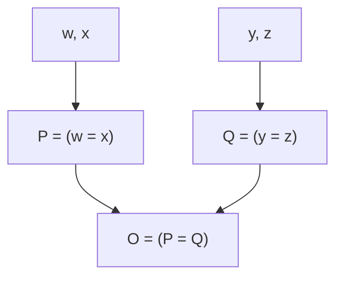

# DAS Foundations: Causal Abstraction, Interventions, and Hierarchical Equality

*Imported from the Notion research log on 2026-11-16. This file is now the maintained copy.*

> [!NOTE]
> Topic notes on the conceptual foundations of Distributed Alignment Search (DAS), including causal abstraction, interchange interventions, the limitations of earlier alignment methods, and the hierarchical equality example.

## Scope and current status

**Paper:** Geiger et al., *Finding Alignments Between Interpretable Causal Variables and Distributed Neural Representations*

**Current scope:** Abstract, Introduction, and the hierarchical equality motivation

**Status:** Conceptual review completed; implementation not yet started

> [!NOTE]
> **Central takeaway:** DAS tests whether an interpretable high-level causal model faithfully captures the counterfactual behavior of a neural network, while allowing causal variables to be represented in distributed neural subspaces.

---

## 1. Central research question

The paper asks whether an interpretable symbolic algorithm can faithfully explain a complex neural network. High task accuracy alone does not answer this question: two systems can produce the same outputs while relying on different internal mechanisms.

The target of explanation is therefore not only observed input-output behavior, but also counterfactual behavior under interventions on internal variables.

## 2. Conceptual framework: causal abstraction

A **high-level causal model** is a simple, interpretable algorithm proposed by the researcher. A **low-level model** is the trained neural network with many internal numerical states.

Causal abstraction asks whether the high-level model is a faithful simplification of the low-level model under a specified alignment.

| Component | Role in the analysis |
| --- | --- |
| High-level causal model | A human-interpretable candidate algorithm with variables such as P and Q. |
| Low-level neural model | The trained network and its internal activations. |
| Alignment | A proposed correspondence between high-level variables and low-level neural states or subspaces. |
| Intervention | A controlled replacement of an intermediate state used to test causal behavior. |

## 3. Why interchange interventions are needed

An interchange intervention processes a **base input** and a **source input**, then replaces a selected intermediate variable in the base computation with the value produced by the source computation.

The remaining base state is preserved as much as possible, and the model continues to compute a counterfactual output.

This goes beyond asking whether information can be observed in an activation. It tests whether changing the proposed representation produces the output change predicted by the high-level causal model.

## 4. Two limitations of previous causal-abstraction methods

### 4.1 Brute-force alignment search

Earlier approaches searched through discrete, hand-selected correspondences between high-level variables and low-level neural units. The search space grows quickly, making exhaustive search computationally expensive and creating a risk that the best alignment is never tested.

### 4.2 Localist alignment assumption

Earlier approaches often assumed that each high-level variable corresponds to an individual neuron or a disjoint set of neurons.

This may miss distributed representations in which a concept is encoded by a linear combination of multiple neurons and individual neurons contribute to multiple conceptual roles.

## 5. The DAS proposal

DAS addresses both limitations:

1. It learns an alignment with gradient descent instead of exhaustively enumerating candidate neuron groups.
2. It analyzes neural representations in a learned non-standard basis, allowing high-level variables to align with distributed subspaces rather than individual neurons.

During alignment learning, the high-level model and the neural model remain frozen. The learned object is the **rotation or alignment** that determines which neural subspace will be treated as corresponding to a high-level causal variable.

| Earlier limitation | DAS response |
| --- | --- |
| Brute-force search over alignments | Optimize the alignment using a differentiable objective and gradient descent. |
| One concept mapped to fixed neurons | Permit concepts to align with directions or subspaces spanning multiple neurons. |

## 6. Hierarchical equality example

The first experiment uses inputs `[w, x, y, z]` and the target function:

$$
(w = x) = (y = z)
$$

A natural high-level algorithm introduces two intermediate variables:

$$
P = (w = x)
$$

$$
Q = (y = z)
$$

$$
O = (P = Q)
$$

| P | Q | O = (P = Q) | Example input |
| --- | --- | --- | --- |
| True | True | True | `[A, A, B, B]` |
| True | False | False | `[A, A, B, C]` |
| False | True | False | `[A, B, C, C]` |
| False | False | True | `[A, B, C, D]` |

A neural network can achieve perfect task accuracy without this alone proving that it computes P and Q as intermediate relations.

DAS tests the stronger hypothesis that internal neural subspaces have the same causal roles as P and Q under interchange interventions.

## 7. Worked counterfactual example

| Stage | State | Explanation |
| --- | --- | --- |
| Base | `[A, B, C, C]` | P_base = False, Q_base = True, O_base = False |
| Source | `[D, D, E, F]` | P_source = True, Q_source = False, O_source = False |
| Intervention | P_base ← P_source | Keep the base setting, but replace only the value assigned to P. |
| Counterfactual | P = True, Q = True | The high-level model predicts O = True. |

At the neural level, DAS searches for a subspace where the analogous activation replacement yields the same counterfactual output. Agreement across many interventions is summarized by **interchange intervention accuracy (IIA)**.

## 8. Clarification: hidden layers and neural representations

The standard machine-learning concept of a hidden layer still applies. In a feed-forward network, a hidden activation is the vector produced by an intermediate layer.

DAS treats such a vector as a representation space and searches for meaningful directions or subspaces within it.

The apparent complexity comes from the analysis, not from a different definition of hidden layer. Instead of assuming one neuron equals one concept, DAS allows a causal variable to correspond to a linear combination of many activation dimensions.

In transformer models, the same idea can be applied to a selected layer, token position, attention output, or residual-stream representation.

### Probe as my current entry point

I initially approached this representation question through the idea of a **probe**. Suppose a classifier can predict the high-level variable P from a hidden activation vector h. High probe accuracy would suggest that h contains information predictive of P.

However, this result alone would not establish that the neural network explicitly computes P as an intermediate variable or that the downstream computation uses P to produce O. The information may be decodable from h even if it is incidental, redundant, or unused by the model's own computation.

> [!NOTE]
> **Current distinction:** A probe primarily tests **decodability**: can P be predicted from h? DAS tests a stronger causal-abstraction claim: can an aligned part of h be exchanged so that the neural network's counterfactual output agrees with the intervention predicted by the high-level model?

I understand this broad distinction, but I am still working through the precise methodological boundary between probe-based analysis and DAS—particularly the difference between learning a predictive direction and learning a subspace whose intervention reproduces the causal behavior of P.

## 9. Current understanding

- P and Q are researcher-defined high-level intermediate variables, not inputs supplied to the neural network.
- I am currently using the idea of a probe as an intuitive starting point: if a classifier can predict P from h, then h contains information predictive of P.
- Probe accuracy alone does not show that the network computed P in the same causal sense as the high-level model or used P to produce O.
- An intervention changes an intermediate state while retaining the base input and the non-targeted state.
- High task accuracy does not establish that the network implements the proposed symbolic algorithm.
- DAS learns an alignment while freezing the neural and high-level models, then evaluates the alignment through counterfactual interventions.

## 10. Questions to clarify next

- What is the precise methodological difference between a probe and DAS? Is the key difference only the use of interventions, or also the training objective and the definition of alignment?
- If P can be decoded from a hidden activation, what evidence—if any—does that provide that the network actually computes or uses P?
- How should a direction learned by a probe be compared with the causal subspace learned by DAS?
- How is the dimensionality of each causal subspace selected in the original DAS experiments?
- Which neural layer and intervention site should be used in the first reproduction?
- Should the immediate goal be hierarchical-equality reproduction or the BERT/MoNLI experiment?
- What result should be treated as the expected deliverable by September 25?

## 11. Proposed meeting update

*I reviewed the DAS abstract and introduction and focused on the causal-abstraction motivation. My current understanding is that task accuracy alone cannot establish that a neural network implements an interpretable symbolic algorithm. DAS therefore compares counterfactual behavior under corresponding interventions in a high-level causal model and a low-level neural model.*

*I also reconstructed the hierarchical equality model using P = (w = x), Q = (y = z), and O = (P = Q), and worked through an initial interchange-intervention example. I understand that DAS improves on earlier approaches by replacing brute-force alignment search with gradient-based optimization and by allowing variables to align with distributed neural subspaces.*

*I initially used probing as an intuitive way to understand whether a hidden activation contains information about P. I now understand that decodability alone is weaker than the causal claim tested by DAS, although I am still clarifying the precise methodological difference between learning a predictive probe direction and learning an interventionally valid DAS subspace.*

*My next step is to study the distributed intervention and rotation in detail, then begin reproducing the official implementation. Before doing that, I would like to confirm which experiment, model, and intervention site I should prioritize.*

## 12. Key terminology

| Term | Working definition |
| --- | --- |
| Mechanistic interpretability | The broader effort to explain how internal model computations produce behavior. |
| Causal abstraction | A framework for determining when a simpler causal model faithfully characterizes a complex model. |
| High-level causal model | A human-interpretable candidate algorithm with explicit causal variables. |
| Low-level neural model | The trained network and its detailed numerical states. |
| Alignment | A correspondence between high-level variables and low-level neural variables or subspaces. |
| Interchange intervention | Replacing a base intermediate value with the value generated by a source input. |
| Distributed representation | A representation in which concepts correspond to combinations of multiple neural dimensions. |
| IIA | The proportion of interventions for which high- and low-level counterfactual outputs agree. |

---

## Sources

- [DAS paper — arXiv](https://arxiv.org/abs/2303.02536)
- [SIDN — Distributed Alignment Search: Identifying Causal Mechanisms](https://sidn.baulab.info/structure/)
