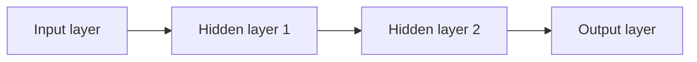
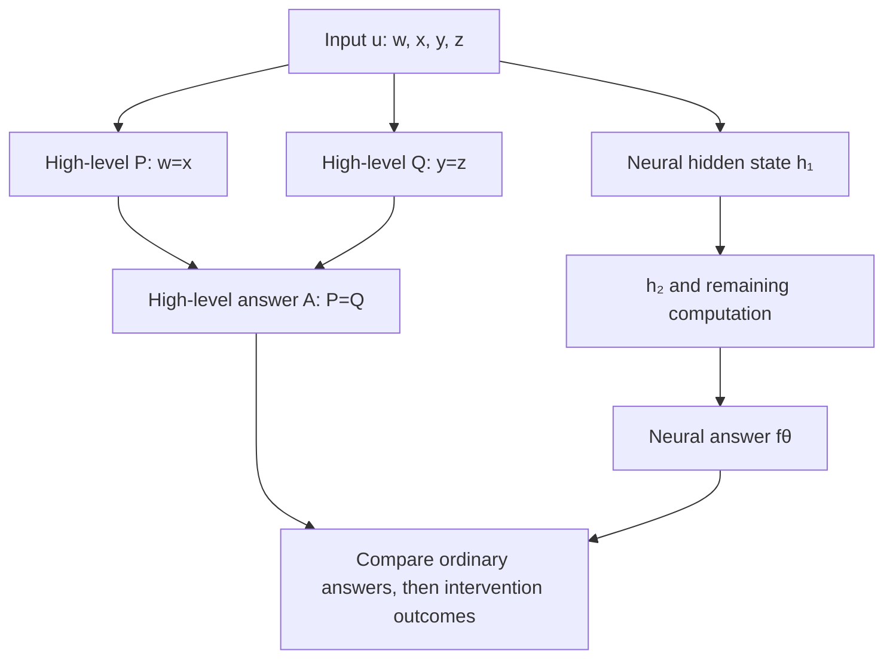
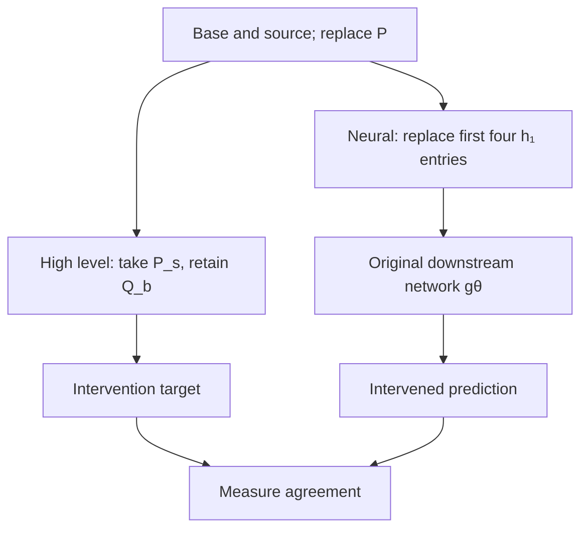
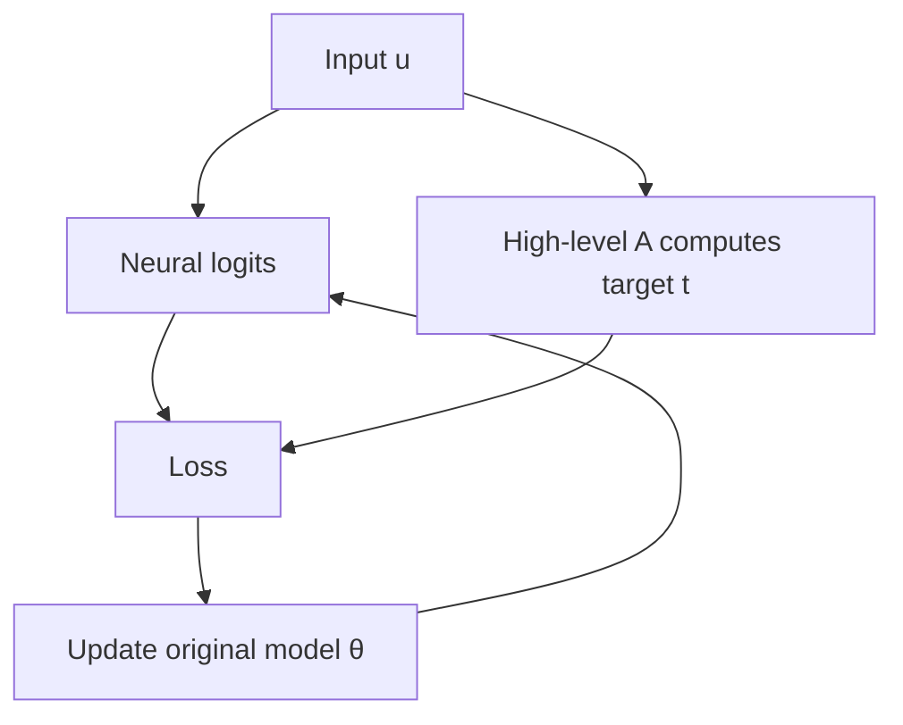

# DAS Notebook Implementation Notes: High-Level Models, Handcrafted Tests, and Learned Alignment

*Imported from the Notion research log on 2026-11-16. This file is now the maintained copy.*

Format reference: [Understanding DAS II: From Exchanging an Intermediate Value to Learning an Alignment](das-alignment-learning.md). This note follows the execution order of **DAS_Main_Introduction.ipynb**, summarizing each section's purpose, implementation, and verification target. Conceptual explanations are limited to what is needed to understand the implementation; the full discussion is not repeated as a question-and-answer log.

**Colab:** [https://colab.research.google.com/drive/1Cpw4lrK8kT-LNQ-j26I7cxhy_aEWEShA?usp=sharing](https://colab.research.google.com/drive/1Cpw4lrK8kT-LNQ-j26I7cxhy_aEWEShA?usp=sharing)

**Basis:** the official notebook inspected during this discussion. The complete current outputs of the Colab copy have not been independently verified. Saved official results are not my reproduction results.

## 1. Notebook overview and notation

| Part | Notebook sections | Implementation goal |
| --- | --- | --- |
| 1. Construct the task and an understandable network | Hierarchical Equality; Hand Crafting an MLP | Define the high-level rule and manually assign neural weights to solve it |
| 2. Test a known alignment | Causal abstraction | Select two first-layer activation groups and test agreement after interchange |
| 3. Train a model and search for an alignment | Training an MLP; Distributed Alignment Search | Learn the task, then freeze the network and learn a rotation |

*A generic MLP: an input layer, two hidden layers, and an output layer. Redrawn for the repository; the Notion page used a third-party illustration of unknown license.*

### Notation used here

- **u=[w;x;y;z]:** the concatenation of four object vectors.
- **A(u):** the high-level algorithm, with P=(w=x), Q=(y=z), and output O=(P=Q). WX and YZ in the code correspond to P and Q.
- **fθ(u):** the neural class prediction; θ contains the original network weights and biases.
- **h₁, h₂, h₃:** input-dependent hidden activations.
- **Gθ(h):** logits obtained by continuing the original network downstream from a selected hidden state; gθ(h)=argmax(Gθ(h)) is the class prediction.
- **t:** the target label, avoiding confusion with input object y.
- **Rφ:** an orthogonal rotation parameterized by trainable alignment parameters φ; θ and φ refer to different parameter sets.

A is a proposed simplified causal account; fθ is the actual numerical model. Matching ordinary answers does not establish matching internal causal structure.

Each hidden node represents a group of neurons. This MLP illustrates basic neural computation; it is not a complete or minimal LLM.

## 2. The Hierarchical Equality Task: inputs and the high-level model

### Purpose

Define a transparent task that supplies both ordinary and intervention targets.

| P: w=x | Q: y=z | Final O: P=Q |
| --- | --- | --- |
| True | True | True |
| True | False | False |
| False | True | False |
| False | False | True |

Two unequal pairs also require True. The task does not require all four objects to be equal.

### Implementation

1. Set seeds for NumPy, Python random, and PyTorch.
2. Generate vectors with randvec: components between −1 and 1, rounded to two decimal places.
3. Initially use embedding_dim=2 and a list of 20 objects, reps.
4. Define seven high-level variables: W, X, Y, Z, WX, YZ, O.
5. Specify dependencies with parents and computations with functions, then construct CausalModel.

| Node | Parents | Computation |
| --- | --- | --- |
| W, X, Y, Z | None | Externally supplied object vectors |
| WX/P | W, X | np.array_equal(W,X) |
| YZ/Q | Y, Z | np.array_equal(Y,Z) |
| O | WX, YZ | Equality of the two Boolean values |

reps[0] selects the first object; embedding_dim specifies numbers per object. Four two-dimensional objects form an eight-dimensional input. CausalModel is an executable high-level model, not a neural network, and requires no training.

### Verification

Run a known input through run_forward and check all nodes and O against the truth table.

## 3. High-level interventions: define the effects the network should reproduce

### Purpose

Compute the correct answer when an intermediate state is modified.

### Implementation

| Operation | API | Meaning |
| --- | --- | --- |
| Ordinary execution | run_forward(base) | Compute P, Q, O from the original input |
| Direct intervention | Specify WX=False in run_forward | Override P, then continue to O |
| Interchange intervention | run_interchange(base,{"WX":source}) | Take the source's P and retain the base's Q |

Let b denote base and s denote source. For a P intervention:

$$
t_{cf}=(P_s=Q_b)
$$

The subscript cf means counterfactual. This target can be computed without a neural network or rotation matrix.

### Running example

| Example | P | Q | Original answer |
| --- | --- | --- | --- |
| Base | True | False | False |
| Source | False | True | False |

After replacing only P, the base state becomes (False,False), giving t_cf=True. The target is not the source's original False answer.

## 4. Hand Crafting an MLP: assign weights that solve the task

### Purpose

Start with a known implementation so causal analysis can be demonstrated without simultaneously learning the task and searching for an unknown alignment.

### Architecture and implementation

MLPConfig uses h_dim=8, ReLU, two hidden layers, two output classes, and dropout=0. Weights are assigned directly; no optimizer trains them.

$$
h_1=\operatorname{ReLU}(W_1u+b_1),\quad
h_2=\operatorname{ReLU}(W_2h_1+b_2),\quad
\ell=W_3h_2+b_3
$$

Here b₁ and b₂ are zero, and ℓ is ordered as [False score, True score].

### First layer: directional differences within each pair

$$
\operatorname{ReLU}(a)=\max(a,0)
$$

| h₁ positions | Computation |
| --- | --- |
| 0, 1 | ReLU(w₁−x₁), ReLU(w₂−x₂) |
| 2, 3 | ReLU(x₁−w₁), ReLU(x₂−w₂) |
| 4, 5 | ReLU(y₁−z₁), ReLU(y₂−z₂) |
| 6, 7 | ReLU(z₁−y₁), ReLU(z₂−y₂) |

A −1 weight implements subtraction. The weighted sum is computed before ReLU; ReLU does not remove negative entries from the weight matrix.

### Second layer: combine distances and their differences

$$
D_{WX}=|w_1-x_1|+|w_2-x_2|,\qquad D_{YZ}=|y_1-z_1|+|y_2-z_2|
$$

Using ReLU(a−b)+ReLU(b−a)=|a−b|, sum the first and last four activations separately, then construct:

$$
h_2=[\operatorname{ReLU}(D_{WX}-D_{YZ}),\operatorname{ReLU}(D_{YZ}-D_{WX}),D_{YZ},D_{WX},0,0,0,0]
$$

This ordering follows the code; the prose formula orders the third and fourth entries differently. Their equal output coefficients make the ordering immaterial to classification.

The two distances contain the required information, but a linear head cannot directly implement the equality logic. The additional ReLU features make the decision accessible to a weighted sum. The first two entries sum to |D_WX−D_YZ|; if that absolute difference were directly available, three features would suffice.

### Output layer: construct comparable scores

$$
s_F=|D_{WX}-D_{YZ}|-0.999999(D_{WX}+D_{YZ}),\qquad s_T=10^{-14}
$$

| D_WX, D_YZ | s_F | Prediction |
| --- | --- | --- |
| 0, 0 | 0 | True |
| 0, 3 | 0.000003 | False |
| 3, 4 | −5.999993 | True |

A tiny positive s_T prevents the [0,0] tie from selecting False. These coefficients should be understood within the tutorial's numerical input regime, not as a guarantee for arbitrary real-valued vectors.

### Verification

Generate 100,000 ordinary examples, obtain logits, apply argmax, and compare against labels from A(u). This is task accuracy. The printed heading “Train Results” does not mean this model was trained.

## 5. Causal abstraction: configure interventions and counterfactual data

### Purpose

Test whether P and Q faithfully describe the causal roles of selected hidden representations.

### Implementation

Select two regions at the first layer's block_output:

$$
P\longleftrightarrow h_1[0:4],\qquad Q\longleftrightarrow h_1[4:8]
$$

IntervenableConfig specifies sites and partitions, VanillaIntervention directly replaces values, and IntervenableModel wraps the original model. Two RepresentationConfig entries permit separate P/Q interventions; they do not add neural layers.

P is Boolean, while h₁[0:4] contains four real numbers. For example, [0.90,0.60,0,0] corresponds to P=False and has total distance 1.50. These are different representations, not interchangeable quantities.

Generate 2,048 counterfactual cases in batches of 16:

| Field | Role |
| --- | --- |
| input_ids | Base vector input |
| source_input_ids | Source inputs providing intermediate states |
| base_labels | Unintervened base answers |
| labels | Correct high-level intervention answers |
| intervention_id | 0: P; 1: Q; 2: both |

### Verification

Hand-check one labels entry. In the running example, replacing P has target True even though base_labels and the source's original answer are both False.

## 6. The interchange loop and IIA: what is compared?

### Implementation

1. Put the model and data on the same device.
2. Read batches; unsqueeze inserts the length-one dimension required by the interface without changing values.
3. Choose P, Q, or joint intervention by ID.
4. Compute the base and source first-layer activations.
5. Replace the selected region and continue the original network from layer two.
6. Collect intervened logits and evaluate against high-level intervention labels.

Let h_b and h_s denote first-layer outputs.

| Operation | State passed downstream | Target |
| --- | --- | --- |
| P only | concat(h_s[0:4],h_b[4:8]) | P_s=Q_b |
| Q only | concat(h_b[0:4],h_s[4:8]) | P_b=Q_s |
| Joint | concat(h_s₁[0:4],h_s₂[4:8]) | P_s₁=Q_s₂ |

None means no intervention for that entry. Joint interventions may use two sources. Original weights are not updated.

For a P intervention:

$$
\tilde h_b=\operatorname{concat}(h_s[0:4],h_b[4:8]),\qquad
\boxed{g_\theta(\tilde h_b)\stackrel{?}{=}(P_s=Q_b)}
$$

### Verification

$$
\mathrm{IIA}=\frac{\text{matching neural and high-level intervention answers}}{\text{all evaluated intervention cases}}
$$

This does not compare “continue from layer two” with “rerun the original input,” nor does it measure a correlation coefficient between h₁ and P. It compares intervention outcomes at two levels. High IIA supports the specified alignment, data regime, and operations; it does not automatically prove uniqueness or equivalence on every input.

## 7. Training an MLP: train a separate model

### Purpose

Let the model learn the task from inputs and final answers rather than manually arranging its representations. This supplies the model for DAS.

### Data and architecture

- Increase each object from two to four dimensions, giving sixteen input dimensions.
- input_sampler generates vectors and arranges four P/Q truth patterns, approximately balancing labels.
- Generate 1,048,576 training examples with batch size 1,024.
- Initialize a new MLP with three sixteen-dimensional hidden layers, ReLU, two output classes, and dropout=0.
- Encode False and True labels as one-hot [1,0] and [0,1].

$$
\mathbf u_i=[w_i;x_i;y_i;z_i],\qquad t_i=A(\mathbf u_i)
$$

The label is the answer computed by A, not the function itself. P and Q are not supplied as intermediate supervision.

### Training procedure

Trainer uses an initial learning rate of 0.001 and three epochs. Each batch computes logits and loss, backpropagates, and updates θ. Switching to train mode alone does not update parameters; executing training does.

Three passes progressively optimize the same model. On the second pass, θ has changed, so predictions and gradients differ. Three is a hyperparameter, not a requirement. The dataset is generated once and reused rather than fully regenerated each epoch.

### Verification

The original train_dataset and eval_dataset are the same, so epoch-level eval_accuracy is training-data performance. Saved official values are approximately 97.91%, 99.47%, and 99.62%, not zero-error results. These are not my reproduction measurements.

## 8. Test the trained model: establish ordinary task performance first

### Implementation

Construct test_equality_model with the same logic, generate 10,000 new examples, and use trainer.predict without updating θ.

$$
f_\theta(\mathbf u)\stackrel{?}{=}A(\mathbf u)
$$

Although the code defines 100 test reps, the supplied input_sampler generates vectors itself rather than sampling only those 100 objects.

### Verification

This tests ordinary generalization, not IIA. A displayed accuracy of 1.00 can be rounded; record full accuracy or an error count. Fresh sampling also does not mean complete disjointness from training has been explicitly checked.

Even high task accuracy leaves the alignment of P and Q unknown, motivating DAS.

## 9. Distributed Alignment Search: freeze the model and learn a rotation

This section records the implementation principles understood so far; complete execution and results remain to be verified.

### Purpose and configuration

Freeze trained θ and search for subspaces with the proposed P/Q causal roles inside the first layer's sixteen-dimensional representation. Use RotatedSpaceIntervention; both intervention entries share a rotation. The example assigns the first eight rotated coordinates to P and the last eight to Q.

The researcher selects site and dimension. DAS learns the directions of these coordinates in the original neural space. R is an orthogonal coordinate transformation, not a translation, and its coordinates need not directly equal True or False.

### Data and labels

Each case contains a base, source, intervention ID, and high-level intervention answer. For P:

$$
t_{cf}=(P_s=Q_b)
$$

**The training label is not the correct subspace or R.** The high-level model supplies the target answer; R is learned from errors relative to those answers.

### How does one batch update R?

Let M_P be a fixed diagonal selector: one in selected rotated coordinates and zero elsewhere. Using column vectors, RᵀR=I, so Rᵀ is the inverse:

$$
\tilde h_b(R)=R^\top[(I-M_P)Rh_b+M_PRh_s]
$$

The sequence is: rotate base and source; retain unselected base coordinates and substitute selected source coordinates; invert the rotation; continue through the original network.

$$
L_{DAS}(\phi)=\operatorname{CE}\left(G_\theta(\tilde h_b(R_\phi)),t_{cf}\right)
$$

CE is cross-entropy. Compute loss from intervened logits and targets, differentiate with respect to alignment parameters φ, and update φ. Original θ remains fixed, but gradients can pass through downstream computation to the alignment parameters.

| Code anchor | Role |
| --- | --- |
| disable_model_gradients | Freeze the original model |
| rotate_layer.parameters | Alignment parameters passed to the optimizer |
| counterfactual_outputs | Intervened scores |
| batch labels | High-level intervention targets |
| loss.backward / optimizer.step | Compute gradients and update the alignment |

The official example uses 1,280,000 intervention cases, batch size 6,400, and ten epochs. These are example settings, not requirements of DAS.

### Verification

Evaluate IIA on separate interchange cases not used to learn R. DAS does not train a new f₂(h₁) to predict ordinary A; that would be probe-like. It uses the existing Gθ and learns a transformation whose exchanges produce the expected effects.

## 10. Compare the two training procedures and record the implementation

| Item | MLP training | DAS training |
| --- | --- | --- |
| Input | One ordinary u | Base, source, intervention |
| Target | A(u) | High-level intervention answer |
| Updated | Model θ | Alignment φ / rotation R |
| Fixed | High-level rule | Original θ and high-level rule |
| Evaluation | Task accuracy | Held-out IIA |
| Learned object | Task-performing network | Candidate causal alignment |

### Colab record to complete

| Item | Pending details |
| --- | --- |
| Environment | Python/PyTorch/Transformers/pyvene, GPU |
| Task model | Seed, data split, task accuracy, error count |
| DAS | Site, subspace dimension, training setup, held-out IIA |
| Breakdown | P-only, Q-only, joint |
| Controls | No intervention, random rotation, original-coordinate exchange |
| Execution | Last successful cell, errors and fixes, output links |

The handcrafted classification report and code logic have been discussed; full MLP/DAS reproduction is not claimed here.

## 11. Three priority questions for the professor

1. **Reproduction scope and next step.** Should I first reproduce the official task accuracy and IIA before running one small ablation? Which results should I prioritize in the next report?
2. **Intervention site and dimension.** The example splits sixteen first-layer dimensions equally between P and Q. After establishing the baseline, would you recommend comparing layers or subspace dimensions first?
3. **Evaluation and controls.** How should I split base/source training and test cases, and which minimum controls would support a causal P/Q interpretation rather than merely demonstrating output steering?

### References

- [Official DAS introductory notebook](https://github.com/stanfordnlp/pyvene/blob/main/tutorials/advanced_tutorials/DAS_Main_Introduction.ipynb)
- [Understanding DAS II: From Exchanging an Intermediate Value to Learning an Alignment](das-alignment-learning.md)

Equations use a single MLP intervention site and column-vector notation. Illustrative numbers are not personal experimental results.
