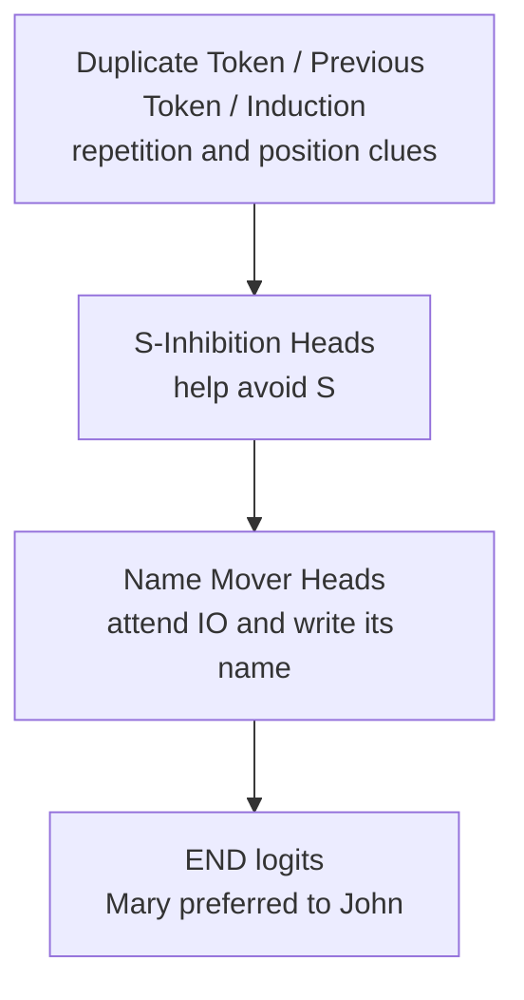
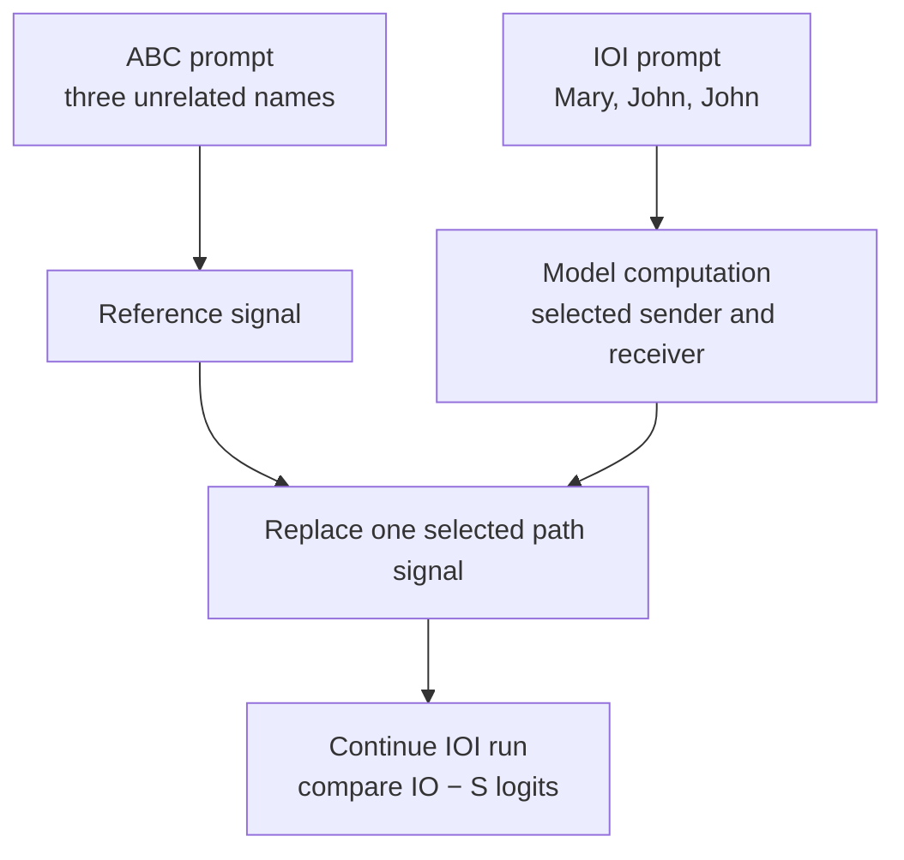
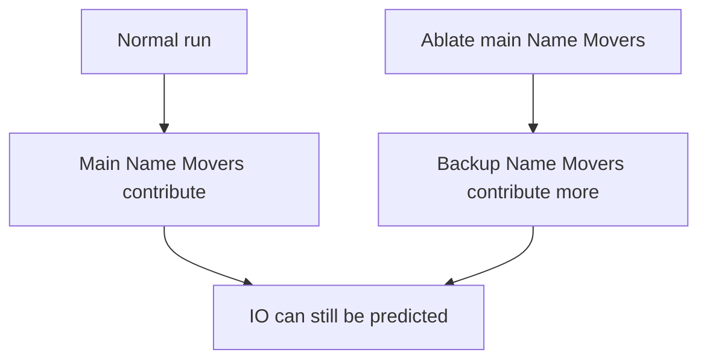

# IOI Circuit Paper Notes: Section-by-Section Outline

*Imported from the Notion research log on 2026-11-16. This file is now the maintained copy.*

> [!NOTE]
> Section-by-section notes on Wang et al., Interpretability in the Wild: a Circuit for Indirect Object Identification in GPT-2 small. Focus: the original paper.

**Source:** [Full paper](https://arxiv.org/html/2211.00593v1). **Status:** Reading summary; numbers below are reported by the authors, not my reproduction.

> [!NOTE]
> **Central idea:** The authors trace repeated-name detection, subject inhibition, and copying of the other name into the next-token prediction. Their 26-head circuit captures most, but not all, of the computation.

---

## Notation

For “When Mary and John went to the store, John gave a drink to \_\_\_”, **IO** is Mary, the indirect object and correct next token; **S** is John, the repeated subject; **S1/S2** are the first/second John positions; **END** is the final prompt position. The experiments use controlled templates and single-token names.

**Position guide (schematic; other words omitted):**

| Position | IO | S1 | S2 | END |
| --- | --- | --- | --- | --- |
| Example | Mary | first John | second John | “to” → predict Mary |
| Role | candidate answer | first subject mention | repeated subject | next-token logits |

## Abstract and §1 Introduction

**Abstract:** Earlier mechanistic interpretability work often explained very small models in depth or larger models only broadly. The authors choose GPT-2 small on the IOI task to trace a relatively complete computation from input to output. Their proposed circuit contains **26 attention heads in 7 classes**. Three validation criteria—**faithfulness, completeness, and minimality**—provide support while exposing what remains unexplained.

**Motivation:** Transformers perform sophisticated tasks, yet the precise internal computations are often unknown. Mechanistic interpretability seeks components and connections that can be understood and tested. IOI is a bounded language behavior with an interpretable candidate algorithm.

**Strategy:** Treat GPT-2 small as a computation graph and trace the circuit **backward from the final logits**: first identify heads directly affecting the answer, then identify upstream heads affecting those heads. **Path patching** changes a selected internal signal path and measures the resulting change in prediction. Attention patterns, activation patching, and embedding projections supplement it.

**Contributions and caution:** The authors find backup components, components pushing against the correct answer, and known induction heads used in an unexpected way. A plausible working path alone does not establish that the entire mechanism has been identified.

## §2 Background

**IOI task and metrics:** The authors generate prompts using 15 templates and two candidate names: the correct **IO** and the repeated **S**. **Logit difference = logit(IO) − logit(S)**; positive values mean the model prefers the correct name. **IO probability** is the absolute probability assigned to the correct next token. Across more than 100,000 prompts, mean logit difference is **3.56**; IO has a higher logit than S **99.3%** of the time; mean IO probability is **49%**. These figures establish that the model is capable on this controlled task before the paper asks how it succeeds.

**Transformer background:** GPT-2 small has **12 layers** with **12 attention heads per layer**. The **residual stream** is the information channel between components: heads and MLPs read from it and write back to it. A head’s **QK** computation largely determines which position it attends to; its **OV** computation determines what information it takes from that position and writes back. The final state becomes token **logits**. The analysis therefore checks not only whether a head looks at Mary, but also what it writes and whether that writing causally changes the answer.

### §2.1 Circuits and Knockouts

A **circuit** is the part of the model’s computation graph responsible for a behavior. To measure whether a proposed circuit performs IOI, the authors **knock out** components outside it and observe the remaining behavior. Setting outputs to zero may create artificial effects, so they mainly use **mean ablation**: replace an activation with its average over reference examples. This aims to preserve constant background information while removing information that varies with a specific example. The reference **p_ABC distribution** retains the grammatical templates but uses three unrelated names, removing the cue that exactly one of two candidates repeats. Means are matched by template so changes in grammatical position do not confound the test.

## §3 Discovering the circuit

The proposed human-readable algorithm is:

1. Identify the previously mentioned names: Mary, John, John.
2. Recognize that John repeats.
3. Output the remaining name, Mary.

This is a **hypothesis about the network’s behavior**, not a claim that GPT-2 literally runs three lines of symbolic code. The experiments identify which heads carry out analogous information processing. Attention heads receive the closest scrutiny; MLPs, layer normalization, and embeddings are not analyzed to the same depth.

**Figure A — Main circuit, simplified from the paper’s Figure 2.** Arrows show the hypothesized information flow; the diagram omits backup and negative paths.

[Compare with the paper’s full circuit (Figure 2)](https://arxiv.org/html/2211.00593v1).

### §3.1 Direct effects: Name Movers

**First, path patching:** Run a normal IOI prompt, but on one selected pathway replace a head’s internal signal with the corresponding signal from a p_ABC reference prompt. A sharp decrease in IO-versus-S logit difference suggests that the original pathway helped the model select IO. The experiment exchanges numerical activations; it does not append the ABC text to the prompt.

**Figure B — What a path-patching test changes (conceptual).** The clean IOI run is evaluated while one specified signal on a selected path is replaced by a signal from an ABC run; effects are measured against the clean run.

The actual procedure also controls other activations; this sketch illustrates the experimental question, not every implementation step. **Second, Name Mover Heads:** Late heads **9.6, 9.9, and 10.0** have strong positive direct effects. They usually attend to IO; greater attention is associated with stronger name-output signals, and OV tests support the interpretation that they copy information about the attended name toward the logits.

**Third, opposing heads:** **10.7 and 11.10** reduce the correct name’s advantage and are called **Negative Name Movers**. The authors speculate they may help avoid overconfidence, but this is not established.

**Notation:** 9.6 means layer 9, head 6; it is not a decimal number.

### §3.2 What guides Name Movers: S-Inhibition

Since Name Movers can copy names, the next question is: **Why do they attend primarily to Mary instead of John?** Path patching into their **queries** identifies heads **7.3, 7.9, 8.6, and 8.10**. When their signals are patched, Name Movers attend more to S1 and less selectively to IO. The authors call them **S-Inhibition Heads**.

Counterfactual experiments separate two kinds of influence: a **token-identity signal** about which name to avoid, and a **position signal** about where S1 is. Both matter; the position signal has the larger effect in these tests. This creates a further question: how do S-Inhibition Heads know S1’s position?

### §3.3 Origins of the position signal

Tracing further upstream shows that pathways into S-Inhibition **values** matter. **Duplicate Token Heads** attend from S2 (the second John) to S1 (the first John), helping detect that the present name occurred before and conveying a clue about its earlier position.

Another route involves **Previous Token Heads** and **Induction Heads**. Previous Token Heads carry information about an earlier token to the following position. Induction Heads can exploit a repeated pattern of the form “\[A\]\[B\] … \[A\]” to recover a position near the earlier A. This route also supplies position information downstream.

The authors test these attention patterns on random-token sequences and use counterfactual interventions to test the positional signal. These results support the account but do not fully establish its parameter-level details, especially exactly how the induction pathway produces the position signal used by downstream heads.

### §3.4 Backup Name Movers

The authors knock out the three main Name Mover Heads together. Surprisingly, the circuit’s **logit difference drops by only about 5%**, because other heads compensate. A new path-patching search identifies the eight strongest such heads, which the authors include as **Backup Name Mover Heads**.

**Interpretation:** A head that seems unimportant when removed by itself may matter greatly in another context because computation is redistributed after ablation. The authors suggest dropout during training might contribute to this redundancy, but do not establish its cause.

**Figure C — Why a single knockout can be misleading.**

## §4 Experimental validation

Section 3 builds a mechanism story; Section 4 asks how well it survives systematic tests. **Faithfulness** asks whether the retained circuit behaves like the full model. **Completeness** asks whether the full model uses important paths omitted from the circuit. **Minimality** asks whether every included component can matter under some conditions.

**Faithfulness result:** The proposed circuit retains about **87% of the full model’s logit-difference performance** (gap 0.46 relative to a full-model value of 3.56). This supports its explanatory power but alone cannot rule out missing routes.

**Figure D — Three distinct validation questions.**

| Test | Comparison | Question answered |
| --- | --- | --- |
| Faithfulness | C versus full model M | Does C retain the behavior? |
| Completeness | C without K versus M without K | Can omitted paths compensate? |
| Minimality | C with/without one head in a chosen context | Does each included head matter somewhere? |

### §4.1 Completeness

Imagine two parallel, equivalent routes: a circuit containing just one could still do well by itself, despite omitting the other. The authors select a subset **K** of circuit nodes and compare performance when K is removed from the proposed circuit **C** and from the full model **M**: **F(C ∖ K)** versus **F(M ∖ K)**. If the full model can recover through components outside C while C cannot, the difference reveals incompleteness.

They sample K randomly, remove whole head classes, and use greedy optimization. The first two strategies suggest small gaps, but **greedy search finds large ones**, up to an incompleteness score of **3.09**. The circuit is informative but not complete.

### §4.2 Minimality

A single-head knockout with no observable effect need not mean the head is irrelevant when components back one another up. **Minimality** asks whether some background removal of other heads makes each included head’s presence observably matter. The authors find a nonzero effect for every included head; the smallest reaches about **1%** of the original logit difference, although individual contributions vary considerably.

### §4.3 Simpler circuit

The authors construct a simpler baseline circuit omitting Backup and Negative Name Movers. It still performs reasonably on ordinary IOI prompts. Thus **strong faithfulness does not prove a structurally complete account**. Other tests expose weaknesses of this simpler circuit more readily, while the strongest greedy search also finds gaps in the fuller version.

### §4.4 Adversarial prompts

The mechanism suggests an adversarial test: insert an **additional occurrence of IO**, so the correct name also repeats and the cue “only S repeats” is broken. Mean logit difference falls from approximately **3.55 to 1.23**, and S outranks IO in **23.4%** of cases. A control that adds another S occurrence yields only **0.4%** such cases. This supports the importance of the repetition cue, but the new prompts lie outside the original distribution and their internal mechanism is not fully established.

## §5 Discussion and limitations

The authors highlight a mechanism that routes **the position of information**, rather than always copying its content directly. They also find backup heads and heads that decrease the correct answer’s advantage. Important boundaries remain: parts of S-Inhibition’s attention behavior, the roles of MLPs and layer normalization, and the proposed circuit’s completeness are not fully understood. This is a GPT-2 small result on a particular task; preliminary examination of GPT-2 medium suggests greater complexity rather than a demonstrated universal circuit.

## Appendix map

The appendices provide experimental detail behind the main narrative:

- **A:** Disentangles S-Inhibition’s token-identity and position signals; position has the larger effect.
- **B:** Step-by-step path patching with an original prompt, reference prompt, controlled activations, recomputed receiving node, and output.
- **C:** Paths into S-Inhibition keys and less clear Duplicate/Induction heads.
- **D:** Path-patching identification and validation of Previous Token Heads.
- **E:** IOI templates and sampled single-token names, places, and objects, useful for position alignment.
- **F:** Backup Name Movers’ attention patterns and knockout results.
- **G:** GPT-2 small architecture and notation.
- **H–I:** Repeated random-token tests of Previous Token, Induction, and Duplicate Token Heads.
- **J:** Additional MLP ablations, including combined effects.
- **K:** Specific minimality sets and scores.
- **L:** Template for the adversarial prompts in §4.4.
- **M:** Greedy completeness-search procedure and results.

**Connection to input alignment:** Appendix E’s controlled templates and single-token vocabulary help make corresponding positions and activation comparisons meaningful.

## Questions for discussion

- What role does a head play normally if its effect appears only after other heads are removed?
- Which omitted components could account for the greedy-search completeness gap?
- How much of the exact positional encoding is established by the intervention evidence?

---

**Reference:** [Wang et al., arXiv:2211.00593](https://arxiv.org/abs/2211.00593)
