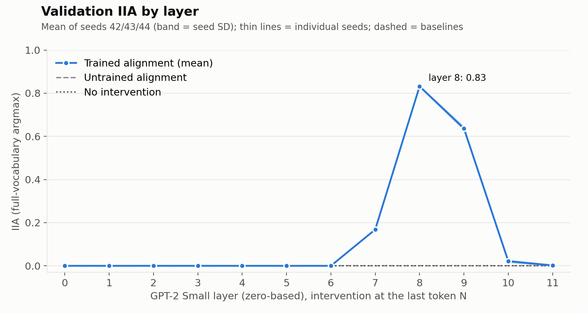
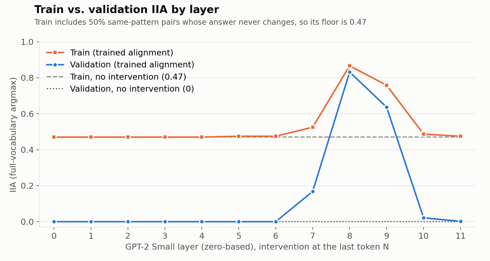
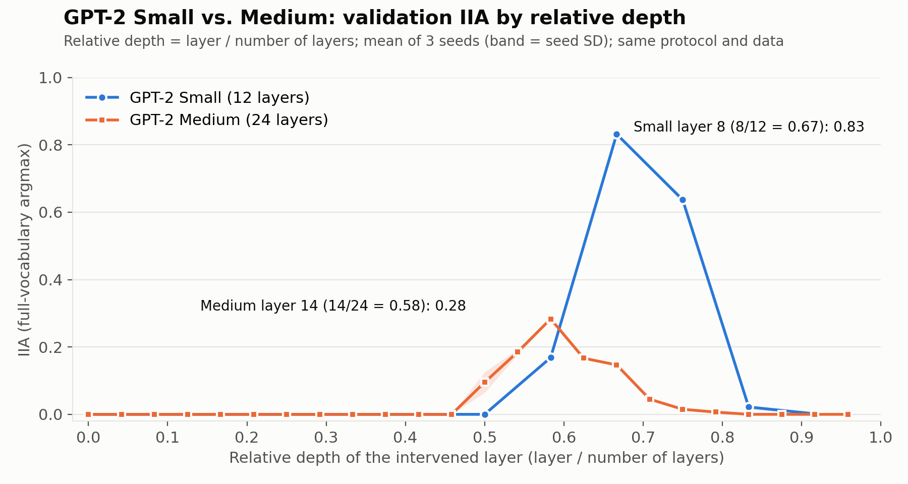
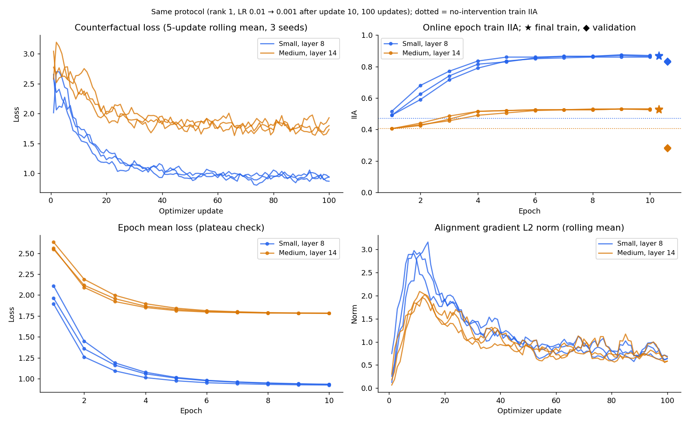

# 2026-10-15 Weekly progress report

*Imported from the Notion research log on 2026-11-16. This file is now the maintained copy.*

## Summary

- **Goal 1 (per-layer comparison) is done**: at the last token of GPT-2 Small, the position variable is found only at **layers 7–9**, strongest at **layer 8** (validation IIA 0.83, test 0.79). All baselines are 0 and the three seeds agree.
- **Goal 2 (larger model): first round done**: the 72 GPT-2 Medium runs finished on HPC3 (46 minutes). The shape matches Small and the peak is at **layer 14** (relative depth 0.58; Small: 0.67), but **validation IIA is only 0.28** and training plateaus; the cause is still open.
- **Goal 3 (larger data) is ready**: the 200 / 1000 / 5000-pair datasets and both training budgets are implemented and smoke-tested; the run starts once the budget is decided.
- **More rigorous method**: a separate validation set, layer selection on validation only and locked before looking at test, two baselines, and bit-for-bit reproducibility; the second machine (HPC3) is verified too.

## 1. Review of the 10/12 goals

| Goal | Status | Notes |
| --- | --- | --- |
| Last token, every layer (layer-sweep) | ✅ Done | 36/36 runs complete, layer 8 selected, verified by an independent rerun |
| Larger model (model-scale) | ✅ First round done | GPT-2 Medium 72/72 runs complete, layer 14 selected (validation 0.28); next check to be discussed |
| Larger dataset (data-scale) | 🟡 Ready, waiting for the budget decision | 200 / 1000 / 5000-pair datasets built and audited; smoke passed for both training budgets |
| Progress reports in Notion | ✅ Done | Chinese and English directories, meeting notes, weekly reports, experiment reports |

## 2. Result 1: layer-sweep (GPT-2 Small)

*Figure 1: Validation IIA by layer (mean of 3 seeds; thin lines are individual seeds; dashed lines are baselines).*

| Layer | 0–6 | 7 | 8 | 9 | 10 | 11 |
| --- | --- | --- | --- | --- | --- | --- |
| Validation | 0.00 | 0.17 | **0.83** | 0.64 | 0.02 | 0.00 |
| Test (descriptive) | 0.00 | 0.08 | **0.79** | 0.51 | 0.04 | 0.00 |
| Baselines (validation) | 0 | 0 | 0 | 0 | 0 | 0 |

- The position variable can be swapped by a rank-1 intervention only at layers 7–9, strongest at layer 8; earlier and later layers are at 0.
- No intervention and the untrained direction are 0 at every layer, so the 0.83 is learned.
- Seed SD is below 0.01 at every layer; at layer 8 the seeds get 166 / 167 / 166 of 200 correct.

### Why we do not read train

*Figure 2: Train (orange) and validation (blue). Train is already 0.47 without any intervention.*

Half of the training pairs keep their answer (ABB→ABB, BAB→BAB), which gives 0.47 with no intervention. Split by pairing type, the switch-required training pairs reach 0.79 at layer 8, matching validation, so the train/validation gap comes from the data composition rather than overfitting.

### Preliminary interpretation (hypothesis)

The result looks consistent with the IOI circuit of Wang et al. (2022): S-inhibition heads (layers 7–8) write positional information to the last token, and name mover heads (layers 9–10) read it. Our signal sits between writing and reading. This is a hypothesis that still needs testing.

## 3. Result 2: model-scale (GPT-2 Medium)

*Figure 3: Validation IIA of Small (blue) and Medium (orange) against relative depth (layer / number of layers).*

| Item | GPT-2 Small | GPT-2 Medium |
| --- | --- | --- |
| Layers | 12 | 24 |
| Selected layer (relative depth) | 8 (0.67) | 14 (0.58) |
| Validation IIA | **0.83** | **0.28** |
| Test IIA (descriptive) | 0.79 | 0.47 |
| Train IIA (no-intervention floor) | 0.87 (0.47) | 0.53 (0.41) |
| Model's own accuracy (validation, no intervention) | 0.975 | 0.79 |

- **Same shape**: zero in the early layers and one mid-depth peak; Medium's peak is slightly earlier in relative depth.
- **Much weaker**: Medium's best layer reaches only 0.28; baselines are still 0, and seed SD is ≤ 0.03.

### Training plateaus

*Figure 4: Training traces for Small layer 8 (blue) and Medium layer 14 (orange), 3 seeds. Top left: loss; top right: train IIA per epoch (★ final train, ◆ validation); bottom left: mean loss per epoch; bottom right: gradient norm.*

- Medium's loss falls from about 2.6 to 1.78 and is nearly flat from epoch 6; Small flattens at about 0.93.
- Train IIA stays at 0.52–0.53 from epoch 5; gradient norms are of the same order as Small's.
- So training is not cut off early; it has converged under Small's settings (rank 1, learning rate, 100 updates). Whether rank is too small or the learning rate / budget does not suit Medium is untested.

### Medium often answers " the" (post-hoc analysis)

- Without any intervention, Medium is only 0.76 / 0.79 accurate on train / validation (Small: 0.95 / 0.975). When wrong it almost always outputs " the" (41 of 42 validation errors), and those prompts are almost never right after the intervention either.
- Restricted to validation prompts that Medium answers correctly, layer-14 IIA is 0.35 (56/158), still far below Small's 0.84. So this explains only part of the gap.
- Medium answers every test-template prompt correctly (100/100), which may be why its test IIA (0.47) is higher than its validation IIA (0.28).
- This section was computed from saved predictions without rerunning the model and does not affect layer selection. Details: [model-scale · Per-layer DAS at the last token of GPT-2 Medium (2026-10-15)](../reports/2026-10-15-model-scale.md).

## 4. Method improvements

- **Separate validation set** (`val_indist_v1`, 200 pairs) with no text or semantic-group overlap with train or test.
- **Validation-only selection, locked before test**: the choice is written to `selection.json` before test is evaluated, and every condition is evaluated on test. The legacy test was inspected in earlier runs, so it is descriptive only.
- **Baselines**: every run saves no-intervention and untrained-direction scores, plus results split by pairing type.
- **Reproducibility**: every result records its commit, config, and data hashes. An independent rerun of layer-sweep matched all 72 alignment files and every prediction bit for bit, and the new pipeline reproduced last week's single run exactly (94/200 → 173/200, test 79/100).

## 5. data-scale: ready, waiting for the budget decision

- Data: three new nested datasets of 200 / 1000 / 5000 pairs (each smaller set is a subset of the larger), balanced across the four pairings, with no overlap with validation or test, all passing the tokenizer audit.
- Setup: GPT-2 Small, layer 8 fixed (chosen by layer-sweep), 3 seeds; validation and test unchanged.
- Both training budgets are supported:
  - **Equal updates**: 100 updates for every size (equal compute; at 5000 pairs each example is seen 0.4 times on average).
  - **Equal epochs**: 10 epochs for every size (100 / 500 / 2500 updates).
- Question: does validation IIA keep rising above 0.83 with more data, or are 200 pairs already enough?

## 6. Project and engineering

- **Planning**: one cycle per advisor meeting, with stable task IDs (layer-sweep, model-scale, data-scale) instead of Phase or M3-style numbering.
- **Code**: one shared pipeline for all experiments, defined by configs; switching to Medium only changed the config (4 fields differ from Small).
- **Workflow**: each code change has a written brief with acceptance criteria and is merged only after an independent review and a GPU rerun.
- **Second machine**: UCI HPC3 (NVIDIA A30) is set up; its environment matches the lock file and all tests pass. The GPT-2 Small reference run, repeated on HPC3, matched every IIA count of the RTX 2080 Ti run; losses differ at about 1e-6.

## 7. Limitations

- Only the last token, rank 1, and the block output have been tested.
- Medium uses Small's training settings without tuning.
- Full-vocabulary argmax scoring is strict for Medium, which often outputs " the".
- Validation comes from the training distribution; generalization to new names or templates is untested.
- The legacy test was inspected in earlier runs and is descriptive only.

## 8. Questions for discussion

1. **Medium reaches only 0.28: which check first?** A rank sweep (e.g. rank 1, 2, 4, 8 at layers 12–16), a learning-rate / budget change, or more training data? Should these settings stay identical across model sizes, or be tuned per model on validation?
2. **Add a supplementary metric?** Medium often outputs " the"; we could also compare only the two names (IO vs S) to see how well the position variable itself is swapped.
3. **Which budget for the data-size experiment?** Equal updates (effect of data diversity at fixed compute) or equal epochs (effect of data size when each example is seen equally often)? The code supports both.
4. **Larger data first in-distribution, or generalization first** (new names, new templates)?
5. **Test other token positions at layers 7–9** (N-1, N-2, name tokens)? This is the project's original relative-position direction.
6. Is a 200-pair in-distribution validation set enough?
7. Results from the A30 and the RTX 2080 Ti agree in every IIA count but not bit for bit. May they be compared directly?
8. Test the IOI circuit interpretation? For example, compare the learned layer-8 direction with the outputs of the S-inhibition heads.

## 9. Plan for next week

- [ ] Run the first Medium check chosen at the meeting (rank, learning rate / budget, or data size)
- [ ] Run data-scale with the chosen budget and plot data size vs. IIA
- [ ] Decide on other token positions based on feedback
