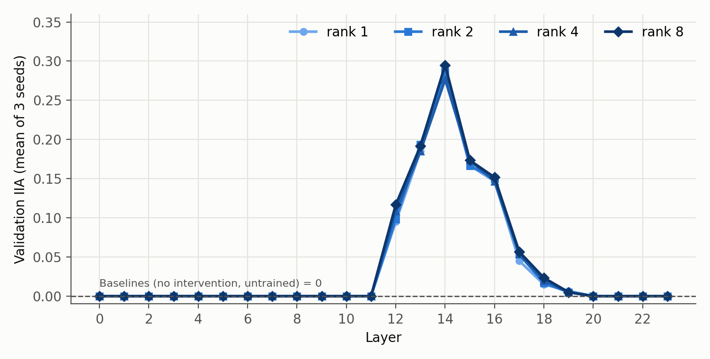
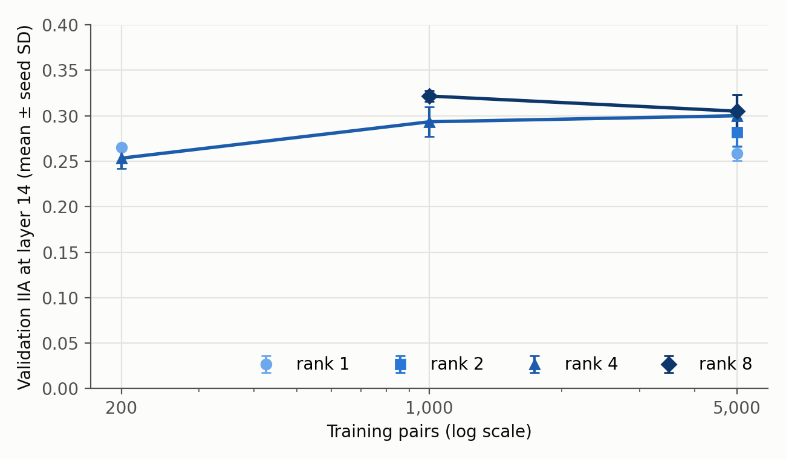
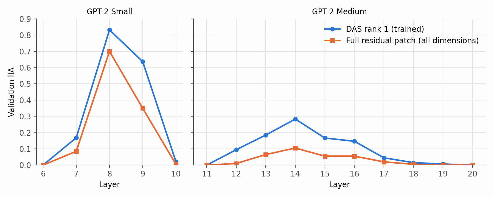

# 2026-10-19 Weekly progress report

*Imported from the Notion research log on 2026-11-16. This file is now the maintained copy.*

## Summary

- **rank-sweep (GPT-2 Medium) done**: rank 1 / 2 / 4 / 8 × 24 layers × 3 seeds (288 runs). Rank barely matters: every rank selects layer 14, validation IIA 0.28–0.30.
- **data-scale (GPT-2 Medium) 10 of 16 done**: training pairs 200 → 5,000, updates 100 → 2,500, rank 1 → 8; IIA stays within **0.25–0.32**. The same 200 pairs trained 25× longer change nothing.
- **Cause identified**: not a bug and not a lack of data, but a ceiling of the intervention site. Replacing the whole residual vector at Medium layer 14, position N gives only **0.105** (Small layer 8: 0.70).
- **Caveat**: in Medium, DAS beats the full-residual patch by about 3×, the warning sign of the subspace illusion (Makelov et al. 2023).
- object-names and the GPT-2 Small rank sweep have not started.

## 1. Review of the 10/15 goals

| Goal | Status | Notes |
| --- | --- | --- |
| Rank sweep: GPT-2 Medium | ✅ Done | 4 × 72 runs complete over all 24 layers; rank 1 reproduces 10/15 bit for bit |
| Rank sweep: GPT-2 Small (reference) | ✅ Done | Configs ready |
| Learning-rate / budget check | 🟡 Partly answered | Learning rate unchanged; but the data-scale control raised updates 25× with no change |
| object-names (objects in place of names) | ⬜ Not started | Briefs written; waiting for design decisions (vocabulary, articles, retraining) |
| Consolidate results | 🔵 In progress | This report and two experiment reports; automated cross-run figures await a brief |
| data-scale (added 10/19) | 🔵 10 of 16 done | The other 6 configs were cancelled |

## 2. Result 1: rank-sweep (GPT-2 Medium)

*Figure 1: Validation IIA by layer for rank 1 / 2 / 4 / 8 (mean of 3 seeds).*

| Rank | 1 | 2 | 4 | 8 |
| --- | --- | --- | --- | --- |
| Validation (layer 14) | 0.283 | 0.287 | 0.277 | **0.295** |
| Test (descriptive) | 0.470 | 0.473 | 0.467 | 0.477 |
| Train, switch-required | 0.247 | 0.243 | 0.253 | 0.263 |

- The four by-layer curves nearly coincide; a higher rank neither moves the peak nor creates signal at layers that are 0 at rank 1.
- All baselines are 0; differences between ranks are of the size of the seed SD.

## 3. Result 2: data-scale (GPT-2 Medium)

*Figure 2: Validation IIA at layer 14 vs training size (mean ± seed SD).*

| Rank | n200 | n1000 | n5000 | n200, 2,500 updates |
| --- | --- | --- | --- | --- |
| 1 | 0.265 | — | 0.258 | 0.265 |
| 2 | — | — | 0.282 | — |
| 4 | 0.253 | 0.293 | 0.300 | 0.250 |
| 8 | — | **0.322** | 0.305 | — |

- Every run selects layer 14; "—" marks a cancelled config.
- 25× more data adds at most 0.05; 25× more updates on the same 200 pairs adds nothing.

## 4. Why neither rank nor data helps

*Figure 3: DAS rank 1 (blue) and replacing the whole residual vector with the source's (orange). Left: Small; right: Medium.*

1. **Not a bug**: rank and size reach the code; reloading the saved alignments reproduces the IIA counts exactly.
2. **Only one direction is useful**: every seed, size, and rank finds the same direction (|cos| 0.90–1.0); higher ranks only add unused dimensions.
3. **Underfitting, not too little data**: 250 epochs on 200 pairs still fit only 32% of the switch-required training pairs; train and validation are nearly equal.
4. **The site holds little of the decision in Medium**: the full-residual patch peaks at 0.105 in Medium (0.70 in Small).
5. **Medium itself is unsure**: without intervention it answers IO on 79% and " the" on 20.5%. Among layer-14 failures, IO stays top-1 in 39% and another token (mostly " the") in 33%. Counting only the two names, IIA is 0.34–0.41.
6. **Caveat**: DAS exceeds the full patch (Medium 0.27–0.32 vs 0.105), so part of it may be the subspace illusion.

Details: [data-scale · Training size × rank on GPT-2 Medium (2026-10-19)](../reports/2026-10-19-data-scale.md) (section 3.4).

## 5. object-names: waiting for design decisions

- Two briefs are written: evaluating the name-trained alignment on object data, and building object-noun datasets.
- Still to decide: object vocabulary, articles ("the ball" vs "ball"), which models and layers, and whether to retrain the alignment.

## 6. Project and engineering

- rank-sweep and data-scale added configs only, no code; all ran on HPC3 (A30).
- Rank 1 reproduces the 10/15 result bit for bit on the same GPU type (288 identical artifact hashes).
- This week's analysis scripts are in [`scripts/adhoc/`](../../scripts/adhoc/), so every number in the reports can be recomputed.

## 7. Limitations

- data-scale is 10 of 16 complete.
- Learning rate unchanged; the GPT-2 Small rank sweep has not run.
- Scored by full-vocabulary argmax; names-only IIA and the full patch are post-hoc and use validation only.
- The test set was inspected early; descriptive only.

## 8. Questions for the professor

1. **What next for Medium?** Rank, data size, and updates do not raise IIA; the limit is the site (one layer, one position). Intervene at several layers or positions, return to GPT-2 Small for the mechanism work, or treat Medium's low IIA as the result and explain it?
2. **Add a standard reference and a second metric?** Report the full-residual patch at every site (no training, cheap) and names-only IIA alongside.
3. **How much to trust Medium's 0.3?** DAS beats the full patch by about 3×; run the checks Makelov et al. propose?
4. **Finish data-scale?** The 6 cancelled configs need about 3 A30 hours; or stop data-scale on Medium.
5. **Is the learning-rate check still needed?** 25× more updates leave the loss unchanged.
6. **object-names design**: vocabulary, articles, and evaluating the old alignment vs retraining (or both).
7. **GPT-2 Small rank sweep**: still run it?

## 9. Plan for next week (depends on the meeting)

- [ ] Adjust the Medium direction (site or model) as decided
- [ ] object-names: build data, check model behavior, run DAS once the design is set
- [ ] Add the full-patch reference and names-only metric if agreed
- [ ] Finish data-scale or run the GPT-2 Small rank sweep if agreed
