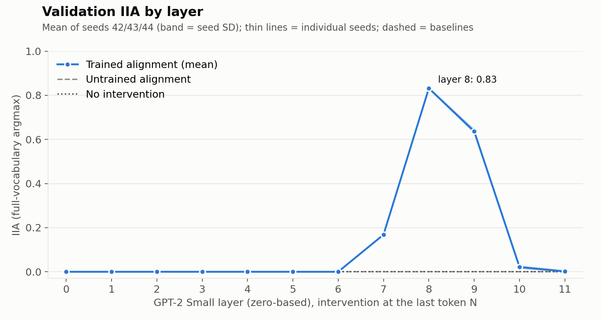
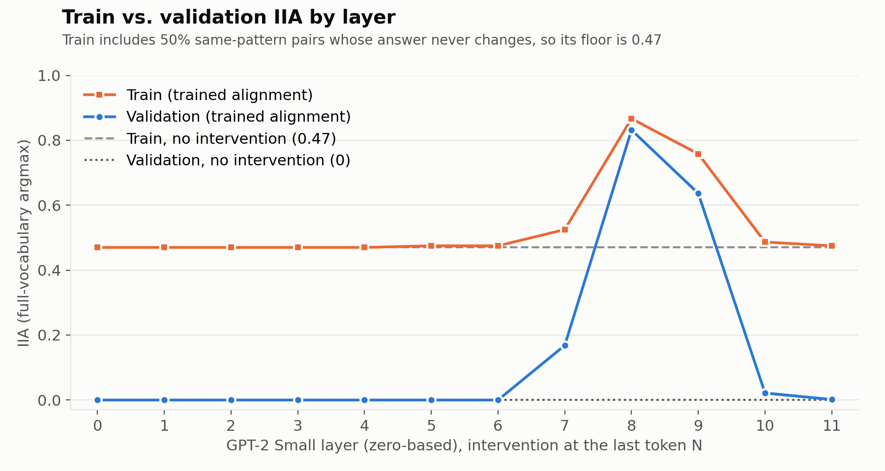
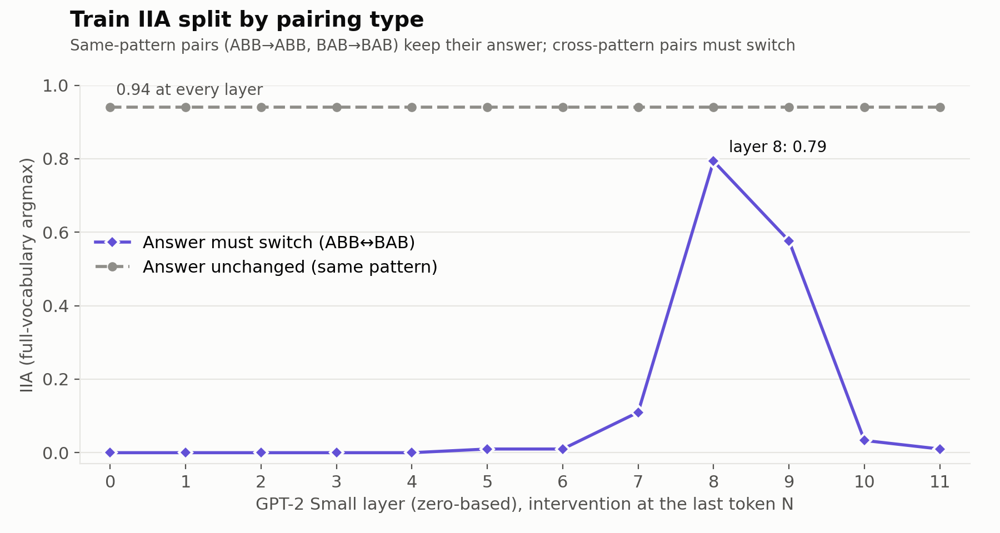
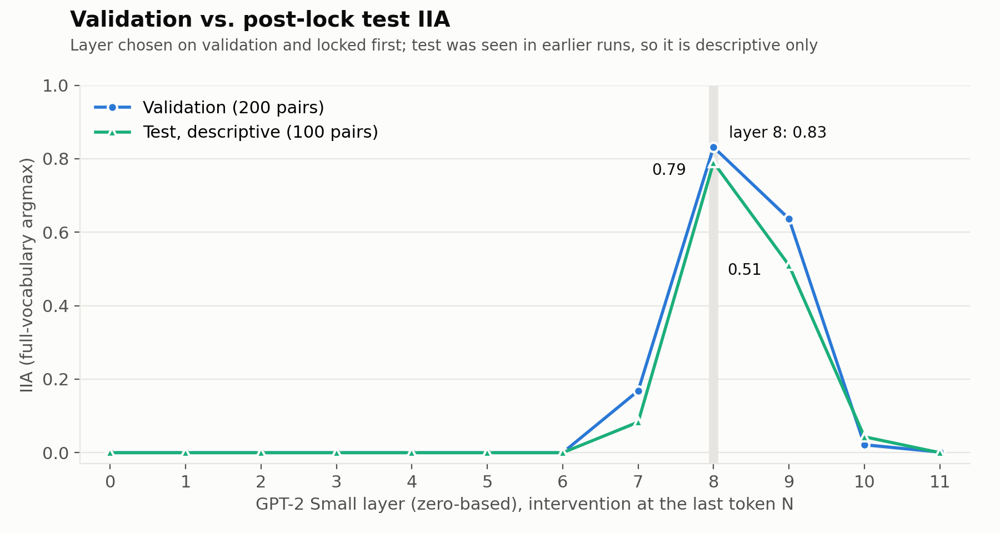

# layer-sweep · Per-layer DAS at the last token of GPT-2 Small (2026-10-15)

*Imported from the Notion research log on 2026-11-16. This file is now the maintained copy.*

> [!NOTE]
> **Conclusion:** At the last token (N) of GPT-2 Small, the POSITION variable can be found and swapped by rank-1 DAS only at **layers 7–9**, strongest at **layer 8** (validation IIA 0.83, test 0.79). Both baselines are 0 at every layer, and the three seeds almost coincide.

## 1. Question

- Goal 1 from the 2026-10-12 meeting: put DAS at the last token, run every layer, and compare.
- Concretely: at the position where the model produces its answer (the last token), which layers' residual stream carry the POSITION causal variable in a form that a single rank-1 direction can capture and swap?

## 2. Task, metric, and baselines

### POSITION task (real example)

- **base (ABB)**: Then, Brittany and Joseph went to the school. Joseph gave a basketball to → the model should answer Brittany
- **source (BAB)**: Then, Joseph and Brittany went to the school. Joseph gave a basketball to
- **Position variable**: whether the answer (the indirect object, IO) is the first or the second name mentioned. It is the first in the base and the second in the source.
- **Counterfactual answer**: apply the source's position variable to the base names → the base's second name → **Joseph**.

### IIA (interchange intervention accuracy)

At a given layer and the base's last token, replace only the base's component along the learned direction with the source's component, then check whether the full-vocabulary argmax is the counterfactual answer. IIA is the fraction of pairs where it is.

### Baselines

- **No intervention**: run the model unchanged and count how often its answer already equals the counterfactual answer (points the data gives for free).
- **Untrained alignment**: intervene with a randomly initialized direction (a placebo) to confirm the score does not come from the act of intervening.

## 3. Setup

| Item | Setting |
| --- | --- |
| Model | GPT-2 Small (124M parameters, 12 layers, hidden size 768), revision `607a30d`, float32, frozen weights |
| Intervention | Rank-1 DAS (pyvene 0.1.8) on the block output, source N → base N, readout at base N |
| Conditions | Layers 0–11 × seeds 42/43/44 = **36 independent runs**, each from a fresh alignment |
| Training data | `legacy_v1` train: 200 pairs (ABB/BAB × ABB/BAB, 50 each) |
| Validation | `val_indist_v1`: 200 pairs (100 ABB→BAB, 100 BAB→ABB), no text or semantic-group overlap with train or test |
| Test | `legacy_v1` test: 100 pairs with unseen names and templates; inspected in earlier runs, so descriptive only |
| Training | Adam lr 0.01, 10 epochs, batch 20 (100 updates), the original tutorial's per-update LinearLR |
| Selection | Mean validation IIA over 3 seeds; ties go to the lower layer; written to `selection.json` before any test evaluation |
| Compute | One RTX 2080 Ti, about 25 minutes in total (about 37 s per condition) |

## 4. Results

### 4.1 Validation: signal only at layers 7–9

*Figure 1: validation IIA by layer. Thick blue line: mean of 3 seeds; thin lines: individual seeds; dashed: the two baselines.*

- Layers 0–6 stay at 0 after training, the same as the baselines.
- The signal appears at layer 7 (0.17), peaks at layer 8 (0.83), and is still 0.64 at layer 9.
- Layers 10–11 are near zero (≤ 0.02).
- The untrained direction and no intervention are 0 at every layer, so the score comes entirely from training.

### 4.2 Per-layer numbers (mean ± SD over 3 seeds)

| Layer | Validation | Test (descriptive) | Train |
| --- | --- | --- | --- |
| 0–4 | 0.000 | 0.000 | 0.470 |
| 5–6 | 0.000 | 0.000 | 0.475 |
| 7 | 0.168 ± 0.003 | 0.083 ± 0.006 | 0.525 |
| **8** | **0.832 ± 0.003** | **0.790 ± 0.000** | 0.867 ± 0.003 |
| 9 | 0.637 ± 0.008 | 0.510 ± 0.000 | 0.758 ± 0.006 |
| 10 | 0.022 ± 0.006 | 0.043 ± 0.006 | 0.487 ± 0.006 |
| 11 | 0.002 ± 0.003 | 0.000 | 0.475 |

Correct validation pairs per seed (out of 200): layer 7 34 / 34 / 33, layer 8 166 / 167 / 166, layer 9 127 / 129 / 126, layer 10 3 / 5 / 5.

### 4.3 Why train has a 0.47 floor

*Figure 2: train (orange) and validation (blue). The train no-intervention baseline is 0.47.*

Half of the training pairs are ABB→ABB or BAB→BAB: source and base share a pattern, so the counterfactual answer equals the original answer. The model scores 94/200 = 0.47 without any intervention. Validation and test contain only pairs whose answer must switch, so their baseline is 0. **Compare layers on validation, not train.**

### 4.4 Train split by pairing type

*Figure 3: pairs whose answer must switch (violet) and pairs whose answer is unchanged (gray).*

- Unchanged-answer pairs: 0.94 at every layer, which is the model's own accuracy on them and has nothing to do with the intervention.
- Switch-required pairs: the curve matches validation, 0.79 at layer 8. The train/validation gap comes from the data composition, not from overfitting.

### 4.5 Post-lock test

*Figure 4: validation (blue) and post-lock test (green).*

- Test was evaluated only after the layer choice was locked, for all 36 conditions, not just the winner.
- The test curve has the same shape as validation: 0.79 at layer 8 and 0.51 at layer 9. Test uses unseen names and templates, so slightly lower values are expected.

## 5. Conclusions

1. At the last token, the position variable is found by a rank-1 intervention only at layers 7–9, strongest at layer 8.
2. The effect is learned: no intervention and the untrained direction are both 0.
3. The result is stable: seed SD is below 0.01 at every layer.
4. The layer was chosen on validation only, and the post-lock test agrees with validation.
5. Zero at layers 0–6 means the variable is not found at the last token there; it does not mean those layers lack the information elsewhere.

## 6. Interpretation (hypothesis, not yet tested)

The result looks consistent with the GPT-2 Small IOI circuit described by Wang et al. (2022), *Interpretability in the Wild*:

- S-inhibition heads in layers 7–8 move positional information about the duplicated name to the last token.
- Name mover heads in layers 9–10 read it and output a name.
- Our IIA appears at layers 7–9, peaks at 8, and is gone by 10, which falls between writing and reading. By layers 10–11 the answer may already be encoded as a name, so swapping the position variable no longer has an effect.

A direct check would compare the layer-8 learned direction with the outputs of those attention heads.

## 7. Limitations

- One position (N), rank 1, and the block output only.
- Validation comes from the training distribution; generalization is untested.
- The test set was inspected in earlier runs, so it is descriptive only.
- Training uses only 200 pairs; the data-scale experiment addresses data size.

## 8. Next steps

- **model-scale**: first round done, see [model-scale · Per-layer DAS at the last token of GPT-2 Medium (2026-10-15)](2026-10-15-model-scale.md). GPT-2 Medium peaks at layer 14 (relative depth 0.58), but validation IIA is only 0.28.
- **data-scale**: 200 / 1000 / 5000 training pairs at layer 8; does IIA rise? (Waiting for the budget decision.)
- Possible: test other token positions (N-1, N-2, name tokens) at layers 7–9.

## 9. Reproducibility

- Config: [`configs/layer-sweep/gpt2-small.json`](../../configs/layer-sweep/gpt2-small.json)
- Results: [`outputs/layer-sweep/20261015-gpt2-small/`](../../outputs/layer-sweep/20261015-gpt2-small/) ([`summary.md`](../../outputs/layer-sweep/20261015-gpt2-small/summary.md), [`selection.json`](../../outputs/layer-sweep/20261015-gpt2-small/selection.json), [`layer_summary.csv`](../../outputs/layer-sweep/20261015-gpt2-small/layer_summary.csv))
- Code: run commit `774657e`, merge commit `03dad11` (tag `brief/layer-sweep`)
- Command: `ioi-das run --config configs/layer-sweep/gpt2-small.json`
- Verification: an independent rerun matched all 72 alignment files and every prediction bit for bit, and the numbers match the earlier reference run (branch `m3-complete-20261015`). Figures on this page were redrawn from the saved results without rerunning the model.
