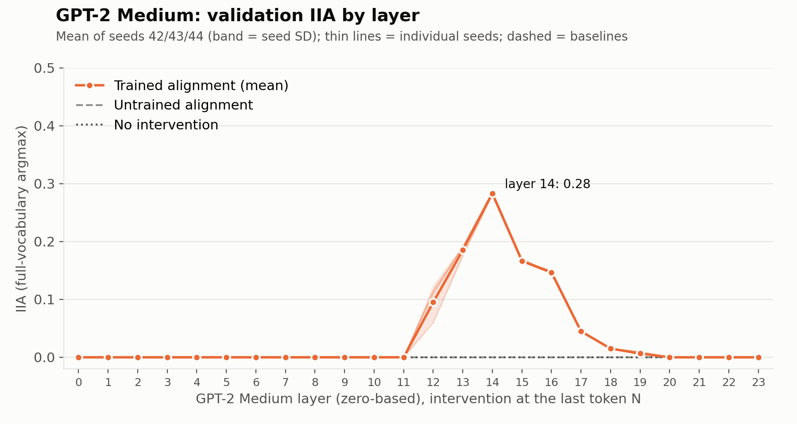
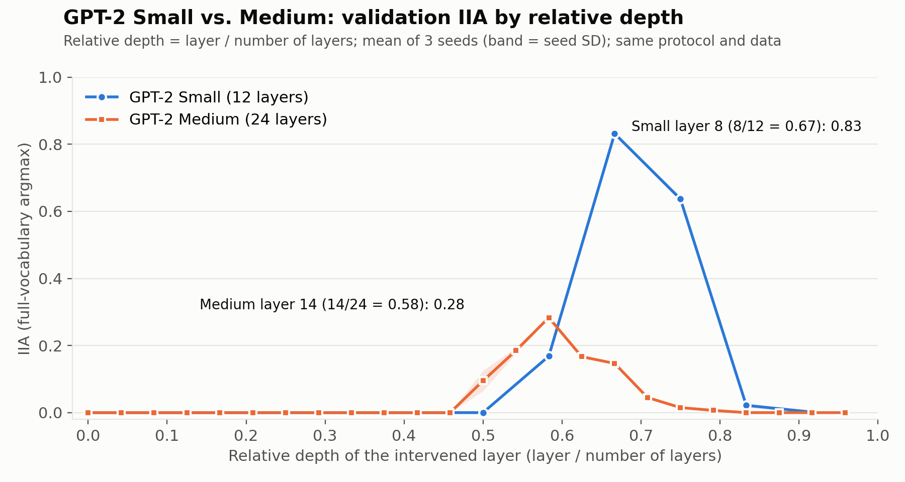
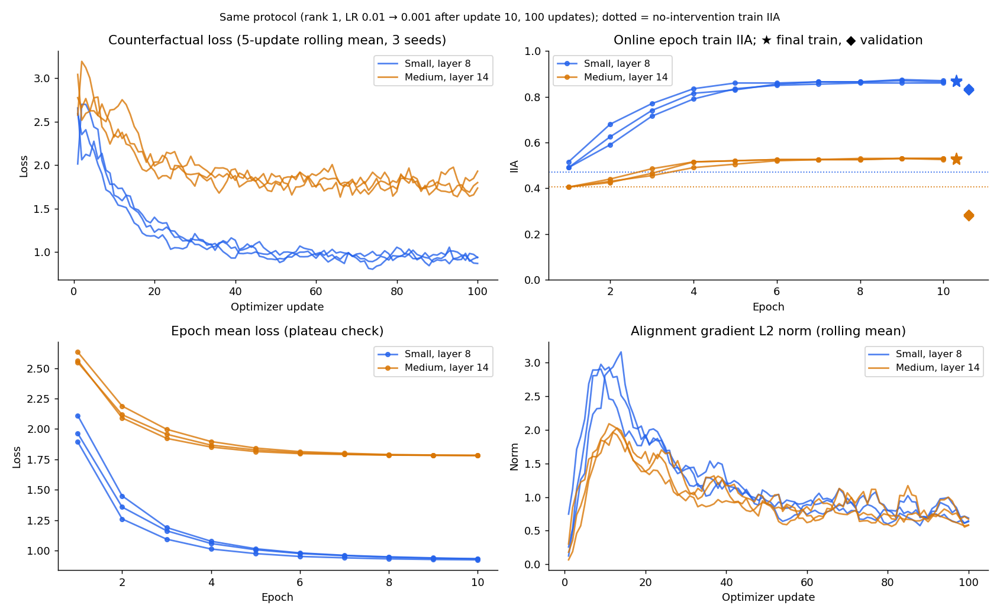
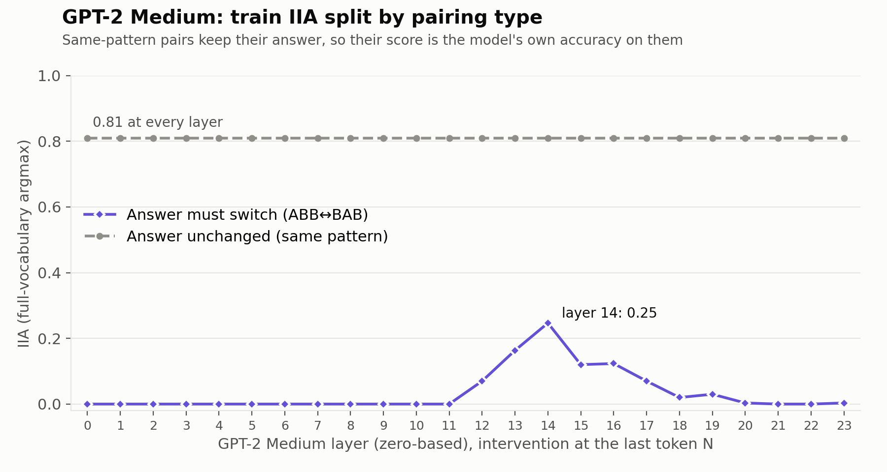
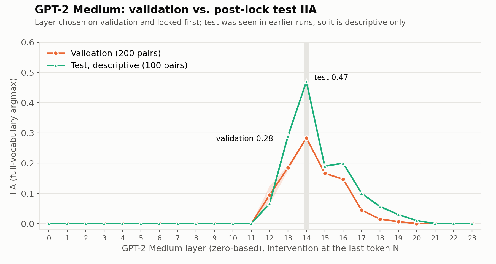

# model-scale · Per-layer DAS at the last token of GPT-2 Medium (2026-10-15)

*Imported from the Notion research log on 2026-11-16. This file is now the maintained copy.*

> [!NOTE]
> **Conclusion:** With the same protocol on GPT-2 Medium (24 layers), the position variable at the last token still appears only in the middle layers, peaking at **layer 14** (relative depth 0.58; Small: 0.67). But the peak is only **validation IIA 0.28** (Small: 0.83), and training plateaus at train IIA 0.53 (0.41 with no intervention): with Small's settings, the rank-1 alignment does not even fit Medium's training data well. Baselines are 0 at every layer, and the three seeds agree.

## 1. Question

- Goal 2 from the 2026-10-12 meeting: use a larger model.
- Concretely: at the last token of GPT-2 Medium, which layers hold a position variable that rank-1 DAS can capture and swap? Compared with GPT-2 Small, does the peak sit at the same relative depth or at the same absolute layer, and is it as strong?

## 2. Setup

Everything except the model is identical to layer-sweep (the config changes only task, name, model, and tokenizer).

| Item | Setting |
| --- | --- |
| Model | GPT-2 Medium (about 355M parameters, 24 layers, hidden size 1024), revision `6dcaa7a`, float32, frozen weights; same tokenizer as Small |
| Intervention | Rank-1 DAS (pyvene 0.1.8) on the block output, source N → base N, readout at base N |
| Conditions | Layers 0–23 × seeds 42/43/44 = **72 independent runs**, each from a fresh alignment |
| Data | Same as layer-sweep: `legacy_v1` train (200 pairs), `val_indist_v1` validation (200 pairs), `legacy_v1` test (100 pairs, inspected earlier, descriptive only) |
| Training | Kept from Small, not tuned for Medium: Adam, 10 epochs, batch 20 (100 updates); learning rate falls linearly from 0.0033 (0.01 × 1/3) to 0.001 over the first 10 updates, then stays at 0.001 for 90 updates |
| Selection | Mean validation IIA over 3 seeds; written to `selection.json` before any test evaluation |
| Compute | UCI HPC3, one NVIDIA A30, 46 minutes in total (33 s per condition on average), Slurm job 58157400 |

## 3. Results

### 3.1 Validation: signal at layers 12–19, peak at layer 14

*Figure 1: validation IIA by layer for GPT-2 Medium. Thick line: mean of 3 seeds; thin lines: individual seeds; dashed: the two baselines.*

- Layers 0–11 stay at 0 after training, the same as the baselines.
- The signal appears at layer 12 (0.10), peaks at layer 14 (0.28), then declines and is back to 0 from layer 20.
- No intervention and the untrained alignment are 0 at every layer, so the score comes entirely from training.
- Seed SD ≤ 0.03 (0.03 only at layer 12; ≤ 0.01 elsewhere).

### 3.2 Comparison with GPT-2 Small

*Figure 2: validation IIA of Small (blue) and Medium (orange) against relative depth (layer / number of layers).*

| Item | GPT-2 Small | GPT-2 Medium |
| --- | --- | --- |
| Layers | 12 | 24 |
| Selected layer (relative depth) | 8 (0.67) | 14 (0.58) |
| Validation IIA | **0.832 ± 0.003** | **0.283 ± 0.003** |
| Test IIA (descriptive) | 0.79 | 0.47 |
| Train IIA | 0.867 | 0.528 |
| Train no-intervention floor | 0.47 | 0.405 |
| Switch-required train pairs | 0.79 | 0.25 |
| Model's own accuracy (validation, no intervention) | 0.975 | 0.79 |

- **Same shape**: zero in the early layers, one mid-depth peak, then gone.
- **Slightly earlier**: Medium peaks at relative depth 0.58, Small at 0.67. In absolute layers, all of Medium's signal (layers 12–19) lies beyond Small's layer range.
- **Much weaker**: Medium's best layer reaches only 0.28, about a third of Small's.

### 3.3 Training plateaus

*Figure 3: training traces for Small layer 8 (blue) and Medium layer 14 (orange), 3 seeds. Top left: per-update loss (5-update rolling mean); top right: train IIA per epoch (★ final train, ◆ validation, dotted = no-intervention floor); bottom left: mean loss per epoch; bottom right: alignment gradient norm.*

- The Medium layer-14 loss falls from about 2.6 to 1.78 and is nearly flat from epoch 6 (epoch means 1.791 → 1.781 over epochs 7–10); Small layer 8 flattens at about 0.93.
- Train IIA per epoch stays at 0.52–0.53 from epoch 5.
- Gradient norms are of the same order as Small's and end between 0.5 and 1, so this is not a vanishing gradient.
- So training is not cut off early; it has converged under these settings. The cause is untested: rank 1 may be too small for Medium, or the learning rate or budget may not suit Medium.

### 3.4 Medium often answers " the" on these prompts (post-hoc analysis)

> [!NOTE]
> This section was computed afterwards from the saved prediction files, without rerunning the model, and does not affect layer selection.

| Accuracy without intervention | GPT-2 Small | GPT-2 Medium |
| --- | --- | --- |
| Train (templates 0–1) | 190/200 = 0.95 | 152/200 = 0.76 |
| Validation (templates 0–1) | 195/200 = 0.975 | 158/200 = 0.79 |
| Test (other templates) | 98/100 = 0.98 | 100/100 = 1.00 |

- When Medium is wrong, it almost always outputs " the" (41 of 42 validation errors), not the wrong name.
- Those prompts are almost never right after the intervention either (1 of 42), so under full-vocabulary argmax Medium's attainable IIA is lower than Small's.
- Restricted to validation prompts that Medium answers correctly, layer-14 IIA is 56/158 = 0.35 (seeds: 56, 56, 55), still far below Small's 164/195 = 0.84. The lower accuracy explains only part of the gap.
- Of the validation pairs that layer 14 fails to switch (seed 42, 143 pairs), 79 still output the original answer (the base IO), 61 output " the", and 3 output another word.
- Medium answers every test-template prompt correctly, which may be why its test IIA (0.47) is higher than its validation IIA (0.28); for Small, test is slightly lower than validation.

### 3.5 Train split by pairing type

*Figure 4: Medium train IIA for pairs whose answer must switch (violet) and pairs whose answer is unchanged (gray).*

- Unchanged-answer pairs: 0.81 at every layer, which is Medium's own accuracy on them (Small: 0.94). The 0.405 = 81/200 train floor comes from these.
- Switch-required pairs: only 0.25 at layer 14 (Small layer 8: 0.79), consistent with validation's 0.28.

### 3.6 Post-lock test

*Figure 5: Medium validation (orange) and post-lock test (green).*

- Test was evaluated only after the layer choice was locked, for all 72 conditions, not just the winner.
- Same shape as validation, also peaking at layer 14 (0.47).

### 3.7 Per-layer numbers (mean ± SD over 3 seeds)

| Layer | Validation | Test (descriptive) | Train |
| --- | --- | --- | --- |
| 0–11 | 0.000 | 0.000 | 0.405 |
| 12 | 0.095 ± 0.030 | 0.067 ± 0.006 | 0.440 |
| 13 | 0.185 ± 0.009 | 0.290 ± 0.010 | 0.487 ± 0.010 |
| **14** | **0.283 ± 0.003** | **0.470 ± 0.000** | 0.528 ± 0.003 |
| 15 | 0.167 ± 0.003 | 0.190 | 0.465 ± 0.005 |
| 16 | 0.147 ± 0.003 | 0.200 | 0.467 ± 0.003 |
| 17 | 0.045 | 0.100 | 0.440 |
| 18 | 0.015 | 0.057 ± 0.006 | 0.415 |
| 19 | 0.007 ± 0.003 | 0.030 | 0.420 |
| 20 | 0.000 | 0.010 | 0.407 ± 0.003 |
| 21–23 | 0.000 | 0.000 | 0.405–0.407 |

Correct validation pairs per seed (out of 200): layer 13 38 / 38 / 35, layer 14 57 / 57 / 56, layer 15 34 / 33 / 33, layer 16 29 / 30 / 29.

## 4. Conclusions

1. On GPT-2 Medium, the position variable at the last token still appears only in the middle layers, peaking at layer 14 (relative depth 0.58, slightly earlier than Small's 0.67).
2. The peak is far weaker than Small's: validation 0.28 vs 0.83. The effect is still learned; both baselines are 0.
3. This uses Small's settings (rank 1, learning rate, 100 updates). Training has plateaued, so "Medium's position variable is harder to capture with rank 1" and "these settings do not suit Medium" cannot yet be told apart.
4. Medium often outputs " the" on templates 0–1 and is only 0.76–0.79 accurate there; restricted to prompts it answers correctly, IIA is still only 0.35, so this explains only part of the gap.
5. The layer was chosen on validation only, and the post-lock test peaks at the same layer.

## 5. Limitations

- Learning rate, budget, and rank were not tuned for Medium.
- One position (N), the block output, and rank 1 only.
- Full-vocabulary argmax scoring is strict for Medium, which often outputs " the".
- The test set was inspected in earlier runs, so it is descriptive only.
- Medium ran on HPC3 (A30) and Small on an RTX 2080 Ti. The Small reference run, repeated on HPC3, matched every IIA count; losses differ at about 1e-6.

## 6. Next steps (to be decided at the meeting)

- Which check first: a rank sweep (e.g. rank 1, 2, 4, 8 at layers 12–16), a learning-rate / budget change, or more training data?
- Keep settings identical across model sizes, or tune each model on validation?
- Add a supplementary metric that compares only the two names (IO vs S), removing the effect of " the"?

## 7. Reproducibility

- Config: [`configs/model-scale/gpt2-medium.json`](../../configs/model-scale/gpt2-medium.json) (SHA-256 `76a6dd7f…8334de`), extends [`configs/layer-sweep/gpt2-small.json`](../../configs/layer-sweep/gpt2-small.json)
- Results: [`outputs/model-scale/20261015-gpt2-medium/`](../../outputs/model-scale/20261015-gpt2-medium/) ([`summary.md`](../../outputs/model-scale/20261015-gpt2-medium/summary.md), [`selection.json`](../../outputs/model-scale/20261015-gpt2-medium/selection.json), [`layer_summary.csv`](../../outputs/model-scale/20261015-gpt2-medium/layer_summary.csv), and per-condition `training_steps.jsonl`)
- Code: source commit `c578921`, results commit `f833245`
- Command: `ioi-das run --config configs/model-scale/gpt2-medium.json`
- All figures were drawn from the saved results without rerunning the model; the numbers in section 3.4 were computed from the saved prediction files.
