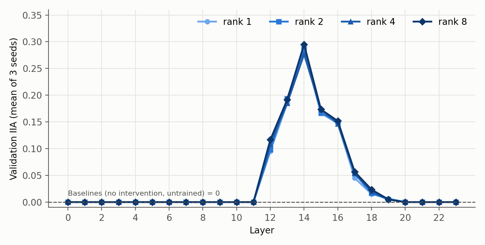

# rank-sweep · DAS rank 1/2/4/8 on GPT-2 Medium (2026-10-18)

*Imported from the Notion research log on 2026-11-16. This file is now the maintained copy.*

> [!NOTE]
> **Conclusion:** On GPT-2 Medium, raising the DAS subspace from rank 1 to rank 8 changes almost nothing. All four ranks select **layer 14**, with validation IIA **0.283 / 0.287 / 0.277 / 0.295**, and the by-layer profile is identical (0 at layers 0–11 and 20–23). Even rank 8 fits only 26% of its own switch-required training pairs, so subspace size is not what limits Medium. The analysis of why is in the data-scale report.

## 1. Question

- From decision D1 of the 10/15 meeting: compare DAS rank 1 / 2 / 4 / 8 to see whether Medium's low IIA (0.28) is because rank 1 is too small.
- From 10/18 the sweep covers all 24 Medium layers (originally 12–16), to see whether a higher rank moves the peak or gives IIA at layers that are 0 at rank 1.

## 2. Setup

Everything except the rank is identical to model-scale; one config per rank.

| Item | Setting |
| --- | --- |
| Model | GPT-2 Medium (24 layers, hidden size 1024), revision `6dcaa7a`, float32, frozen |
| Intervention | DAS (pyvene 0.1.8 `LowRankRotatedSpaceIntervention`), block output, source N → base N, rank 1 / 2 / 4 / 8 |
| Conditions | Per rank: layers 0–23 × seeds 42/43/44 = 72 runs; **288** in total |
| Data | `legacy_v1` train (200 pairs), `val_indist_v1` validation (200), `legacy_v1` test (100, descriptive only) |
| Training | Adam, 10 epochs, batch 20 (100 updates); learning rate 0.0033 → 0.001 over the first 10 updates, then 0.001 |
| Selection | Per rank, mean validation IIA over 3 seeds; locked before test evaluation |
| Compute | UCI HPC3, one A30 per rank, 46–48 min each (Slurm jobs 58223841–58223844) |

## 3. Results

### 3.1 The four by-layer curves nearly coincide

*Figure 1: GPT-2 Medium validation IIA by layer for rank 1 / 2 / 4 / 8 (mean of 3 seeds). The dashed line is the baselines.*

- Every rank has signal only at layers 12–19, peaking at layer 14.
- A higher rank neither creates signal at layers that are 0 at rank 1 nor moves the peak.
- No-intervention and untrained-alignment validation IIA are 0 at every layer for every rank.

### 3.2 Layer 14

| Rank | Validation (mean ± SD) | Test (descriptive) | Train | Train, switch-required pairs |
| --- | --- | --- | --- | --- |
| 1 | 0.283 ± 0.003 | 0.470 | 0.528 | 0.247 |
| 2 | 0.287 ± 0.003 | 0.473 | 0.527 | 0.243 |
| 4 | 0.277 ± 0.006 | 0.467 | 0.532 | 0.253 |
| **8** | **0.295 ± 0.013** | 0.477 | 0.537 | 0.263 |

- Differences between ranks (at most 0.018) are of the same size as the seed SD.
- Rank 8 fits only 26% of the switch-required training pairs: a larger subspace does not even make the training data easier to fit.

### 3.3 Reproduction

- Rank 1 reproduces the 10/15 model-scale run bit for bit on the same GPU type (A30): all 288 compared artifact hashes are identical (alignment, initial alignment, train and validation predictions).

### 3.4 Why rank does not help (summary)

- Not a bug: the saved projections are 1024 × rank, and pyvene swaps all rank dimensions.
- Every higher-rank subspace contains the same direction rank 1 learns (projection 0.91–1.0); the extra dimensions add nothing.
- Replacing the whole residual vector (all 1024 dimensions) at layer 14, position N with the source's gives only 0.105 validation IIA. In Medium this site holds only a small part of the information that decides the answer.
- Full analysis: [data-scale · Training size × rank on GPT-2 Medium (2026-10-19)](2026-10-19-data-scale.md) (section 3.4).

## 4. Conclusions

1. On GPT-2 Medium, DAS rank 1 to 8 give nearly the same IIA (layer 14: 0.28–0.30) and the same by-layer profile.
2. Medium's low IIA is not caused by rank 1 being too small.
3. This holds at a fixed learning rate and 100 updates; data-scale raises updates to 2,500 without changing it (see the data-scale report).

## 5. Limitations

- The learning rate was not varied; the learning-rate check has not been run.
- The GPT-2 Small rank sweep (reference) has not been run.
- Scored by full-vocabulary argmax.
- The test set was inspected early; descriptive only.

## 6. Next steps (for the meeting)

- Whether to still run the GPT-2 Small rank sweep and the learning-rate check.
- For Medium, the next lever is the intervention site (several layers or positions), not a larger rank.

## 7. Reproducibility

- Configs: [`configs/rank-sweep/gpt2-medium-rank{1,2,4,8}.json`](../../configs/rank-sweep/) (SHA-256 prefixes `20400c7e` / `70329bf5` / `e5c88d0a` / `b43cb81d`)
- Outputs: [`outputs/rank-sweep/20261018-gpt2-medium-rank{1,2,4,8}/`](../../outputs/rank-sweep/)
- Code: source commit `0e448cb`; results commit `77da9d3`
- Command: `ioi-das run --config configs/rank-sweep/gpt2-medium-rank8.json` (likewise for the other ranks)
- Figure 1 is drawn from the saved `layer_summary.csv`; no model was rerun.
