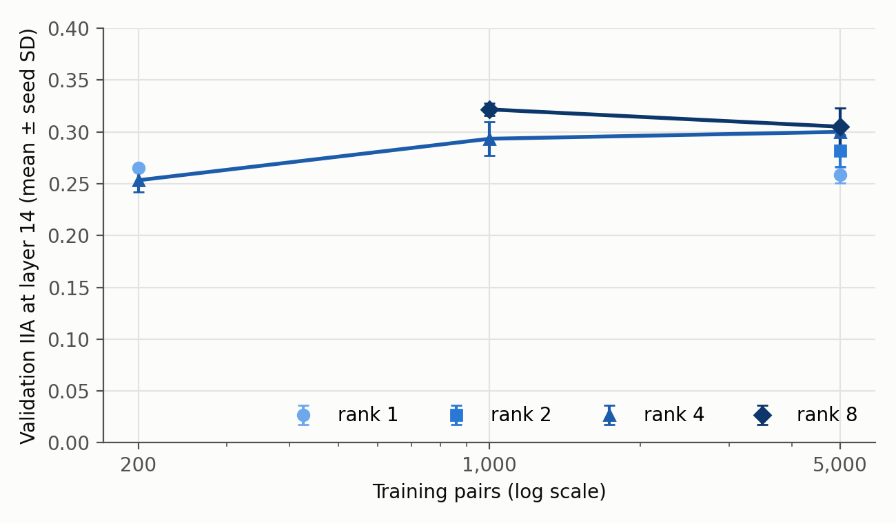
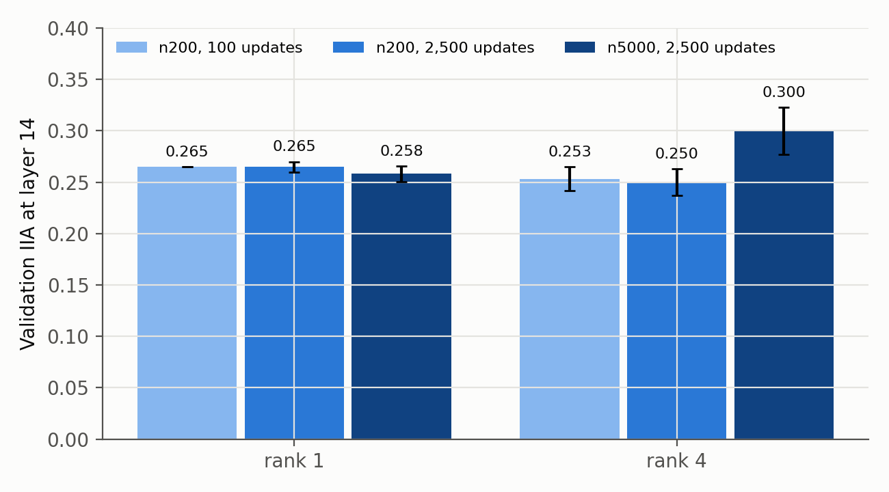
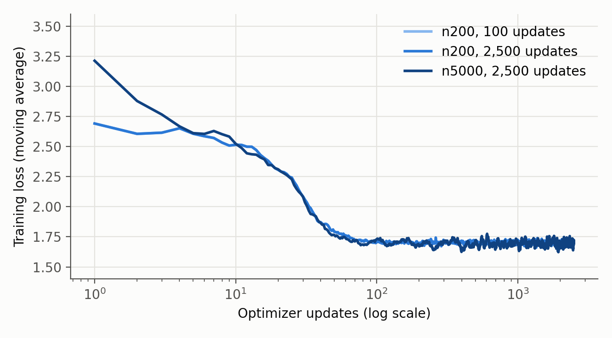
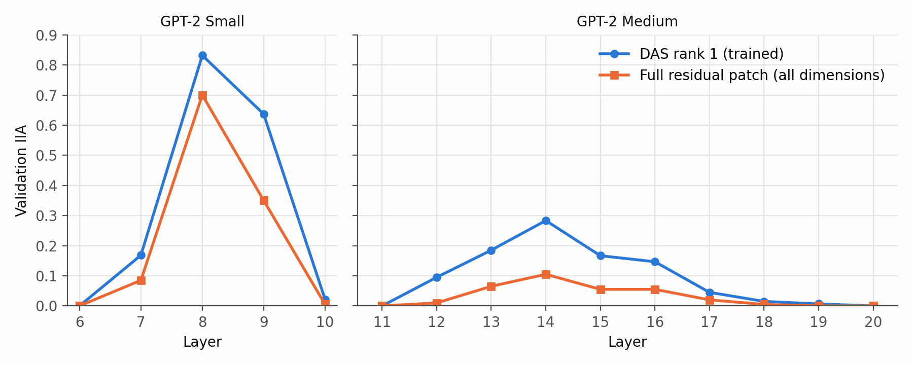

# data-scale · Training size × rank on GPT-2 Medium (2026-10-19)

*Imported from the Notion research log on 2026-11-16. This file is now the maintained copy.*

> [!NOTE]
> **Conclusion:** At GPT-2 Medium layer 14, raising the training set from 200 to 5,000 pairs, the updates from 100 to 2,500, and the rank from 1 to 8 keeps validation IIA within **0.25–0.32**. The same 200 pairs trained 25× longer (250 epochs) leave loss and IIA unchanged. This is neither a bug nor a lack of data: the limit is the intervention site. Replacing the whole residual vector at layer 14, position N gives only **0.105** (Small: 0.70).

## 1. Question

- Original question: does more training data raise IIA?
- On 10/19 it moved to GPT-2 Medium, crossed with rank: the rank sweep showed rank barely matters, so the next question is whether data size or training length limits Medium.
- A control separates "more data" from "more updates".

## 2. Setup

| Item | Setting |
| --- | --- |
| Model, intervention | Same as rank-sweep: GPT-2 Medium, DAS, block output, N → N |
| Training data | Nested `train_n200_v1` / `train_n1000_v1` / `train_n5000_v1` (each smaller set is a subset of the larger; the four pairings are balanced; no overlap with validation or test) |
| Main runs | 3 sizes × rank 1 / 2 / 4 / 8 × layers 11–20 × seeds 42/43/44; 10 epochs each, so 100 / 500 / 2,500 updates |
| Control | `train_n200_v1` at layer 14 for **2,500 updates** (as many as n5000) |
| Other | Learning rate, validation, selection, and test lock as in rank-sweep |
| Compute | UCI HPC3, one A30 per config (Slurm jobs 58242123–58242137); n200 about 20 min, n1000 about 55 min, n5000 about 3.5 h |

> [!NOTE]
> 10 of 16 configs are complete. Rank 1 n1000, rank 2 n200 / n1000, rank 8 n200, and the rank 2 / rank 8 controls were not run (cancelled).

## 3. Results

### 3.1 Every run selects layer 14; IIA stays within 0.25–0.32

*Figure 1: Validation IIA at layer 14 vs training size (mean ± seed SD over 3 seeds). Lines join only adjacent sizes that were both run.*

| Rank | Training pairs | Updates | Validation (mean ± SD) | Test (descriptive) | Train, switch-required |
| --- | --- | --- | --- | --- | --- |
| 1 | 200 | 100 | 0.265 ± 0.000 | 0.497 | 0.320 |
| 1 | 200 | 2,500 (control) | 0.265 ± 0.005 | 0.497 | 0.320 |
| 1 | 5,000 | 2,500 | 0.258 ± 0.008 | 0.473 | 0.268 |
| 2 | 5,000 | 2,500 | 0.282 ± 0.015 | 0.470 | 0.273 |
| 4 | 200 | 100 | 0.253 ± 0.012 | 0.460 | 0.257 |
| 4 | 200 | 2,500 (control) | 0.250 ± 0.013 | 0.457 | 0.290 |
| 4 | 1,000 | 500 | 0.293 ± 0.016 | 0.490 | 0.287 |
| 4 | 5,000 | 2,500 | 0.300 ± 0.023 | 0.487 | 0.292 |
| **8** | **1,000** | 500 | **0.322 ± 0.006** | 0.483 | 0.305 |
| 8 | 5,000 | 2,500 | 0.305 ± 0.018 | 0.483 | 0.304 |

- The by-layer profile matches the rank sweep: 0 at layers 11 and 20, peak at 14. All baselines are 0.
- 25× more data adds at most 0.05; for rank 1 it adds nothing.

### 3.2 Control: 25× more training changes nothing

*Figure 2: Validation IIA at layer 14. Light: 200 pairs, 100 updates; medium: 200 pairs, 2,500 updates; dark: 5,000 pairs, 2,500 updates.*

- Same 200 pairs, 100 vs 2,500 updates: rank 1 is 0.265 both times; rank 4 is 0.253 vs 0.250.
- Same 2,500 updates, 200 vs 5,000 pairs: rank 1 goes 0.265 → 0.258; rank 4 goes 0.250 → 0.300.

*Figure 3: Training loss for rank 1 at layer 14 (25-update moving average, mean of 3 seeds). The first 100 updates of the 2,500-update run are identical to the 100-update run (same seed and data order), so the light line is hidden.*

- The loss settles at about 1.70 after 60–80 updates and does not fall over the next 2,400 (mean of the last 10% of updates: 1.705 at 100 updates, 1.703 at 2,500).
- After 250 epochs on 200 pairs the alignment still fits only 32% of the switch-required training pairs. A model with spare capacity would overfit; here train and validation are nearly equal. This is **underfitting**, not a lack of data.

### 3.3 Not a bug

- Rank reaches the code: the saved projections are 1024 × rank, and pyvene swaps all rank dimensions.
- Size reaches the code: 100 / 500 / 2,500 updates, and each run records a different training-data hash.
- Reloading the saved alignments and re-evaluating validation reproduces the saved IIA counts exactly.
- Training moves the alignment: the trained rank-1 direction is far from its random start (cos ≤ 0.08).

### 3.4 Why neither rank nor data helps (post-hoc analysis)

> [!NOTE]
> This section uses saved outputs plus a fixed-weight re-evaluation on validation (local RTX 2080 Ti); nothing was trained, test was not used, and layer selection is unaffected. Scripts: [`scripts/adhoc/20261019-rank-data-plateau.py`](../../scripts/adhoc/20261019-rank-data-plateau.py), [`scripts/adhoc/20261019-medium-ceiling.py`](../../scripts/adhoc/20261019-medium-ceiling.py).

**(a) Only one direction is useful.**

- The trained rank-1 direction is nearly the same across seeds and training sizes (|cos| 0.90–1.0).
- Every rank 2 / 4 / 8 subspace contains it (projection 0.91–1.0).
- At 100 or 500 updates, 2–3 of the extra dimensions stay near their random start (cos 0.93–0.98); after 2,500 updates they move away, but IIA does not rise (rank 4 control 0.250).

**(b) In Medium this site holds little of the decision.**

*Figure 4: Validation IIA of DAS rank 1 (blue) and of replacing the whole residual vector with the source's (orange). Left: GPT-2 Small; right: GPT-2 Medium.*

| Validation | GPT-2 Small, layer 8 | GPT-2 Medium, layer 14 |
| --- | --- | --- |
| IO is top-1 without intervention | 0.975 | 0.79 |
| " the" is top-1 without intervention | 0.025 | 0.205 |
| Full residual patch (all dimensions) | 0.70 | 0.105 |
| DAS rank 1 | 0.83 | 0.265–0.285 |
| DAS, names only (S > IO) | 0.875 | 0.34–0.41 (all ranks and sizes) |
| Median logit(S) − logit(IO): no intervention → DAS | −3.1 → +1.6 | −3.1 → −0.2 to −0.3 |

- In Medium, even replacing the entire residual vector at N gives at most 0.105 (layer 14). Most of the information that decides the answer is not at this layer and position, so even the best subspace here has a ceiling.
- DAS moves the name gap from −3.1 to about −0.3: most of the way, but not past the threshold for most examples.

**(c) Medium itself is unsure on these prompts.**

- Pooled over 42 layer-14 conditions (all ranks, sizes, seeds): S top-1 (success) 0.281, IO still top-1 0.394, another token (almost always " the") 0.325.
- 91 of 200 validation pairs never flip in any of the 42 conditions; 20 flip every time. On the 91, Medium's own accuracy is 0.57; on the 20, it is 1.00.

**(d) Caveat.**

- DAS beats the full-residual patch: Medium 0.27–0.32 vs 0.105 (about 3×), Small 0.83 vs 0.70. A subspace patch that exceeds the full patch is the pattern Makelov et al. (2023) warn about as the subspace illusion: DAS may use a path the model does not normally use. The untrained baseline (0) cannot detect this, so Medium's 0.3 should be read cautiously.

**(e) Almost all " the" answers come from one sentence type.**

| Prompt | Medium " the" without intervention | Medium DAS IIA (layer 14, 42 conditions) | " the" top-1 after DAS | Small " the" without intervention | Small DAS IIA (layer 8, seed 42) |
| --- | --- | --- | --- | --- | --- |
| gave a **bone** to | **40 / 57** | **0.03** | **0.95** | 5 / 57 | 0.61 |
| gave a kiss to | 1 / 45 | 0.29 | 0.15 | 0 / 45 | 0.93 |
| gave a basketball to | 0 / 48 | 0.42 | 0.00 | 0 / 48 | 0.92 |
| gave a ring to | 0 / 50 | 0.43 | 0.00 | 0 / 50 | 0.90 |

- Scoring is full-vocabulary argmax: the most likely token must be the target name. 40 of Medium's 41 " the" answers without intervention are on "gave a bone to" prompts, probably "…to the dog" (an inference; the following token was not checked).
- On bone prompts DAS lowers IO, but the probability moves to " the", not to S. Example: "Then, Laura and Steven went to the store. Steven gave a bone to": IO (Laura) 0.25 before; after DAS " the" 0.19 and S (Steven) only 0.03.
- Without bone prompts Medium's IIA is 0.38 instead of 0.28. This explains part of the gap, not all of it: Small reaches 0.90–0.93 on the other three objects, and Medium's full-residual patch stays at 0.105.
- Base and source share the object, so changing the intervention site should not remove this preference. A gain on bone prompts that comes from suppressing " the" would not be a POSITION effect.

## 4. Conclusions

1. At GPT-2 Medium layer 14, training size (200 → 5,000), updates (100 → 2,500), and rank (1 → 8) move validation IIA only within 0.25–0.32.
2. The cause is underfitting, not too little data: the same direction is found every time, and more data or training adds nothing.
3. The limit comes from the site: in Medium, layer 14 at position N holds a small part of the decision (full patch 0.105), and Medium often answers " the".
4. DAS exceeds the full patch, so part of Medium's IIA may come from the subspace illusion.

## 5. Limitations

- Only 10 of 16 configs are complete.
- The learning rate was not varied.
- Scored by full-vocabulary argmax; names-only IIA is a post-hoc complement.
- The full patch and names-only scores use validation only, not test.
- The test set was inspected early; descriptive only.

## 6. Next steps (for the meeting)

- For Medium: intervene at several layers or positions at once, or return to GPT-2 Small for the mechanism work?
- Make the full-residual patch a standard reference at every site, and report names-only IIA alongside?
- Finish the 6 cancelled configs (about 3 A30 hours), or stop data-scale on Medium?
- How to handle bone prompts: report per object with a names-only score, analyze prompts the model answers correctly separately, or change the templates or objects (a change to the original task, so a protocol decision)?

## 7. Reproducibility

- Configs: [`configs/data-scale/gpt2-medium-rank{1,2,4,8}-n{200,1000,5000}.json`](../../configs/data-scale/) and `…-n200-updates2500.json`
- Outputs: [`outputs/data-scale/20261019-gpt2-medium-*`](../../outputs/data-scale/) (the 10 complete runs)
- Code: source commit `43a0d06`; results commit `4cad294`; analysis commit `3b54312`
- Command: `ioi-das run --config configs/data-scale/gpt2-medium-rank8-n1000.json` (likewise for the others)
- Figures 1–3 are drawn from saved results; the full patch in Figure 4 is computed by [`scripts/adhoc/20261019-medium-ceiling.py`](../../scripts/adhoc/20261019-medium-ceiling.py) with fixed weights on validation.

## Amendments

- 2026-11-16 (checked against saved outputs when imported): §3.1 says the profile is 0 at layers 11 and 20. At layer 20, validation IIA is 1/600 (0.002) for rank 4 n1000 and 3/600 (0.005) for rank 8 n1000; layer 11 is 0 in every run. The output directory linked in §7 also holds the four partial runs listed in STATUS and two smoke directories of the GPT-2 Small configs; the 10 complete runs are those in the §3.1 table.
