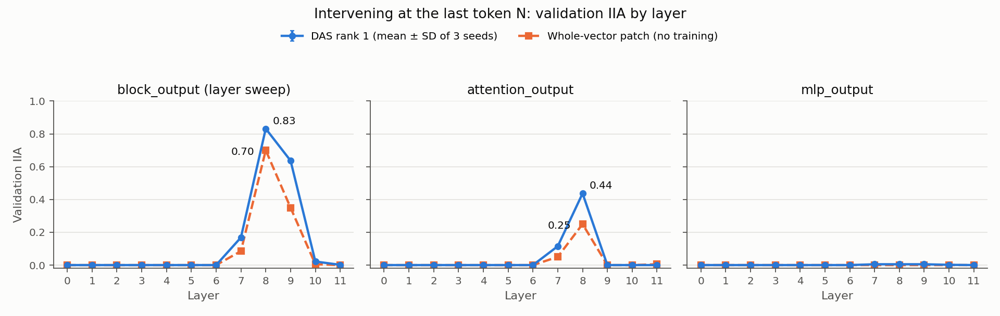
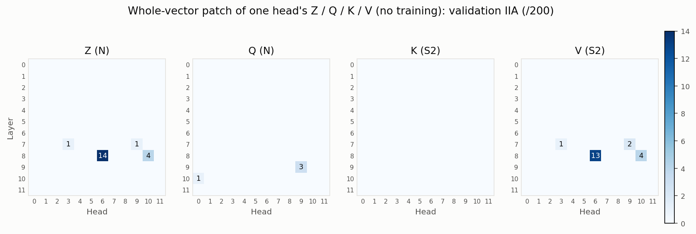
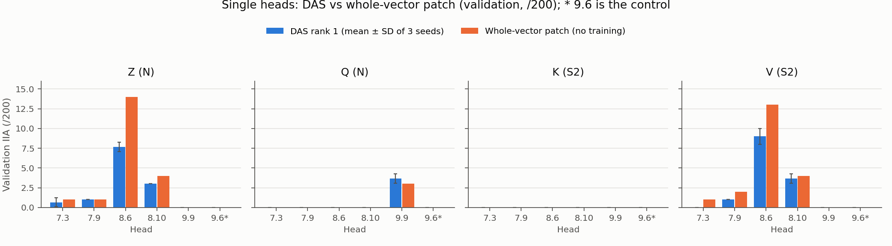

# intervention-sites · Attention, MLP, and single-head DAS on GPT-2 Small (2026-11-05)

*Imported from the Notion research log on 2026-11-16. This file is now the maintained copy.*

> [!NOTE]
> **Conclusion:** At the last token N of GPT-2 Small, the POSITION signal is written by **attention** (layers 7 and 8); the MLP gives 0 at every layer. With DAS, all of layer 8's attention reaches **0.44**, but no single head exceeds **0.05**: the signal is spread over several heads. The heads that matter are exactly the S-inhibition heads of Wang et al. (2022) (8.6, 8.10, 7.9, 7.3), and they pass the signal through their **V at S2 (what they read)**, not through K or Q (where they look).

## 1. Research question

- Conclusion of the 10/19 and 11/2 meetings: besides the block output, apply DAS to other activations, such as single attention head outputs.
- Question 1: at the last token N, can the attention branch or the MLP branch alone move the answer to the counterfactual? How do their layer profiles compare with the block output?
- Question 2: which single heads carry the POSITION signal? Is it in the head's output (Z), where it looks (Q, K), or what it reads (V)? Does this match the IOI circuit of Wang et al.?

## 2. Setup

| Item | Setting |
| --- | --- |
| Model | GPT-2 Small (12 layers, 12 heads per layer, 64 dimensions per head); weights frozen, only the DAS rotation is trained |
| DAS | Rank 1, legacy training data (200 pairs), 10 epochs, seeds 42/43/44; learning rate as in layer-sweep |
| Evaluation | Layer chosen on validation (`val_indist_v1`, 200 pairs); test (100 pairs, descriptive) only after the lock; the full-vocabulary argmax must be exactly the counterfactual answer |
| Reference (no training) | Whole-vector patch: replace the site's entire activation with the source's (64 dimensions for a head, 768 for a branch). 144 heads × 4 sites plus 3 branches per layer, validation only |
| Head choice | The whole-vector patch map picked the heads with any effect (7.3, 7.9, 8.6, 8.10, 9.9), plus 9.6 as a control with no effect; each head runs Z, Q, K, and V |
| Execution | Six local RTX 2080 Ti; 26 configs, 144 conditions (plus 144 post-lock test evaluations); 2026-11-05 12:09–12:37 Pacific; median 40 s per condition |

Intervention sites:

| Site | What it is | Size | Token |
| --- | --- | --- | --- |
| `block_output` | Residual after the layer (the earlier site; reference) | 768 | N |
| `attention_output` | Sum of the 12 heads after W_O, before it is added to the residual | 768 | N |
| `mlp_output` | MLP output, before it is added to the residual | 768 | N |
| Z | One head's output A·V, before W_O | 64 | N |
| Q | One head's query (before QKᵀ) | 64 | N |
| K | One head's key (before QKᵀ) | 64 | S2 |
| V | One head's value (before AV) | 64 | S2 |

- K and V live at the attended token, so they use S2: the S-inhibition heads read S2 from the last token. In this data S2 has the same index in base and source; only its context (where S1 was) differs.
- Z and Q use N while K and V use S2, so comparing them changes the component and the location together.

## 3. Results

### 3.1 Attention writes the signal, the MLP does not

*Figure 1: validation IIA by layer, intervening at the last token N. Blue: DAS rank 1 (mean ± SD of 3 seeds); dashed orange: whole-vector patch (no training). block_output comes from the 10/15 layer sweep.*

| Validation | block_output DAS | block_output whole patch | attention_output DAS | attention_output whole patch | mlp_output DAS |
| --- | --- | --- | --- | --- | --- |
| Layer 7 | 0.17 | 0.085 | 0.115 | 0.05 | 0.005 |
| **Layer 8** | **0.83** | 0.70 | **0.44** | 0.25 | 0.005 |
| Layer 9 | 0.64 | 0.35 | 0 | 0 | 0.005 |
| Other layers | ≤ 0.02 | ≤ 0.005 | 0 | ≤ 0.005 | ≤ 0.005 |

- attention_output selects layer 8: validation 87.3/200 (0.44), test 37.3/100 (descriptive). It fits 38% of the switch-required training pairs, about the same as validation, so it does not overfit.
- mlp_output is ≤ 1/200 at every layer: the MLP at the last token does not carry this signal.
- block_output is cumulative (everything written so far), while attention_output is only this layer's increment. So attention's 0.44 at layer 8 being below block_output's 0.83 is expected: what layer 7 wrote is still base's.
- The untrained baseline is 0 at every site.

### 3.2 Whole-head patches: only the S-inhibition heads matter

*Figure 2: validation IIA (/200) after replacing one head's Z or Q (at N), or K or V (at S2), with the source's. Empty cells are 0.*

- Of 144 heads, only 7.3, 7.9, 8.6, and 8.10 have effects on Z and V; the largest is 8.6 (Z 14/200, V 13/200). These are the S-inhibition heads of Wang et al.
- For each S-inhibition head, V at S2 gives about what Z at N gives: the head's output at the last token depends on what it reads at S2.
- Q has small effects only for the name movers 9.9 (3) and 10.0 (1); K is 0 everywhere.
- Single heads are weak: the four S-inhibition heads' Z patches sum to 20, while all of layer 8's attention gives 50 and the residual 140.

### 3.3 DAS on single heads

*Figure 3: DAS (blue, mean ± SD of 3 seeds) and whole-vector patch (orange) for six heads, validation IIA (/200). 9.6 is the control.*

| Head | Site | DAS validation (/200) | Whole patch (/200) | Test (/100, descriptive) |
| --- | --- | --- | --- | --- |
| **8.6** | V (S2) | **9.0 ± 1.0** | 13 | 3.3 |
| 8.6 | Z (N) | 7.7 ± 0.6 | 14 | 3.3 |
| 8.10 | V (S2) | 3.7 ± 0.6 | 4 | 0 |
| 8.10 | Z (N) | 3.0 ± 0.0 | 4 | 0.7 |
| 9.9 | Q (N) | 3.7 ± 0.6 | 3 | 0 |
| 7.9 | Z / V | 1.0 / 1.0 | 1 / 2 | 0 |
| 7.3 | Z / V | 0.7 / 0 | 1 / 1 | 0 |
| The other 15 (every K, control 9.6) | — | 0–1 | 0 | 0 |

- DAS never exceeds the whole-vector patch, the control 9.6 stays at 0, and the untrained baseline is 0: single heads show no sign of the subspace illusion.
- K is 0 everywhere and V matches Z: the S-inhibition heads pass the signal through what they read, not through where they attend.
- Single-head DAS reaches at most 9/200, far below the 87/200 of layer 8's attention as a whole.

### 3.4 Caveats

- attention_output DAS (0.44) is well above its whole-vector patch (0.25), the same pattern as block_output (0.83 vs 0.70). A subspace intervention beating the whole-vector one is the subspace-illusion warning of Makelov et al. (2023), so branch-level DAS numbers need caution.
- Base and source use the same two names and have the same factual answer; only the name order differs, and the counterfactual answer is neither prompt's own answer. A head that only carries which name to say (for example the name movers 9.6, 9.9, 10.0) therefore stays near 0 even if it matters for IOI. IIA here measures whether a site carries the subject-position signal.

## 4. Conclusions

1. At the last token of GPT-2 Small, the POSITION signal is written by attention in layers 7 and 8; the MLP takes no part.
2. The signal is spread over heads: a single head reaches at most 9/200 (DAS) or 14/200 (whole patch), whole-layer attention 87/200 (DAS).
3. The heads that matter are the S-inhibition heads, and they pass the signal through V at S2, as in the IOI circuit of Wang et al.
4. Single heads show no sign of the subspace illusion; branch- and block-level DAS exceeds the whole-vector patch and needs cautious reading.

## 5. Limitations

- GPT-2 Small only, and only the locations N and S2.
- DAS ran only on the 6 heads chosen from the whole-vector patch map; a head that only DAS can move may be missed.
- Rank 1 only, with the learning rate tuned for block_output.
- The whole-vector patch comes from an ad hoc script on validation only; it is not yet part of the pipeline.
- Z is the head output before W_O; low-rank DAS on the head's 768-dimensional write to the residual may differ.
- The test set was inspected early and is descriptive only.

## 6. Next steps (to be decided at the meeting)

- Swap several heads together: DAS over the S-inhibition heads of layers 7 and 8, to see whether they approach whole-layer attention's 87/200 (needs a new capability).
- Run the subspace-illusion checks of Makelov et al. on attention_output.
- Trace backwards: which heads write the signal that the S-inhibition heads read at S2 (duplicate-token and induction heads)? Config only.
- Apply the same approach to GPT-2 Medium.

## 7. Reproducibility

- Configs: [`configs/intervention-sites/gpt2-small-attention-output.json`](../../configs/intervention-sites/gpt2-small-attention-output.json), [`gpt2-small-mlp-output.json`](../../configs/intervention-sites/gpt2-small-mlp-output.json), and [`gpt2-small-l{layer}h{head}-{z,q,k,v}.json`](../../configs/intervention-sites/) (24)
- Results: [`outputs/intervention-sites/20261105-gpt2-small-*`](../../outputs/intervention-sites/) (26 runs, all complete)
- Code: source commit `831d2d9` (site support merged in `b2c3b8e`), results commit `4342512`
- Command: `ioi-das run --config configs/intervention-sites/gpt2-small-l8h6-v.json` (and likewise for the others)
- Whole-vector patch: [`scripts/adhoc/20261105-full-patch-map.py`](../../scripts/adhoc/20261105-full-patch-map.py); summary table: [`scripts/adhoc/20261105-site-das-summary.py`](../../scripts/adhoc/20261105-site-das-summary.py); figures drawn from saved results.

## Amendments

- 2026-11-16 (checked against saved outputs when imported): §3.3 says DAS never exceeds the whole-vector patch on single heads. One cell does, slightly: head 9.9 Q gives 3.7 ± 0.6/200 with DAS against 3/200 for the whole patch (the §3.3 table). The gap is under one pair and within seed variation, not the "DAS far above the whole patch" pattern that signals the subspace illusion.
