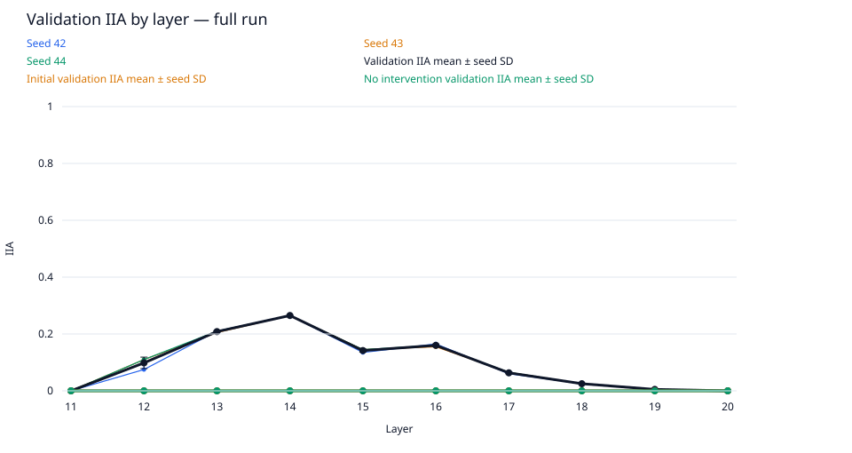
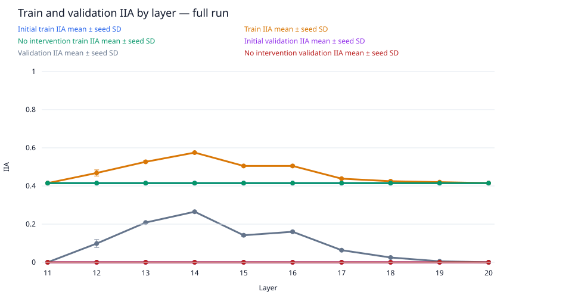
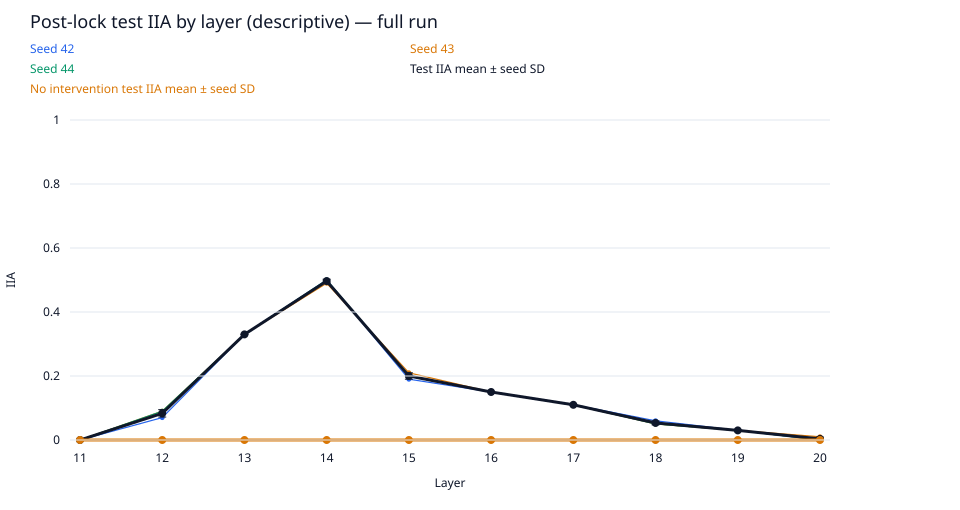
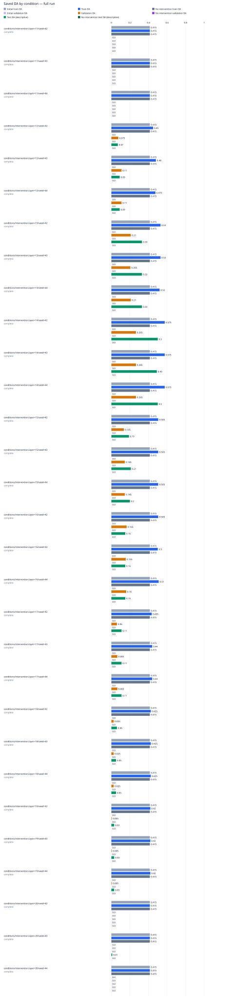

# data-scale / gpt2-medium-rank1-n200

Run kind: **full**; run status: **complete**.

Config SHA-256: `f30aae6955882bab67a2f327c88bfc5abbd504c9938e53d13f075ea6aa43b79c`.

Conditions: complete=30.

The legacy test set is a descriptive benchmark, previously inspected in earlier runs.
It is not an untouched held-out test.

Selected layer: **14**; metric: `validation_iia`.
The choice was locked in `selection.json` before post-lock evaluation.

| Condition | Status | Initial train IIA | Train IIA | No intervention train IIA | Initial validation IIA | Validation IIA | No intervention validation IIA | Test IIA (descriptive) | No intervention test IIA (descriptive) | Post-lock status |
| --- | --- | --- | --- | --- | --- | --- | --- | --- | --- | --- |
| conditions/intervention.layer=11/seed=42 | complete | 83/200 = 0.415 | 83/200 = 0.415 | 83/200 = 0.415 | 0/200 = 0.0 | 0/200 = 0.0 | 0/200 = 0.0 | 0/100 = 0.0 | 0/100 = 0.0 | complete |
| conditions/intervention.layer=11/seed=43 | complete | 83/200 = 0.415 | 83/200 = 0.415 | 83/200 = 0.415 | 0/200 = 0.0 | 0/200 = 0.0 | 0/200 = 0.0 | 0/100 = 0.0 | 0/100 = 0.0 | complete |
| conditions/intervention.layer=11/seed=44 | complete | 83/200 = 0.415 | 83/200 = 0.415 | 83/200 = 0.415 | 0/200 = 0.0 | 0/200 = 0.0 | 0/200 = 0.0 | 0/100 = 0.0 | 0/100 = 0.0 | complete |
| conditions/intervention.layer=12/seed=42 | complete | 83/200 = 0.415 | 90/200 = 0.45 | 83/200 = 0.415 | 0/200 = 0.0 | 15/200 = 0.075 | 0/200 = 0.0 | 7/100 = 0.07 | 0/100 = 0.0 | complete |
| conditions/intervention.layer=12/seed=43 | complete | 83/200 = 0.415 | 96/200 = 0.48 | 83/200 = 0.415 | 0/200 = 0.0 | 22/200 = 0.11 | 0/200 = 0.0 | 9/100 = 0.09 | 0/100 = 0.0 | complete |
| conditions/intervention.layer=12/seed=44 | complete | 83/200 = 0.415 | 95/200 = 0.475 | 83/200 = 0.415 | 0/200 = 0.0 | 22/200 = 0.11 | 0/200 = 0.0 | 9/100 = 0.09 | 0/100 = 0.0 | complete |
| conditions/intervention.layer=13/seed=42 | complete | 83/200 = 0.415 | 106/200 = 0.53 | 83/200 = 0.415 | 0/200 = 0.0 | 42/200 = 0.21 | 0/200 = 0.0 | 33/100 = 0.33 | 0/100 = 0.0 | complete |
| conditions/intervention.layer=13/seed=43 | complete | 83/200 = 0.415 | 106/200 = 0.53 | 83/200 = 0.415 | 0/200 = 0.0 | 41/200 = 0.205 | 0/200 = 0.0 | 33/100 = 0.33 | 0/100 = 0.0 | complete |
| conditions/intervention.layer=13/seed=44 | complete | 83/200 = 0.415 | 104/200 = 0.52 | 83/200 = 0.415 | 0/200 = 0.0 | 42/200 = 0.21 | 0/200 = 0.0 | 33/100 = 0.33 | 0/100 = 0.0 | complete |
| conditions/intervention.layer=14/seed=42 | complete | 83/200 = 0.415 | 115/200 = 0.575 | 83/200 = 0.415 | 0/200 = 0.0 | 53/200 = 0.265 | 0/200 = 0.0 | 50/100 = 0.5 | 0/100 = 0.0 | complete |
| conditions/intervention.layer=14/seed=43 | complete | 83/200 = 0.415 | 115/200 = 0.575 | 83/200 = 0.415 | 0/200 = 0.0 | 53/200 = 0.265 | 0/200 = 0.0 | 49/100 = 0.49 | 0/100 = 0.0 | complete |
| conditions/intervention.layer=14/seed=44 | complete | 83/200 = 0.415 | 115/200 = 0.575 | 83/200 = 0.415 | 0/200 = 0.0 | 53/200 = 0.265 | 0/200 = 0.0 | 50/100 = 0.5 | 0/100 = 0.0 | complete |
| conditions/intervention.layer=15/seed=42 | complete | 83/200 = 0.415 | 101/200 = 0.505 | 83/200 = 0.415 | 0/200 = 0.0 | 27/200 = 0.135 | 0/200 = 0.0 | 19/100 = 0.19 | 0/100 = 0.0 | complete |
| conditions/intervention.layer=15/seed=43 | complete | 83/200 = 0.415 | 101/200 = 0.505 | 83/200 = 0.415 | 0/200 = 0.0 | 29/200 = 0.145 | 0/200 = 0.0 | 21/100 = 0.21 | 0/100 = 0.0 | complete |
| conditions/intervention.layer=15/seed=44 | complete | 83/200 = 0.415 | 101/200 = 0.505 | 83/200 = 0.415 | 0/200 = 0.0 | 29/200 = 0.145 | 0/200 = 0.0 | 20/100 = 0.2 | 0/100 = 0.0 | complete |
| conditions/intervention.layer=16/seed=42 | complete | 83/200 = 0.415 | 101/200 = 0.505 | 83/200 = 0.415 | 0/200 = 0.0 | 33/200 = 0.165 | 0/200 = 0.0 | 15/100 = 0.15 | 0/100 = 0.0 | complete |
| conditions/intervention.layer=16/seed=43 | complete | 83/200 = 0.415 | 100/200 = 0.5 | 83/200 = 0.415 | 0/200 = 0.0 | 31/200 = 0.155 | 0/200 = 0.0 | 15/100 = 0.15 | 0/100 = 0.0 | complete |
| conditions/intervention.layer=16/seed=44 | complete | 83/200 = 0.415 | 102/200 = 0.51 | 83/200 = 0.415 | 0/200 = 0.0 | 32/200 = 0.16 | 0/200 = 0.0 | 15/100 = 0.15 | 0/100 = 0.0 | complete |
| conditions/intervention.layer=17/seed=42 | complete | 83/200 = 0.415 | 87/200 = 0.435 | 83/200 = 0.415 | 0/200 = 0.0 | 12/200 = 0.06 | 0/200 = 0.0 | 11/100 = 0.11 | 0/100 = 0.0 | complete |
| conditions/intervention.layer=17/seed=43 | complete | 83/200 = 0.415 | 88/200 = 0.44 | 83/200 = 0.415 | 0/200 = 0.0 | 13/200 = 0.065 | 0/200 = 0.0 | 11/100 = 0.11 | 0/100 = 0.0 | complete |
| conditions/intervention.layer=17/seed=44 | complete | 83/200 = 0.415 | 88/200 = 0.44 | 83/200 = 0.415 | 0/200 = 0.0 | 13/200 = 0.065 | 0/200 = 0.0 | 11/100 = 0.11 | 0/100 = 0.0 | complete |
| conditions/intervention.layer=18/seed=42 | complete | 83/200 = 0.415 | 85/200 = 0.425 | 83/200 = 0.415 | 0/200 = 0.0 | 5/200 = 0.025 | 0/200 = 0.0 | 6/100 = 0.06 | 0/100 = 0.0 | complete |
| conditions/intervention.layer=18/seed=43 | complete | 83/200 = 0.415 | 85/200 = 0.425 | 83/200 = 0.415 | 0/200 = 0.0 | 5/200 = 0.025 | 0/200 = 0.0 | 5/100 = 0.05 | 0/100 = 0.0 | complete |
| conditions/intervention.layer=18/seed=44 | complete | 83/200 = 0.415 | 85/200 = 0.425 | 83/200 = 0.415 | 0/200 = 0.0 | 5/200 = 0.025 | 0/200 = 0.0 | 5/100 = 0.05 | 0/100 = 0.0 | complete |
| conditions/intervention.layer=19/seed=42 | complete | 83/200 = 0.415 | 84/200 = 0.42 | 83/200 = 0.415 | 0/200 = 0.0 | 1/200 = 0.005 | 0/200 = 0.0 | 3/100 = 0.03 | 0/100 = 0.0 | complete |
| conditions/intervention.layer=19/seed=43 | complete | 83/200 = 0.415 | 84/200 = 0.42 | 83/200 = 0.415 | 0/200 = 0.0 | 1/200 = 0.005 | 0/200 = 0.0 | 3/100 = 0.03 | 0/100 = 0.0 | complete |
| conditions/intervention.layer=19/seed=44 | complete | 83/200 = 0.415 | 84/200 = 0.42 | 83/200 = 0.415 | 0/200 = 0.0 | 1/200 = 0.005 | 0/200 = 0.0 | 3/100 = 0.03 | 0/100 = 0.0 | complete |
| conditions/intervention.layer=20/seed=42 | complete | 83/200 = 0.415 | 83/200 = 0.415 | 83/200 = 0.415 | 0/200 = 0.0 | 0/200 = 0.0 | 0/200 = 0.0 | 0/100 = 0.0 | 0/100 = 0.0 | complete |
| conditions/intervention.layer=20/seed=43 | complete | 83/200 = 0.415 | 83/200 = 0.415 | 83/200 = 0.415 | 0/200 = 0.0 | 0/200 = 0.0 | 0/200 = 0.0 | 1/100 = 0.01 | 0/100 = 0.0 | complete |
| conditions/intervention.layer=20/seed=44 | complete | 83/200 = 0.415 | 83/200 = 0.415 | 83/200 = 0.415 | 0/200 = 0.0 | 0/200 = 0.0 | 0/200 = 0.0 | 0/100 = 0.0 | 0/100 = 0.0 | complete |

Full-precision metrics and exact counts are saved in `conditions.csv`.
Missing metrics are shown as —; failed and pending conditions remain in the table.

Per-layer means and sample SD across seeds are saved in `layer_summary.csv`.
Seed SD describes variation across seeds; it is not a confidence interval.
A single available seed has no sample SD. Incomplete layers are flagged in the CSV.

Per-pairing and target-change groups (counts summed across seeds; means give equal weight to each seed):

| Layer | Split | Group | IIA | No-intervention IIA |
| --- | --- | --- | --- | --- |
| 11 | initial_train | ABB->ABB | 114/150; mean 0.76 | 114/150; mean 0.76 |
| 11 | initial_train | ABB->BAB | 0/150; mean 0.0 | 0/150; mean 0.0 |
| 11 | initial_train | BAB->ABB | 0/150; mean 0.0 | 0/150; mean 0.0 |
| 11 | initial_train | BAB->BAB | 135/150; mean 0.9 | 135/150; mean 0.9 |
| 11 | initial_train | switch_required | 0/300; mean 0.0 | 0/300; mean 0.0 |
| 11 | initial_train | unchanged_target | 249/300; mean 0.83 | 249/300; mean 0.83 |
| 12 | initial_train | ABB->ABB | 114/150; mean 0.76 | 114/150; mean 0.76 |
| 12 | initial_train | ABB->BAB | 0/150; mean 0.0 | 0/150; mean 0.0 |
| 12 | initial_train | BAB->ABB | 0/150; mean 0.0 | 0/150; mean 0.0 |
| 12 | initial_train | BAB->BAB | 135/150; mean 0.9 | 135/150; mean 0.9 |
| 12 | initial_train | switch_required | 0/300; mean 0.0 | 0/300; mean 0.0 |
| 12 | initial_train | unchanged_target | 249/300; mean 0.83 | 249/300; mean 0.83 |
| 13 | initial_train | ABB->ABB | 114/150; mean 0.76 | 114/150; mean 0.76 |
| 13 | initial_train | ABB->BAB | 0/150; mean 0.0 | 0/150; mean 0.0 |
| 13 | initial_train | BAB->ABB | 0/150; mean 0.0 | 0/150; mean 0.0 |
| 13 | initial_train | BAB->BAB | 135/150; mean 0.9 | 135/150; mean 0.9 |
| 13 | initial_train | switch_required | 0/300; mean 0.0 | 0/300; mean 0.0 |
| 13 | initial_train | unchanged_target | 249/300; mean 0.83 | 249/300; mean 0.83 |
| 14 | initial_train | ABB->ABB | 114/150; mean 0.76 | 114/150; mean 0.76 |
| 14 | initial_train | ABB->BAB | 0/150; mean 0.0 | 0/150; mean 0.0 |
| 14 | initial_train | BAB->ABB | 0/150; mean 0.0 | 0/150; mean 0.0 |
| 14 | initial_train | BAB->BAB | 135/150; mean 0.9 | 135/150; mean 0.9 |
| 14 | initial_train | switch_required | 0/300; mean 0.0 | 0/300; mean 0.0 |
| 14 | initial_train | unchanged_target | 249/300; mean 0.83 | 249/300; mean 0.83 |
| 15 | initial_train | ABB->ABB | 114/150; mean 0.76 | 114/150; mean 0.76 |
| 15 | initial_train | ABB->BAB | 0/150; mean 0.0 | 0/150; mean 0.0 |
| 15 | initial_train | BAB->ABB | 0/150; mean 0.0 | 0/150; mean 0.0 |
| 15 | initial_train | BAB->BAB | 135/150; mean 0.9 | 135/150; mean 0.9 |
| 15 | initial_train | switch_required | 0/300; mean 0.0 | 0/300; mean 0.0 |
| 15 | initial_train | unchanged_target | 249/300; mean 0.83 | 249/300; mean 0.83 |
| 16 | initial_train | ABB->ABB | 114/150; mean 0.76 | 114/150; mean 0.76 |
| 16 | initial_train | ABB->BAB | 0/150; mean 0.0 | 0/150; mean 0.0 |
| 16 | initial_train | BAB->ABB | 0/150; mean 0.0 | 0/150; mean 0.0 |
| 16 | initial_train | BAB->BAB | 135/150; mean 0.9 | 135/150; mean 0.9 |
| 16 | initial_train | switch_required | 0/300; mean 0.0 | 0/300; mean 0.0 |
| 16 | initial_train | unchanged_target | 249/300; mean 0.83 | 249/300; mean 0.83 |
| 17 | initial_train | ABB->ABB | 114/150; mean 0.76 | 114/150; mean 0.76 |
| 17 | initial_train | ABB->BAB | 0/150; mean 0.0 | 0/150; mean 0.0 |
| 17 | initial_train | BAB->ABB | 0/150; mean 0.0 | 0/150; mean 0.0 |
| 17 | initial_train | BAB->BAB | 135/150; mean 0.9 | 135/150; mean 0.9 |
| 17 | initial_train | switch_required | 0/300; mean 0.0 | 0/300; mean 0.0 |
| 17 | initial_train | unchanged_target | 249/300; mean 0.83 | 249/300; mean 0.83 |
| 18 | initial_train | ABB->ABB | 114/150; mean 0.76 | 114/150; mean 0.76 |
| 18 | initial_train | ABB->BAB | 0/150; mean 0.0 | 0/150; mean 0.0 |
| 18 | initial_train | BAB->ABB | 0/150; mean 0.0 | 0/150; mean 0.0 |
| 18 | initial_train | BAB->BAB | 135/150; mean 0.9 | 135/150; mean 0.9 |
| 18 | initial_train | switch_required | 0/300; mean 0.0 | 0/300; mean 0.0 |
| 18 | initial_train | unchanged_target | 249/300; mean 0.83 | 249/300; mean 0.83 |
| 19 | initial_train | ABB->ABB | 114/150; mean 0.76 | 114/150; mean 0.76 |
| 19 | initial_train | ABB->BAB | 0/150; mean 0.0 | 0/150; mean 0.0 |
| 19 | initial_train | BAB->ABB | 0/150; mean 0.0 | 0/150; mean 0.0 |
| 19 | initial_train | BAB->BAB | 135/150; mean 0.9 | 135/150; mean 0.9 |
| 19 | initial_train | switch_required | 0/300; mean 0.0 | 0/300; mean 0.0 |
| 19 | initial_train | unchanged_target | 249/300; mean 0.83 | 249/300; mean 0.83 |
| 20 | initial_train | ABB->ABB | 114/150; mean 0.76 | 114/150; mean 0.76 |
| 20 | initial_train | ABB->BAB | 0/150; mean 0.0 | 0/150; mean 0.0 |
| 20 | initial_train | BAB->ABB | 0/150; mean 0.0 | 0/150; mean 0.0 |
| 20 | initial_train | BAB->BAB | 135/150; mean 0.9 | 135/150; mean 0.9 |
| 20 | initial_train | switch_required | 0/300; mean 0.0 | 0/300; mean 0.0 |
| 20 | initial_train | unchanged_target | 249/300; mean 0.83 | 249/300; mean 0.83 |
| 11 | train | ABB->ABB | 114/150; mean 0.76 | 114/150; mean 0.76 |
| 11 | train | ABB->BAB | 0/150; mean 0.0 | 0/150; mean 0.0 |
| 11 | train | BAB->ABB | 0/150; mean 0.0 | 0/150; mean 0.0 |
| 11 | train | BAB->BAB | 135/150; mean 0.9 | 135/150; mean 0.9 |
| 11 | train | switch_required | 0/300; mean 0.0 | 0/300; mean 0.0 |
| 11 | train | unchanged_target | 249/300; mean 0.83 | 249/300; mean 0.83 |
| 12 | train | ABB->ABB | 114/150; mean 0.76 | 114/150; mean 0.76 |
| 12 | train | ABB->BAB | 3/150; mean 0.02 | 0/150; mean 0.0 |
| 12 | train | BAB->ABB | 29/150; mean 0.19333333333333333 | 0/150; mean 0.0 |
| 12 | train | BAB->BAB | 135/150; mean 0.9 | 135/150; mean 0.9 |
| 12 | train | switch_required | 32/300; mean 0.10666666666666667 | 0/300; mean 0.0 |
| 12 | train | unchanged_target | 249/300; mean 0.83 | 249/300; mean 0.83 |
| 13 | train | ABB->ABB | 114/150; mean 0.76 | 114/150; mean 0.76 |
| 13 | train | ABB->BAB | 9/150; mean 0.06 | 0/150; mean 0.0 |
| 13 | train | BAB->ABB | 58/150; mean 0.38666666666666666 | 0/150; mean 0.0 |
| 13 | train | BAB->BAB | 135/150; mean 0.9 | 135/150; mean 0.9 |
| 13 | train | switch_required | 67/300; mean 0.22333333333333333 | 0/300; mean 0.0 |
| 13 | train | unchanged_target | 249/300; mean 0.83 | 249/300; mean 0.83 |
| 14 | train | ABB->ABB | 114/150; mean 0.76 | 114/150; mean 0.76 |
| 14 | train | ABB->BAB | 18/150; mean 0.12 | 0/150; mean 0.0 |
| 14 | train | BAB->ABB | 78/150; mean 0.52 | 0/150; mean 0.0 |
| 14 | train | BAB->BAB | 135/150; mean 0.9 | 135/150; mean 0.9 |
| 14 | train | switch_required | 96/300; mean 0.32 | 0/300; mean 0.0 |
| 14 | train | unchanged_target | 249/300; mean 0.83 | 249/300; mean 0.83 |
| 15 | train | ABB->ABB | 114/150; mean 0.76 | 114/150; mean 0.76 |
| 15 | train | ABB->BAB | 15/150; mean 0.1 | 0/150; mean 0.0 |
| 15 | train | BAB->ABB | 39/150; mean 0.26 | 0/150; mean 0.0 |
| 15 | train | BAB->BAB | 135/150; mean 0.9 | 135/150; mean 0.9 |
| 15 | train | switch_required | 54/300; mean 0.18 | 0/300; mean 0.0 |
| 15 | train | unchanged_target | 249/300; mean 0.83 | 249/300; mean 0.83 |
| 16 | train | ABB->ABB | 114/150; mean 0.76 | 114/150; mean 0.76 |
| 16 | train | ABB->BAB | 15/150; mean 0.1 | 0/150; mean 0.0 |
| 16 | train | BAB->ABB | 39/150; mean 0.26 | 0/150; mean 0.0 |
| 16 | train | BAB->BAB | 135/150; mean 0.9 | 135/150; mean 0.9 |
| 16 | train | switch_required | 54/300; mean 0.18 | 0/300; mean 0.0 |
| 16 | train | unchanged_target | 249/300; mean 0.83 | 249/300; mean 0.83 |
| 17 | train | ABB->ABB | 114/150; mean 0.76 | 114/150; mean 0.76 |
| 17 | train | ABB->BAB | 5/150; mean 0.03333333333333333 | 0/150; mean 0.0 |
| 17 | train | BAB->ABB | 9/150; mean 0.06 | 0/150; mean 0.0 |
| 17 | train | BAB->BAB | 135/150; mean 0.9 | 135/150; mean 0.9 |
| 17 | train | switch_required | 14/300; mean 0.04666666666666667 | 0/300; mean 0.0 |
| 17 | train | unchanged_target | 249/300; mean 0.83 | 249/300; mean 0.83 |
| 18 | train | ABB->ABB | 114/150; mean 0.76 | 114/150; mean 0.76 |
| 18 | train | ABB->BAB | 3/150; mean 0.02 | 0/150; mean 0.0 |
| 18 | train | BAB->ABB | 3/150; mean 0.02 | 0/150; mean 0.0 |
| 18 | train | BAB->BAB | 135/150; mean 0.9 | 135/150; mean 0.9 |
| 18 | train | switch_required | 6/300; mean 0.02 | 0/300; mean 0.0 |
| 18 | train | unchanged_target | 249/300; mean 0.83 | 249/300; mean 0.83 |
| 19 | train | ABB->ABB | 114/150; mean 0.76 | 114/150; mean 0.76 |
| 19 | train | ABB->BAB | 3/150; mean 0.02 | 0/150; mean 0.0 |
| 19 | train | BAB->ABB | 0/150; mean 0.0 | 0/150; mean 0.0 |
| 19 | train | BAB->BAB | 135/150; mean 0.9 | 135/150; mean 0.9 |
| 19 | train | switch_required | 3/300; mean 0.01 | 0/300; mean 0.0 |
| 19 | train | unchanged_target | 249/300; mean 0.83 | 249/300; mean 0.83 |
| 20 | train | ABB->ABB | 114/150; mean 0.76 | 114/150; mean 0.76 |
| 20 | train | ABB->BAB | 0/150; mean 0.0 | 0/150; mean 0.0 |
| 20 | train | BAB->ABB | 0/150; mean 0.0 | 0/150; mean 0.0 |
| 20 | train | BAB->BAB | 135/150; mean 0.9 | 135/150; mean 0.9 |
| 20 | train | switch_required | 0/300; mean 0.0 | 0/300; mean 0.0 |
| 20 | train | unchanged_target | 249/300; mean 0.83 | 249/300; mean 0.83 |
| 11 | initial_validation | ABB->ABB | 0/0; mean — | 0/0; mean — |
| 11 | initial_validation | ABB->BAB | 0/300; mean 0.0 | 0/300; mean 0.0 |
| 11 | initial_validation | BAB->ABB | 0/300; mean 0.0 | 0/300; mean 0.0 |
| 11 | initial_validation | BAB->BAB | 0/0; mean — | 0/0; mean — |
| 11 | initial_validation | switch_required | 0/600; mean 0.0 | 0/600; mean 0.0 |
| 11 | initial_validation | unchanged_target | 0/0; mean — | 0/0; mean — |
| 12 | initial_validation | ABB->ABB | 0/0; mean — | 0/0; mean — |
| 12 | initial_validation | ABB->BAB | 0/300; mean 0.0 | 0/300; mean 0.0 |
| 12 | initial_validation | BAB->ABB | 0/300; mean 0.0 | 0/300; mean 0.0 |
| 12 | initial_validation | BAB->BAB | 0/0; mean — | 0/0; mean — |
| 12 | initial_validation | switch_required | 0/600; mean 0.0 | 0/600; mean 0.0 |
| 12 | initial_validation | unchanged_target | 0/0; mean — | 0/0; mean — |
| 13 | initial_validation | ABB->ABB | 0/0; mean — | 0/0; mean — |
| 13 | initial_validation | ABB->BAB | 0/300; mean 0.0 | 0/300; mean 0.0 |
| 13 | initial_validation | BAB->ABB | 0/300; mean 0.0 | 0/300; mean 0.0 |
| 13 | initial_validation | BAB->BAB | 0/0; mean — | 0/0; mean — |
| 13 | initial_validation | switch_required | 0/600; mean 0.0 | 0/600; mean 0.0 |
| 13 | initial_validation | unchanged_target | 0/0; mean — | 0/0; mean — |
| 14 | initial_validation | ABB->ABB | 0/0; mean — | 0/0; mean — |
| 14 | initial_validation | ABB->BAB | 0/300; mean 0.0 | 0/300; mean 0.0 |
| 14 | initial_validation | BAB->ABB | 0/300; mean 0.0 | 0/300; mean 0.0 |
| 14 | initial_validation | BAB->BAB | 0/0; mean — | 0/0; mean — |
| 14 | initial_validation | switch_required | 0/600; mean 0.0 | 0/600; mean 0.0 |
| 14 | initial_validation | unchanged_target | 0/0; mean — | 0/0; mean — |
| 15 | initial_validation | ABB->ABB | 0/0; mean — | 0/0; mean — |
| 15 | initial_validation | ABB->BAB | 0/300; mean 0.0 | 0/300; mean 0.0 |
| 15 | initial_validation | BAB->ABB | 0/300; mean 0.0 | 0/300; mean 0.0 |
| 15 | initial_validation | BAB->BAB | 0/0; mean — | 0/0; mean — |
| 15 | initial_validation | switch_required | 0/600; mean 0.0 | 0/600; mean 0.0 |
| 15 | initial_validation | unchanged_target | 0/0; mean — | 0/0; mean — |
| 16 | initial_validation | ABB->ABB | 0/0; mean — | 0/0; mean — |
| 16 | initial_validation | ABB->BAB | 0/300; mean 0.0 | 0/300; mean 0.0 |
| 16 | initial_validation | BAB->ABB | 0/300; mean 0.0 | 0/300; mean 0.0 |
| 16 | initial_validation | BAB->BAB | 0/0; mean — | 0/0; mean — |
| 16 | initial_validation | switch_required | 0/600; mean 0.0 | 0/600; mean 0.0 |
| 16 | initial_validation | unchanged_target | 0/0; mean — | 0/0; mean — |
| 17 | initial_validation | ABB->ABB | 0/0; mean — | 0/0; mean — |
| 17 | initial_validation | ABB->BAB | 0/300; mean 0.0 | 0/300; mean 0.0 |
| 17 | initial_validation | BAB->ABB | 0/300; mean 0.0 | 0/300; mean 0.0 |
| 17 | initial_validation | BAB->BAB | 0/0; mean — | 0/0; mean — |
| 17 | initial_validation | switch_required | 0/600; mean 0.0 | 0/600; mean 0.0 |
| 17 | initial_validation | unchanged_target | 0/0; mean — | 0/0; mean — |
| 18 | initial_validation | ABB->ABB | 0/0; mean — | 0/0; mean — |
| 18 | initial_validation | ABB->BAB | 0/300; mean 0.0 | 0/300; mean 0.0 |
| 18 | initial_validation | BAB->ABB | 0/300; mean 0.0 | 0/300; mean 0.0 |
| 18 | initial_validation | BAB->BAB | 0/0; mean — | 0/0; mean — |
| 18 | initial_validation | switch_required | 0/600; mean 0.0 | 0/600; mean 0.0 |
| 18 | initial_validation | unchanged_target | 0/0; mean — | 0/0; mean — |
| 19 | initial_validation | ABB->ABB | 0/0; mean — | 0/0; mean — |
| 19 | initial_validation | ABB->BAB | 0/300; mean 0.0 | 0/300; mean 0.0 |
| 19 | initial_validation | BAB->ABB | 0/300; mean 0.0 | 0/300; mean 0.0 |
| 19 | initial_validation | BAB->BAB | 0/0; mean — | 0/0; mean — |
| 19 | initial_validation | switch_required | 0/600; mean 0.0 | 0/600; mean 0.0 |
| 19 | initial_validation | unchanged_target | 0/0; mean — | 0/0; mean — |
| 20 | initial_validation | ABB->ABB | 0/0; mean — | 0/0; mean — |
| 20 | initial_validation | ABB->BAB | 0/300; mean 0.0 | 0/300; mean 0.0 |
| 20 | initial_validation | BAB->ABB | 0/300; mean 0.0 | 0/300; mean 0.0 |
| 20 | initial_validation | BAB->BAB | 0/0; mean — | 0/0; mean — |
| 20 | initial_validation | switch_required | 0/600; mean 0.0 | 0/600; mean 0.0 |
| 20 | initial_validation | unchanged_target | 0/0; mean — | 0/0; mean — |
| 11 | validation | ABB->ABB | 0/0; mean — | 0/0; mean — |
| 11 | validation | ABB->BAB | 0/300; mean 0.0 | 0/300; mean 0.0 |
| 11 | validation | BAB->ABB | 0/300; mean 0.0 | 0/300; mean 0.0 |
| 11 | validation | BAB->BAB | 0/0; mean — | 0/0; mean — |
| 11 | validation | switch_required | 0/600; mean 0.0 | 0/600; mean 0.0 |
| 11 | validation | unchanged_target | 0/0; mean — | 0/0; mean — |
| 12 | validation | ABB->ABB | 0/0; mean — | 0/0; mean — |
| 12 | validation | ABB->BAB | 3/300; mean 0.01 | 0/300; mean 0.0 |
| 12 | validation | BAB->ABB | 56/300; mean 0.18666666666666668 | 0/300; mean 0.0 |
| 12 | validation | BAB->BAB | 0/0; mean — | 0/0; mean — |
| 12 | validation | switch_required | 59/600; mean 0.09833333333333333 | 0/600; mean 0.0 |
| 12 | validation | unchanged_target | 0/0; mean — | 0/0; mean — |
| 13 | validation | ABB->ABB | 0/0; mean — | 0/0; mean — |
| 13 | validation | ABB->BAB | 23/300; mean 0.07666666666666667 | 0/300; mean 0.0 |
| 13 | validation | BAB->ABB | 102/300; mean 0.34 | 0/300; mean 0.0 |
| 13 | validation | BAB->BAB | 0/0; mean — | 0/0; mean — |
| 13 | validation | switch_required | 125/600; mean 0.20833333333333331 | 0/600; mean 0.0 |
| 13 | validation | unchanged_target | 0/0; mean — | 0/0; mean — |
| 14 | validation | ABB->ABB | 0/0; mean — | 0/0; mean — |
| 14 | validation | ABB->BAB | 21/300; mean 0.07 | 0/300; mean 0.0 |
| 14 | validation | BAB->ABB | 138/300; mean 0.46 | 0/300; mean 0.0 |
| 14 | validation | BAB->BAB | 0/0; mean — | 0/0; mean — |
| 14 | validation | switch_required | 159/600; mean 0.265 | 0/600; mean 0.0 |
| 14 | validation | unchanged_target | 0/0; mean — | 0/0; mean — |
| 15 | validation | ABB->ABB | 0/0; mean — | 0/0; mean — |
| 15 | validation | ABB->BAB | 28/300; mean 0.09333333333333334 | 0/300; mean 0.0 |
| 15 | validation | BAB->ABB | 57/300; mean 0.19 | 0/300; mean 0.0 |
| 15 | validation | BAB->BAB | 0/0; mean — | 0/0; mean — |
| 15 | validation | switch_required | 85/600; mean 0.14166666666666666 | 0/600; mean 0.0 |
| 15 | validation | unchanged_target | 0/0; mean — | 0/0; mean — |
| 16 | validation | ABB->ABB | 0/0; mean — | 0/0; mean — |
| 16 | validation | ABB->BAB | 28/300; mean 0.09333333333333334 | 0/300; mean 0.0 |
| 16 | validation | BAB->ABB | 68/300; mean 0.22666666666666668 | 0/300; mean 0.0 |
| 16 | validation | BAB->BAB | 0/0; mean — | 0/0; mean — |
| 16 | validation | switch_required | 96/600; mean 0.16 | 0/600; mean 0.0 |
| 16 | validation | unchanged_target | 0/0; mean — | 0/0; mean — |
| 17 | validation | ABB->ABB | 0/0; mean — | 0/0; mean — |
| 17 | validation | ABB->BAB | 6/300; mean 0.02 | 0/300; mean 0.0 |
| 17 | validation | BAB->ABB | 32/300; mean 0.10666666666666667 | 0/300; mean 0.0 |
| 17 | validation | BAB->BAB | 0/0; mean — | 0/0; mean — |
| 17 | validation | switch_required | 38/600; mean 0.06333333333333334 | 0/600; mean 0.0 |
| 17 | validation | unchanged_target | 0/0; mean — | 0/0; mean — |
| 18 | validation | ABB->ABB | 0/0; mean — | 0/0; mean — |
| 18 | validation | ABB->BAB | 6/300; mean 0.02 | 0/300; mean 0.0 |
| 18 | validation | BAB->ABB | 9/300; mean 0.03 | 0/300; mean 0.0 |
| 18 | validation | BAB->BAB | 0/0; mean — | 0/0; mean — |
| 18 | validation | switch_required | 15/600; mean 0.025 | 0/600; mean 0.0 |
| 18 | validation | unchanged_target | 0/0; mean — | 0/0; mean — |
| 19 | validation | ABB->ABB | 0/0; mean — | 0/0; mean — |
| 19 | validation | ABB->BAB | 0/300; mean 0.0 | 0/300; mean 0.0 |
| 19 | validation | BAB->ABB | 3/300; mean 0.01 | 0/300; mean 0.0 |
| 19 | validation | BAB->BAB | 0/0; mean — | 0/0; mean — |
| 19 | validation | switch_required | 3/600; mean 0.005 | 0/600; mean 0.0 |
| 19 | validation | unchanged_target | 0/0; mean — | 0/0; mean — |
| 20 | validation | ABB->ABB | 0/0; mean — | 0/0; mean — |
| 20 | validation | ABB->BAB | 0/300; mean 0.0 | 0/300; mean 0.0 |
| 20 | validation | BAB->ABB | 0/300; mean 0.0 | 0/300; mean 0.0 |
| 20 | validation | BAB->BAB | 0/0; mean — | 0/0; mean — |
| 20 | validation | switch_required | 0/600; mean 0.0 | 0/600; mean 0.0 |
| 20 | validation | unchanged_target | 0/0; mean — | 0/0; mean — |
| 11 | test | ABB->ABB | 0/0; mean — | 0/0; mean — |
| 11 | test | ABB->BAB | 0/150; mean 0.0 | 0/150; mean 0.0 |
| 11 | test | BAB->ABB | 0/150; mean 0.0 | 0/150; mean 0.0 |
| 11 | test | BAB->BAB | 0/0; mean — | 0/0; mean — |
| 11 | test | switch_required | 0/300; mean 0.0 | 0/300; mean 0.0 |
| 11 | test | unchanged_target | 0/0; mean — | 0/0; mean — |
| 12 | test | ABB->ABB | 0/0; mean — | 0/0; mean — |
| 12 | test | ABB->BAB | 1/150; mean 0.006666666666666667 | 0/150; mean 0.0 |
| 12 | test | BAB->ABB | 24/150; mean 0.16 | 0/150; mean 0.0 |
| 12 | test | BAB->BAB | 0/0; mean — | 0/0; mean — |
| 12 | test | switch_required | 25/300; mean 0.08333333333333333 | 0/300; mean 0.0 |
| 12 | test | unchanged_target | 0/0; mean — | 0/0; mean — |
| 13 | test | ABB->ABB | 0/0; mean — | 0/0; mean — |
| 13 | test | ABB->BAB | 18/150; mean 0.12 | 0/150; mean 0.0 |
| 13 | test | BAB->ABB | 81/150; mean 0.54 | 0/150; mean 0.0 |
| 13 | test | BAB->BAB | 0/0; mean — | 0/0; mean — |
| 13 | test | switch_required | 99/300; mean 0.33 | 0/300; mean 0.0 |
| 13 | test | unchanged_target | 0/0; mean — | 0/0; mean — |
| 14 | test | ABB->ABB | 0/0; mean — | 0/0; mean — |
| 14 | test | ABB->BAB | 29/150; mean 0.19333333333333333 | 0/150; mean 0.0 |
| 14 | test | BAB->ABB | 120/150; mean 0.8 | 0/150; mean 0.0 |
| 14 | test | BAB->BAB | 0/0; mean — | 0/0; mean — |
| 14 | test | switch_required | 149/300; mean 0.49666666666666665 | 0/300; mean 0.0 |
| 14 | test | unchanged_target | 0/0; mean — | 0/0; mean — |
| 15 | test | ABB->ABB | 0/0; mean — | 0/0; mean — |
| 15 | test | ABB->BAB | 26/150; mean 0.17333333333333334 | 0/150; mean 0.0 |
| 15 | test | BAB->ABB | 34/150; mean 0.22666666666666666 | 0/150; mean 0.0 |
| 15 | test | BAB->BAB | 0/0; mean — | 0/0; mean — |
| 15 | test | switch_required | 60/300; mean 0.2 | 0/300; mean 0.0 |
| 15 | test | unchanged_target | 0/0; mean — | 0/0; mean — |
| 16 | test | ABB->ABB | 0/0; mean — | 0/0; mean — |
| 16 | test | ABB->BAB | 24/150; mean 0.16 | 0/150; mean 0.0 |
| 16 | test | BAB->ABB | 21/150; mean 0.14 | 0/150; mean 0.0 |
| 16 | test | BAB->BAB | 0/0; mean — | 0/0; mean — |
| 16 | test | switch_required | 45/300; mean 0.15 | 0/300; mean 0.0 |
| 16 | test | unchanged_target | 0/0; mean — | 0/0; mean — |
| 17 | test | ABB->ABB | 0/0; mean — | 0/0; mean — |
| 17 | test | ABB->BAB | 21/150; mean 0.14 | 0/150; mean 0.0 |
| 17 | test | BAB->ABB | 12/150; mean 0.08 | 0/150; mean 0.0 |
| 17 | test | BAB->BAB | 0/0; mean — | 0/0; mean — |
| 17 | test | switch_required | 33/300; mean 0.11 | 0/300; mean 0.0 |
| 17 | test | unchanged_target | 0/0; mean — | 0/0; mean — |
| 18 | test | ABB->ABB | 0/0; mean — | 0/0; mean — |
| 18 | test | ABB->BAB | 13/150; mean 0.08666666666666667 | 0/150; mean 0.0 |
| 18 | test | BAB->ABB | 3/150; mean 0.02 | 0/150; mean 0.0 |
| 18 | test | BAB->BAB | 0/0; mean — | 0/0; mean — |
| 18 | test | switch_required | 16/300; mean 0.05333333333333334 | 0/300; mean 0.0 |
| 18 | test | unchanged_target | 0/0; mean — | 0/0; mean — |
| 19 | test | ABB->ABB | 0/0; mean — | 0/0; mean — |
| 19 | test | ABB->BAB | 6/150; mean 0.04 | 0/150; mean 0.0 |
| 19 | test | BAB->ABB | 3/150; mean 0.02 | 0/150; mean 0.0 |
| 19 | test | BAB->BAB | 0/0; mean — | 0/0; mean — |
| 19 | test | switch_required | 9/300; mean 0.03 | 0/300; mean 0.0 |
| 19 | test | unchanged_target | 0/0; mean — | 0/0; mean — |
| 20 | test | ABB->ABB | 0/0; mean — | 0/0; mean — |
| 20 | test | ABB->BAB | 0/150; mean 0.0 | 0/150; mean 0.0 |
| 20 | test | BAB->ABB | 1/150; mean 0.006666666666666667 | 0/150; mean 0.0 |
| 20 | test | BAB->BAB | 0/0; mean — | 0/0; mean — |
| 20 | test | switch_required | 1/300; mean 0.0033333333333333335 | 0/300; mean 0.0 |
| 20 | test | unchanged_target | 0/0; mean — | 0/0; mean — |

