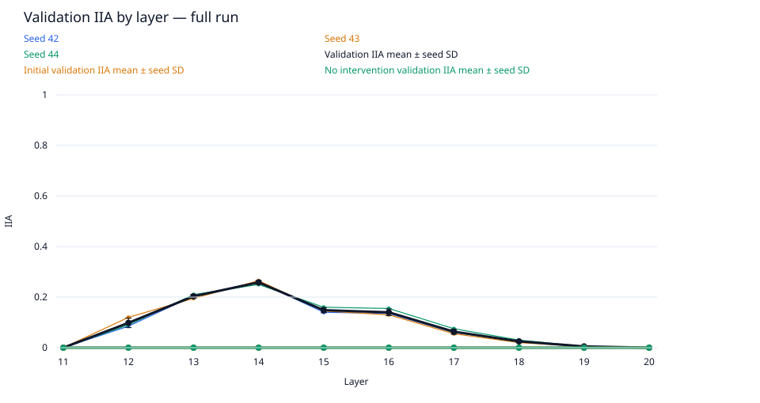
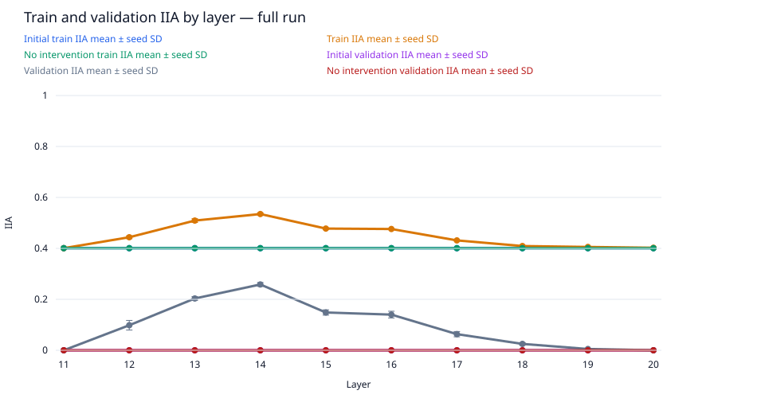
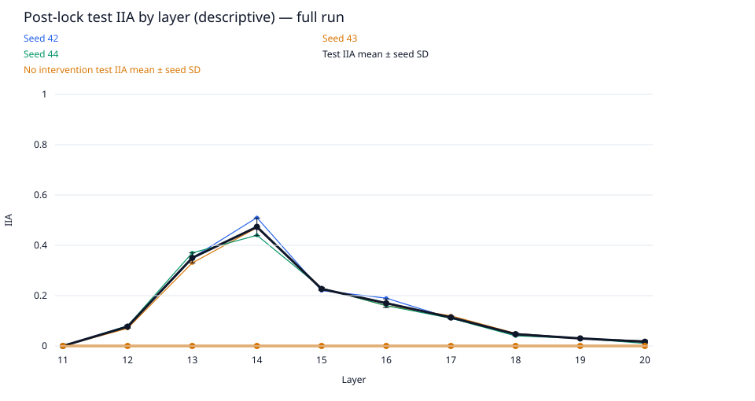
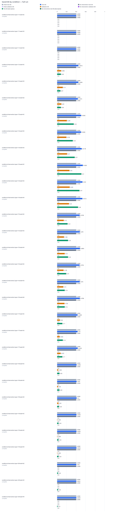

# data-scale / gpt2-medium-rank1-n5000

Run kind: **full**; run status: **complete**.

Config SHA-256: `3c5c50fd04ac1d773e034e4ee999ab2341873773df21e96a79d6a49e6c2f1aa8`.

Conditions: complete=30.

The legacy test set is a descriptive benchmark, previously inspected in earlier runs.
It is not an untouched held-out test.

Selected layer: **14**; metric: `validation_iia`.
The choice was locked in `selection.json` before post-lock evaluation.

| Condition | Status | Initial train IIA | Train IIA | No intervention train IIA | Initial validation IIA | Validation IIA | No intervention validation IIA | Test IIA (descriptive) | No intervention test IIA (descriptive) | Post-lock status |
| --- | --- | --- | --- | --- | --- | --- | --- | --- | --- | --- |
| conditions/intervention.layer=11/seed=42 | complete | 2004/5000 = 0.4008 | 2004/5000 = 0.4008 | 2004/5000 = 0.4008 | 0/200 = 0.0 | 0/200 = 0.0 | 0/200 = 0.0 | 0/100 = 0.0 | 0/100 = 0.0 | complete |
| conditions/intervention.layer=11/seed=43 | complete | 2004/5000 = 0.4008 | 2004/5000 = 0.4008 | 2004/5000 = 0.4008 | 0/200 = 0.0 | 0/200 = 0.0 | 0/200 = 0.0 | 0/100 = 0.0 | 0/100 = 0.0 | complete |
| conditions/intervention.layer=11/seed=44 | complete | 2004/5000 = 0.4008 | 2004/5000 = 0.4008 | 2004/5000 = 0.4008 | 0/200 = 0.0 | 0/200 = 0.0 | 0/200 = 0.0 | 0/100 = 0.0 | 0/100 = 0.0 | complete |
| conditions/intervention.layer=12/seed=42 | complete | 2004/5000 = 0.4008 | 2236/5000 = 0.4472 | 2004/5000 = 0.4008 | 0/200 = 0.0 | 17/200 = 0.085 | 0/200 = 0.0 | 8/100 = 0.08 | 0/100 = 0.0 | complete |
| conditions/intervention.layer=12/seed=43 | complete | 2004/5000 = 0.4008 | 2233/5000 = 0.4466 | 2004/5000 = 0.4008 | 0/200 = 0.0 | 24/200 = 0.12 | 0/200 = 0.0 | 7/100 = 0.07 | 0/100 = 0.0 | complete |
| conditions/intervention.layer=12/seed=44 | complete | 2004/5000 = 0.4008 | 2187/5000 = 0.4374 | 2004/5000 = 0.4008 | 0/200 = 0.0 | 18/200 = 0.09 | 0/200 = 0.0 | 8/100 = 0.08 | 0/100 = 0.0 | complete |
| conditions/intervention.layer=13/seed=42 | complete | 2004/5000 = 0.4008 | 2529/5000 = 0.5058 | 2004/5000 = 0.4008 | 0/200 = 0.0 | 41/200 = 0.205 | 0/200 = 0.0 | 35/100 = 0.35 | 0/100 = 0.0 | complete |
| conditions/intervention.layer=13/seed=43 | complete | 2004/5000 = 0.4008 | 2519/5000 = 0.5038 | 2004/5000 = 0.4008 | 0/200 = 0.0 | 39/200 = 0.195 | 0/200 = 0.0 | 33/100 = 0.33 | 0/100 = 0.0 | complete |
| conditions/intervention.layer=13/seed=44 | complete | 2004/5000 = 0.4008 | 2589/5000 = 0.5178 | 2004/5000 = 0.4008 | 0/200 = 0.0 | 42/200 = 0.21 | 0/200 = 0.0 | 37/100 = 0.37 | 0/100 = 0.0 | complete |
| conditions/intervention.layer=14/seed=42 | complete | 2004/5000 = 0.4008 | 2701/5000 = 0.5402 | 2004/5000 = 0.4008 | 0/200 = 0.0 | 52/200 = 0.26 | 0/200 = 0.0 | 51/100 = 0.51 | 0/100 = 0.0 | complete |
| conditions/intervention.layer=14/seed=43 | complete | 2004/5000 = 0.4008 | 2665/5000 = 0.533 | 2004/5000 = 0.4008 | 0/200 = 0.0 | 53/200 = 0.265 | 0/200 = 0.0 | 47/100 = 0.47 | 0/100 = 0.0 | complete |
| conditions/intervention.layer=14/seed=44 | complete | 2004/5000 = 0.4008 | 2656/5000 = 0.5312 | 2004/5000 = 0.4008 | 0/200 = 0.0 | 50/200 = 0.25 | 0/200 = 0.0 | 44/100 = 0.44 | 0/100 = 0.0 | complete |
| conditions/intervention.layer=15/seed=42 | complete | 2004/5000 = 0.4008 | 2374/5000 = 0.4748 | 2004/5000 = 0.4008 | 0/200 = 0.0 | 28/200 = 0.14 | 0/200 = 0.0 | 22/100 = 0.22 | 0/100 = 0.0 | complete |
| conditions/intervention.layer=15/seed=43 | complete | 2004/5000 = 0.4008 | 2390/5000 = 0.478 | 2004/5000 = 0.4008 | 0/200 = 0.0 | 29/200 = 0.145 | 0/200 = 0.0 | 23/100 = 0.23 | 0/100 = 0.0 | complete |
| conditions/intervention.layer=15/seed=44 | complete | 2004/5000 = 0.4008 | 2402/5000 = 0.4804 | 2004/5000 = 0.4008 | 0/200 = 0.0 | 32/200 = 0.16 | 0/200 = 0.0 | 23/100 = 0.23 | 0/100 = 0.0 | complete |
| conditions/intervention.layer=16/seed=42 | complete | 2004/5000 = 0.4008 | 2368/5000 = 0.4736 | 2004/5000 = 0.4008 | 0/200 = 0.0 | 27/200 = 0.135 | 0/200 = 0.0 | 19/100 = 0.19 | 0/100 = 0.0 | complete |
| conditions/intervention.layer=16/seed=43 | complete | 2004/5000 = 0.4008 | 2380/5000 = 0.476 | 2004/5000 = 0.4008 | 0/200 = 0.0 | 26/200 = 0.13 | 0/200 = 0.0 | 16/100 = 0.16 | 0/100 = 0.0 | complete |
| conditions/intervention.layer=16/seed=44 | complete | 2004/5000 = 0.4008 | 2393/5000 = 0.4786 | 2004/5000 = 0.4008 | 0/200 = 0.0 | 31/200 = 0.155 | 0/200 = 0.0 | 16/100 = 0.16 | 0/100 = 0.0 | complete |
| conditions/intervention.layer=17/seed=42 | complete | 2004/5000 = 0.4008 | 2154/5000 = 0.4308 | 2004/5000 = 0.4008 | 0/200 = 0.0 | 12/200 = 0.06 | 0/200 = 0.0 | 11/100 = 0.11 | 0/100 = 0.0 | complete |
| conditions/intervention.layer=17/seed=43 | complete | 2004/5000 = 0.4008 | 2150/5000 = 0.43 | 2004/5000 = 0.4008 | 0/200 = 0.0 | 11/200 = 0.055 | 0/200 = 0.0 | 12/100 = 0.12 | 0/100 = 0.0 | complete |
| conditions/intervention.layer=17/seed=44 | complete | 2004/5000 = 0.4008 | 2166/5000 = 0.4332 | 2004/5000 = 0.4008 | 0/200 = 0.0 | 15/200 = 0.075 | 0/200 = 0.0 | 11/100 = 0.11 | 0/100 = 0.0 | complete |
| conditions/intervention.layer=18/seed=42 | complete | 2004/5000 = 0.4008 | 2043/5000 = 0.4086 | 2004/5000 = 0.4008 | 0/200 = 0.0 | 5/200 = 0.025 | 0/200 = 0.0 | 5/100 = 0.05 | 0/100 = 0.0 | complete |
| conditions/intervention.layer=18/seed=43 | complete | 2004/5000 = 0.4008 | 2045/5000 = 0.409 | 2004/5000 = 0.4008 | 0/200 = 0.0 | 4/200 = 0.02 | 0/200 = 0.0 | 5/100 = 0.05 | 0/100 = 0.0 | complete |
| conditions/intervention.layer=18/seed=44 | complete | 2004/5000 = 0.4008 | 2050/5000 = 0.41 | 2004/5000 = 0.4008 | 0/200 = 0.0 | 6/200 = 0.03 | 0/200 = 0.0 | 4/100 = 0.04 | 0/100 = 0.0 | complete |
| conditions/intervention.layer=19/seed=42 | complete | 2004/5000 = 0.4008 | 2029/5000 = 0.4058 | 2004/5000 = 0.4008 | 0/200 = 0.0 | 1/200 = 0.005 | 0/200 = 0.0 | 3/100 = 0.03 | 0/100 = 0.0 | complete |
| conditions/intervention.layer=19/seed=43 | complete | 2004/5000 = 0.4008 | 2028/5000 = 0.4056 | 2004/5000 = 0.4008 | 0/200 = 0.0 | 1/200 = 0.005 | 0/200 = 0.0 | 3/100 = 0.03 | 0/100 = 0.0 | complete |
| conditions/intervention.layer=19/seed=44 | complete | 2004/5000 = 0.4008 | 2027/5000 = 0.4054 | 2004/5000 = 0.4008 | 0/200 = 0.0 | 1/200 = 0.005 | 0/200 = 0.0 | 3/100 = 0.03 | 0/100 = 0.0 | complete |
| conditions/intervention.layer=20/seed=42 | complete | 2004/5000 = 0.4008 | 2010/5000 = 0.402 | 2004/5000 = 0.4008 | 0/200 = 0.0 | 0/200 = 0.0 | 0/200 = 0.0 | 2/100 = 0.02 | 0/100 = 0.0 | complete |
| conditions/intervention.layer=20/seed=43 | complete | 2004/5000 = 0.4008 | 2011/5000 = 0.4022 | 2004/5000 = 0.4008 | 0/200 = 0.0 | 0/200 = 0.0 | 0/200 = 0.0 | 2/100 = 0.02 | 0/100 = 0.0 | complete |
| conditions/intervention.layer=20/seed=44 | complete | 2004/5000 = 0.4008 | 2014/5000 = 0.4028 | 2004/5000 = 0.4008 | 0/200 = 0.0 | 0/200 = 0.0 | 0/200 = 0.0 | 1/100 = 0.01 | 0/100 = 0.0 | complete |

Full-precision metrics and exact counts are saved in `conditions.csv`.
Missing metrics are shown as —; failed and pending conditions remain in the table.

Per-layer means and sample SD across seeds are saved in `layer_summary.csv`.
Seed SD describes variation across seeds; it is not a confidence interval.
A single available seed has no sample SD. Incomplete layers are flagged in the CSV.

Per-pairing and target-change groups (counts summed across seeds; means give equal weight to each seed):

| Layer | Split | Group | IIA | No-intervention IIA |
| --- | --- | --- | --- | --- |
| 11 | initial_train | ABB->ABB | 3021/3750; mean 0.8056 | 3021/3750; mean 0.8056 |
| 11 | initial_train | ABB->BAB | 0/3750; mean 0.0 | 0/3750; mean 0.0 |
| 11 | initial_train | BAB->ABB | 0/3750; mean 0.0 | 0/3750; mean 0.0 |
| 11 | initial_train | BAB->BAB | 2991/3750; mean 0.7976 | 2991/3750; mean 0.7976 |
| 11 | initial_train | switch_required | 0/7500; mean 0.0 | 0/7500; mean 0.0 |
| 11 | initial_train | unchanged_target | 6012/7500; mean 0.8016 | 6012/7500; mean 0.8016 |
| 12 | initial_train | ABB->ABB | 3021/3750; mean 0.8056 | 3021/3750; mean 0.8056 |
| 12 | initial_train | ABB->BAB | 0/3750; mean 0.0 | 0/3750; mean 0.0 |
| 12 | initial_train | BAB->ABB | 0/3750; mean 0.0 | 0/3750; mean 0.0 |
| 12 | initial_train | BAB->BAB | 2991/3750; mean 0.7976 | 2991/3750; mean 0.7976 |
| 12 | initial_train | switch_required | 0/7500; mean 0.0 | 0/7500; mean 0.0 |
| 12 | initial_train | unchanged_target | 6012/7500; mean 0.8016 | 6012/7500; mean 0.8016 |
| 13 | initial_train | ABB->ABB | 3021/3750; mean 0.8056 | 3021/3750; mean 0.8056 |
| 13 | initial_train | ABB->BAB | 0/3750; mean 0.0 | 0/3750; mean 0.0 |
| 13 | initial_train | BAB->ABB | 0/3750; mean 0.0 | 0/3750; mean 0.0 |
| 13 | initial_train | BAB->BAB | 2991/3750; mean 0.7976 | 2991/3750; mean 0.7976 |
| 13 | initial_train | switch_required | 0/7500; mean 0.0 | 0/7500; mean 0.0 |
| 13 | initial_train | unchanged_target | 6012/7500; mean 0.8016 | 6012/7500; mean 0.8016 |
| 14 | initial_train | ABB->ABB | 3021/3750; mean 0.8056 | 3021/3750; mean 0.8056 |
| 14 | initial_train | ABB->BAB | 0/3750; mean 0.0 | 0/3750; mean 0.0 |
| 14 | initial_train | BAB->ABB | 0/3750; mean 0.0 | 0/3750; mean 0.0 |
| 14 | initial_train | BAB->BAB | 2991/3750; mean 0.7976 | 2991/3750; mean 0.7976 |
| 14 | initial_train | switch_required | 0/7500; mean 0.0 | 0/7500; mean 0.0 |
| 14 | initial_train | unchanged_target | 6012/7500; mean 0.8016 | 6012/7500; mean 0.8016 |
| 15 | initial_train | ABB->ABB | 3021/3750; mean 0.8056 | 3021/3750; mean 0.8056 |
| 15 | initial_train | ABB->BAB | 0/3750; mean 0.0 | 0/3750; mean 0.0 |
| 15 | initial_train | BAB->ABB | 0/3750; mean 0.0 | 0/3750; mean 0.0 |
| 15 | initial_train | BAB->BAB | 2991/3750; mean 0.7976 | 2991/3750; mean 0.7976 |
| 15 | initial_train | switch_required | 0/7500; mean 0.0 | 0/7500; mean 0.0 |
| 15 | initial_train | unchanged_target | 6012/7500; mean 0.8016 | 6012/7500; mean 0.8016 |
| 16 | initial_train | ABB->ABB | 3021/3750; mean 0.8056 | 3021/3750; mean 0.8056 |
| 16 | initial_train | ABB->BAB | 0/3750; mean 0.0 | 0/3750; mean 0.0 |
| 16 | initial_train | BAB->ABB | 0/3750; mean 0.0 | 0/3750; mean 0.0 |
| 16 | initial_train | BAB->BAB | 2991/3750; mean 0.7976 | 2991/3750; mean 0.7976 |
| 16 | initial_train | switch_required | 0/7500; mean 0.0 | 0/7500; mean 0.0 |
| 16 | initial_train | unchanged_target | 6012/7500; mean 0.8016 | 6012/7500; mean 0.8016 |
| 17 | initial_train | ABB->ABB | 3021/3750; mean 0.8056 | 3021/3750; mean 0.8056 |
| 17 | initial_train | ABB->BAB | 0/3750; mean 0.0 | 0/3750; mean 0.0 |
| 17 | initial_train | BAB->ABB | 0/3750; mean 0.0 | 0/3750; mean 0.0 |
| 17 | initial_train | BAB->BAB | 2991/3750; mean 0.7976 | 2991/3750; mean 0.7976 |
| 17 | initial_train | switch_required | 0/7500; mean 0.0 | 0/7500; mean 0.0 |
| 17 | initial_train | unchanged_target | 6012/7500; mean 0.8016 | 6012/7500; mean 0.8016 |
| 18 | initial_train | ABB->ABB | 3021/3750; mean 0.8056 | 3021/3750; mean 0.8056 |
| 18 | initial_train | ABB->BAB | 0/3750; mean 0.0 | 0/3750; mean 0.0 |
| 18 | initial_train | BAB->ABB | 0/3750; mean 0.0 | 0/3750; mean 0.0 |
| 18 | initial_train | BAB->BAB | 2991/3750; mean 0.7976 | 2991/3750; mean 0.7976 |
| 18 | initial_train | switch_required | 0/7500; mean 0.0 | 0/7500; mean 0.0 |
| 18 | initial_train | unchanged_target | 6012/7500; mean 0.8016 | 6012/7500; mean 0.8016 |
| 19 | initial_train | ABB->ABB | 3021/3750; mean 0.8056 | 3021/3750; mean 0.8056 |
| 19 | initial_train | ABB->BAB | 0/3750; mean 0.0 | 0/3750; mean 0.0 |
| 19 | initial_train | BAB->ABB | 0/3750; mean 0.0 | 0/3750; mean 0.0 |
| 19 | initial_train | BAB->BAB | 2991/3750; mean 0.7976 | 2991/3750; mean 0.7976 |
| 19 | initial_train | switch_required | 0/7500; mean 0.0 | 0/7500; mean 0.0 |
| 19 | initial_train | unchanged_target | 6012/7500; mean 0.8016 | 6012/7500; mean 0.8016 |
| 20 | initial_train | ABB->ABB | 3021/3750; mean 0.8056 | 3021/3750; mean 0.8056 |
| 20 | initial_train | ABB->BAB | 0/3750; mean 0.0 | 0/3750; mean 0.0 |
| 20 | initial_train | BAB->ABB | 0/3750; mean 0.0 | 0/3750; mean 0.0 |
| 20 | initial_train | BAB->BAB | 2991/3750; mean 0.7976 | 2991/3750; mean 0.7976 |
| 20 | initial_train | switch_required | 0/7500; mean 0.0 | 0/7500; mean 0.0 |
| 20 | initial_train | unchanged_target | 6012/7500; mean 0.8016 | 6012/7500; mean 0.8016 |
| 11 | train | ABB->ABB | 3021/3750; mean 0.8056 | 3021/3750; mean 0.8056 |
| 11 | train | ABB->BAB | 0/3750; mean 0.0 | 0/3750; mean 0.0 |
| 11 | train | BAB->ABB | 0/3750; mean 0.0 | 0/3750; mean 0.0 |
| 11 | train | BAB->BAB | 2991/3750; mean 0.7976 | 2991/3750; mean 0.7976 |
| 11 | train | switch_required | 0/7500; mean 0.0 | 0/7500; mean 0.0 |
| 11 | train | unchanged_target | 6012/7500; mean 0.8016 | 6012/7500; mean 0.8016 |
| 12 | train | ABB->ABB | 3021/3750; mean 0.8056 | 3021/3750; mean 0.8056 |
| 12 | train | ABB->BAB | 374/3750; mean 0.09973333333333334 | 0/3750; mean 0.0 |
| 12 | train | BAB->ABB | 270/3750; mean 0.072 | 0/3750; mean 0.0 |
| 12 | train | BAB->BAB | 2991/3750; mean 0.7976 | 2991/3750; mean 0.7976 |
| 12 | train | switch_required | 644/7500; mean 0.08586666666666666 | 0/7500; mean 0.0 |
| 12 | train | unchanged_target | 6012/7500; mean 0.8016 | 6012/7500; mean 0.8016 |
| 13 | train | ABB->ABB | 3021/3750; mean 0.8056 | 3021/3750; mean 0.8056 |
| 13 | train | ABB->BAB | 253/3750; mean 0.06746666666666666 | 0/3750; mean 0.0 |
| 13 | train | BAB->ABB | 1372/3750; mean 0.3658666666666667 | 0/3750; mean 0.0 |
| 13 | train | BAB->BAB | 2991/3750; mean 0.7976 | 2991/3750; mean 0.7976 |
| 13 | train | switch_required | 1625/7500; mean 0.21666666666666667 | 0/7500; mean 0.0 |
| 13 | train | unchanged_target | 6012/7500; mean 0.8016 | 6012/7500; mean 0.8016 |
| 14 | train | ABB->ABB | 3021/3750; mean 0.8056 | 3021/3750; mean 0.8056 |
| 14 | train | ABB->BAB | 891/3750; mean 0.2376 | 0/3750; mean 0.0 |
| 14 | train | BAB->ABB | 1119/3750; mean 0.2984 | 0/3750; mean 0.0 |
| 14 | train | BAB->BAB | 2991/3750; mean 0.7976 | 2991/3750; mean 0.7976 |
| 14 | train | switch_required | 2010/7500; mean 0.268 | 0/7500; mean 0.0 |
| 14 | train | unchanged_target | 6012/7500; mean 0.8016 | 6012/7500; mean 0.8016 |
| 15 | train | ABB->ABB | 3021/3750; mean 0.8056 | 3021/3750; mean 0.8056 |
| 15 | train | ABB->BAB | 368/3750; mean 0.09813333333333334 | 0/3750; mean 0.0 |
| 15 | train | BAB->ABB | 786/3750; mean 0.2096 | 0/3750; mean 0.0 |
| 15 | train | BAB->BAB | 2991/3750; mean 0.7976 | 2991/3750; mean 0.7976 |
| 15 | train | switch_required | 1154/7500; mean 0.15386666666666668 | 0/7500; mean 0.0 |
| 15 | train | unchanged_target | 6012/7500; mean 0.8016 | 6012/7500; mean 0.8016 |
| 16 | train | ABB->ABB | 3021/3750; mean 0.8056 | 3021/3750; mean 0.8056 |
| 16 | train | ABB->BAB | 451/3750; mean 0.12026666666666666 | 0/3750; mean 0.0 |
| 16 | train | BAB->ABB | 678/3750; mean 0.1808 | 0/3750; mean 0.0 |
| 16 | train | BAB->BAB | 2991/3750; mean 0.7976 | 2991/3750; mean 0.7976 |
| 16 | train | switch_required | 1129/7500; mean 0.15053333333333332 | 0/7500; mean 0.0 |
| 16 | train | unchanged_target | 6012/7500; mean 0.8016 | 6012/7500; mean 0.8016 |
| 17 | train | ABB->ABB | 3021/3750; mean 0.8056 | 3021/3750; mean 0.8056 |
| 17 | train | ABB->BAB | 155/3750; mean 0.04133333333333333 | 0/3750; mean 0.0 |
| 17 | train | BAB->ABB | 303/3750; mean 0.0808 | 0/3750; mean 0.0 |
| 17 | train | BAB->BAB | 2991/3750; mean 0.7976 | 2991/3750; mean 0.7976 |
| 17 | train | switch_required | 458/7500; mean 0.061066666666666665 | 0/7500; mean 0.0 |
| 17 | train | unchanged_target | 6012/7500; mean 0.8016 | 6012/7500; mean 0.8016 |
| 18 | train | ABB->ABB | 3021/3750; mean 0.8056 | 3021/3750; mean 0.8056 |
| 18 | train | ABB->BAB | 45/3750; mean 0.012 | 0/3750; mean 0.0 |
| 18 | train | BAB->ABB | 81/3750; mean 0.021599999999999998 | 0/3750; mean 0.0 |
| 18 | train | BAB->BAB | 2991/3750; mean 0.7976 | 2991/3750; mean 0.7976 |
| 18 | train | switch_required | 126/7500; mean 0.0168 | 0/7500; mean 0.0 |
| 18 | train | unchanged_target | 6012/7500; mean 0.8016 | 6012/7500; mean 0.8016 |
| 19 | train | ABB->ABB | 3021/3750; mean 0.8056 | 3021/3750; mean 0.8056 |
| 19 | train | ABB->BAB | 17/3750; mean 0.004533333333333334 | 0/3750; mean 0.0 |
| 19 | train | BAB->ABB | 55/3750; mean 0.014666666666666666 | 0/3750; mean 0.0 |
| 19 | train | BAB->BAB | 2991/3750; mean 0.7976 | 2991/3750; mean 0.7976 |
| 19 | train | switch_required | 72/7500; mean 0.0096 | 0/7500; mean 0.0 |
| 19 | train | unchanged_target | 6012/7500; mean 0.8016 | 6012/7500; mean 0.8016 |
| 20 | train | ABB->ABB | 3021/3750; mean 0.8056 | 3021/3750; mean 0.8056 |
| 20 | train | ABB->BAB | 1/3750; mean 0.0002666666666666667 | 0/3750; mean 0.0 |
| 20 | train | BAB->ABB | 22/3750; mean 0.005866666666666667 | 0/3750; mean 0.0 |
| 20 | train | BAB->BAB | 2991/3750; mean 0.7976 | 2991/3750; mean 0.7976 |
| 20 | train | switch_required | 23/7500; mean 0.0030666666666666668 | 0/7500; mean 0.0 |
| 20 | train | unchanged_target | 6012/7500; mean 0.8016 | 6012/7500; mean 0.8016 |
| 11 | initial_validation | ABB->ABB | 0/0; mean — | 0/0; mean — |
| 11 | initial_validation | ABB->BAB | 0/300; mean 0.0 | 0/300; mean 0.0 |
| 11 | initial_validation | BAB->ABB | 0/300; mean 0.0 | 0/300; mean 0.0 |
| 11 | initial_validation | BAB->BAB | 0/0; mean — | 0/0; mean — |
| 11 | initial_validation | switch_required | 0/600; mean 0.0 | 0/600; mean 0.0 |
| 11 | initial_validation | unchanged_target | 0/0; mean — | 0/0; mean — |
| 12 | initial_validation | ABB->ABB | 0/0; mean — | 0/0; mean — |
| 12 | initial_validation | ABB->BAB | 0/300; mean 0.0 | 0/300; mean 0.0 |
| 12 | initial_validation | BAB->ABB | 0/300; mean 0.0 | 0/300; mean 0.0 |
| 12 | initial_validation | BAB->BAB | 0/0; mean — | 0/0; mean — |
| 12 | initial_validation | switch_required | 0/600; mean 0.0 | 0/600; mean 0.0 |
| 12 | initial_validation | unchanged_target | 0/0; mean — | 0/0; mean — |
| 13 | initial_validation | ABB->ABB | 0/0; mean — | 0/0; mean — |
| 13 | initial_validation | ABB->BAB | 0/300; mean 0.0 | 0/300; mean 0.0 |
| 13 | initial_validation | BAB->ABB | 0/300; mean 0.0 | 0/300; mean 0.0 |
| 13 | initial_validation | BAB->BAB | 0/0; mean — | 0/0; mean — |
| 13 | initial_validation | switch_required | 0/600; mean 0.0 | 0/600; mean 0.0 |
| 13 | initial_validation | unchanged_target | 0/0; mean — | 0/0; mean — |
| 14 | initial_validation | ABB->ABB | 0/0; mean — | 0/0; mean — |
| 14 | initial_validation | ABB->BAB | 0/300; mean 0.0 | 0/300; mean 0.0 |
| 14 | initial_validation | BAB->ABB | 0/300; mean 0.0 | 0/300; mean 0.0 |
| 14 | initial_validation | BAB->BAB | 0/0; mean — | 0/0; mean — |
| 14 | initial_validation | switch_required | 0/600; mean 0.0 | 0/600; mean 0.0 |
| 14 | initial_validation | unchanged_target | 0/0; mean — | 0/0; mean — |
| 15 | initial_validation | ABB->ABB | 0/0; mean — | 0/0; mean — |
| 15 | initial_validation | ABB->BAB | 0/300; mean 0.0 | 0/300; mean 0.0 |
| 15 | initial_validation | BAB->ABB | 0/300; mean 0.0 | 0/300; mean 0.0 |
| 15 | initial_validation | BAB->BAB | 0/0; mean — | 0/0; mean — |
| 15 | initial_validation | switch_required | 0/600; mean 0.0 | 0/600; mean 0.0 |
| 15 | initial_validation | unchanged_target | 0/0; mean — | 0/0; mean — |
| 16 | initial_validation | ABB->ABB | 0/0; mean — | 0/0; mean — |
| 16 | initial_validation | ABB->BAB | 0/300; mean 0.0 | 0/300; mean 0.0 |
| 16 | initial_validation | BAB->ABB | 0/300; mean 0.0 | 0/300; mean 0.0 |
| 16 | initial_validation | BAB->BAB | 0/0; mean — | 0/0; mean — |
| 16 | initial_validation | switch_required | 0/600; mean 0.0 | 0/600; mean 0.0 |
| 16 | initial_validation | unchanged_target | 0/0; mean — | 0/0; mean — |
| 17 | initial_validation | ABB->ABB | 0/0; mean — | 0/0; mean — |
| 17 | initial_validation | ABB->BAB | 0/300; mean 0.0 | 0/300; mean 0.0 |
| 17 | initial_validation | BAB->ABB | 0/300; mean 0.0 | 0/300; mean 0.0 |
| 17 | initial_validation | BAB->BAB | 0/0; mean — | 0/0; mean — |
| 17 | initial_validation | switch_required | 0/600; mean 0.0 | 0/600; mean 0.0 |
| 17 | initial_validation | unchanged_target | 0/0; mean — | 0/0; mean — |
| 18 | initial_validation | ABB->ABB | 0/0; mean — | 0/0; mean — |
| 18 | initial_validation | ABB->BAB | 0/300; mean 0.0 | 0/300; mean 0.0 |
| 18 | initial_validation | BAB->ABB | 0/300; mean 0.0 | 0/300; mean 0.0 |
| 18 | initial_validation | BAB->BAB | 0/0; mean — | 0/0; mean — |
| 18 | initial_validation | switch_required | 0/600; mean 0.0 | 0/600; mean 0.0 |
| 18 | initial_validation | unchanged_target | 0/0; mean — | 0/0; mean — |
| 19 | initial_validation | ABB->ABB | 0/0; mean — | 0/0; mean — |
| 19 | initial_validation | ABB->BAB | 0/300; mean 0.0 | 0/300; mean 0.0 |
| 19 | initial_validation | BAB->ABB | 0/300; mean 0.0 | 0/300; mean 0.0 |
| 19 | initial_validation | BAB->BAB | 0/0; mean — | 0/0; mean — |
| 19 | initial_validation | switch_required | 0/600; mean 0.0 | 0/600; mean 0.0 |
| 19 | initial_validation | unchanged_target | 0/0; mean — | 0/0; mean — |
| 20 | initial_validation | ABB->ABB | 0/0; mean — | 0/0; mean — |
| 20 | initial_validation | ABB->BAB | 0/300; mean 0.0 | 0/300; mean 0.0 |
| 20 | initial_validation | BAB->ABB | 0/300; mean 0.0 | 0/300; mean 0.0 |
| 20 | initial_validation | BAB->BAB | 0/0; mean — | 0/0; mean — |
| 20 | initial_validation | switch_required | 0/600; mean 0.0 | 0/600; mean 0.0 |
| 20 | initial_validation | unchanged_target | 0/0; mean — | 0/0; mean — |
| 11 | validation | ABB->ABB | 0/0; mean — | 0/0; mean — |
| 11 | validation | ABB->BAB | 0/300; mean 0.0 | 0/300; mean 0.0 |
| 11 | validation | BAB->ABB | 0/300; mean 0.0 | 0/300; mean 0.0 |
| 11 | validation | BAB->BAB | 0/0; mean — | 0/0; mean — |
| 11 | validation | switch_required | 0/600; mean 0.0 | 0/600; mean 0.0 |
| 11 | validation | unchanged_target | 0/0; mean — | 0/0; mean — |
| 12 | validation | ABB->ABB | 0/0; mean — | 0/0; mean — |
| 12 | validation | ABB->BAB | 35/300; mean 0.11666666666666667 | 0/300; mean 0.0 |
| 12 | validation | BAB->ABB | 24/300; mean 0.08 | 0/300; mean 0.0 |
| 12 | validation | BAB->BAB | 0/0; mean — | 0/0; mean — |
| 12 | validation | switch_required | 59/600; mean 0.09833333333333333 | 0/600; mean 0.0 |
| 12 | validation | unchanged_target | 0/0; mean — | 0/0; mean — |
| 13 | validation | ABB->ABB | 0/0; mean — | 0/0; mean — |
| 13 | validation | ABB->BAB | 24/300; mean 0.08 | 0/300; mean 0.0 |
| 13 | validation | BAB->ABB | 98/300; mean 0.32666666666666666 | 0/300; mean 0.0 |
| 13 | validation | BAB->BAB | 0/0; mean — | 0/0; mean — |
| 13 | validation | switch_required | 122/600; mean 0.20333333333333334 | 0/600; mean 0.0 |
| 13 | validation | unchanged_target | 0/0; mean — | 0/0; mean — |
| 14 | validation | ABB->ABB | 0/0; mean — | 0/0; mean — |
| 14 | validation | ABB->BAB | 76/300; mean 0.2533333333333333 | 0/300; mean 0.0 |
| 14 | validation | BAB->ABB | 79/300; mean 0.2633333333333333 | 0/300; mean 0.0 |
| 14 | validation | BAB->BAB | 0/0; mean — | 0/0; mean — |
| 14 | validation | switch_required | 155/600; mean 0.25833333333333336 | 0/600; mean 0.0 |
| 14 | validation | unchanged_target | 0/0; mean — | 0/0; mean — |
| 15 | validation | ABB->ABB | 0/0; mean — | 0/0; mean — |
| 15 | validation | ABB->BAB | 35/300; mean 0.11666666666666667 | 0/300; mean 0.0 |
| 15 | validation | BAB->ABB | 54/300; mean 0.18 | 0/300; mean 0.0 |
| 15 | validation | BAB->BAB | 0/0; mean — | 0/0; mean — |
| 15 | validation | switch_required | 89/600; mean 0.14833333333333334 | 0/600; mean 0.0 |
| 15 | validation | unchanged_target | 0/0; mean — | 0/0; mean — |
| 16 | validation | ABB->ABB | 0/0; mean — | 0/0; mean — |
| 16 | validation | ABB->BAB | 32/300; mean 0.10666666666666667 | 0/300; mean 0.0 |
| 16 | validation | BAB->ABB | 52/300; mean 0.17333333333333334 | 0/300; mean 0.0 |
| 16 | validation | BAB->BAB | 0/0; mean — | 0/0; mean — |
| 16 | validation | switch_required | 84/600; mean 0.14 | 0/600; mean 0.0 |
| 16 | validation | unchanged_target | 0/0; mean — | 0/0; mean — |
| 17 | validation | ABB->ABB | 0/0; mean — | 0/0; mean — |
| 17 | validation | ABB->BAB | 6/300; mean 0.02 | 0/300; mean 0.0 |
| 17 | validation | BAB->ABB | 32/300; mean 0.10666666666666667 | 0/300; mean 0.0 |
| 17 | validation | BAB->BAB | 0/0; mean — | 0/0; mean — |
| 17 | validation | switch_required | 38/600; mean 0.06333333333333332 | 0/600; mean 0.0 |
| 17 | validation | unchanged_target | 0/0; mean — | 0/0; mean — |
| 18 | validation | ABB->ABB | 0/0; mean — | 0/0; mean — |
| 18 | validation | ABB->BAB | 6/300; mean 0.02 | 0/300; mean 0.0 |
| 18 | validation | BAB->ABB | 9/300; mean 0.03 | 0/300; mean 0.0 |
| 18 | validation | BAB->BAB | 0/0; mean — | 0/0; mean — |
| 18 | validation | switch_required | 15/600; mean 0.025 | 0/600; mean 0.0 |
| 18 | validation | unchanged_target | 0/0; mean — | 0/0; mean — |
| 19 | validation | ABB->ABB | 0/0; mean — | 0/0; mean — |
| 19 | validation | ABB->BAB | 0/300; mean 0.0 | 0/300; mean 0.0 |
| 19 | validation | BAB->ABB | 3/300; mean 0.01 | 0/300; mean 0.0 |
| 19 | validation | BAB->BAB | 0/0; mean — | 0/0; mean — |
| 19 | validation | switch_required | 3/600; mean 0.005 | 0/600; mean 0.0 |
| 19 | validation | unchanged_target | 0/0; mean — | 0/0; mean — |
| 20 | validation | ABB->ABB | 0/0; mean — | 0/0; mean — |
| 20 | validation | ABB->BAB | 0/300; mean 0.0 | 0/300; mean 0.0 |
| 20 | validation | BAB->ABB | 0/300; mean 0.0 | 0/300; mean 0.0 |
| 20 | validation | BAB->BAB | 0/0; mean — | 0/0; mean — |
| 20 | validation | switch_required | 0/600; mean 0.0 | 0/600; mean 0.0 |
| 20 | validation | unchanged_target | 0/0; mean — | 0/0; mean — |
| 11 | test | ABB->ABB | 0/0; mean — | 0/0; mean — |
| 11 | test | ABB->BAB | 0/150; mean 0.0 | 0/150; mean 0.0 |
| 11 | test | BAB->ABB | 0/150; mean 0.0 | 0/150; mean 0.0 |
| 11 | test | BAB->BAB | 0/0; mean — | 0/0; mean — |
| 11 | test | switch_required | 0/300; mean 0.0 | 0/300; mean 0.0 |
| 11 | test | unchanged_target | 0/0; mean — | 0/0; mean — |
| 12 | test | ABB->ABB | 0/0; mean — | 0/0; mean — |
| 12 | test | ABB->BAB | 15/150; mean 0.1 | 0/150; mean 0.0 |
| 12 | test | BAB->ABB | 8/150; mean 0.05333333333333334 | 0/150; mean 0.0 |
| 12 | test | BAB->BAB | 0/0; mean — | 0/0; mean — |
| 12 | test | switch_required | 23/300; mean 0.07666666666666667 | 0/300; mean 0.0 |
| 12 | test | unchanged_target | 0/0; mean — | 0/0; mean — |
| 13 | test | ABB->ABB | 0/0; mean — | 0/0; mean — |
| 13 | test | ABB->BAB | 24/150; mean 0.16 | 0/150; mean 0.0 |
| 13 | test | BAB->ABB | 81/150; mean 0.54 | 0/150; mean 0.0 |
| 13 | test | BAB->BAB | 0/0; mean — | 0/0; mean — |
| 13 | test | switch_required | 105/300; mean 0.35 | 0/300; mean 0.0 |
| 13 | test | unchanged_target | 0/0; mean — | 0/0; mean — |
| 14 | test | ABB->ABB | 0/0; mean — | 0/0; mean — |
| 14 | test | ABB->BAB | 74/150; mean 0.49333333333333335 | 0/150; mean 0.0 |
| 14 | test | BAB->ABB | 68/150; mean 0.45333333333333337 | 0/150; mean 0.0 |
| 14 | test | BAB->BAB | 0/0; mean — | 0/0; mean — |
| 14 | test | switch_required | 142/300; mean 0.47333333333333333 | 0/300; mean 0.0 |
| 14 | test | unchanged_target | 0/0; mean — | 0/0; mean — |
| 15 | test | ABB->ABB | 0/0; mean — | 0/0; mean — |
| 15 | test | ABB->BAB | 35/150; mean 0.23333333333333334 | 0/150; mean 0.0 |
| 15 | test | BAB->ABB | 33/150; mean 0.22 | 0/150; mean 0.0 |
| 15 | test | BAB->BAB | 0/0; mean — | 0/0; mean — |
| 15 | test | switch_required | 68/300; mean 0.22666666666666668 | 0/300; mean 0.0 |
| 15 | test | unchanged_target | 0/0; mean — | 0/0; mean — |
| 16 | test | ABB->ABB | 0/0; mean — | 0/0; mean — |
| 16 | test | ABB->BAB | 34/150; mean 0.22666666666666668 | 0/150; mean 0.0 |
| 16 | test | BAB->ABB | 17/150; mean 0.11333333333333334 | 0/150; mean 0.0 |
| 16 | test | BAB->BAB | 0/0; mean — | 0/0; mean — |
| 16 | test | switch_required | 51/300; mean 0.17 | 0/300; mean 0.0 |
| 16 | test | unchanged_target | 0/0; mean — | 0/0; mean — |
| 17 | test | ABB->ABB | 0/0; mean — | 0/0; mean — |
| 17 | test | ABB->BAB | 23/150; mean 0.15333333333333335 | 0/150; mean 0.0 |
| 17 | test | BAB->ABB | 11/150; mean 0.07333333333333333 | 0/150; mean 0.0 |
| 17 | test | BAB->BAB | 0/0; mean — | 0/0; mean — |
| 17 | test | switch_required | 34/300; mean 0.11333333333333333 | 0/300; mean 0.0 |
| 17 | test | unchanged_target | 0/0; mean — | 0/0; mean — |
| 18 | test | ABB->ABB | 0/0; mean — | 0/0; mean — |
| 18 | test | ABB->BAB | 11/150; mean 0.07333333333333333 | 0/150; mean 0.0 |
| 18 | test | BAB->ABB | 3/150; mean 0.02 | 0/150; mean 0.0 |
| 18 | test | BAB->BAB | 0/0; mean — | 0/0; mean — |
| 18 | test | switch_required | 14/300; mean 0.04666666666666667 | 0/300; mean 0.0 |
| 18 | test | unchanged_target | 0/0; mean — | 0/0; mean — |
| 19 | test | ABB->ABB | 0/0; mean — | 0/0; mean — |
| 19 | test | ABB->BAB | 6/150; mean 0.04 | 0/150; mean 0.0 |
| 19 | test | BAB->ABB | 3/150; mean 0.02 | 0/150; mean 0.0 |
| 19 | test | BAB->BAB | 0/0; mean — | 0/0; mean — |
| 19 | test | switch_required | 9/300; mean 0.03 | 0/300; mean 0.0 |
| 19 | test | unchanged_target | 0/0; mean — | 0/0; mean — |
| 20 | test | ABB->ABB | 0/0; mean — | 0/0; mean — |
| 20 | test | ABB->BAB | 2/150; mean 0.013333333333333334 | 0/150; mean 0.0 |
| 20 | test | BAB->ABB | 3/150; mean 0.02 | 0/150; mean 0.0 |
| 20 | test | BAB->BAB | 0/0; mean — | 0/0; mean — |
| 20 | test | switch_required | 5/300; mean 0.016666666666666666 | 0/300; mean 0.0 |
| 20 | test | unchanged_target | 0/0; mean — | 0/0; mean — |

