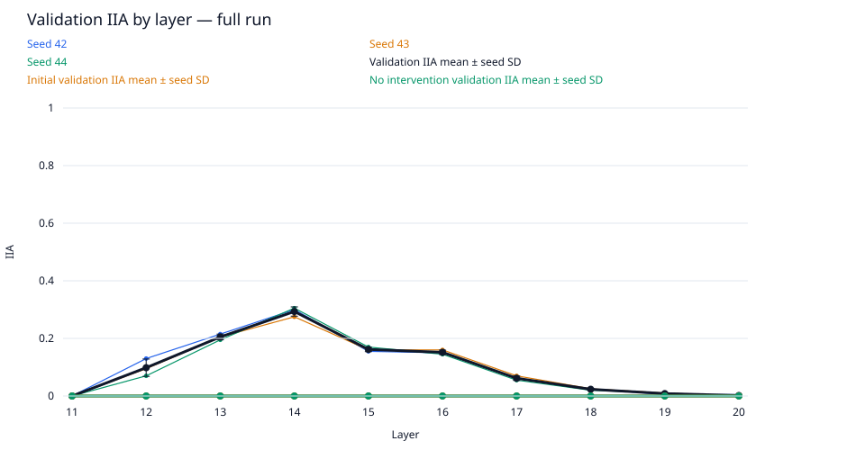
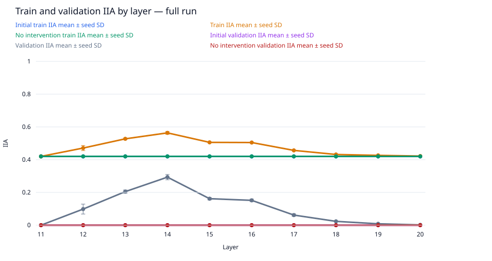
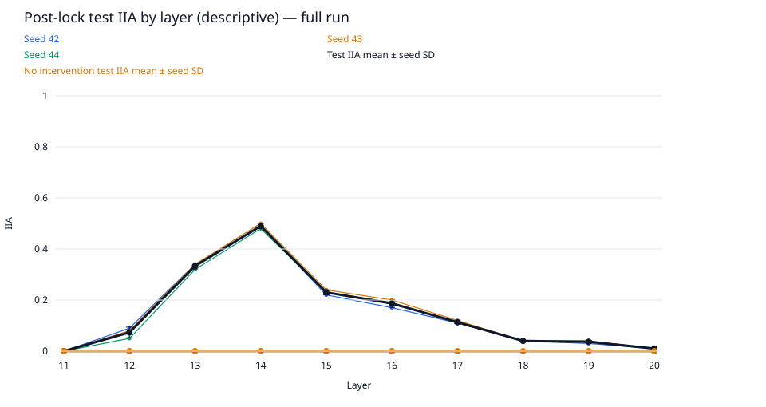
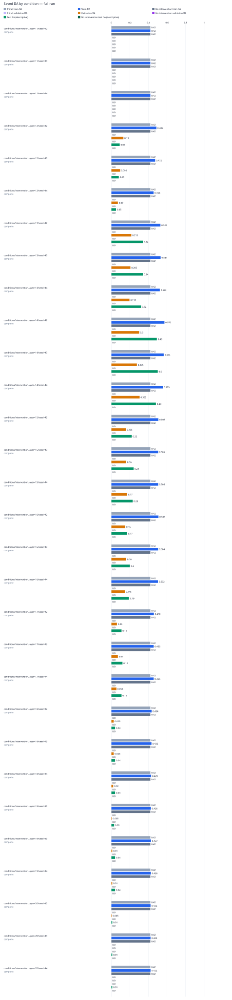

# data-scale / gpt2-medium-rank4-n1000

Run kind: **full**; run status: **complete**.

Config SHA-256: `f2ae35155dbf1020351d496b085eff7c6434eb800dfe98835598ea7bf9bc3a0c`.

Conditions: complete=30.

The legacy test set is a descriptive benchmark, previously inspected in earlier runs.
It is not an untouched held-out test.

Selected layer: **14**; metric: `validation_iia`.
The choice was locked in `selection.json` before post-lock evaluation.

| Condition | Status | Initial train IIA | Train IIA | No intervention train IIA | Initial validation IIA | Validation IIA | No intervention validation IIA | Test IIA (descriptive) | No intervention test IIA (descriptive) | Post-lock status |
| --- | --- | --- | --- | --- | --- | --- | --- | --- | --- | --- |
| conditions/intervention.layer=11/seed=42 | complete | 420/1000 = 0.42 | 420/1000 = 0.42 | 420/1000 = 0.42 | 0/200 = 0.0 | 0/200 = 0.0 | 0/200 = 0.0 | 0/100 = 0.0 | 0/100 = 0.0 | complete |
| conditions/intervention.layer=11/seed=43 | complete | 420/1000 = 0.42 | 420/1000 = 0.42 | 420/1000 = 0.42 | 0/200 = 0.0 | 0/200 = 0.0 | 0/200 = 0.0 | 0/100 = 0.0 | 0/100 = 0.0 | complete |
| conditions/intervention.layer=11/seed=44 | complete | 420/1000 = 0.42 | 420/1000 = 0.42 | 420/1000 = 0.42 | 0/200 = 0.0 | 0/200 = 0.0 | 0/200 = 0.0 | 0/100 = 0.0 | 0/100 = 0.0 | complete |
| conditions/intervention.layer=12/seed=42 | complete | 420/1000 = 0.42 | 486/1000 = 0.486 | 420/1000 = 0.42 | 0/200 = 0.0 | 26/200 = 0.13 | 0/200 = 0.0 | 9/100 = 0.09 | 0/100 = 0.0 | complete |
| conditions/intervention.layer=12/seed=43 | complete | 420/1000 = 0.42 | 472/1000 = 0.472 | 420/1000 = 0.42 | 0/200 = 0.0 | 19/200 = 0.095 | 0/200 = 0.0 | 8/100 = 0.08 | 0/100 = 0.0 | complete |
| conditions/intervention.layer=12/seed=44 | complete | 420/1000 = 0.42 | 455/1000 = 0.455 | 420/1000 = 0.42 | 0/200 = 0.0 | 14/200 = 0.07 | 0/200 = 0.0 | 5/100 = 0.05 | 0/100 = 0.0 | complete |
| conditions/intervention.layer=13/seed=42 | complete | 420/1000 = 0.42 | 529/1000 = 0.529 | 420/1000 = 0.42 | 0/200 = 0.0 | 43/200 = 0.215 | 0/200 = 0.0 | 34/100 = 0.34 | 0/100 = 0.0 | complete |
| conditions/intervention.layer=13/seed=43 | complete | 420/1000 = 0.42 | 531/1000 = 0.531 | 420/1000 = 0.42 | 0/200 = 0.0 | 41/200 = 0.205 | 0/200 = 0.0 | 34/100 = 0.34 | 0/100 = 0.0 | complete |
| conditions/intervention.layer=13/seed=44 | complete | 420/1000 = 0.42 | 522/1000 = 0.522 | 420/1000 = 0.42 | 0/200 = 0.0 | 39/200 = 0.195 | 0/200 = 0.0 | 32/100 = 0.32 | 0/100 = 0.0 | complete |
| conditions/intervention.layer=14/seed=42 | complete | 420/1000 = 0.42 | 572/1000 = 0.572 | 420/1000 = 0.42 | 0/200 = 0.0 | 60/200 = 0.3 | 0/200 = 0.0 | 49/100 = 0.49 | 0/100 = 0.0 | complete |
| conditions/intervention.layer=14/seed=43 | complete | 420/1000 = 0.42 | 564/1000 = 0.564 | 420/1000 = 0.42 | 0/200 = 0.0 | 55/200 = 0.275 | 0/200 = 0.0 | 50/100 = 0.5 | 0/100 = 0.0 | complete |
| conditions/intervention.layer=14/seed=44 | complete | 420/1000 = 0.42 | 555/1000 = 0.555 | 420/1000 = 0.42 | 0/200 = 0.0 | 61/200 = 0.305 | 0/200 = 0.0 | 48/100 = 0.48 | 0/100 = 0.0 | complete |
| conditions/intervention.layer=15/seed=42 | complete | 420/1000 = 0.42 | 507/1000 = 0.507 | 420/1000 = 0.42 | 0/200 = 0.0 | 31/200 = 0.155 | 0/200 = 0.0 | 22/100 = 0.22 | 0/100 = 0.0 | complete |
| conditions/intervention.layer=15/seed=43 | complete | 420/1000 = 0.42 | 505/1000 = 0.505 | 420/1000 = 0.42 | 0/200 = 0.0 | 32/200 = 0.16 | 0/200 = 0.0 | 24/100 = 0.24 | 0/100 = 0.0 | complete |
| conditions/intervention.layer=15/seed=44 | complete | 420/1000 = 0.42 | 505/1000 = 0.505 | 420/1000 = 0.42 | 0/200 = 0.0 | 34/200 = 0.17 | 0/200 = 0.0 | 23/100 = 0.23 | 0/100 = 0.0 | complete |
| conditions/intervention.layer=16/seed=42 | complete | 420/1000 = 0.42 | 508/1000 = 0.508 | 420/1000 = 0.42 | 0/200 = 0.0 | 30/200 = 0.15 | 0/200 = 0.0 | 17/100 = 0.17 | 0/100 = 0.0 | complete |
| conditions/intervention.layer=16/seed=43 | complete | 420/1000 = 0.42 | 504/1000 = 0.504 | 420/1000 = 0.42 | 0/200 = 0.0 | 32/200 = 0.16 | 0/200 = 0.0 | 20/100 = 0.2 | 0/100 = 0.0 | complete |
| conditions/intervention.layer=16/seed=44 | complete | 420/1000 = 0.42 | 502/1000 = 0.502 | 420/1000 = 0.42 | 0/200 = 0.0 | 29/200 = 0.145 | 0/200 = 0.0 | 19/100 = 0.19 | 0/100 = 0.0 | complete |
| conditions/intervention.layer=17/seed=42 | complete | 420/1000 = 0.42 | 458/1000 = 0.458 | 420/1000 = 0.42 | 0/200 = 0.0 | 12/200 = 0.06 | 0/200 = 0.0 | 11/100 = 0.11 | 0/100 = 0.0 | complete |
| conditions/intervention.layer=17/seed=43 | complete | 420/1000 = 0.42 | 456/1000 = 0.456 | 420/1000 = 0.42 | 0/200 = 0.0 | 14/200 = 0.07 | 0/200 = 0.0 | 12/100 = 0.12 | 0/100 = 0.0 | complete |
| conditions/intervention.layer=17/seed=44 | complete | 420/1000 = 0.42 | 456/1000 = 0.456 | 420/1000 = 0.42 | 0/200 = 0.0 | 11/200 = 0.055 | 0/200 = 0.0 | 11/100 = 0.11 | 0/100 = 0.0 | complete |
| conditions/intervention.layer=18/seed=42 | complete | 420/1000 = 0.42 | 434/1000 = 0.434 | 420/1000 = 0.42 | 0/200 = 0.0 | 5/200 = 0.025 | 0/200 = 0.0 | 4/100 = 0.04 | 0/100 = 0.0 | complete |
| conditions/intervention.layer=18/seed=43 | complete | 420/1000 = 0.42 | 432/1000 = 0.432 | 420/1000 = 0.42 | 0/200 = 0.0 | 5/200 = 0.025 | 0/200 = 0.0 | 4/100 = 0.04 | 0/100 = 0.0 | complete |
| conditions/intervention.layer=18/seed=44 | complete | 420/1000 = 0.42 | 429/1000 = 0.429 | 420/1000 = 0.42 | 0/200 = 0.0 | 4/200 = 0.02 | 0/200 = 0.0 | 4/100 = 0.04 | 0/100 = 0.0 | complete |
| conditions/intervention.layer=19/seed=42 | complete | 420/1000 = 0.42 | 426/1000 = 0.426 | 420/1000 = 0.42 | 0/200 = 0.0 | 1/200 = 0.005 | 0/200 = 0.0 | 3/100 = 0.03 | 0/100 = 0.0 | complete |
| conditions/intervention.layer=19/seed=43 | complete | 420/1000 = 0.42 | 427/1000 = 0.427 | 420/1000 = 0.42 | 0/200 = 0.0 | 2/200 = 0.01 | 0/200 = 0.0 | 4/100 = 0.04 | 0/100 = 0.0 | complete |
| conditions/intervention.layer=19/seed=44 | complete | 420/1000 = 0.42 | 426/1000 = 0.426 | 420/1000 = 0.42 | 0/200 = 0.0 | 2/200 = 0.01 | 0/200 = 0.0 | 4/100 = 0.04 | 0/100 = 0.0 | complete |
| conditions/intervention.layer=20/seed=42 | complete | 420/1000 = 0.42 | 422/1000 = 0.422 | 420/1000 = 0.42 | 0/200 = 0.0 | 1/200 = 0.005 | 0/200 = 0.0 | 1/100 = 0.01 | 0/100 = 0.0 | complete |
| conditions/intervention.layer=20/seed=43 | complete | 420/1000 = 0.42 | 422/1000 = 0.422 | 420/1000 = 0.42 | 0/200 = 0.0 | 0/200 = 0.0 | 0/200 = 0.0 | 1/100 = 0.01 | 0/100 = 0.0 | complete |
| conditions/intervention.layer=20/seed=44 | complete | 420/1000 = 0.42 | 422/1000 = 0.422 | 420/1000 = 0.42 | 0/200 = 0.0 | 0/200 = 0.0 | 0/200 = 0.0 | 1/100 = 0.01 | 0/100 = 0.0 | complete |

Full-precision metrics and exact counts are saved in `conditions.csv`.
Missing metrics are shown as —; failed and pending conditions remain in the table.

Per-layer means and sample SD across seeds are saved in `layer_summary.csv`.
Seed SD describes variation across seeds; it is not a confidence interval.
A single available seed has no sample SD. Incomplete layers are flagged in the CSV.

Per-pairing and target-change groups (counts summed across seeds; means give equal weight to each seed):

| Layer | Split | Group | IIA | No-intervention IIA |
| --- | --- | --- | --- | --- |
| 11 | initial_train | ABB->ABB | 615/750; mean 0.82 | 615/750; mean 0.82 |
| 11 | initial_train | ABB->BAB | 0/750; mean 0.0 | 0/750; mean 0.0 |
| 11 | initial_train | BAB->ABB | 0/750; mean 0.0 | 0/750; mean 0.0 |
| 11 | initial_train | BAB->BAB | 645/750; mean 0.86 | 645/750; mean 0.86 |
| 11 | initial_train | switch_required | 0/1500; mean 0.0 | 0/1500; mean 0.0 |
| 11 | initial_train | unchanged_target | 1260/1500; mean 0.84 | 1260/1500; mean 0.84 |
| 12 | initial_train | ABB->ABB | 615/750; mean 0.82 | 615/750; mean 0.82 |
| 12 | initial_train | ABB->BAB | 0/750; mean 0.0 | 0/750; mean 0.0 |
| 12 | initial_train | BAB->ABB | 0/750; mean 0.0 | 0/750; mean 0.0 |
| 12 | initial_train | BAB->BAB | 645/750; mean 0.86 | 645/750; mean 0.86 |
| 12 | initial_train | switch_required | 0/1500; mean 0.0 | 0/1500; mean 0.0 |
| 12 | initial_train | unchanged_target | 1260/1500; mean 0.84 | 1260/1500; mean 0.84 |
| 13 | initial_train | ABB->ABB | 615/750; mean 0.82 | 615/750; mean 0.82 |
| 13 | initial_train | ABB->BAB | 0/750; mean 0.0 | 0/750; mean 0.0 |
| 13 | initial_train | BAB->ABB | 0/750; mean 0.0 | 0/750; mean 0.0 |
| 13 | initial_train | BAB->BAB | 645/750; mean 0.86 | 645/750; mean 0.86 |
| 13 | initial_train | switch_required | 0/1500; mean 0.0 | 0/1500; mean 0.0 |
| 13 | initial_train | unchanged_target | 1260/1500; mean 0.84 | 1260/1500; mean 0.84 |
| 14 | initial_train | ABB->ABB | 615/750; mean 0.82 | 615/750; mean 0.82 |
| 14 | initial_train | ABB->BAB | 0/750; mean 0.0 | 0/750; mean 0.0 |
| 14 | initial_train | BAB->ABB | 0/750; mean 0.0 | 0/750; mean 0.0 |
| 14 | initial_train | BAB->BAB | 645/750; mean 0.86 | 645/750; mean 0.86 |
| 14 | initial_train | switch_required | 0/1500; mean 0.0 | 0/1500; mean 0.0 |
| 14 | initial_train | unchanged_target | 1260/1500; mean 0.84 | 1260/1500; mean 0.84 |
| 15 | initial_train | ABB->ABB | 615/750; mean 0.82 | 615/750; mean 0.82 |
| 15 | initial_train | ABB->BAB | 0/750; mean 0.0 | 0/750; mean 0.0 |
| 15 | initial_train | BAB->ABB | 0/750; mean 0.0 | 0/750; mean 0.0 |
| 15 | initial_train | BAB->BAB | 645/750; mean 0.86 | 645/750; mean 0.86 |
| 15 | initial_train | switch_required | 0/1500; mean 0.0 | 0/1500; mean 0.0 |
| 15 | initial_train | unchanged_target | 1260/1500; mean 0.84 | 1260/1500; mean 0.84 |
| 16 | initial_train | ABB->ABB | 615/750; mean 0.82 | 615/750; mean 0.82 |
| 16 | initial_train | ABB->BAB | 0/750; mean 0.0 | 0/750; mean 0.0 |
| 16 | initial_train | BAB->ABB | 0/750; mean 0.0 | 0/750; mean 0.0 |
| 16 | initial_train | BAB->BAB | 645/750; mean 0.86 | 645/750; mean 0.86 |
| 16 | initial_train | switch_required | 0/1500; mean 0.0 | 0/1500; mean 0.0 |
| 16 | initial_train | unchanged_target | 1260/1500; mean 0.84 | 1260/1500; mean 0.84 |
| 17 | initial_train | ABB->ABB | 615/750; mean 0.82 | 615/750; mean 0.82 |
| 17 | initial_train | ABB->BAB | 0/750; mean 0.0 | 0/750; mean 0.0 |
| 17 | initial_train | BAB->ABB | 0/750; mean 0.0 | 0/750; mean 0.0 |
| 17 | initial_train | BAB->BAB | 645/750; mean 0.86 | 645/750; mean 0.86 |
| 17 | initial_train | switch_required | 0/1500; mean 0.0 | 0/1500; mean 0.0 |
| 17 | initial_train | unchanged_target | 1260/1500; mean 0.84 | 1260/1500; mean 0.84 |
| 18 | initial_train | ABB->ABB | 615/750; mean 0.82 | 615/750; mean 0.82 |
| 18 | initial_train | ABB->BAB | 0/750; mean 0.0 | 0/750; mean 0.0 |
| 18 | initial_train | BAB->ABB | 0/750; mean 0.0 | 0/750; mean 0.0 |
| 18 | initial_train | BAB->BAB | 645/750; mean 0.86 | 645/750; mean 0.86 |
| 18 | initial_train | switch_required | 0/1500; mean 0.0 | 0/1500; mean 0.0 |
| 18 | initial_train | unchanged_target | 1260/1500; mean 0.84 | 1260/1500; mean 0.84 |
| 19 | initial_train | ABB->ABB | 615/750; mean 0.82 | 615/750; mean 0.82 |
| 19 | initial_train | ABB->BAB | 0/750; mean 0.0 | 0/750; mean 0.0 |
| 19 | initial_train | BAB->ABB | 0/750; mean 0.0 | 0/750; mean 0.0 |
| 19 | initial_train | BAB->BAB | 645/750; mean 0.86 | 645/750; mean 0.86 |
| 19 | initial_train | switch_required | 0/1500; mean 0.0 | 0/1500; mean 0.0 |
| 19 | initial_train | unchanged_target | 1260/1500; mean 0.84 | 1260/1500; mean 0.84 |
| 20 | initial_train | ABB->ABB | 615/750; mean 0.82 | 615/750; mean 0.82 |
| 20 | initial_train | ABB->BAB | 0/750; mean 0.0 | 0/750; mean 0.0 |
| 20 | initial_train | BAB->ABB | 0/750; mean 0.0 | 0/750; mean 0.0 |
| 20 | initial_train | BAB->BAB | 645/750; mean 0.86 | 645/750; mean 0.86 |
| 20 | initial_train | switch_required | 0/1500; mean 0.0 | 0/1500; mean 0.0 |
| 20 | initial_train | unchanged_target | 1260/1500; mean 0.84 | 1260/1500; mean 0.84 |
| 11 | train | ABB->ABB | 615/750; mean 0.82 | 615/750; mean 0.82 |
| 11 | train | ABB->BAB | 0/750; mean 0.0 | 0/750; mean 0.0 |
| 11 | train | BAB->ABB | 0/750; mean 0.0 | 0/750; mean 0.0 |
| 11 | train | BAB->BAB | 645/750; mean 0.86 | 645/750; mean 0.86 |
| 11 | train | switch_required | 0/1500; mean 0.0 | 0/1500; mean 0.0 |
| 11 | train | unchanged_target | 1260/1500; mean 0.84 | 1260/1500; mean 0.84 |
| 12 | train | ABB->ABB | 615/750; mean 0.82 | 615/750; mean 0.82 |
| 12 | train | ABB->BAB | 6/750; mean 0.008 | 0/750; mean 0.0 |
| 12 | train | BAB->ABB | 147/750; mean 0.196 | 0/750; mean 0.0 |
| 12 | train | BAB->BAB | 645/750; mean 0.86 | 645/750; mean 0.86 |
| 12 | train | switch_required | 153/1500; mean 0.10200000000000001 | 0/1500; mean 0.0 |
| 12 | train | unchanged_target | 1260/1500; mean 0.84 | 1260/1500; mean 0.84 |
| 13 | train | ABB->ABB | 615/750; mean 0.82 | 615/750; mean 0.82 |
| 13 | train | ABB->BAB | 53/750; mean 0.07066666666666667 | 0/750; mean 0.0 |
| 13 | train | BAB->ABB | 269/750; mean 0.3586666666666667 | 0/750; mean 0.0 |
| 13 | train | BAB->BAB | 645/750; mean 0.86 | 645/750; mean 0.86 |
| 13 | train | switch_required | 322/1500; mean 0.21466666666666667 | 0/1500; mean 0.0 |
| 13 | train | unchanged_target | 1260/1500; mean 0.84 | 1260/1500; mean 0.84 |
| 14 | train | ABB->ABB | 615/750; mean 0.82 | 615/750; mean 0.82 |
| 14 | train | ABB->BAB | 129/750; mean 0.172 | 0/750; mean 0.0 |
| 14 | train | BAB->ABB | 302/750; mean 0.4026666666666667 | 0/750; mean 0.0 |
| 14 | train | BAB->BAB | 645/750; mean 0.86 | 645/750; mean 0.86 |
| 14 | train | switch_required | 431/1500; mean 0.28733333333333333 | 0/1500; mean 0.0 |
| 14 | train | unchanged_target | 1260/1500; mean 0.84 | 1260/1500; mean 0.84 |
| 15 | train | ABB->ABB | 615/750; mean 0.82 | 615/750; mean 0.82 |
| 15 | train | ABB->BAB | 90/750; mean 0.12 | 0/750; mean 0.0 |
| 15 | train | BAB->ABB | 167/750; mean 0.22266666666666665 | 0/750; mean 0.0 |
| 15 | train | BAB->BAB | 645/750; mean 0.86 | 645/750; mean 0.86 |
| 15 | train | switch_required | 257/1500; mean 0.17133333333333334 | 0/1500; mean 0.0 |
| 15 | train | unchanged_target | 1260/1500; mean 0.84 | 1260/1500; mean 0.84 |
| 16 | train | ABB->ABB | 615/750; mean 0.82 | 615/750; mean 0.82 |
| 16 | train | ABB->BAB | 100/750; mean 0.13333333333333333 | 0/750; mean 0.0 |
| 16 | train | BAB->ABB | 154/750; mean 0.20533333333333334 | 0/750; mean 0.0 |
| 16 | train | BAB->BAB | 645/750; mean 0.86 | 645/750; mean 0.86 |
| 16 | train | switch_required | 254/1500; mean 0.16933333333333334 | 0/1500; mean 0.0 |
| 16 | train | unchanged_target | 1260/1500; mean 0.84 | 1260/1500; mean 0.84 |
| 17 | train | ABB->ABB | 615/750; mean 0.82 | 615/750; mean 0.82 |
| 17 | train | ABB->BAB | 45/750; mean 0.060000000000000005 | 0/750; mean 0.0 |
| 17 | train | BAB->ABB | 65/750; mean 0.08666666666666667 | 0/750; mean 0.0 |
| 17 | train | BAB->BAB | 645/750; mean 0.86 | 645/750; mean 0.86 |
| 17 | train | switch_required | 110/1500; mean 0.07333333333333333 | 0/1500; mean 0.0 |
| 17 | train | unchanged_target | 1260/1500; mean 0.84 | 1260/1500; mean 0.84 |
| 18 | train | ABB->ABB | 615/750; mean 0.82 | 615/750; mean 0.82 |
| 18 | train | ABB->BAB | 15/750; mean 0.02 | 0/750; mean 0.0 |
| 18 | train | BAB->ABB | 20/750; mean 0.02666666666666667 | 0/750; mean 0.0 |
| 18 | train | BAB->BAB | 645/750; mean 0.86 | 645/750; mean 0.86 |
| 18 | train | switch_required | 35/1500; mean 0.023333333333333334 | 0/1500; mean 0.0 |
| 18 | train | unchanged_target | 1260/1500; mean 0.84 | 1260/1500; mean 0.84 |
| 19 | train | ABB->ABB | 615/750; mean 0.82 | 615/750; mean 0.82 |
| 19 | train | ABB->BAB | 8/750; mean 0.010666666666666666 | 0/750; mean 0.0 |
| 19 | train | BAB->ABB | 11/750; mean 0.014666666666666666 | 0/750; mean 0.0 |
| 19 | train | BAB->BAB | 645/750; mean 0.86 | 645/750; mean 0.86 |
| 19 | train | switch_required | 19/1500; mean 0.012666666666666666 | 0/1500; mean 0.0 |
| 19 | train | unchanged_target | 1260/1500; mean 0.84 | 1260/1500; mean 0.84 |
| 20 | train | ABB->ABB | 615/750; mean 0.82 | 615/750; mean 0.82 |
| 20 | train | ABB->BAB | 2/750; mean 0.0026666666666666666 | 0/750; mean 0.0 |
| 20 | train | BAB->ABB | 4/750; mean 0.005333333333333333 | 0/750; mean 0.0 |
| 20 | train | BAB->BAB | 645/750; mean 0.86 | 645/750; mean 0.86 |
| 20 | train | switch_required | 6/1500; mean 0.004 | 0/1500; mean 0.0 |
| 20 | train | unchanged_target | 1260/1500; mean 0.84 | 1260/1500; mean 0.84 |
| 11 | initial_validation | ABB->ABB | 0/0; mean — | 0/0; mean — |
| 11 | initial_validation | ABB->BAB | 0/300; mean 0.0 | 0/300; mean 0.0 |
| 11 | initial_validation | BAB->ABB | 0/300; mean 0.0 | 0/300; mean 0.0 |
| 11 | initial_validation | BAB->BAB | 0/0; mean — | 0/0; mean — |
| 11 | initial_validation | switch_required | 0/600; mean 0.0 | 0/600; mean 0.0 |
| 11 | initial_validation | unchanged_target | 0/0; mean — | 0/0; mean — |
| 12 | initial_validation | ABB->ABB | 0/0; mean — | 0/0; mean — |
| 12 | initial_validation | ABB->BAB | 0/300; mean 0.0 | 0/300; mean 0.0 |
| 12 | initial_validation | BAB->ABB | 0/300; mean 0.0 | 0/300; mean 0.0 |
| 12 | initial_validation | BAB->BAB | 0/0; mean — | 0/0; mean — |
| 12 | initial_validation | switch_required | 0/600; mean 0.0 | 0/600; mean 0.0 |
| 12 | initial_validation | unchanged_target | 0/0; mean — | 0/0; mean — |
| 13 | initial_validation | ABB->ABB | 0/0; mean — | 0/0; mean — |
| 13 | initial_validation | ABB->BAB | 0/300; mean 0.0 | 0/300; mean 0.0 |
| 13 | initial_validation | BAB->ABB | 0/300; mean 0.0 | 0/300; mean 0.0 |
| 13 | initial_validation | BAB->BAB | 0/0; mean — | 0/0; mean — |
| 13 | initial_validation | switch_required | 0/600; mean 0.0 | 0/600; mean 0.0 |
| 13 | initial_validation | unchanged_target | 0/0; mean — | 0/0; mean — |
| 14 | initial_validation | ABB->ABB | 0/0; mean — | 0/0; mean — |
| 14 | initial_validation | ABB->BAB | 0/300; mean 0.0 | 0/300; mean 0.0 |
| 14 | initial_validation | BAB->ABB | 0/300; mean 0.0 | 0/300; mean 0.0 |
| 14 | initial_validation | BAB->BAB | 0/0; mean — | 0/0; mean — |
| 14 | initial_validation | switch_required | 0/600; mean 0.0 | 0/600; mean 0.0 |
| 14 | initial_validation | unchanged_target | 0/0; mean — | 0/0; mean — |
| 15 | initial_validation | ABB->ABB | 0/0; mean — | 0/0; mean — |
| 15 | initial_validation | ABB->BAB | 0/300; mean 0.0 | 0/300; mean 0.0 |
| 15 | initial_validation | BAB->ABB | 0/300; mean 0.0 | 0/300; mean 0.0 |
| 15 | initial_validation | BAB->BAB | 0/0; mean — | 0/0; mean — |
| 15 | initial_validation | switch_required | 0/600; mean 0.0 | 0/600; mean 0.0 |
| 15 | initial_validation | unchanged_target | 0/0; mean — | 0/0; mean — |
| 16 | initial_validation | ABB->ABB | 0/0; mean — | 0/0; mean — |
| 16 | initial_validation | ABB->BAB | 0/300; mean 0.0 | 0/300; mean 0.0 |
| 16 | initial_validation | BAB->ABB | 0/300; mean 0.0 | 0/300; mean 0.0 |
| 16 | initial_validation | BAB->BAB | 0/0; mean — | 0/0; mean — |
| 16 | initial_validation | switch_required | 0/600; mean 0.0 | 0/600; mean 0.0 |
| 16 | initial_validation | unchanged_target | 0/0; mean — | 0/0; mean — |
| 17 | initial_validation | ABB->ABB | 0/0; mean — | 0/0; mean — |
| 17 | initial_validation | ABB->BAB | 0/300; mean 0.0 | 0/300; mean 0.0 |
| 17 | initial_validation | BAB->ABB | 0/300; mean 0.0 | 0/300; mean 0.0 |
| 17 | initial_validation | BAB->BAB | 0/0; mean — | 0/0; mean — |
| 17 | initial_validation | switch_required | 0/600; mean 0.0 | 0/600; mean 0.0 |
| 17 | initial_validation | unchanged_target | 0/0; mean — | 0/0; mean — |
| 18 | initial_validation | ABB->ABB | 0/0; mean — | 0/0; mean — |
| 18 | initial_validation | ABB->BAB | 0/300; mean 0.0 | 0/300; mean 0.0 |
| 18 | initial_validation | BAB->ABB | 0/300; mean 0.0 | 0/300; mean 0.0 |
| 18 | initial_validation | BAB->BAB | 0/0; mean — | 0/0; mean — |
| 18 | initial_validation | switch_required | 0/600; mean 0.0 | 0/600; mean 0.0 |
| 18 | initial_validation | unchanged_target | 0/0; mean — | 0/0; mean — |
| 19 | initial_validation | ABB->ABB | 0/0; mean — | 0/0; mean — |
| 19 | initial_validation | ABB->BAB | 0/300; mean 0.0 | 0/300; mean 0.0 |
| 19 | initial_validation | BAB->ABB | 0/300; mean 0.0 | 0/300; mean 0.0 |
| 19 | initial_validation | BAB->BAB | 0/0; mean — | 0/0; mean — |
| 19 | initial_validation | switch_required | 0/600; mean 0.0 | 0/600; mean 0.0 |
| 19 | initial_validation | unchanged_target | 0/0; mean — | 0/0; mean — |
| 20 | initial_validation | ABB->ABB | 0/0; mean — | 0/0; mean — |
| 20 | initial_validation | ABB->BAB | 0/300; mean 0.0 | 0/300; mean 0.0 |
| 20 | initial_validation | BAB->ABB | 0/300; mean 0.0 | 0/300; mean 0.0 |
| 20 | initial_validation | BAB->BAB | 0/0; mean — | 0/0; mean — |
| 20 | initial_validation | switch_required | 0/600; mean 0.0 | 0/600; mean 0.0 |
| 20 | initial_validation | unchanged_target | 0/0; mean — | 0/0; mean — |
| 11 | validation | ABB->ABB | 0/0; mean — | 0/0; mean — |
| 11 | validation | ABB->BAB | 0/300; mean 0.0 | 0/300; mean 0.0 |
| 11 | validation | BAB->ABB | 0/300; mean 0.0 | 0/300; mean 0.0 |
| 11 | validation | BAB->BAB | 0/0; mean — | 0/0; mean — |
| 11 | validation | switch_required | 0/600; mean 0.0 | 0/600; mean 0.0 |
| 11 | validation | unchanged_target | 0/0; mean — | 0/0; mean — |
| 12 | validation | ABB->ABB | 0/0; mean — | 0/0; mean — |
| 12 | validation | ABB->BAB | 3/300; mean 0.01 | 0/300; mean 0.0 |
| 12 | validation | BAB->ABB | 56/300; mean 0.18666666666666668 | 0/300; mean 0.0 |
| 12 | validation | BAB->BAB | 0/0; mean — | 0/0; mean — |
| 12 | validation | switch_required | 59/600; mean 0.09833333333333334 | 0/600; mean 0.0 |
| 12 | validation | unchanged_target | 0/0; mean — | 0/0; mean — |
| 13 | validation | ABB->ABB | 0/0; mean — | 0/0; mean — |
| 13 | validation | ABB->BAB | 27/300; mean 0.09 | 0/300; mean 0.0 |
| 13 | validation | BAB->ABB | 96/300; mean 0.32 | 0/300; mean 0.0 |
| 13 | validation | BAB->BAB | 0/0; mean — | 0/0; mean — |
| 13 | validation | switch_required | 123/600; mean 0.205 | 0/600; mean 0.0 |
| 13 | validation | unchanged_target | 0/0; mean — | 0/0; mean — |
| 14 | validation | ABB->ABB | 0/0; mean — | 0/0; mean — |
| 14 | validation | ABB->BAB | 63/300; mean 0.21 | 0/300; mean 0.0 |
| 14 | validation | BAB->ABB | 113/300; mean 0.3766666666666667 | 0/300; mean 0.0 |
| 14 | validation | BAB->BAB | 0/0; mean — | 0/0; mean — |
| 14 | validation | switch_required | 176/600; mean 0.29333333333333333 | 0/600; mean 0.0 |
| 14 | validation | unchanged_target | 0/0; mean — | 0/0; mean — |
| 15 | validation | ABB->ABB | 0/0; mean — | 0/0; mean — |
| 15 | validation | ABB->BAB | 41/300; mean 0.13666666666666666 | 0/300; mean 0.0 |
| 15 | validation | BAB->ABB | 56/300; mean 0.18666666666666668 | 0/300; mean 0.0 |
| 15 | validation | BAB->BAB | 0/0; mean — | 0/0; mean — |
| 15 | validation | switch_required | 97/600; mean 0.16166666666666668 | 0/600; mean 0.0 |
| 15 | validation | unchanged_target | 0/0; mean — | 0/0; mean — |
| 16 | validation | ABB->ABB | 0/0; mean — | 0/0; mean — |
| 16 | validation | ABB->BAB | 36/300; mean 0.12 | 0/300; mean 0.0 |
| 16 | validation | BAB->ABB | 55/300; mean 0.18333333333333335 | 0/300; mean 0.0 |
| 16 | validation | BAB->BAB | 0/0; mean — | 0/0; mean — |
| 16 | validation | switch_required | 91/600; mean 0.15166666666666667 | 0/600; mean 0.0 |
| 16 | validation | unchanged_target | 0/0; mean — | 0/0; mean — |
| 17 | validation | ABB->ABB | 0/0; mean — | 0/0; mean — |
| 17 | validation | ABB->BAB | 11/300; mean 0.03666666666666667 | 0/300; mean 0.0 |
| 17 | validation | BAB->ABB | 26/300; mean 0.08666666666666667 | 0/300; mean 0.0 |
| 17 | validation | BAB->BAB | 0/0; mean — | 0/0; mean — |
| 17 | validation | switch_required | 37/600; mean 0.06166666666666667 | 0/600; mean 0.0 |
| 17 | validation | unchanged_target | 0/0; mean — | 0/0; mean — |
| 18 | validation | ABB->ABB | 0/0; mean — | 0/0; mean — |
| 18 | validation | ABB->BAB | 6/300; mean 0.02 | 0/300; mean 0.0 |
| 18 | validation | BAB->ABB | 8/300; mean 0.026666666666666665 | 0/300; mean 0.0 |
| 18 | validation | BAB->BAB | 0/0; mean — | 0/0; mean — |
| 18 | validation | switch_required | 14/600; mean 0.023333333333333334 | 0/600; mean 0.0 |
| 18 | validation | unchanged_target | 0/0; mean — | 0/0; mean — |
| 19 | validation | ABB->ABB | 0/0; mean — | 0/0; mean — |
| 19 | validation | ABB->BAB | 2/300; mean 0.006666666666666667 | 0/300; mean 0.0 |
| 19 | validation | BAB->ABB | 3/300; mean 0.01 | 0/300; mean 0.0 |
| 19 | validation | BAB->BAB | 0/0; mean — | 0/0; mean — |
| 19 | validation | switch_required | 5/600; mean 0.008333333333333333 | 0/600; mean 0.0 |
| 19 | validation | unchanged_target | 0/0; mean — | 0/0; mean — |
| 20 | validation | ABB->ABB | 0/0; mean — | 0/0; mean — |
| 20 | validation | ABB->BAB | 1/300; mean 0.0033333333333333335 | 0/300; mean 0.0 |
| 20 | validation | BAB->ABB | 0/300; mean 0.0 | 0/300; mean 0.0 |
| 20 | validation | BAB->BAB | 0/0; mean — | 0/0; mean — |
| 20 | validation | switch_required | 1/600; mean 0.0016666666666666668 | 0/600; mean 0.0 |
| 20 | validation | unchanged_target | 0/0; mean — | 0/0; mean — |
| 11 | test | ABB->ABB | 0/0; mean — | 0/0; mean — |
| 11 | test | ABB->BAB | 0/150; mean 0.0 | 0/150; mean 0.0 |
| 11 | test | BAB->ABB | 0/150; mean 0.0 | 0/150; mean 0.0 |
| 11 | test | BAB->BAB | 0/0; mean — | 0/0; mean — |
| 11 | test | switch_required | 0/300; mean 0.0 | 0/300; mean 0.0 |
| 11 | test | unchanged_target | 0/0; mean — | 0/0; mean — |
| 12 | test | ABB->ABB | 0/0; mean — | 0/0; mean — |
| 12 | test | ABB->BAB | 2/150; mean 0.013333333333333334 | 0/150; mean 0.0 |
| 12 | test | BAB->ABB | 20/150; mean 0.13333333333333333 | 0/150; mean 0.0 |
| 12 | test | BAB->BAB | 0/0; mean — | 0/0; mean — |
| 12 | test | switch_required | 22/300; mean 0.07333333333333333 | 0/300; mean 0.0 |
| 12 | test | unchanged_target | 0/0; mean — | 0/0; mean — |
| 13 | test | ABB->ABB | 0/0; mean — | 0/0; mean — |
| 13 | test | ABB->BAB | 25/150; mean 0.16666666666666666 | 0/150; mean 0.0 |
| 13 | test | BAB->ABB | 75/150; mean 0.5 | 0/150; mean 0.0 |
| 13 | test | BAB->BAB | 0/0; mean — | 0/0; mean — |
| 13 | test | switch_required | 100/300; mean 0.33333333333333337 | 0/300; mean 0.0 |
| 13 | test | unchanged_target | 0/0; mean — | 0/0; mean — |
| 14 | test | ABB->ABB | 0/0; mean — | 0/0; mean — |
| 14 | test | ABB->BAB | 55/150; mean 0.36666666666666664 | 0/150; mean 0.0 |
| 14 | test | BAB->ABB | 92/150; mean 0.6133333333333333 | 0/150; mean 0.0 |
| 14 | test | BAB->BAB | 0/0; mean — | 0/0; mean — |
| 14 | test | switch_required | 147/300; mean 0.49 | 0/300; mean 0.0 |
| 14 | test | unchanged_target | 0/0; mean — | 0/0; mean — |
| 15 | test | ABB->ABB | 0/0; mean — | 0/0; mean — |
| 15 | test | ABB->BAB | 38/150; mean 0.25333333333333335 | 0/150; mean 0.0 |
| 15 | test | BAB->ABB | 31/150; mean 0.20666666666666667 | 0/150; mean 0.0 |
| 15 | test | BAB->BAB | 0/0; mean — | 0/0; mean — |
| 15 | test | switch_required | 69/300; mean 0.23 | 0/300; mean 0.0 |
| 15 | test | unchanged_target | 0/0; mean — | 0/0; mean — |
| 16 | test | ABB->ABB | 0/0; mean — | 0/0; mean — |
| 16 | test | ABB->BAB | 37/150; mean 0.24666666666666667 | 0/150; mean 0.0 |
| 16 | test | BAB->ABB | 19/150; mean 0.12666666666666668 | 0/150; mean 0.0 |
| 16 | test | BAB->BAB | 0/0; mean — | 0/0; mean — |
| 16 | test | switch_required | 56/300; mean 0.18666666666666668 | 0/300; mean 0.0 |
| 16 | test | unchanged_target | 0/0; mean — | 0/0; mean — |
| 17 | test | ABB->ABB | 0/0; mean — | 0/0; mean — |
| 17 | test | ABB->BAB | 22/150; mean 0.14666666666666667 | 0/150; mean 0.0 |
| 17 | test | BAB->ABB | 12/150; mean 0.08 | 0/150; mean 0.0 |
| 17 | test | BAB->BAB | 0/0; mean — | 0/0; mean — |
| 17 | test | switch_required | 34/300; mean 0.11333333333333333 | 0/300; mean 0.0 |
| 17 | test | unchanged_target | 0/0; mean — | 0/0; mean — |
| 18 | test | ABB->ABB | 0/0; mean — | 0/0; mean — |
| 18 | test | ABB->BAB | 9/150; mean 0.06 | 0/150; mean 0.0 |
| 18 | test | BAB->ABB | 3/150; mean 0.02 | 0/150; mean 0.0 |
| 18 | test | BAB->BAB | 0/0; mean — | 0/0; mean — |
| 18 | test | switch_required | 12/300; mean 0.04 | 0/300; mean 0.0 |
| 18 | test | unchanged_target | 0/0; mean — | 0/0; mean — |
| 19 | test | ABB->ABB | 0/0; mean — | 0/0; mean — |
| 19 | test | ABB->BAB | 8/150; mean 0.05333333333333333 | 0/150; mean 0.0 |
| 19 | test | BAB->ABB | 3/150; mean 0.02 | 0/150; mean 0.0 |
| 19 | test | BAB->BAB | 0/0; mean — | 0/0; mean — |
| 19 | test | switch_required | 11/300; mean 0.03666666666666667 | 0/300; mean 0.0 |
| 19 | test | unchanged_target | 0/0; mean — | 0/0; mean — |
| 20 | test | ABB->ABB | 0/0; mean — | 0/0; mean — |
| 20 | test | ABB->BAB | 0/150; mean 0.0 | 0/150; mean 0.0 |
| 20 | test | BAB->ABB | 3/150; mean 0.02 | 0/150; mean 0.0 |
| 20 | test | BAB->BAB | 0/0; mean — | 0/0; mean — |
| 20 | test | switch_required | 3/300; mean 0.01 | 0/300; mean 0.0 |
| 20 | test | unchanged_target | 0/0; mean — | 0/0; mean — |

