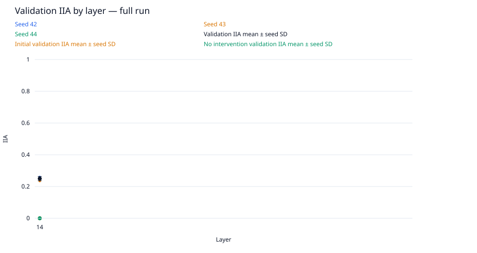
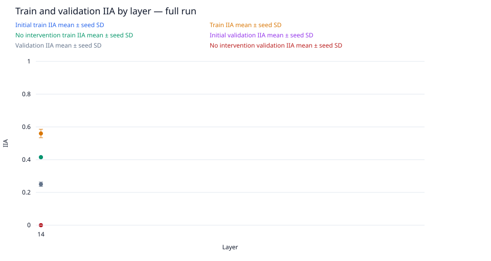
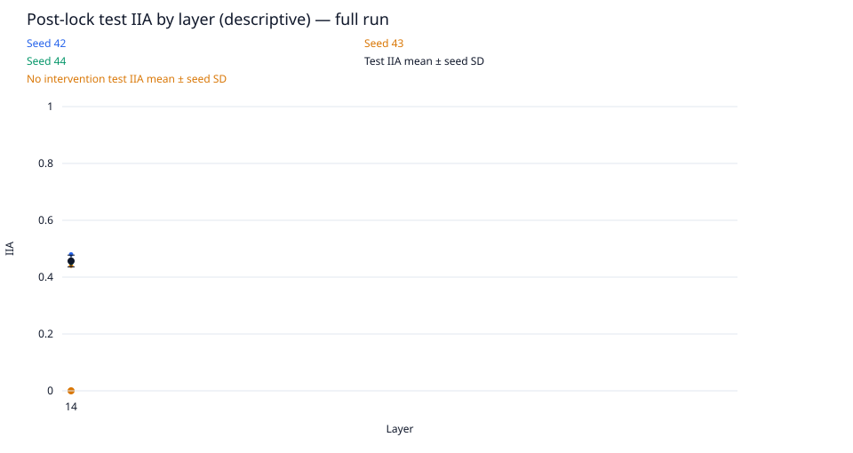
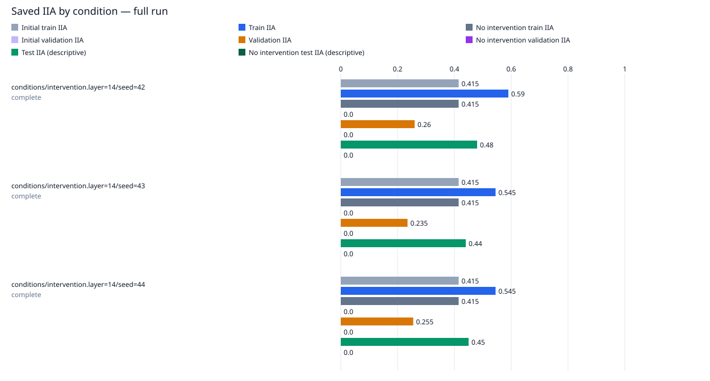

# data-scale / gpt2-medium-rank4-n200-updates2500

Run kind: **full**; run status: **complete**.

Config SHA-256: `e98ba1281d2cdd2755405d33cb39f0289eb23a7c7b95bd5f5cb8ce65261e152d`.

Conditions: complete=3.

The legacy test set is a descriptive benchmark, previously inspected in earlier runs.
It is not an untouched held-out test.

Selected layer: **14**; metric: `validation_iia`.
The choice was locked in `selection.json` before post-lock evaluation.

| Condition | Status | Initial train IIA | Train IIA | No intervention train IIA | Initial validation IIA | Validation IIA | No intervention validation IIA | Test IIA (descriptive) | No intervention test IIA (descriptive) | Post-lock status |
| --- | --- | --- | --- | --- | --- | --- | --- | --- | --- | --- |
| conditions/intervention.layer=14/seed=42 | complete | 83/200 = 0.415 | 118/200 = 0.59 | 83/200 = 0.415 | 0/200 = 0.0 | 52/200 = 0.26 | 0/200 = 0.0 | 48/100 = 0.48 | 0/100 = 0.0 | complete |
| conditions/intervention.layer=14/seed=43 | complete | 83/200 = 0.415 | 109/200 = 0.545 | 83/200 = 0.415 | 0/200 = 0.0 | 47/200 = 0.235 | 0/200 = 0.0 | 44/100 = 0.44 | 0/100 = 0.0 | complete |
| conditions/intervention.layer=14/seed=44 | complete | 83/200 = 0.415 | 109/200 = 0.545 | 83/200 = 0.415 | 0/200 = 0.0 | 51/200 = 0.255 | 0/200 = 0.0 | 45/100 = 0.45 | 0/100 = 0.0 | complete |

Full-precision metrics and exact counts are saved in `conditions.csv`.
Missing metrics are shown as —; failed and pending conditions remain in the table.

Per-layer means and sample SD across seeds are saved in `layer_summary.csv`.
Seed SD describes variation across seeds; it is not a confidence interval.
A single available seed has no sample SD. Incomplete layers are flagged in the CSV.

Per-pairing and target-change groups (counts summed across seeds; means give equal weight to each seed):

| Layer | Split | Group | IIA | No-intervention IIA |
| --- | --- | --- | --- | --- |
| 14 | initial_train | ABB->ABB | 114/150; mean 0.76 | 114/150; mean 0.76 |
| 14 | initial_train | ABB->BAB | 0/150; mean 0.0 | 0/150; mean 0.0 |
| 14 | initial_train | BAB->ABB | 0/150; mean 0.0 | 0/150; mean 0.0 |
| 14 | initial_train | BAB->BAB | 135/150; mean 0.9 | 135/150; mean 0.9 |
| 14 | initial_train | switch_required | 0/300; mean 0.0 | 0/300; mean 0.0 |
| 14 | initial_train | unchanged_target | 249/300; mean 0.83 | 249/300; mean 0.83 |
| 14 | train | ABB->ABB | 114/150; mean 0.76 | 114/150; mean 0.76 |
| 14 | train | ABB->BAB | 33/150; mean 0.22 | 0/150; mean 0.0 |
| 14 | train | BAB->ABB | 54/150; mean 0.36000000000000004 | 0/150; mean 0.0 |
| 14 | train | BAB->BAB | 135/150; mean 0.9 | 135/150; mean 0.9 |
| 14 | train | switch_required | 87/300; mean 0.29 | 0/300; mean 0.0 |
| 14 | train | unchanged_target | 249/300; mean 0.83 | 249/300; mean 0.83 |
| 14 | initial_validation | ABB->ABB | 0/0; mean — | 0/0; mean — |
| 14 | initial_validation | ABB->BAB | 0/300; mean 0.0 | 0/300; mean 0.0 |
| 14 | initial_validation | BAB->ABB | 0/300; mean 0.0 | 0/300; mean 0.0 |
| 14 | initial_validation | BAB->BAB | 0/0; mean — | 0/0; mean — |
| 14 | initial_validation | switch_required | 0/600; mean 0.0 | 0/600; mean 0.0 |
| 14 | initial_validation | unchanged_target | 0/0; mean — | 0/0; mean — |
| 14 | validation | ABB->ABB | 0/0; mean — | 0/0; mean — |
| 14 | validation | ABB->BAB | 75/300; mean 0.25 | 0/300; mean 0.0 |
| 14 | validation | BAB->ABB | 75/300; mean 0.25 | 0/300; mean 0.0 |
| 14 | validation | BAB->BAB | 0/0; mean — | 0/0; mean — |
| 14 | validation | switch_required | 150/600; mean 0.25 | 0/600; mean 0.0 |
| 14 | validation | unchanged_target | 0/0; mean — | 0/0; mean — |
| 14 | test | ABB->ABB | 0/0; mean — | 0/0; mean — |
| 14 | test | ABB->BAB | 74/150; mean 0.49333333333333335 | 0/150; mean 0.0 |
| 14 | test | BAB->ABB | 63/150; mean 0.42 | 0/150; mean 0.0 |
| 14 | test | BAB->BAB | 0/0; mean — | 0/0; mean — |
| 14 | test | switch_required | 137/300; mean 0.45666666666666667 | 0/300; mean 0.0 |
| 14 | test | unchanged_target | 0/0; mean — | 0/0; mean — |

