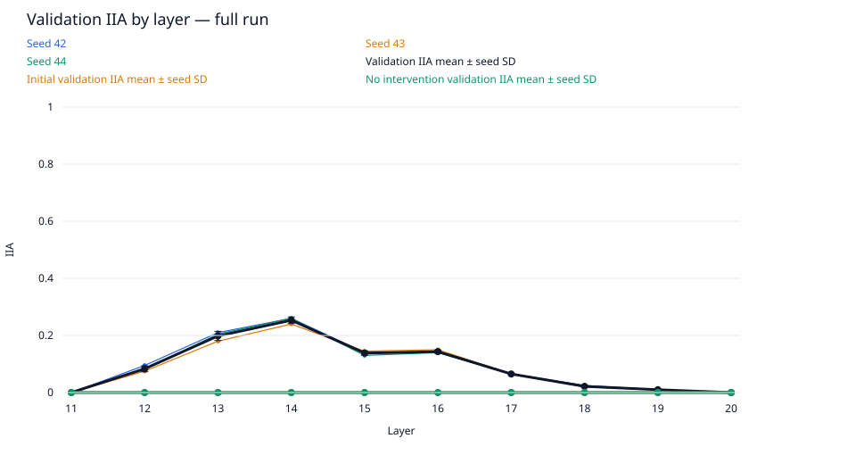
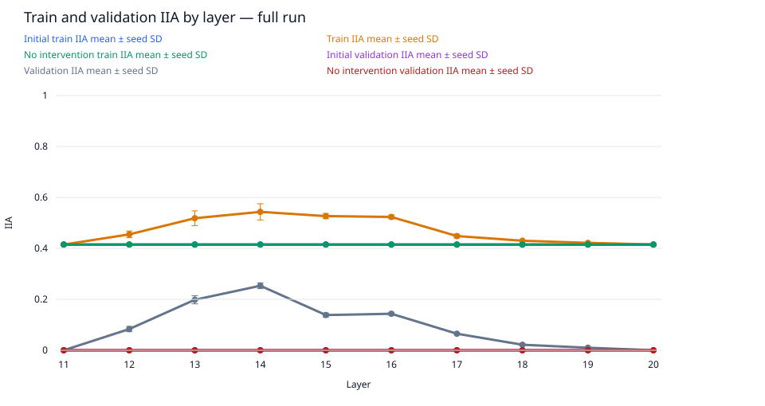
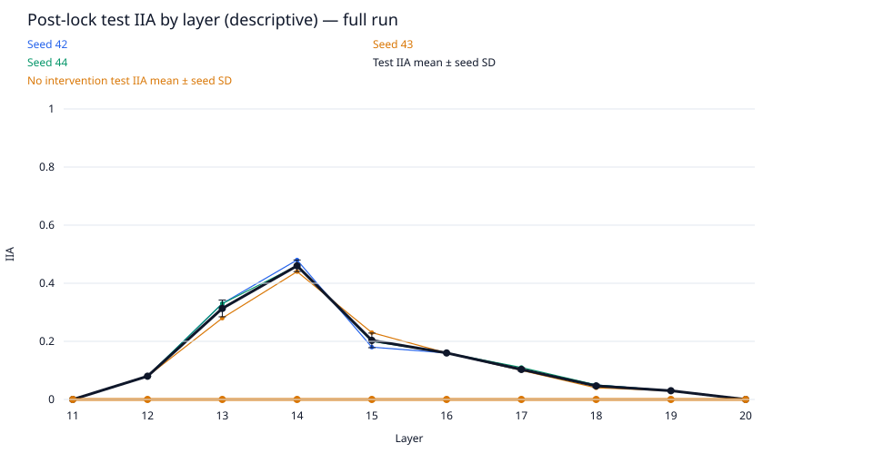
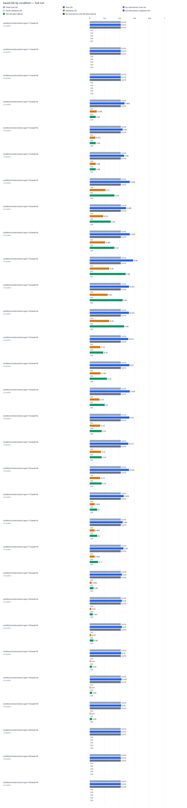

# data-scale / gpt2-medium-rank4-n200

Run kind: **full**; run status: **complete**.

Config SHA-256: `a4b008a8b41c5dd0f87587395d21c39b59a7d211e711819f3c29d2da9aa65b33`.

Conditions: complete=30.

The legacy test set is a descriptive benchmark, previously inspected in earlier runs.
It is not an untouched held-out test.

Selected layer: **14**; metric: `validation_iia`.
The choice was locked in `selection.json` before post-lock evaluation.

| Condition | Status | Initial train IIA | Train IIA | No intervention train IIA | Initial validation IIA | Validation IIA | No intervention validation IIA | Test IIA (descriptive) | No intervention test IIA (descriptive) | Post-lock status |
| --- | --- | --- | --- | --- | --- | --- | --- | --- | --- | --- |
| conditions/intervention.layer=11/seed=42 | complete | 83/200 = 0.415 | 83/200 = 0.415 | 83/200 = 0.415 | 0/200 = 0.0 | 0/200 = 0.0 | 0/200 = 0.0 | 0/100 = 0.0 | 0/100 = 0.0 | complete |
| conditions/intervention.layer=11/seed=43 | complete | 83/200 = 0.415 | 83/200 = 0.415 | 83/200 = 0.415 | 0/200 = 0.0 | 0/200 = 0.0 | 0/200 = 0.0 | 0/100 = 0.0 | 0/100 = 0.0 | complete |
| conditions/intervention.layer=11/seed=44 | complete | 83/200 = 0.415 | 83/200 = 0.415 | 83/200 = 0.415 | 0/200 = 0.0 | 0/200 = 0.0 | 0/200 = 0.0 | 0/100 = 0.0 | 0/100 = 0.0 | complete |
| conditions/intervention.layer=12/seed=42 | complete | 83/200 = 0.415 | 93/200 = 0.465 | 83/200 = 0.415 | 0/200 = 0.0 | 19/200 = 0.095 | 0/200 = 0.0 | 8/100 = 0.08 | 0/100 = 0.0 | complete |
| conditions/intervention.layer=12/seed=43 | complete | 83/200 = 0.415 | 88/200 = 0.44 | 83/200 = 0.415 | 0/200 = 0.0 | 15/200 = 0.075 | 0/200 = 0.0 | 8/100 = 0.08 | 0/100 = 0.0 | complete |
| conditions/intervention.layer=12/seed=44 | complete | 83/200 = 0.415 | 92/200 = 0.46 | 83/200 = 0.415 | 0/200 = 0.0 | 16/200 = 0.08 | 0/200 = 0.0 | 8/100 = 0.08 | 0/100 = 0.0 | complete |
| conditions/intervention.layer=13/seed=42 | complete | 83/200 = 0.415 | 107/200 = 0.535 | 83/200 = 0.415 | 0/200 = 0.0 | 42/200 = 0.21 | 0/200 = 0.0 | 33/100 = 0.33 | 0/100 = 0.0 | complete |
| conditions/intervention.layer=13/seed=43 | complete | 83/200 = 0.415 | 97/200 = 0.485 | 83/200 = 0.415 | 0/200 = 0.0 | 36/200 = 0.18 | 0/200 = 0.0 | 28/100 = 0.28 | 0/100 = 0.0 | complete |
| conditions/intervention.layer=13/seed=44 | complete | 83/200 = 0.415 | 107/200 = 0.535 | 83/200 = 0.415 | 0/200 = 0.0 | 41/200 = 0.205 | 0/200 = 0.0 | 33/100 = 0.33 | 0/100 = 0.0 | complete |
| conditions/intervention.layer=14/seed=42 | complete | 83/200 = 0.415 | 116/200 = 0.58 | 83/200 = 0.415 | 0/200 = 0.0 | 52/200 = 0.26 | 0/200 = 0.0 | 48/100 = 0.48 | 0/100 = 0.0 | complete |
| conditions/intervention.layer=14/seed=43 | complete | 83/200 = 0.415 | 105/200 = 0.525 | 83/200 = 0.415 | 0/200 = 0.0 | 48/200 = 0.24 | 0/200 = 0.0 | 44/100 = 0.44 | 0/100 = 0.0 | complete |
| conditions/intervention.layer=14/seed=44 | complete | 83/200 = 0.415 | 105/200 = 0.525 | 83/200 = 0.415 | 0/200 = 0.0 | 52/200 = 0.26 | 0/200 = 0.0 | 46/100 = 0.46 | 0/100 = 0.0 | complete |
| conditions/intervention.layer=15/seed=42 | complete | 83/200 = 0.415 | 103/200 = 0.515 | 83/200 = 0.415 | 0/200 = 0.0 | 28/200 = 0.14 | 0/200 = 0.0 | 18/100 = 0.18 | 0/100 = 0.0 | complete |
| conditions/intervention.layer=15/seed=43 | complete | 83/200 = 0.415 | 106/200 = 0.53 | 83/200 = 0.415 | 0/200 = 0.0 | 29/200 = 0.145 | 0/200 = 0.0 | 23/100 = 0.23 | 0/100 = 0.0 | complete |
| conditions/intervention.layer=15/seed=44 | complete | 83/200 = 0.415 | 107/200 = 0.535 | 83/200 = 0.415 | 0/200 = 0.0 | 26/200 = 0.13 | 0/200 = 0.0 | 20/100 = 0.2 | 0/100 = 0.0 | complete |
| conditions/intervention.layer=16/seed=42 | complete | 83/200 = 0.415 | 106/200 = 0.53 | 83/200 = 0.415 | 0/200 = 0.0 | 28/200 = 0.14 | 0/200 = 0.0 | 16/100 = 0.16 | 0/100 = 0.0 | complete |
| conditions/intervention.layer=16/seed=43 | complete | 83/200 = 0.415 | 103/200 = 0.515 | 83/200 = 0.415 | 0/200 = 0.0 | 30/200 = 0.15 | 0/200 = 0.0 | 16/100 = 0.16 | 0/100 = 0.0 | complete |
| conditions/intervention.layer=16/seed=44 | complete | 83/200 = 0.415 | 105/200 = 0.525 | 83/200 = 0.415 | 0/200 = 0.0 | 28/200 = 0.14 | 0/200 = 0.0 | 16/100 = 0.16 | 0/100 = 0.0 | complete |
| conditions/intervention.layer=17/seed=42 | complete | 83/200 = 0.415 | 91/200 = 0.455 | 83/200 = 0.415 | 0/200 = 0.0 | 13/200 = 0.065 | 0/200 = 0.0 | 10/100 = 0.1 | 0/100 = 0.0 | complete |
| conditions/intervention.layer=17/seed=43 | complete | 83/200 = 0.415 | 88/200 = 0.44 | 83/200 = 0.415 | 0/200 = 0.0 | 13/200 = 0.065 | 0/200 = 0.0 | 10/100 = 0.1 | 0/100 = 0.0 | complete |
| conditions/intervention.layer=17/seed=44 | complete | 83/200 = 0.415 | 90/200 = 0.45 | 83/200 = 0.415 | 0/200 = 0.0 | 13/200 = 0.065 | 0/200 = 0.0 | 11/100 = 0.11 | 0/100 = 0.0 | complete |
| conditions/intervention.layer=18/seed=42 | complete | 83/200 = 0.415 | 86/200 = 0.43 | 83/200 = 0.415 | 0/200 = 0.0 | 5/200 = 0.025 | 0/200 = 0.0 | 5/100 = 0.05 | 0/100 = 0.0 | complete |
| conditions/intervention.layer=18/seed=43 | complete | 83/200 = 0.415 | 86/200 = 0.43 | 83/200 = 0.415 | 0/200 = 0.0 | 4/200 = 0.02 | 0/200 = 0.0 | 4/100 = 0.04 | 0/100 = 0.0 | complete |
| conditions/intervention.layer=18/seed=44 | complete | 83/200 = 0.415 | 86/200 = 0.43 | 83/200 = 0.415 | 0/200 = 0.0 | 4/200 = 0.02 | 0/200 = 0.0 | 5/100 = 0.05 | 0/100 = 0.0 | complete |
| conditions/intervention.layer=19/seed=42 | complete | 83/200 = 0.415 | 84/200 = 0.42 | 83/200 = 0.415 | 0/200 = 0.0 | 2/200 = 0.01 | 0/200 = 0.0 | 3/100 = 0.03 | 0/100 = 0.0 | complete |
| conditions/intervention.layer=19/seed=43 | complete | 83/200 = 0.415 | 85/200 = 0.425 | 83/200 = 0.415 | 0/200 = 0.0 | 2/200 = 0.01 | 0/200 = 0.0 | 3/100 = 0.03 | 0/100 = 0.0 | complete |
| conditions/intervention.layer=19/seed=44 | complete | 83/200 = 0.415 | 84/200 = 0.42 | 83/200 = 0.415 | 0/200 = 0.0 | 2/200 = 0.01 | 0/200 = 0.0 | 3/100 = 0.03 | 0/100 = 0.0 | complete |
| conditions/intervention.layer=20/seed=42 | complete | 83/200 = 0.415 | 83/200 = 0.415 | 83/200 = 0.415 | 0/200 = 0.0 | 0/200 = 0.0 | 0/200 = 0.0 | 0/100 = 0.0 | 0/100 = 0.0 | complete |
| conditions/intervention.layer=20/seed=43 | complete | 83/200 = 0.415 | 83/200 = 0.415 | 83/200 = 0.415 | 0/200 = 0.0 | 0/200 = 0.0 | 0/200 = 0.0 | 0/100 = 0.0 | 0/100 = 0.0 | complete |
| conditions/intervention.layer=20/seed=44 | complete | 83/200 = 0.415 | 83/200 = 0.415 | 83/200 = 0.415 | 0/200 = 0.0 | 0/200 = 0.0 | 0/200 = 0.0 | 0/100 = 0.0 | 0/100 = 0.0 | complete |

Full-precision metrics and exact counts are saved in `conditions.csv`.
Missing metrics are shown as —; failed and pending conditions remain in the table.

Per-layer means and sample SD across seeds are saved in `layer_summary.csv`.
Seed SD describes variation across seeds; it is not a confidence interval.
A single available seed has no sample SD. Incomplete layers are flagged in the CSV.

Per-pairing and target-change groups (counts summed across seeds; means give equal weight to each seed):

| Layer | Split | Group | IIA | No-intervention IIA |
| --- | --- | --- | --- | --- |
| 11 | initial_train | ABB->ABB | 114/150; mean 0.76 | 114/150; mean 0.76 |
| 11 | initial_train | ABB->BAB | 0/150; mean 0.0 | 0/150; mean 0.0 |
| 11 | initial_train | BAB->ABB | 0/150; mean 0.0 | 0/150; mean 0.0 |
| 11 | initial_train | BAB->BAB | 135/150; mean 0.9 | 135/150; mean 0.9 |
| 11 | initial_train | switch_required | 0/300; mean 0.0 | 0/300; mean 0.0 |
| 11 | initial_train | unchanged_target | 249/300; mean 0.83 | 249/300; mean 0.83 |
| 12 | initial_train | ABB->ABB | 114/150; mean 0.76 | 114/150; mean 0.76 |
| 12 | initial_train | ABB->BAB | 0/150; mean 0.0 | 0/150; mean 0.0 |
| 12 | initial_train | BAB->ABB | 0/150; mean 0.0 | 0/150; mean 0.0 |
| 12 | initial_train | BAB->BAB | 135/150; mean 0.9 | 135/150; mean 0.9 |
| 12 | initial_train | switch_required | 0/300; mean 0.0 | 0/300; mean 0.0 |
| 12 | initial_train | unchanged_target | 249/300; mean 0.83 | 249/300; mean 0.83 |
| 13 | initial_train | ABB->ABB | 114/150; mean 0.76 | 114/150; mean 0.76 |
| 13 | initial_train | ABB->BAB | 0/150; mean 0.0 | 0/150; mean 0.0 |
| 13 | initial_train | BAB->ABB | 0/150; mean 0.0 | 0/150; mean 0.0 |
| 13 | initial_train | BAB->BAB | 135/150; mean 0.9 | 135/150; mean 0.9 |
| 13 | initial_train | switch_required | 0/300; mean 0.0 | 0/300; mean 0.0 |
| 13 | initial_train | unchanged_target | 249/300; mean 0.83 | 249/300; mean 0.83 |
| 14 | initial_train | ABB->ABB | 114/150; mean 0.76 | 114/150; mean 0.76 |
| 14 | initial_train | ABB->BAB | 0/150; mean 0.0 | 0/150; mean 0.0 |
| 14 | initial_train | BAB->ABB | 0/150; mean 0.0 | 0/150; mean 0.0 |
| 14 | initial_train | BAB->BAB | 135/150; mean 0.9 | 135/150; mean 0.9 |
| 14 | initial_train | switch_required | 0/300; mean 0.0 | 0/300; mean 0.0 |
| 14 | initial_train | unchanged_target | 249/300; mean 0.83 | 249/300; mean 0.83 |
| 15 | initial_train | ABB->ABB | 114/150; mean 0.76 | 114/150; mean 0.76 |
| 15 | initial_train | ABB->BAB | 0/150; mean 0.0 | 0/150; mean 0.0 |
| 15 | initial_train | BAB->ABB | 0/150; mean 0.0 | 0/150; mean 0.0 |
| 15 | initial_train | BAB->BAB | 135/150; mean 0.9 | 135/150; mean 0.9 |
| 15 | initial_train | switch_required | 0/300; mean 0.0 | 0/300; mean 0.0 |
| 15 | initial_train | unchanged_target | 249/300; mean 0.83 | 249/300; mean 0.83 |
| 16 | initial_train | ABB->ABB | 114/150; mean 0.76 | 114/150; mean 0.76 |
| 16 | initial_train | ABB->BAB | 0/150; mean 0.0 | 0/150; mean 0.0 |
| 16 | initial_train | BAB->ABB | 0/150; mean 0.0 | 0/150; mean 0.0 |
| 16 | initial_train | BAB->BAB | 135/150; mean 0.9 | 135/150; mean 0.9 |
| 16 | initial_train | switch_required | 0/300; mean 0.0 | 0/300; mean 0.0 |
| 16 | initial_train | unchanged_target | 249/300; mean 0.83 | 249/300; mean 0.83 |
| 17 | initial_train | ABB->ABB | 114/150; mean 0.76 | 114/150; mean 0.76 |
| 17 | initial_train | ABB->BAB | 0/150; mean 0.0 | 0/150; mean 0.0 |
| 17 | initial_train | BAB->ABB | 0/150; mean 0.0 | 0/150; mean 0.0 |
| 17 | initial_train | BAB->BAB | 135/150; mean 0.9 | 135/150; mean 0.9 |
| 17 | initial_train | switch_required | 0/300; mean 0.0 | 0/300; mean 0.0 |
| 17 | initial_train | unchanged_target | 249/300; mean 0.83 | 249/300; mean 0.83 |
| 18 | initial_train | ABB->ABB | 114/150; mean 0.76 | 114/150; mean 0.76 |
| 18 | initial_train | ABB->BAB | 0/150; mean 0.0 | 0/150; mean 0.0 |
| 18 | initial_train | BAB->ABB | 0/150; mean 0.0 | 0/150; mean 0.0 |
| 18 | initial_train | BAB->BAB | 135/150; mean 0.9 | 135/150; mean 0.9 |
| 18 | initial_train | switch_required | 0/300; mean 0.0 | 0/300; mean 0.0 |
| 18 | initial_train | unchanged_target | 249/300; mean 0.83 | 249/300; mean 0.83 |
| 19 | initial_train | ABB->ABB | 114/150; mean 0.76 | 114/150; mean 0.76 |
| 19 | initial_train | ABB->BAB | 0/150; mean 0.0 | 0/150; mean 0.0 |
| 19 | initial_train | BAB->ABB | 0/150; mean 0.0 | 0/150; mean 0.0 |
| 19 | initial_train | BAB->BAB | 135/150; mean 0.9 | 135/150; mean 0.9 |
| 19 | initial_train | switch_required | 0/300; mean 0.0 | 0/300; mean 0.0 |
| 19 | initial_train | unchanged_target | 249/300; mean 0.83 | 249/300; mean 0.83 |
| 20 | initial_train | ABB->ABB | 114/150; mean 0.76 | 114/150; mean 0.76 |
| 20 | initial_train | ABB->BAB | 0/150; mean 0.0 | 0/150; mean 0.0 |
| 20 | initial_train | BAB->ABB | 0/150; mean 0.0 | 0/150; mean 0.0 |
| 20 | initial_train | BAB->BAB | 135/150; mean 0.9 | 135/150; mean 0.9 |
| 20 | initial_train | switch_required | 0/300; mean 0.0 | 0/300; mean 0.0 |
| 20 | initial_train | unchanged_target | 249/300; mean 0.83 | 249/300; mean 0.83 |
| 11 | train | ABB->ABB | 114/150; mean 0.76 | 114/150; mean 0.76 |
| 11 | train | ABB->BAB | 0/150; mean 0.0 | 0/150; mean 0.0 |
| 11 | train | BAB->ABB | 0/150; mean 0.0 | 0/150; mean 0.0 |
| 11 | train | BAB->BAB | 135/150; mean 0.9 | 135/150; mean 0.9 |
| 11 | train | switch_required | 0/300; mean 0.0 | 0/300; mean 0.0 |
| 11 | train | unchanged_target | 249/300; mean 0.83 | 249/300; mean 0.83 |
| 12 | train | ABB->ABB | 114/150; mean 0.76 | 114/150; mean 0.76 |
| 12 | train | ABB->BAB | 5/150; mean 0.03333333333333333 | 0/150; mean 0.0 |
| 12 | train | BAB->ABB | 19/150; mean 0.12666666666666668 | 0/150; mean 0.0 |
| 12 | train | BAB->BAB | 135/150; mean 0.9 | 135/150; mean 0.9 |
| 12 | train | switch_required | 24/300; mean 0.08 | 0/300; mean 0.0 |
| 12 | train | unchanged_target | 249/300; mean 0.83 | 249/300; mean 0.83 |
| 13 | train | ABB->ABB | 114/150; mean 0.76 | 114/150; mean 0.76 |
| 13 | train | ABB->BAB | 15/150; mean 0.09999999999999999 | 0/150; mean 0.0 |
| 13 | train | BAB->ABB | 47/150; mean 0.31333333333333335 | 0/150; mean 0.0 |
| 13 | train | BAB->BAB | 135/150; mean 0.9 | 135/150; mean 0.9 |
| 13 | train | switch_required | 62/300; mean 0.20666666666666667 | 0/300; mean 0.0 |
| 13 | train | unchanged_target | 249/300; mean 0.83 | 249/300; mean 0.83 |
| 14 | train | ABB->ABB | 114/150; mean 0.76 | 114/150; mean 0.76 |
| 14 | train | ABB->BAB | 27/150; mean 0.18 | 0/150; mean 0.0 |
| 14 | train | BAB->ABB | 50/150; mean 0.33333333333333337 | 0/150; mean 0.0 |
| 14 | train | BAB->BAB | 135/150; mean 0.9 | 135/150; mean 0.9 |
| 14 | train | switch_required | 77/300; mean 0.25666666666666665 | 0/300; mean 0.0 |
| 14 | train | unchanged_target | 249/300; mean 0.83 | 249/300; mean 0.83 |
| 15 | train | ABB->ABB | 114/150; mean 0.76 | 114/150; mean 0.76 |
| 15 | train | ABB->BAB | 17/150; mean 0.11333333333333334 | 0/150; mean 0.0 |
| 15 | train | BAB->ABB | 50/150; mean 0.3333333333333333 | 0/150; mean 0.0 |
| 15 | train | BAB->BAB | 135/150; mean 0.9 | 135/150; mean 0.9 |
| 15 | train | switch_required | 67/300; mean 0.22333333333333333 | 0/300; mean 0.0 |
| 15 | train | unchanged_target | 249/300; mean 0.83 | 249/300; mean 0.83 |
| 16 | train | ABB->ABB | 114/150; mean 0.76 | 114/150; mean 0.76 |
| 16 | train | ABB->BAB | 17/150; mean 0.11333333333333333 | 0/150; mean 0.0 |
| 16 | train | BAB->ABB | 48/150; mean 0.32 | 0/150; mean 0.0 |
| 16 | train | BAB->BAB | 135/150; mean 0.9 | 135/150; mean 0.9 |
| 16 | train | switch_required | 65/300; mean 0.21666666666666667 | 0/300; mean 0.0 |
| 16 | train | unchanged_target | 249/300; mean 0.83 | 249/300; mean 0.83 |
| 17 | train | ABB->ABB | 114/150; mean 0.76 | 114/150; mean 0.76 |
| 17 | train | ABB->BAB | 8/150; mean 0.05333333333333333 | 0/150; mean 0.0 |
| 17 | train | BAB->ABB | 12/150; mean 0.08 | 0/150; mean 0.0 |
| 17 | train | BAB->BAB | 135/150; mean 0.9 | 135/150; mean 0.9 |
| 17 | train | switch_required | 20/300; mean 0.06666666666666667 | 0/300; mean 0.0 |
| 17 | train | unchanged_target | 249/300; mean 0.83 | 249/300; mean 0.83 |
| 18 | train | ABB->ABB | 114/150; mean 0.76 | 114/150; mean 0.76 |
| 18 | train | ABB->BAB | 3/150; mean 0.02 | 0/150; mean 0.0 |
| 18 | train | BAB->ABB | 6/150; mean 0.04 | 0/150; mean 0.0 |
| 18 | train | BAB->BAB | 135/150; mean 0.9 | 135/150; mean 0.9 |
| 18 | train | switch_required | 9/300; mean 0.03 | 0/300; mean 0.0 |
| 18 | train | unchanged_target | 249/300; mean 0.83 | 249/300; mean 0.83 |
| 19 | train | ABB->ABB | 114/150; mean 0.76 | 114/150; mean 0.76 |
| 19 | train | ABB->BAB | 3/150; mean 0.02 | 0/150; mean 0.0 |
| 19 | train | BAB->ABB | 1/150; mean 0.006666666666666667 | 0/150; mean 0.0 |
| 19 | train | BAB->BAB | 135/150; mean 0.9 | 135/150; mean 0.9 |
| 19 | train | switch_required | 4/300; mean 0.013333333333333334 | 0/300; mean 0.0 |
| 19 | train | unchanged_target | 249/300; mean 0.83 | 249/300; mean 0.83 |
| 20 | train | ABB->ABB | 114/150; mean 0.76 | 114/150; mean 0.76 |
| 20 | train | ABB->BAB | 0/150; mean 0.0 | 0/150; mean 0.0 |
| 20 | train | BAB->ABB | 0/150; mean 0.0 | 0/150; mean 0.0 |
| 20 | train | BAB->BAB | 135/150; mean 0.9 | 135/150; mean 0.9 |
| 20 | train | switch_required | 0/300; mean 0.0 | 0/300; mean 0.0 |
| 20 | train | unchanged_target | 249/300; mean 0.83 | 249/300; mean 0.83 |
| 11 | initial_validation | ABB->ABB | 0/0; mean — | 0/0; mean — |
| 11 | initial_validation | ABB->BAB | 0/300; mean 0.0 | 0/300; mean 0.0 |
| 11 | initial_validation | BAB->ABB | 0/300; mean 0.0 | 0/300; mean 0.0 |
| 11 | initial_validation | BAB->BAB | 0/0; mean — | 0/0; mean — |
| 11 | initial_validation | switch_required | 0/600; mean 0.0 | 0/600; mean 0.0 |
| 11 | initial_validation | unchanged_target | 0/0; mean — | 0/0; mean — |
| 12 | initial_validation | ABB->ABB | 0/0; mean — | 0/0; mean — |
| 12 | initial_validation | ABB->BAB | 0/300; mean 0.0 | 0/300; mean 0.0 |
| 12 | initial_validation | BAB->ABB | 0/300; mean 0.0 | 0/300; mean 0.0 |
| 12 | initial_validation | BAB->BAB | 0/0; mean — | 0/0; mean — |
| 12 | initial_validation | switch_required | 0/600; mean 0.0 | 0/600; mean 0.0 |
| 12 | initial_validation | unchanged_target | 0/0; mean — | 0/0; mean — |
| 13 | initial_validation | ABB->ABB | 0/0; mean — | 0/0; mean — |
| 13 | initial_validation | ABB->BAB | 0/300; mean 0.0 | 0/300; mean 0.0 |
| 13 | initial_validation | BAB->ABB | 0/300; mean 0.0 | 0/300; mean 0.0 |
| 13 | initial_validation | BAB->BAB | 0/0; mean — | 0/0; mean — |
| 13 | initial_validation | switch_required | 0/600; mean 0.0 | 0/600; mean 0.0 |
| 13 | initial_validation | unchanged_target | 0/0; mean — | 0/0; mean — |
| 14 | initial_validation | ABB->ABB | 0/0; mean — | 0/0; mean — |
| 14 | initial_validation | ABB->BAB | 0/300; mean 0.0 | 0/300; mean 0.0 |
| 14 | initial_validation | BAB->ABB | 0/300; mean 0.0 | 0/300; mean 0.0 |
| 14 | initial_validation | BAB->BAB | 0/0; mean — | 0/0; mean — |
| 14 | initial_validation | switch_required | 0/600; mean 0.0 | 0/600; mean 0.0 |
| 14 | initial_validation | unchanged_target | 0/0; mean — | 0/0; mean — |
| 15 | initial_validation | ABB->ABB | 0/0; mean — | 0/0; mean — |
| 15 | initial_validation | ABB->BAB | 0/300; mean 0.0 | 0/300; mean 0.0 |
| 15 | initial_validation | BAB->ABB | 0/300; mean 0.0 | 0/300; mean 0.0 |
| 15 | initial_validation | BAB->BAB | 0/0; mean — | 0/0; mean — |
| 15 | initial_validation | switch_required | 0/600; mean 0.0 | 0/600; mean 0.0 |
| 15 | initial_validation | unchanged_target | 0/0; mean — | 0/0; mean — |
| 16 | initial_validation | ABB->ABB | 0/0; mean — | 0/0; mean — |
| 16 | initial_validation | ABB->BAB | 0/300; mean 0.0 | 0/300; mean 0.0 |
| 16 | initial_validation | BAB->ABB | 0/300; mean 0.0 | 0/300; mean 0.0 |
| 16 | initial_validation | BAB->BAB | 0/0; mean — | 0/0; mean — |
| 16 | initial_validation | switch_required | 0/600; mean 0.0 | 0/600; mean 0.0 |
| 16 | initial_validation | unchanged_target | 0/0; mean — | 0/0; mean — |
| 17 | initial_validation | ABB->ABB | 0/0; mean — | 0/0; mean — |
| 17 | initial_validation | ABB->BAB | 0/300; mean 0.0 | 0/300; mean 0.0 |
| 17 | initial_validation | BAB->ABB | 0/300; mean 0.0 | 0/300; mean 0.0 |
| 17 | initial_validation | BAB->BAB | 0/0; mean — | 0/0; mean — |
| 17 | initial_validation | switch_required | 0/600; mean 0.0 | 0/600; mean 0.0 |
| 17 | initial_validation | unchanged_target | 0/0; mean — | 0/0; mean — |
| 18 | initial_validation | ABB->ABB | 0/0; mean — | 0/0; mean — |
| 18 | initial_validation | ABB->BAB | 0/300; mean 0.0 | 0/300; mean 0.0 |
| 18 | initial_validation | BAB->ABB | 0/300; mean 0.0 | 0/300; mean 0.0 |
| 18 | initial_validation | BAB->BAB | 0/0; mean — | 0/0; mean — |
| 18 | initial_validation | switch_required | 0/600; mean 0.0 | 0/600; mean 0.0 |
| 18 | initial_validation | unchanged_target | 0/0; mean — | 0/0; mean — |
| 19 | initial_validation | ABB->ABB | 0/0; mean — | 0/0; mean — |
| 19 | initial_validation | ABB->BAB | 0/300; mean 0.0 | 0/300; mean 0.0 |
| 19 | initial_validation | BAB->ABB | 0/300; mean 0.0 | 0/300; mean 0.0 |
| 19 | initial_validation | BAB->BAB | 0/0; mean — | 0/0; mean — |
| 19 | initial_validation | switch_required | 0/600; mean 0.0 | 0/600; mean 0.0 |
| 19 | initial_validation | unchanged_target | 0/0; mean — | 0/0; mean — |
| 20 | initial_validation | ABB->ABB | 0/0; mean — | 0/0; mean — |
| 20 | initial_validation | ABB->BAB | 0/300; mean 0.0 | 0/300; mean 0.0 |
| 20 | initial_validation | BAB->ABB | 0/300; mean 0.0 | 0/300; mean 0.0 |
| 20 | initial_validation | BAB->BAB | 0/0; mean — | 0/0; mean — |
| 20 | initial_validation | switch_required | 0/600; mean 0.0 | 0/600; mean 0.0 |
| 20 | initial_validation | unchanged_target | 0/0; mean — | 0/0; mean — |
| 11 | validation | ABB->ABB | 0/0; mean — | 0/0; mean — |
| 11 | validation | ABB->BAB | 0/300; mean 0.0 | 0/300; mean 0.0 |
| 11 | validation | BAB->ABB | 0/300; mean 0.0 | 0/300; mean 0.0 |
| 11 | validation | BAB->BAB | 0/0; mean — | 0/0; mean — |
| 11 | validation | switch_required | 0/600; mean 0.0 | 0/600; mean 0.0 |
| 11 | validation | unchanged_target | 0/0; mean — | 0/0; mean — |
| 12 | validation | ABB->ABB | 0/0; mean — | 0/0; mean — |
| 12 | validation | ABB->BAB | 13/300; mean 0.043333333333333335 | 0/300; mean 0.0 |
| 12 | validation | BAB->ABB | 37/300; mean 0.12333333333333332 | 0/300; mean 0.0 |
| 12 | validation | BAB->BAB | 0/0; mean — | 0/0; mean — |
| 12 | validation | switch_required | 50/600; mean 0.08333333333333333 | 0/600; mean 0.0 |
| 12 | validation | unchanged_target | 0/0; mean — | 0/0; mean — |
| 13 | validation | ABB->ABB | 0/0; mean — | 0/0; mean — |
| 13 | validation | ABB->BAB | 36/300; mean 0.12000000000000001 | 0/300; mean 0.0 |
| 13 | validation | BAB->ABB | 83/300; mean 0.27666666666666667 | 0/300; mean 0.0 |
| 13 | validation | BAB->BAB | 0/0; mean — | 0/0; mean — |
| 13 | validation | switch_required | 119/600; mean 0.19833333333333333 | 0/600; mean 0.0 |
| 13 | validation | unchanged_target | 0/0; mean — | 0/0; mean — |
| 14 | validation | ABB->ABB | 0/0; mean — | 0/0; mean — |
| 14 | validation | ABB->BAB | 68/300; mean 0.22666666666666666 | 0/300; mean 0.0 |
| 14 | validation | BAB->ABB | 84/300; mean 0.28 | 0/300; mean 0.0 |
| 14 | validation | BAB->BAB | 0/0; mean — | 0/0; mean — |
| 14 | validation | switch_required | 152/600; mean 0.25333333333333335 | 0/600; mean 0.0 |
| 14 | validation | unchanged_target | 0/0; mean — | 0/0; mean — |
| 15 | validation | ABB->ABB | 0/0; mean — | 0/0; mean — |
| 15 | validation | ABB->BAB | 27/300; mean 0.09 | 0/300; mean 0.0 |
| 15 | validation | BAB->ABB | 56/300; mean 0.18666666666666668 | 0/300; mean 0.0 |
| 15 | validation | BAB->BAB | 0/0; mean — | 0/0; mean — |
| 15 | validation | switch_required | 83/600; mean 0.13833333333333334 | 0/600; mean 0.0 |
| 15 | validation | unchanged_target | 0/0; mean — | 0/0; mean — |
| 16 | validation | ABB->ABB | 0/0; mean — | 0/0; mean — |
| 16 | validation | ABB->BAB | 21/300; mean 0.07 | 0/300; mean 0.0 |
| 16 | validation | BAB->ABB | 65/300; mean 0.21666666666666667 | 0/300; mean 0.0 |
| 16 | validation | BAB->BAB | 0/0; mean — | 0/0; mean — |
| 16 | validation | switch_required | 86/600; mean 0.14333333333333334 | 0/600; mean 0.0 |
| 16 | validation | unchanged_target | 0/0; mean — | 0/0; mean — |
| 17 | validation | ABB->ABB | 0/0; mean — | 0/0; mean — |
| 17 | validation | ABB->BAB | 8/300; mean 0.026666666666666665 | 0/300; mean 0.0 |
| 17 | validation | BAB->ABB | 31/300; mean 0.10333333333333333 | 0/300; mean 0.0 |
| 17 | validation | BAB->BAB | 0/0; mean — | 0/0; mean — |
| 17 | validation | switch_required | 39/600; mean 0.065 | 0/600; mean 0.0 |
| 17 | validation | unchanged_target | 0/0; mean — | 0/0; mean — |
| 18 | validation | ABB->ABB | 0/0; mean — | 0/0; mean — |
| 18 | validation | ABB->BAB | 6/300; mean 0.02 | 0/300; mean 0.0 |
| 18 | validation | BAB->ABB | 7/300; mean 0.023333333333333334 | 0/300; mean 0.0 |
| 18 | validation | BAB->BAB | 0/0; mean — | 0/0; mean — |
| 18 | validation | switch_required | 13/600; mean 0.021666666666666667 | 0/600; mean 0.0 |
| 18 | validation | unchanged_target | 0/0; mean — | 0/0; mean — |
| 19 | validation | ABB->ABB | 0/0; mean — | 0/0; mean — |
| 19 | validation | ABB->BAB | 2/300; mean 0.006666666666666667 | 0/300; mean 0.0 |
| 19 | validation | BAB->ABB | 4/300; mean 0.013333333333333334 | 0/300; mean 0.0 |
| 19 | validation | BAB->BAB | 0/0; mean — | 0/0; mean — |
| 19 | validation | switch_required | 6/600; mean 0.01 | 0/600; mean 0.0 |
| 19 | validation | unchanged_target | 0/0; mean — | 0/0; mean — |
| 20 | validation | ABB->ABB | 0/0; mean — | 0/0; mean — |
| 20 | validation | ABB->BAB | 0/300; mean 0.0 | 0/300; mean 0.0 |
| 20 | validation | BAB->ABB | 0/300; mean 0.0 | 0/300; mean 0.0 |
| 20 | validation | BAB->BAB | 0/0; mean — | 0/0; mean — |
| 20 | validation | switch_required | 0/600; mean 0.0 | 0/600; mean 0.0 |
| 20 | validation | unchanged_target | 0/0; mean — | 0/0; mean — |
| 11 | test | ABB->ABB | 0/0; mean — | 0/0; mean — |
| 11 | test | ABB->BAB | 0/150; mean 0.0 | 0/150; mean 0.0 |
| 11 | test | BAB->ABB | 0/150; mean 0.0 | 0/150; mean 0.0 |
| 11 | test | BAB->BAB | 0/0; mean — | 0/0; mean — |
| 11 | test | switch_required | 0/300; mean 0.0 | 0/300; mean 0.0 |
| 11 | test | unchanged_target | 0/0; mean — | 0/0; mean — |
| 12 | test | ABB->ABB | 0/0; mean — | 0/0; mean — |
| 12 | test | ABB->BAB | 8/150; mean 0.05333333333333333 | 0/150; mean 0.0 |
| 12 | test | BAB->ABB | 16/150; mean 0.10666666666666667 | 0/150; mean 0.0 |
| 12 | test | BAB->BAB | 0/0; mean — | 0/0; mean — |
| 12 | test | switch_required | 24/300; mean 0.08 | 0/300; mean 0.0 |
| 12 | test | unchanged_target | 0/0; mean — | 0/0; mean — |
| 13 | test | ABB->ABB | 0/0; mean — | 0/0; mean — |
| 13 | test | ABB->BAB | 33/150; mean 0.22 | 0/150; mean 0.0 |
| 13 | test | BAB->ABB | 61/150; mean 0.4066666666666667 | 0/150; mean 0.0 |
| 13 | test | BAB->BAB | 0/0; mean — | 0/0; mean — |
| 13 | test | switch_required | 94/300; mean 0.31333333333333335 | 0/300; mean 0.0 |
| 13 | test | unchanged_target | 0/0; mean — | 0/0; mean — |
| 14 | test | ABB->ABB | 0/0; mean — | 0/0; mean — |
| 14 | test | ABB->BAB | 70/150; mean 0.4666666666666667 | 0/150; mean 0.0 |
| 14 | test | BAB->ABB | 68/150; mean 0.45333333333333337 | 0/150; mean 0.0 |
| 14 | test | BAB->BAB | 0/0; mean — | 0/0; mean — |
| 14 | test | switch_required | 138/300; mean 0.46 | 0/300; mean 0.0 |
| 14 | test | unchanged_target | 0/0; mean — | 0/0; mean — |
| 15 | test | ABB->ABB | 0/0; mean — | 0/0; mean — |
| 15 | test | ABB->BAB | 22/150; mean 0.14666666666666667 | 0/150; mean 0.0 |
| 15 | test | BAB->ABB | 39/150; mean 0.26 | 0/150; mean 0.0 |
| 15 | test | BAB->BAB | 0/0; mean — | 0/0; mean — |
| 15 | test | switch_required | 61/300; mean 0.20333333333333334 | 0/300; mean 0.0 |
| 15 | test | unchanged_target | 0/0; mean — | 0/0; mean — |
| 16 | test | ABB->ABB | 0/0; mean — | 0/0; mean — |
| 16 | test | ABB->BAB | 24/150; mean 0.16 | 0/150; mean 0.0 |
| 16 | test | BAB->ABB | 24/150; mean 0.16 | 0/150; mean 0.0 |
| 16 | test | BAB->BAB | 0/0; mean — | 0/0; mean — |
| 16 | test | switch_required | 48/300; mean 0.16 | 0/300; mean 0.0 |
| 16 | test | unchanged_target | 0/0; mean — | 0/0; mean — |
| 17 | test | ABB->ABB | 0/0; mean — | 0/0; mean — |
| 17 | test | ABB->BAB | 19/150; mean 0.12666666666666668 | 0/150; mean 0.0 |
| 17 | test | BAB->ABB | 12/150; mean 0.08 | 0/150; mean 0.0 |
| 17 | test | BAB->BAB | 0/0; mean — | 0/0; mean — |
| 17 | test | switch_required | 31/300; mean 0.10333333333333333 | 0/300; mean 0.0 |
| 17 | test | unchanged_target | 0/0; mean — | 0/0; mean — |
| 18 | test | ABB->ABB | 0/0; mean — | 0/0; mean — |
| 18 | test | ABB->BAB | 11/150; mean 0.07333333333333333 | 0/150; mean 0.0 |
| 18 | test | BAB->ABB | 3/150; mean 0.02 | 0/150; mean 0.0 |
| 18 | test | BAB->BAB | 0/0; mean — | 0/0; mean — |
| 18 | test | switch_required | 14/300; mean 0.04666666666666667 | 0/300; mean 0.0 |
| 18 | test | unchanged_target | 0/0; mean — | 0/0; mean — |
| 19 | test | ABB->ABB | 0/0; mean — | 0/0; mean — |
| 19 | test | ABB->BAB | 6/150; mean 0.04 | 0/150; mean 0.0 |
| 19 | test | BAB->ABB | 3/150; mean 0.02 | 0/150; mean 0.0 |
| 19 | test | BAB->BAB | 0/0; mean — | 0/0; mean — |
| 19 | test | switch_required | 9/300; mean 0.03 | 0/300; mean 0.0 |
| 19 | test | unchanged_target | 0/0; mean — | 0/0; mean — |
| 20 | test | ABB->ABB | 0/0; mean — | 0/0; mean — |
| 20 | test | ABB->BAB | 0/150; mean 0.0 | 0/150; mean 0.0 |
| 20 | test | BAB->ABB | 0/150; mean 0.0 | 0/150; mean 0.0 |
| 20 | test | BAB->BAB | 0/0; mean — | 0/0; mean — |
| 20 | test | switch_required | 0/300; mean 0.0 | 0/300; mean 0.0 |
| 20 | test | unchanged_target | 0/0; mean — | 0/0; mean — |

