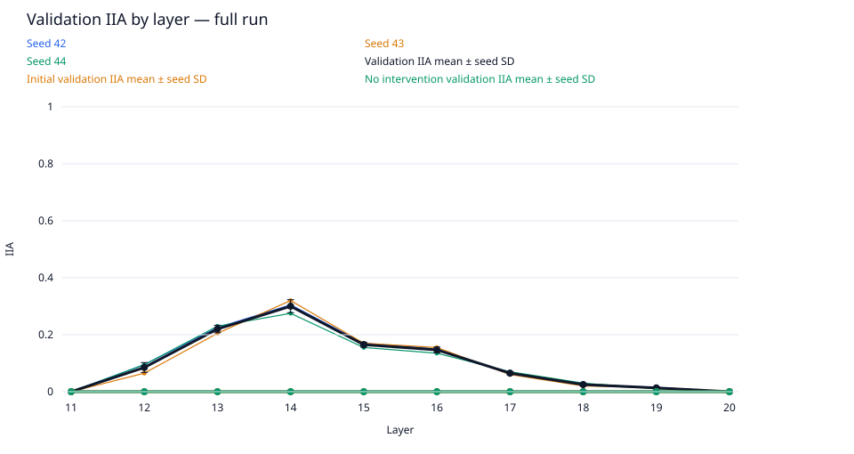
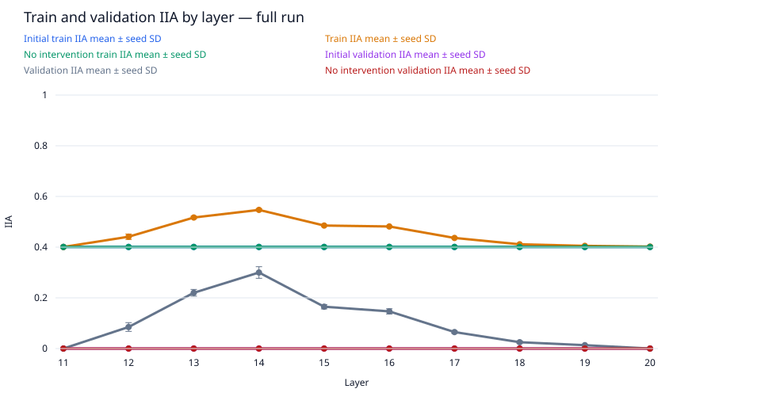
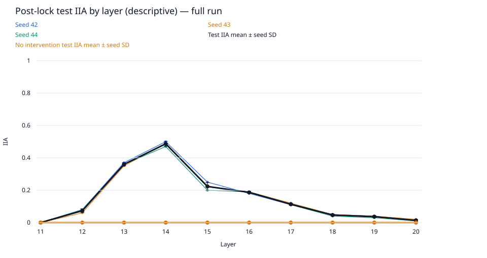
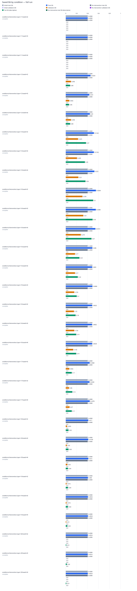

# data-scale / gpt2-medium-rank4-n5000

Run kind: **full**; run status: **complete**.

Config SHA-256: `22da0fddf30c402665129b46ae75afaaa26ff13450bab99cf45c85a853f38d21`.

Conditions: complete=30.

The legacy test set is a descriptive benchmark, previously inspected in earlier runs.
It is not an untouched held-out test.

Selected layer: **14**; metric: `validation_iia`.
The choice was locked in `selection.json` before post-lock evaluation.

| Condition | Status | Initial train IIA | Train IIA | No intervention train IIA | Initial validation IIA | Validation IIA | No intervention validation IIA | Test IIA (descriptive) | No intervention test IIA (descriptive) | Post-lock status |
| --- | --- | --- | --- | --- | --- | --- | --- | --- | --- | --- |
| conditions/intervention.layer=11/seed=42 | complete | 2004/5000 = 0.4008 | 2004/5000 = 0.4008 | 2004/5000 = 0.4008 | 0/200 = 0.0 | 0/200 = 0.0 | 0/200 = 0.0 | 0/100 = 0.0 | 0/100 = 0.0 | complete |
| conditions/intervention.layer=11/seed=43 | complete | 2004/5000 = 0.4008 | 2004/5000 = 0.4008 | 2004/5000 = 0.4008 | 0/200 = 0.0 | 0/200 = 0.0 | 0/200 = 0.0 | 0/100 = 0.0 | 0/100 = 0.0 | complete |
| conditions/intervention.layer=11/seed=44 | complete | 2004/5000 = 0.4008 | 2004/5000 = 0.4008 | 2004/5000 = 0.4008 | 0/200 = 0.0 | 0/200 = 0.0 | 0/200 = 0.0 | 0/100 = 0.0 | 0/100 = 0.0 | complete |
| conditions/intervention.layer=12/seed=42 | complete | 2004/5000 = 0.4008 | 2262/5000 = 0.4524 | 2004/5000 = 0.4008 | 0/200 = 0.0 | 19/200 = 0.095 | 0/200 = 0.0 | 8/100 = 0.08 | 0/100 = 0.0 | complete |
| conditions/intervention.layer=12/seed=43 | complete | 2004/5000 = 0.4008 | 2155/5000 = 0.431 | 2004/5000 = 0.4008 | 0/200 = 0.0 | 13/200 = 0.065 | 0/200 = 0.0 | 6/100 = 0.06 | 0/100 = 0.0 | complete |
| conditions/intervention.layer=12/seed=44 | complete | 2004/5000 = 0.4008 | 2200/5000 = 0.44 | 2004/5000 = 0.4008 | 0/200 = 0.0 | 19/200 = 0.095 | 0/200 = 0.0 | 8/100 = 0.08 | 0/100 = 0.0 | complete |
| conditions/intervention.layer=13/seed=42 | complete | 2004/5000 = 0.4008 | 2571/5000 = 0.5142 | 2004/5000 = 0.4008 | 0/200 = 0.0 | 45/200 = 0.225 | 0/200 = 0.0 | 37/100 = 0.37 | 0/100 = 0.0 | complete |
| conditions/intervention.layer=13/seed=43 | complete | 2004/5000 = 0.4008 | 2568/5000 = 0.5136 | 2004/5000 = 0.4008 | 0/200 = 0.0 | 41/200 = 0.205 | 0/200 = 0.0 | 35/100 = 0.35 | 0/100 = 0.0 | complete |
| conditions/intervention.layer=13/seed=44 | complete | 2004/5000 = 0.4008 | 2615/5000 = 0.523 | 2004/5000 = 0.4008 | 0/200 = 0.0 | 46/200 = 0.23 | 0/200 = 0.0 | 36/100 = 0.36 | 0/100 = 0.0 | complete |
| conditions/intervention.layer=14/seed=42 | complete | 2004/5000 = 0.4008 | 2754/5000 = 0.5508 | 2004/5000 = 0.4008 | 0/200 = 0.0 | 61/200 = 0.305 | 0/200 = 0.0 | 50/100 = 0.5 | 0/100 = 0.0 | complete |
| conditions/intervention.layer=14/seed=43 | complete | 2004/5000 = 0.4008 | 2744/5000 = 0.5488 | 2004/5000 = 0.4008 | 0/200 = 0.0 | 64/200 = 0.32 | 0/200 = 0.0 | 49/100 = 0.49 | 0/100 = 0.0 | complete |
| conditions/intervention.layer=14/seed=44 | complete | 2004/5000 = 0.4008 | 2707/5000 = 0.5414 | 2004/5000 = 0.4008 | 0/200 = 0.0 | 55/200 = 0.275 | 0/200 = 0.0 | 47/100 = 0.47 | 0/100 = 0.0 | complete |
| conditions/intervention.layer=15/seed=42 | complete | 2004/5000 = 0.4008 | 2430/5000 = 0.486 | 2004/5000 = 0.4008 | 0/200 = 0.0 | 34/200 = 0.17 | 0/200 = 0.0 | 25/100 = 0.25 | 0/100 = 0.0 | complete |
| conditions/intervention.layer=15/seed=43 | complete | 2004/5000 = 0.4008 | 2415/5000 = 0.483 | 2004/5000 = 0.4008 | 0/200 = 0.0 | 34/200 = 0.17 | 0/200 = 0.0 | 22/100 = 0.22 | 0/100 = 0.0 | complete |
| conditions/intervention.layer=15/seed=44 | complete | 2004/5000 = 0.4008 | 2434/5000 = 0.4868 | 2004/5000 = 0.4008 | 0/200 = 0.0 | 31/200 = 0.155 | 0/200 = 0.0 | 20/100 = 0.2 | 0/100 = 0.0 | complete |
| conditions/intervention.layer=16/seed=42 | complete | 2004/5000 = 0.4008 | 2411/5000 = 0.4822 | 2004/5000 = 0.4008 | 0/200 = 0.0 | 30/200 = 0.15 | 0/200 = 0.0 | 18/100 = 0.18 | 0/100 = 0.0 | complete |
| conditions/intervention.layer=16/seed=43 | complete | 2004/5000 = 0.4008 | 2401/5000 = 0.4802 | 2004/5000 = 0.4008 | 0/200 = 0.0 | 31/200 = 0.155 | 0/200 = 0.0 | 19/100 = 0.19 | 0/100 = 0.0 | complete |
| conditions/intervention.layer=16/seed=44 | complete | 2004/5000 = 0.4008 | 2412/5000 = 0.4824 | 2004/5000 = 0.4008 | 0/200 = 0.0 | 27/200 = 0.135 | 0/200 = 0.0 | 19/100 = 0.19 | 0/100 = 0.0 | complete |
| conditions/intervention.layer=17/seed=42 | complete | 2004/5000 = 0.4008 | 2184/5000 = 0.4368 | 2004/5000 = 0.4008 | 0/200 = 0.0 | 13/200 = 0.065 | 0/200 = 0.0 | 11/100 = 0.11 | 0/100 = 0.0 | complete |
| conditions/intervention.layer=17/seed=43 | complete | 2004/5000 = 0.4008 | 2172/5000 = 0.4344 | 2004/5000 = 0.4008 | 0/200 = 0.0 | 12/200 = 0.06 | 0/200 = 0.0 | 12/100 = 0.12 | 0/100 = 0.0 | complete |
| conditions/intervention.layer=17/seed=44 | complete | 2004/5000 = 0.4008 | 2189/5000 = 0.4378 | 2004/5000 = 0.4008 | 0/200 = 0.0 | 14/200 = 0.07 | 0/200 = 0.0 | 11/100 = 0.11 | 0/100 = 0.0 | complete |
| conditions/intervention.layer=18/seed=42 | complete | 2004/5000 = 0.4008 | 2055/5000 = 0.411 | 2004/5000 = 0.4008 | 0/200 = 0.0 | 5/200 = 0.025 | 0/200 = 0.0 | 5/100 = 0.05 | 0/100 = 0.0 | complete |
| conditions/intervention.layer=18/seed=43 | complete | 2004/5000 = 0.4008 | 2054/5000 = 0.4108 | 2004/5000 = 0.4008 | 0/200 = 0.0 | 4/200 = 0.02 | 0/200 = 0.0 | 5/100 = 0.05 | 0/100 = 0.0 | complete |
| conditions/intervention.layer=18/seed=44 | complete | 2004/5000 = 0.4008 | 2060/5000 = 0.412 | 2004/5000 = 0.4008 | 0/200 = 0.0 | 6/200 = 0.03 | 0/200 = 0.0 | 4/100 = 0.04 | 0/100 = 0.0 | complete |
| conditions/intervention.layer=19/seed=42 | complete | 2004/5000 = 0.4008 | 2025/5000 = 0.405 | 2004/5000 = 0.4008 | 0/200 = 0.0 | 3/200 = 0.015 | 0/200 = 0.0 | 4/100 = 0.04 | 0/100 = 0.0 | complete |
| conditions/intervention.layer=19/seed=43 | complete | 2004/5000 = 0.4008 | 2026/5000 = 0.4052 | 2004/5000 = 0.4008 | 0/200 = 0.0 | 3/200 = 0.015 | 0/200 = 0.0 | 4/100 = 0.04 | 0/100 = 0.0 | complete |
| conditions/intervention.layer=19/seed=44 | complete | 2004/5000 = 0.4008 | 2026/5000 = 0.4052 | 2004/5000 = 0.4008 | 0/200 = 0.0 | 2/200 = 0.01 | 0/200 = 0.0 | 3/100 = 0.03 | 0/100 = 0.0 | complete |
| conditions/intervention.layer=20/seed=42 | complete | 2004/5000 = 0.4008 | 2012/5000 = 0.4024 | 2004/5000 = 0.4008 | 0/200 = 0.0 | 0/200 = 0.0 | 0/200 = 0.0 | 1/100 = 0.01 | 0/100 = 0.0 | complete |
| conditions/intervention.layer=20/seed=43 | complete | 2004/5000 = 0.4008 | 2008/5000 = 0.4016 | 2004/5000 = 0.4008 | 0/200 = 0.0 | 0/200 = 0.0 | 0/200 = 0.0 | 2/100 = 0.02 | 0/100 = 0.0 | complete |
| conditions/intervention.layer=20/seed=44 | complete | 2004/5000 = 0.4008 | 2012/5000 = 0.4024 | 2004/5000 = 0.4008 | 0/200 = 0.0 | 0/200 = 0.0 | 0/200 = 0.0 | 1/100 = 0.01 | 0/100 = 0.0 | complete |

Full-precision metrics and exact counts are saved in `conditions.csv`.
Missing metrics are shown as —; failed and pending conditions remain in the table.

Per-layer means and sample SD across seeds are saved in `layer_summary.csv`.
Seed SD describes variation across seeds; it is not a confidence interval.
A single available seed has no sample SD. Incomplete layers are flagged in the CSV.

Per-pairing and target-change groups (counts summed across seeds; means give equal weight to each seed):

| Layer | Split | Group | IIA | No-intervention IIA |
| --- | --- | --- | --- | --- |
| 11 | initial_train | ABB->ABB | 3021/3750; mean 0.8056 | 3021/3750; mean 0.8056 |
| 11 | initial_train | ABB->BAB | 0/3750; mean 0.0 | 0/3750; mean 0.0 |
| 11 | initial_train | BAB->ABB | 0/3750; mean 0.0 | 0/3750; mean 0.0 |
| 11 | initial_train | BAB->BAB | 2991/3750; mean 0.7976 | 2991/3750; mean 0.7976 |
| 11 | initial_train | switch_required | 0/7500; mean 0.0 | 0/7500; mean 0.0 |
| 11 | initial_train | unchanged_target | 6012/7500; mean 0.8016 | 6012/7500; mean 0.8016 |
| 12 | initial_train | ABB->ABB | 3021/3750; mean 0.8056 | 3021/3750; mean 0.8056 |
| 12 | initial_train | ABB->BAB | 0/3750; mean 0.0 | 0/3750; mean 0.0 |
| 12 | initial_train | BAB->ABB | 0/3750; mean 0.0 | 0/3750; mean 0.0 |
| 12 | initial_train | BAB->BAB | 2991/3750; mean 0.7976 | 2991/3750; mean 0.7976 |
| 12 | initial_train | switch_required | 0/7500; mean 0.0 | 0/7500; mean 0.0 |
| 12 | initial_train | unchanged_target | 6012/7500; mean 0.8016 | 6012/7500; mean 0.8016 |
| 13 | initial_train | ABB->ABB | 3021/3750; mean 0.8056 | 3021/3750; mean 0.8056 |
| 13 | initial_train | ABB->BAB | 0/3750; mean 0.0 | 0/3750; mean 0.0 |
| 13 | initial_train | BAB->ABB | 0/3750; mean 0.0 | 0/3750; mean 0.0 |
| 13 | initial_train | BAB->BAB | 2991/3750; mean 0.7976 | 2991/3750; mean 0.7976 |
| 13 | initial_train | switch_required | 0/7500; mean 0.0 | 0/7500; mean 0.0 |
| 13 | initial_train | unchanged_target | 6012/7500; mean 0.8016 | 6012/7500; mean 0.8016 |
| 14 | initial_train | ABB->ABB | 3021/3750; mean 0.8056 | 3021/3750; mean 0.8056 |
| 14 | initial_train | ABB->BAB | 0/3750; mean 0.0 | 0/3750; mean 0.0 |
| 14 | initial_train | BAB->ABB | 0/3750; mean 0.0 | 0/3750; mean 0.0 |
| 14 | initial_train | BAB->BAB | 2991/3750; mean 0.7976 | 2991/3750; mean 0.7976 |
| 14 | initial_train | switch_required | 0/7500; mean 0.0 | 0/7500; mean 0.0 |
| 14 | initial_train | unchanged_target | 6012/7500; mean 0.8016 | 6012/7500; mean 0.8016 |
| 15 | initial_train | ABB->ABB | 3021/3750; mean 0.8056 | 3021/3750; mean 0.8056 |
| 15 | initial_train | ABB->BAB | 0/3750; mean 0.0 | 0/3750; mean 0.0 |
| 15 | initial_train | BAB->ABB | 0/3750; mean 0.0 | 0/3750; mean 0.0 |
| 15 | initial_train | BAB->BAB | 2991/3750; mean 0.7976 | 2991/3750; mean 0.7976 |
| 15 | initial_train | switch_required | 0/7500; mean 0.0 | 0/7500; mean 0.0 |
| 15 | initial_train | unchanged_target | 6012/7500; mean 0.8016 | 6012/7500; mean 0.8016 |
| 16 | initial_train | ABB->ABB | 3021/3750; mean 0.8056 | 3021/3750; mean 0.8056 |
| 16 | initial_train | ABB->BAB | 0/3750; mean 0.0 | 0/3750; mean 0.0 |
| 16 | initial_train | BAB->ABB | 0/3750; mean 0.0 | 0/3750; mean 0.0 |
| 16 | initial_train | BAB->BAB | 2991/3750; mean 0.7976 | 2991/3750; mean 0.7976 |
| 16 | initial_train | switch_required | 0/7500; mean 0.0 | 0/7500; mean 0.0 |
| 16 | initial_train | unchanged_target | 6012/7500; mean 0.8016 | 6012/7500; mean 0.8016 |
| 17 | initial_train | ABB->ABB | 3021/3750; mean 0.8056 | 3021/3750; mean 0.8056 |
| 17 | initial_train | ABB->BAB | 0/3750; mean 0.0 | 0/3750; mean 0.0 |
| 17 | initial_train | BAB->ABB | 0/3750; mean 0.0 | 0/3750; mean 0.0 |
| 17 | initial_train | BAB->BAB | 2991/3750; mean 0.7976 | 2991/3750; mean 0.7976 |
| 17 | initial_train | switch_required | 0/7500; mean 0.0 | 0/7500; mean 0.0 |
| 17 | initial_train | unchanged_target | 6012/7500; mean 0.8016 | 6012/7500; mean 0.8016 |
| 18 | initial_train | ABB->ABB | 3021/3750; mean 0.8056 | 3021/3750; mean 0.8056 |
| 18 | initial_train | ABB->BAB | 0/3750; mean 0.0 | 0/3750; mean 0.0 |
| 18 | initial_train | BAB->ABB | 0/3750; mean 0.0 | 0/3750; mean 0.0 |
| 18 | initial_train | BAB->BAB | 2991/3750; mean 0.7976 | 2991/3750; mean 0.7976 |
| 18 | initial_train | switch_required | 0/7500; mean 0.0 | 0/7500; mean 0.0 |
| 18 | initial_train | unchanged_target | 6012/7500; mean 0.8016 | 6012/7500; mean 0.8016 |
| 19 | initial_train | ABB->ABB | 3021/3750; mean 0.8056 | 3021/3750; mean 0.8056 |
| 19 | initial_train | ABB->BAB | 0/3750; mean 0.0 | 0/3750; mean 0.0 |
| 19 | initial_train | BAB->ABB | 0/3750; mean 0.0 | 0/3750; mean 0.0 |
| 19 | initial_train | BAB->BAB | 2991/3750; mean 0.7976 | 2991/3750; mean 0.7976 |
| 19 | initial_train | switch_required | 0/7500; mean 0.0 | 0/7500; mean 0.0 |
| 19 | initial_train | unchanged_target | 6012/7500; mean 0.8016 | 6012/7500; mean 0.8016 |
| 20 | initial_train | ABB->ABB | 3021/3750; mean 0.8056 | 3021/3750; mean 0.8056 |
| 20 | initial_train | ABB->BAB | 0/3750; mean 0.0 | 0/3750; mean 0.0 |
| 20 | initial_train | BAB->ABB | 0/3750; mean 0.0 | 0/3750; mean 0.0 |
| 20 | initial_train | BAB->BAB | 2991/3750; mean 0.7976 | 2991/3750; mean 0.7976 |
| 20 | initial_train | switch_required | 0/7500; mean 0.0 | 0/7500; mean 0.0 |
| 20 | initial_train | unchanged_target | 6012/7500; mean 0.8016 | 6012/7500; mean 0.8016 |
| 11 | train | ABB->ABB | 3021/3750; mean 0.8056 | 3021/3750; mean 0.8056 |
| 11 | train | ABB->BAB | 0/3750; mean 0.0 | 0/3750; mean 0.0 |
| 11 | train | BAB->ABB | 0/3750; mean 0.0 | 0/3750; mean 0.0 |
| 11 | train | BAB->BAB | 2991/3750; mean 0.7976 | 2991/3750; mean 0.7976 |
| 11 | train | switch_required | 0/7500; mean 0.0 | 0/7500; mean 0.0 |
| 11 | train | unchanged_target | 6012/7500; mean 0.8016 | 6012/7500; mean 0.8016 |
| 12 | train | ABB->ABB | 3021/3750; mean 0.8056 | 3021/3750; mean 0.8056 |
| 12 | train | ABB->BAB | 178/3750; mean 0.04746666666666667 | 0/3750; mean 0.0 |
| 12 | train | BAB->ABB | 427/3750; mean 0.11386666666666667 | 0/3750; mean 0.0 |
| 12 | train | BAB->BAB | 2991/3750; mean 0.7976 | 2991/3750; mean 0.7976 |
| 12 | train | switch_required | 605/7500; mean 0.08066666666666666 | 0/7500; mean 0.0 |
| 12 | train | unchanged_target | 6012/7500; mean 0.8016 | 6012/7500; mean 0.8016 |
| 13 | train | ABB->ABB | 3021/3750; mean 0.8056 | 3021/3750; mean 0.8056 |
| 13 | train | ABB->BAB | 299/3750; mean 0.07973333333333334 | 0/3750; mean 0.0 |
| 13 | train | BAB->ABB | 1443/3750; mean 0.38480000000000003 | 0/3750; mean 0.0 |
| 13 | train | BAB->BAB | 2991/3750; mean 0.7976 | 2991/3750; mean 0.7976 |
| 13 | train | switch_required | 1742/7500; mean 0.23226666666666668 | 0/7500; mean 0.0 |
| 13 | train | unchanged_target | 6012/7500; mean 0.8016 | 6012/7500; mean 0.8016 |
| 14 | train | ABB->ABB | 3021/3750; mean 0.8056 | 3021/3750; mean 0.8056 |
| 14 | train | ABB->BAB | 1050/3750; mean 0.28 | 0/3750; mean 0.0 |
| 14 | train | BAB->ABB | 1143/3750; mean 0.3048 | 0/3750; mean 0.0 |
| 14 | train | BAB->BAB | 2991/3750; mean 0.7976 | 2991/3750; mean 0.7976 |
| 14 | train | switch_required | 2193/7500; mean 0.2924 | 0/7500; mean 0.0 |
| 14 | train | unchanged_target | 6012/7500; mean 0.8016 | 6012/7500; mean 0.8016 |
| 15 | train | ABB->ABB | 3021/3750; mean 0.8056 | 3021/3750; mean 0.8056 |
| 15 | train | ABB->BAB | 445/3750; mean 0.11866666666666667 | 0/3750; mean 0.0 |
| 15 | train | BAB->ABB | 822/3750; mean 0.2192 | 0/3750; mean 0.0 |
| 15 | train | BAB->BAB | 2991/3750; mean 0.7976 | 2991/3750; mean 0.7976 |
| 15 | train | switch_required | 1267/7500; mean 0.16893333333333332 | 0/7500; mean 0.0 |
| 15 | train | unchanged_target | 6012/7500; mean 0.8016 | 6012/7500; mean 0.8016 |
| 16 | train | ABB->ABB | 3021/3750; mean 0.8056 | 3021/3750; mean 0.8056 |
| 16 | train | ABB->BAB | 530/3750; mean 0.14133333333333334 | 0/3750; mean 0.0 |
| 16 | train | BAB->ABB | 682/3750; mean 0.18186666666666668 | 0/3750; mean 0.0 |
| 16 | train | BAB->BAB | 2991/3750; mean 0.7976 | 2991/3750; mean 0.7976 |
| 16 | train | switch_required | 1212/7500; mean 0.1616 | 0/7500; mean 0.0 |
| 16 | train | unchanged_target | 6012/7500; mean 0.8016 | 6012/7500; mean 0.8016 |
| 17 | train | ABB->ABB | 3021/3750; mean 0.8056 | 3021/3750; mean 0.8056 |
| 17 | train | ABB->BAB | 213/3750; mean 0.056799999999999996 | 0/3750; mean 0.0 |
| 17 | train | BAB->ABB | 320/3750; mean 0.08533333333333333 | 0/3750; mean 0.0 |
| 17 | train | BAB->BAB | 2991/3750; mean 0.7976 | 2991/3750; mean 0.7976 |
| 17 | train | switch_required | 533/7500; mean 0.07106666666666667 | 0/7500; mean 0.0 |
| 17 | train | unchanged_target | 6012/7500; mean 0.8016 | 6012/7500; mean 0.8016 |
| 18 | train | ABB->ABB | 3021/3750; mean 0.8056 | 3021/3750; mean 0.8056 |
| 18 | train | ABB->BAB | 64/3750; mean 0.017066666666666667 | 0/3750; mean 0.0 |
| 18 | train | BAB->ABB | 93/3750; mean 0.024800000000000003 | 0/3750; mean 0.0 |
| 18 | train | BAB->BAB | 2991/3750; mean 0.7976 | 2991/3750; mean 0.7976 |
| 18 | train | switch_required | 157/7500; mean 0.020933333333333335 | 0/7500; mean 0.0 |
| 18 | train | unchanged_target | 6012/7500; mean 0.8016 | 6012/7500; mean 0.8016 |
| 19 | train | ABB->ABB | 3021/3750; mean 0.8056 | 3021/3750; mean 0.8056 |
| 19 | train | ABB->BAB | 17/3750; mean 0.004533333333333334 | 0/3750; mean 0.0 |
| 19 | train | BAB->ABB | 48/3750; mean 0.0128 | 0/3750; mean 0.0 |
| 19 | train | BAB->BAB | 2991/3750; mean 0.7976 | 2991/3750; mean 0.7976 |
| 19 | train | switch_required | 65/7500; mean 0.008666666666666666 | 0/7500; mean 0.0 |
| 19 | train | unchanged_target | 6012/7500; mean 0.8016 | 6012/7500; mean 0.8016 |
| 20 | train | ABB->ABB | 3021/3750; mean 0.8056 | 3021/3750; mean 0.8056 |
| 20 | train | ABB->BAB | 7/3750; mean 0.0018666666666666666 | 0/3750; mean 0.0 |
| 20 | train | BAB->ABB | 13/3750; mean 0.0034666666666666665 | 0/3750; mean 0.0 |
| 20 | train | BAB->BAB | 2991/3750; mean 0.7976 | 2991/3750; mean 0.7976 |
| 20 | train | switch_required | 20/7500; mean 0.002666666666666667 | 0/7500; mean 0.0 |
| 20 | train | unchanged_target | 6012/7500; mean 0.8016 | 6012/7500; mean 0.8016 |
| 11 | initial_validation | ABB->ABB | 0/0; mean — | 0/0; mean — |
| 11 | initial_validation | ABB->BAB | 0/300; mean 0.0 | 0/300; mean 0.0 |
| 11 | initial_validation | BAB->ABB | 0/300; mean 0.0 | 0/300; mean 0.0 |
| 11 | initial_validation | BAB->BAB | 0/0; mean — | 0/0; mean — |
| 11 | initial_validation | switch_required | 0/600; mean 0.0 | 0/600; mean 0.0 |
| 11 | initial_validation | unchanged_target | 0/0; mean — | 0/0; mean — |
| 12 | initial_validation | ABB->ABB | 0/0; mean — | 0/0; mean — |
| 12 | initial_validation | ABB->BAB | 0/300; mean 0.0 | 0/300; mean 0.0 |
| 12 | initial_validation | BAB->ABB | 0/300; mean 0.0 | 0/300; mean 0.0 |
| 12 | initial_validation | BAB->BAB | 0/0; mean — | 0/0; mean — |
| 12 | initial_validation | switch_required | 0/600; mean 0.0 | 0/600; mean 0.0 |
| 12 | initial_validation | unchanged_target | 0/0; mean — | 0/0; mean — |
| 13 | initial_validation | ABB->ABB | 0/0; mean — | 0/0; mean — |
| 13 | initial_validation | ABB->BAB | 0/300; mean 0.0 | 0/300; mean 0.0 |
| 13 | initial_validation | BAB->ABB | 0/300; mean 0.0 | 0/300; mean 0.0 |
| 13 | initial_validation | BAB->BAB | 0/0; mean — | 0/0; mean — |
| 13 | initial_validation | switch_required | 0/600; mean 0.0 | 0/600; mean 0.0 |
| 13 | initial_validation | unchanged_target | 0/0; mean — | 0/0; mean — |
| 14 | initial_validation | ABB->ABB | 0/0; mean — | 0/0; mean — |
| 14 | initial_validation | ABB->BAB | 0/300; mean 0.0 | 0/300; mean 0.0 |
| 14 | initial_validation | BAB->ABB | 0/300; mean 0.0 | 0/300; mean 0.0 |
| 14 | initial_validation | BAB->BAB | 0/0; mean — | 0/0; mean — |
| 14 | initial_validation | switch_required | 0/600; mean 0.0 | 0/600; mean 0.0 |
| 14 | initial_validation | unchanged_target | 0/0; mean — | 0/0; mean — |
| 15 | initial_validation | ABB->ABB | 0/0; mean — | 0/0; mean — |
| 15 | initial_validation | ABB->BAB | 0/300; mean 0.0 | 0/300; mean 0.0 |
| 15 | initial_validation | BAB->ABB | 0/300; mean 0.0 | 0/300; mean 0.0 |
| 15 | initial_validation | BAB->BAB | 0/0; mean — | 0/0; mean — |
| 15 | initial_validation | switch_required | 0/600; mean 0.0 | 0/600; mean 0.0 |
| 15 | initial_validation | unchanged_target | 0/0; mean — | 0/0; mean — |
| 16 | initial_validation | ABB->ABB | 0/0; mean — | 0/0; mean — |
| 16 | initial_validation | ABB->BAB | 0/300; mean 0.0 | 0/300; mean 0.0 |
| 16 | initial_validation | BAB->ABB | 0/300; mean 0.0 | 0/300; mean 0.0 |
| 16 | initial_validation | BAB->BAB | 0/0; mean — | 0/0; mean — |
| 16 | initial_validation | switch_required | 0/600; mean 0.0 | 0/600; mean 0.0 |
| 16 | initial_validation | unchanged_target | 0/0; mean — | 0/0; mean — |
| 17 | initial_validation | ABB->ABB | 0/0; mean — | 0/0; mean — |
| 17 | initial_validation | ABB->BAB | 0/300; mean 0.0 | 0/300; mean 0.0 |
| 17 | initial_validation | BAB->ABB | 0/300; mean 0.0 | 0/300; mean 0.0 |
| 17 | initial_validation | BAB->BAB | 0/0; mean — | 0/0; mean — |
| 17 | initial_validation | switch_required | 0/600; mean 0.0 | 0/600; mean 0.0 |
| 17 | initial_validation | unchanged_target | 0/0; mean — | 0/0; mean — |
| 18 | initial_validation | ABB->ABB | 0/0; mean — | 0/0; mean — |
| 18 | initial_validation | ABB->BAB | 0/300; mean 0.0 | 0/300; mean 0.0 |
| 18 | initial_validation | BAB->ABB | 0/300; mean 0.0 | 0/300; mean 0.0 |
| 18 | initial_validation | BAB->BAB | 0/0; mean — | 0/0; mean — |
| 18 | initial_validation | switch_required | 0/600; mean 0.0 | 0/600; mean 0.0 |
| 18 | initial_validation | unchanged_target | 0/0; mean — | 0/0; mean — |
| 19 | initial_validation | ABB->ABB | 0/0; mean — | 0/0; mean — |
| 19 | initial_validation | ABB->BAB | 0/300; mean 0.0 | 0/300; mean 0.0 |
| 19 | initial_validation | BAB->ABB | 0/300; mean 0.0 | 0/300; mean 0.0 |
| 19 | initial_validation | BAB->BAB | 0/0; mean — | 0/0; mean — |
| 19 | initial_validation | switch_required | 0/600; mean 0.0 | 0/600; mean 0.0 |
| 19 | initial_validation | unchanged_target | 0/0; mean — | 0/0; mean — |
| 20 | initial_validation | ABB->ABB | 0/0; mean — | 0/0; mean — |
| 20 | initial_validation | ABB->BAB | 0/300; mean 0.0 | 0/300; mean 0.0 |
| 20 | initial_validation | BAB->ABB | 0/300; mean 0.0 | 0/300; mean 0.0 |
| 20 | initial_validation | BAB->BAB | 0/0; mean — | 0/0; mean — |
| 20 | initial_validation | switch_required | 0/600; mean 0.0 | 0/600; mean 0.0 |
| 20 | initial_validation | unchanged_target | 0/0; mean — | 0/0; mean — |
| 11 | validation | ABB->ABB | 0/0; mean — | 0/0; mean — |
| 11 | validation | ABB->BAB | 0/300; mean 0.0 | 0/300; mean 0.0 |
| 11 | validation | BAB->ABB | 0/300; mean 0.0 | 0/300; mean 0.0 |
| 11 | validation | BAB->BAB | 0/0; mean — | 0/0; mean — |
| 11 | validation | switch_required | 0/600; mean 0.0 | 0/600; mean 0.0 |
| 11 | validation | unchanged_target | 0/0; mean — | 0/0; mean — |
| 12 | validation | ABB->ABB | 0/0; mean — | 0/0; mean — |
| 12 | validation | ABB->BAB | 17/300; mean 0.05666666666666667 | 0/300; mean 0.0 |
| 12 | validation | BAB->ABB | 34/300; mean 0.11333333333333333 | 0/300; mean 0.0 |
| 12 | validation | BAB->BAB | 0/0; mean — | 0/0; mean — |
| 12 | validation | switch_required | 51/600; mean 0.085 | 0/600; mean 0.0 |
| 12 | validation | unchanged_target | 0/0; mean — | 0/0; mean — |
| 13 | validation | ABB->ABB | 0/0; mean — | 0/0; mean — |
| 13 | validation | ABB->BAB | 32/300; mean 0.10666666666666666 | 0/300; mean 0.0 |
| 13 | validation | BAB->ABB | 100/300; mean 0.3333333333333333 | 0/300; mean 0.0 |
| 13 | validation | BAB->BAB | 0/0; mean — | 0/0; mean — |
| 13 | validation | switch_required | 132/600; mean 0.22 | 0/600; mean 0.0 |
| 13 | validation | unchanged_target | 0/0; mean — | 0/0; mean — |
| 14 | validation | ABB->ABB | 0/0; mean — | 0/0; mean — |
| 14 | validation | ABB->BAB | 98/300; mean 0.32666666666666666 | 0/300; mean 0.0 |
| 14 | validation | BAB->ABB | 82/300; mean 0.2733333333333333 | 0/300; mean 0.0 |
| 14 | validation | BAB->BAB | 0/0; mean — | 0/0; mean — |
| 14 | validation | switch_required | 180/600; mean 0.3 | 0/600; mean 0.0 |
| 14 | validation | unchanged_target | 0/0; mean — | 0/0; mean — |
| 15 | validation | ABB->ABB | 0/0; mean — | 0/0; mean — |
| 15 | validation | ABB->BAB | 41/300; mean 0.1366666666666667 | 0/300; mean 0.0 |
| 15 | validation | BAB->ABB | 58/300; mean 0.19333333333333333 | 0/300; mean 0.0 |
| 15 | validation | BAB->BAB | 0/0; mean — | 0/0; mean — |
| 15 | validation | switch_required | 99/600; mean 0.165 | 0/600; mean 0.0 |
| 15 | validation | unchanged_target | 0/0; mean — | 0/0; mean — |
| 16 | validation | ABB->ABB | 0/0; mean — | 0/0; mean — |
| 16 | validation | ABB->BAB | 37/300; mean 0.12333333333333334 | 0/300; mean 0.0 |
| 16 | validation | BAB->ABB | 51/300; mean 0.17 | 0/300; mean 0.0 |
| 16 | validation | BAB->BAB | 0/0; mean — | 0/0; mean — |
| 16 | validation | switch_required | 88/600; mean 0.14666666666666667 | 0/600; mean 0.0 |
| 16 | validation | unchanged_target | 0/0; mean — | 0/0; mean — |
| 17 | validation | ABB->ABB | 0/0; mean — | 0/0; mean — |
| 17 | validation | ABB->BAB | 9/300; mean 0.03 | 0/300; mean 0.0 |
| 17 | validation | BAB->ABB | 30/300; mean 0.09999999999999999 | 0/300; mean 0.0 |
| 17 | validation | BAB->BAB | 0/0; mean — | 0/0; mean — |
| 17 | validation | switch_required | 39/600; mean 0.065 | 0/600; mean 0.0 |
| 17 | validation | unchanged_target | 0/0; mean — | 0/0; mean — |
| 18 | validation | ABB->ABB | 0/0; mean — | 0/0; mean — |
| 18 | validation | ABB->BAB | 6/300; mean 0.02 | 0/300; mean 0.0 |
| 18 | validation | BAB->ABB | 9/300; mean 0.03 | 0/300; mean 0.0 |
| 18 | validation | BAB->BAB | 0/0; mean — | 0/0; mean — |
| 18 | validation | switch_required | 15/600; mean 0.025 | 0/600; mean 0.0 |
| 18 | validation | unchanged_target | 0/0; mean — | 0/0; mean — |
| 19 | validation | ABB->ABB | 0/0; mean — | 0/0; mean — |
| 19 | validation | ABB->BAB | 5/300; mean 0.016666666666666666 | 0/300; mean 0.0 |
| 19 | validation | BAB->ABB | 3/300; mean 0.01 | 0/300; mean 0.0 |
| 19 | validation | BAB->BAB | 0/0; mean — | 0/0; mean — |
| 19 | validation | switch_required | 8/600; mean 0.013333333333333332 | 0/600; mean 0.0 |
| 19 | validation | unchanged_target | 0/0; mean — | 0/0; mean — |
| 20 | validation | ABB->ABB | 0/0; mean — | 0/0; mean — |
| 20 | validation | ABB->BAB | 0/300; mean 0.0 | 0/300; mean 0.0 |
| 20 | validation | BAB->ABB | 0/300; mean 0.0 | 0/300; mean 0.0 |
| 20 | validation | BAB->BAB | 0/0; mean — | 0/0; mean — |
| 20 | validation | switch_required | 0/600; mean 0.0 | 0/600; mean 0.0 |
| 20 | validation | unchanged_target | 0/0; mean — | 0/0; mean — |
| 11 | test | ABB->ABB | 0/0; mean — | 0/0; mean — |
| 11 | test | ABB->BAB | 0/150; mean 0.0 | 0/150; mean 0.0 |
| 11 | test | BAB->ABB | 0/150; mean 0.0 | 0/150; mean 0.0 |
| 11 | test | BAB->BAB | 0/0; mean — | 0/0; mean — |
| 11 | test | switch_required | 0/300; mean 0.0 | 0/300; mean 0.0 |
| 11 | test | unchanged_target | 0/0; mean — | 0/0; mean — |
| 12 | test | ABB->ABB | 0/0; mean — | 0/0; mean — |
| 12 | test | ABB->BAB | 9/150; mean 0.06 | 0/150; mean 0.0 |
| 12 | test | BAB->ABB | 13/150; mean 0.08666666666666667 | 0/150; mean 0.0 |
| 12 | test | BAB->BAB | 0/0; mean — | 0/0; mean — |
| 12 | test | switch_required | 22/300; mean 0.07333333333333333 | 0/300; mean 0.0 |
| 12 | test | unchanged_target | 0/0; mean — | 0/0; mean — |
| 13 | test | ABB->ABB | 0/0; mean — | 0/0; mean — |
| 13 | test | ABB->BAB | 24/150; mean 0.16 | 0/150; mean 0.0 |
| 13 | test | BAB->ABB | 84/150; mean 0.56 | 0/150; mean 0.0 |
| 13 | test | BAB->BAB | 0/0; mean — | 0/0; mean — |
| 13 | test | switch_required | 108/300; mean 0.36 | 0/300; mean 0.0 |
| 13 | test | unchanged_target | 0/0; mean — | 0/0; mean — |
| 14 | test | ABB->ABB | 0/0; mean — | 0/0; mean — |
| 14 | test | ABB->BAB | 78/150; mean 0.52 | 0/150; mean 0.0 |
| 14 | test | BAB->ABB | 68/150; mean 0.45333333333333337 | 0/150; mean 0.0 |
| 14 | test | BAB->BAB | 0/0; mean — | 0/0; mean — |
| 14 | test | switch_required | 146/300; mean 0.48666666666666664 | 0/300; mean 0.0 |
| 14 | test | unchanged_target | 0/0; mean — | 0/0; mean — |
| 15 | test | ABB->ABB | 0/0; mean — | 0/0; mean — |
| 15 | test | ABB->BAB | 34/150; mean 0.22666666666666668 | 0/150; mean 0.0 |
| 15 | test | BAB->ABB | 33/150; mean 0.22 | 0/150; mean 0.0 |
| 15 | test | BAB->BAB | 0/0; mean — | 0/0; mean — |
| 15 | test | switch_required | 67/300; mean 0.22333333333333333 | 0/300; mean 0.0 |
| 15 | test | unchanged_target | 0/0; mean — | 0/0; mean — |
| 16 | test | ABB->ABB | 0/0; mean — | 0/0; mean — |
| 16 | test | ABB->BAB | 36/150; mean 0.24 | 0/150; mean 0.0 |
| 16 | test | BAB->ABB | 20/150; mean 0.13333333333333333 | 0/150; mean 0.0 |
| 16 | test | BAB->BAB | 0/0; mean — | 0/0; mean — |
| 16 | test | switch_required | 56/300; mean 0.18666666666666668 | 0/300; mean 0.0 |
| 16 | test | unchanged_target | 0/0; mean — | 0/0; mean — |
| 17 | test | ABB->ABB | 0/0; mean — | 0/0; mean — |
| 17 | test | ABB->BAB | 22/150; mean 0.14666666666666667 | 0/150; mean 0.0 |
| 17 | test | BAB->ABB | 12/150; mean 0.08 | 0/150; mean 0.0 |
| 17 | test | BAB->BAB | 0/0; mean — | 0/0; mean — |
| 17 | test | switch_required | 34/300; mean 0.11333333333333333 | 0/300; mean 0.0 |
| 17 | test | unchanged_target | 0/0; mean — | 0/0; mean — |
| 18 | test | ABB->ABB | 0/0; mean — | 0/0; mean — |
| 18 | test | ABB->BAB | 11/150; mean 0.07333333333333333 | 0/150; mean 0.0 |
| 18 | test | BAB->ABB | 3/150; mean 0.02 | 0/150; mean 0.0 |
| 18 | test | BAB->BAB | 0/0; mean — | 0/0; mean — |
| 18 | test | switch_required | 14/300; mean 0.04666666666666667 | 0/300; mean 0.0 |
| 18 | test | unchanged_target | 0/0; mean — | 0/0; mean — |
| 19 | test | ABB->ABB | 0/0; mean — | 0/0; mean — |
| 19 | test | ABB->BAB | 8/150; mean 0.05333333333333333 | 0/150; mean 0.0 |
| 19 | test | BAB->ABB | 3/150; mean 0.02 | 0/150; mean 0.0 |
| 19 | test | BAB->BAB | 0/0; mean — | 0/0; mean — |
| 19 | test | switch_required | 11/300; mean 0.03666666666666667 | 0/300; mean 0.0 |
| 19 | test | unchanged_target | 0/0; mean — | 0/0; mean — |
| 20 | test | ABB->ABB | 0/0; mean — | 0/0; mean — |
| 20 | test | ABB->BAB | 1/150; mean 0.006666666666666667 | 0/150; mean 0.0 |
| 20 | test | BAB->ABB | 3/150; mean 0.02 | 0/150; mean 0.0 |
| 20 | test | BAB->BAB | 0/0; mean — | 0/0; mean — |
| 20 | test | switch_required | 4/300; mean 0.013333333333333334 | 0/300; mean 0.0 |
| 20 | test | unchanged_target | 0/0; mean — | 0/0; mean — |

