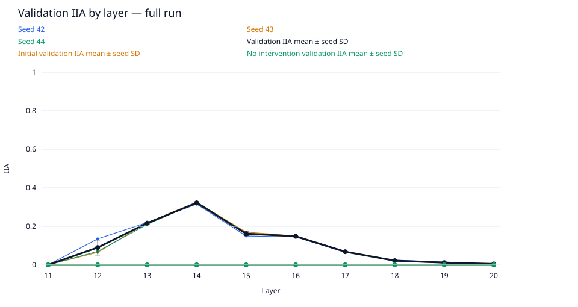
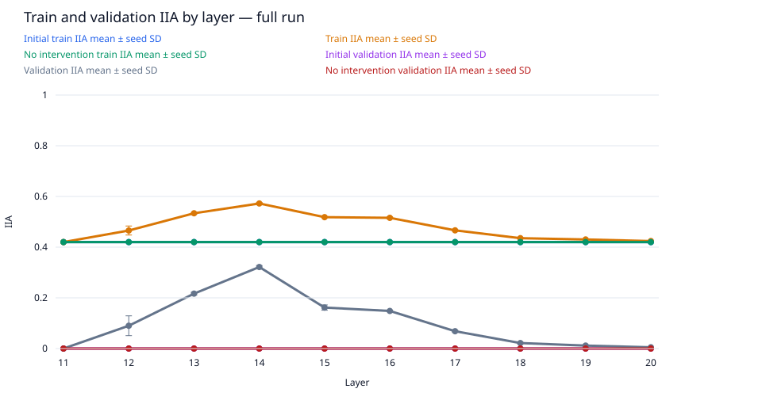
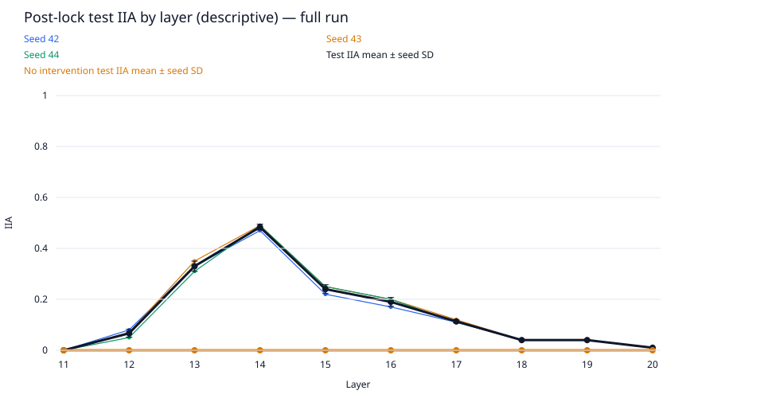
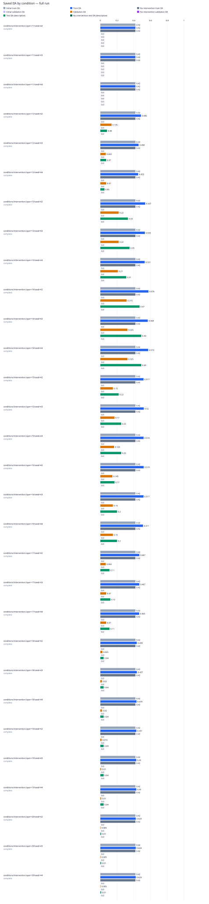

# data-scale / gpt2-medium-rank8-n1000

Run kind: **full**; run status: **complete**.

Config SHA-256: `305a5fbd319fe3cdb3b02b68c3aa54ac399acebb5cdd39a1c9a191adfeeb9077`.

Conditions: complete=30.

The legacy test set is a descriptive benchmark, previously inspected in earlier runs.
It is not an untouched held-out test.

Selected layer: **14**; metric: `validation_iia`.
The choice was locked in `selection.json` before post-lock evaluation.

| Condition | Status | Initial train IIA | Train IIA | No intervention train IIA | Initial validation IIA | Validation IIA | No intervention validation IIA | Test IIA (descriptive) | No intervention test IIA (descriptive) | Post-lock status |
| --- | --- | --- | --- | --- | --- | --- | --- | --- | --- | --- |
| conditions/intervention.layer=11/seed=42 | complete | 420/1000 = 0.42 | 420/1000 = 0.42 | 420/1000 = 0.42 | 0/200 = 0.0 | 0/200 = 0.0 | 0/200 = 0.0 | 0/100 = 0.0 | 0/100 = 0.0 | complete |
| conditions/intervention.layer=11/seed=43 | complete | 420/1000 = 0.42 | 420/1000 = 0.42 | 420/1000 = 0.42 | 0/200 = 0.0 | 0/200 = 0.0 | 0/200 = 0.0 | 0/100 = 0.0 | 0/100 = 0.0 | complete |
| conditions/intervention.layer=11/seed=44 | complete | 420/1000 = 0.42 | 420/1000 = 0.42 | 420/1000 = 0.42 | 0/200 = 0.0 | 0/200 = 0.0 | 0/200 = 0.0 | 0/100 = 0.0 | 0/100 = 0.0 | complete |
| conditions/intervention.layer=12/seed=42 | complete | 420/1000 = 0.42 | 486/1000 = 0.486 | 420/1000 = 0.42 | 0/200 = 0.0 | 27/200 = 0.135 | 0/200 = 0.0 | 8/100 = 0.08 | 0/100 = 0.0 | complete |
| conditions/intervention.layer=12/seed=43 | complete | 420/1000 = 0.42 | 458/1000 = 0.458 | 420/1000 = 0.42 | 0/200 = 0.0 | 13/200 = 0.065 | 0/200 = 0.0 | 7/100 = 0.07 | 0/100 = 0.0 | complete |
| conditions/intervention.layer=12/seed=44 | complete | 420/1000 = 0.42 | 453/1000 = 0.453 | 420/1000 = 0.42 | 0/200 = 0.0 | 14/200 = 0.07 | 0/200 = 0.0 | 5/100 = 0.05 | 0/100 = 0.0 | complete |
| conditions/intervention.layer=13/seed=42 | complete | 420/1000 = 0.42 | 537/1000 = 0.537 | 420/1000 = 0.42 | 0/200 = 0.0 | 44/200 = 0.22 | 0/200 = 0.0 | 33/100 = 0.33 | 0/100 = 0.0 | complete |
| conditions/intervention.layer=13/seed=43 | complete | 420/1000 = 0.42 | 533/1000 = 0.533 | 420/1000 = 0.42 | 0/200 = 0.0 | 44/200 = 0.22 | 0/200 = 0.0 | 35/100 = 0.35 | 0/100 = 0.0 | complete |
| conditions/intervention.layer=13/seed=44 | complete | 420/1000 = 0.42 | 531/1000 = 0.531 | 420/1000 = 0.42 | 0/200 = 0.0 | 42/200 = 0.21 | 0/200 = 0.0 | 31/100 = 0.31 | 0/100 = 0.0 | complete |
| conditions/intervention.layer=14/seed=42 | complete | 420/1000 = 0.42 | 576/1000 = 0.576 | 420/1000 = 0.42 | 0/200 = 0.0 | 63/200 = 0.315 | 0/200 = 0.0 | 47/100 = 0.47 | 0/100 = 0.0 | complete |
| conditions/intervention.layer=14/seed=43 | complete | 420/1000 = 0.42 | 568/1000 = 0.568 | 420/1000 = 0.42 | 0/200 = 0.0 | 65/200 = 0.325 | 0/200 = 0.0 | 49/100 = 0.49 | 0/100 = 0.0 | complete |
| conditions/intervention.layer=14/seed=44 | complete | 420/1000 = 0.42 | 573/1000 = 0.573 | 420/1000 = 0.42 | 0/200 = 0.0 | 65/200 = 0.325 | 0/200 = 0.0 | 49/100 = 0.49 | 0/100 = 0.0 | complete |
| conditions/intervention.layer=15/seed=42 | complete | 420/1000 = 0.42 | 517/1000 = 0.517 | 420/1000 = 0.42 | 0/200 = 0.0 | 30/200 = 0.15 | 0/200 = 0.0 | 22/100 = 0.22 | 0/100 = 0.0 | complete |
| conditions/intervention.layer=15/seed=43 | complete | 420/1000 = 0.42 | 520/1000 = 0.52 | 420/1000 = 0.42 | 0/200 = 0.0 | 34/200 = 0.17 | 0/200 = 0.0 | 25/100 = 0.25 | 0/100 = 0.0 | complete |
| conditions/intervention.layer=15/seed=44 | complete | 420/1000 = 0.42 | 518/1000 = 0.518 | 420/1000 = 0.42 | 0/200 = 0.0 | 33/200 = 0.165 | 0/200 = 0.0 | 25/100 = 0.25 | 0/100 = 0.0 | complete |
| conditions/intervention.layer=16/seed=42 | complete | 420/1000 = 0.42 | 519/1000 = 0.519 | 420/1000 = 0.42 | 0/200 = 0.0 | 29/200 = 0.145 | 0/200 = 0.0 | 17/100 = 0.17 | 0/100 = 0.0 | complete |
| conditions/intervention.layer=16/seed=43 | complete | 420/1000 = 0.42 | 517/1000 = 0.517 | 420/1000 = 0.42 | 0/200 = 0.0 | 30/200 = 0.15 | 0/200 = 0.0 | 20/100 = 0.2 | 0/100 = 0.0 | complete |
| conditions/intervention.layer=16/seed=44 | complete | 420/1000 = 0.42 | 511/1000 = 0.511 | 420/1000 = 0.42 | 0/200 = 0.0 | 30/200 = 0.15 | 0/200 = 0.0 | 20/100 = 0.2 | 0/100 = 0.0 | complete |
| conditions/intervention.layer=17/seed=42 | complete | 420/1000 = 0.42 | 467/1000 = 0.467 | 420/1000 = 0.42 | 0/200 = 0.0 | 13/200 = 0.065 | 0/200 = 0.0 | 11/100 = 0.11 | 0/100 = 0.0 | complete |
| conditions/intervention.layer=17/seed=43 | complete | 420/1000 = 0.42 | 467/1000 = 0.467 | 420/1000 = 0.42 | 0/200 = 0.0 | 14/200 = 0.07 | 0/200 = 0.0 | 12/100 = 0.12 | 0/100 = 0.0 | complete |
| conditions/intervention.layer=17/seed=44 | complete | 420/1000 = 0.42 | 465/1000 = 0.465 | 420/1000 = 0.42 | 0/200 = 0.0 | 14/200 = 0.07 | 0/200 = 0.0 | 11/100 = 0.11 | 0/100 = 0.0 | complete |
| conditions/intervention.layer=18/seed=42 | complete | 420/1000 = 0.42 | 436/1000 = 0.436 | 420/1000 = 0.42 | 0/200 = 0.0 | 5/200 = 0.025 | 0/200 = 0.0 | 4/100 = 0.04 | 0/100 = 0.0 | complete |
| conditions/intervention.layer=18/seed=43 | complete | 420/1000 = 0.42 | 437/1000 = 0.437 | 420/1000 = 0.42 | 0/200 = 0.0 | 4/200 = 0.02 | 0/200 = 0.0 | 4/100 = 0.04 | 0/100 = 0.0 | complete |
| conditions/intervention.layer=18/seed=44 | complete | 420/1000 = 0.42 | 433/1000 = 0.433 | 420/1000 = 0.42 | 0/200 = 0.0 | 4/200 = 0.02 | 0/200 = 0.0 | 4/100 = 0.04 | 0/100 = 0.0 | complete |
| conditions/intervention.layer=19/seed=42 | complete | 420/1000 = 0.42 | 431/1000 = 0.431 | 420/1000 = 0.42 | 0/200 = 0.0 | 3/200 = 0.015 | 0/200 = 0.0 | 4/100 = 0.04 | 0/100 = 0.0 | complete |
| conditions/intervention.layer=19/seed=43 | complete | 420/1000 = 0.42 | 430/1000 = 0.43 | 420/1000 = 0.42 | 0/200 = 0.0 | 2/200 = 0.01 | 0/200 = 0.0 | 4/100 = 0.04 | 0/100 = 0.0 | complete |
| conditions/intervention.layer=19/seed=44 | complete | 420/1000 = 0.42 | 430/1000 = 0.43 | 420/1000 = 0.42 | 0/200 = 0.0 | 2/200 = 0.01 | 0/200 = 0.0 | 4/100 = 0.04 | 0/100 = 0.0 | complete |
| conditions/intervention.layer=20/seed=42 | complete | 420/1000 = 0.42 | 424/1000 = 0.424 | 420/1000 = 0.42 | 0/200 = 0.0 | 1/200 = 0.005 | 0/200 = 0.0 | 1/100 = 0.01 | 0/100 = 0.0 | complete |
| conditions/intervention.layer=20/seed=43 | complete | 420/1000 = 0.42 | 424/1000 = 0.424 | 420/1000 = 0.42 | 0/200 = 0.0 | 1/200 = 0.005 | 0/200 = 0.0 | 1/100 = 0.01 | 0/100 = 0.0 | complete |
| conditions/intervention.layer=20/seed=44 | complete | 420/1000 = 0.42 | 424/1000 = 0.424 | 420/1000 = 0.42 | 0/200 = 0.0 | 1/200 = 0.005 | 0/200 = 0.0 | 1/100 = 0.01 | 0/100 = 0.0 | complete |

Full-precision metrics and exact counts are saved in `conditions.csv`.
Missing metrics are shown as —; failed and pending conditions remain in the table.

Per-layer means and sample SD across seeds are saved in `layer_summary.csv`.
Seed SD describes variation across seeds; it is not a confidence interval.
A single available seed has no sample SD. Incomplete layers are flagged in the CSV.

Per-pairing and target-change groups (counts summed across seeds; means give equal weight to each seed):

| Layer | Split | Group | IIA | No-intervention IIA |
| --- | --- | --- | --- | --- |
| 11 | initial_train | ABB->ABB | 615/750; mean 0.82 | 615/750; mean 0.82 |
| 11 | initial_train | ABB->BAB | 0/750; mean 0.0 | 0/750; mean 0.0 |
| 11 | initial_train | BAB->ABB | 0/750; mean 0.0 | 0/750; mean 0.0 |
| 11 | initial_train | BAB->BAB | 645/750; mean 0.86 | 645/750; mean 0.86 |
| 11 | initial_train | switch_required | 0/1500; mean 0.0 | 0/1500; mean 0.0 |
| 11 | initial_train | unchanged_target | 1260/1500; mean 0.84 | 1260/1500; mean 0.84 |
| 12 | initial_train | ABB->ABB | 615/750; mean 0.82 | 615/750; mean 0.82 |
| 12 | initial_train | ABB->BAB | 0/750; mean 0.0 | 0/750; mean 0.0 |
| 12 | initial_train | BAB->ABB | 0/750; mean 0.0 | 0/750; mean 0.0 |
| 12 | initial_train | BAB->BAB | 645/750; mean 0.86 | 645/750; mean 0.86 |
| 12 | initial_train | switch_required | 0/1500; mean 0.0 | 0/1500; mean 0.0 |
| 12 | initial_train | unchanged_target | 1260/1500; mean 0.84 | 1260/1500; mean 0.84 |
| 13 | initial_train | ABB->ABB | 615/750; mean 0.82 | 615/750; mean 0.82 |
| 13 | initial_train | ABB->BAB | 0/750; mean 0.0 | 0/750; mean 0.0 |
| 13 | initial_train | BAB->ABB | 0/750; mean 0.0 | 0/750; mean 0.0 |
| 13 | initial_train | BAB->BAB | 645/750; mean 0.86 | 645/750; mean 0.86 |
| 13 | initial_train | switch_required | 0/1500; mean 0.0 | 0/1500; mean 0.0 |
| 13 | initial_train | unchanged_target | 1260/1500; mean 0.84 | 1260/1500; mean 0.84 |
| 14 | initial_train | ABB->ABB | 615/750; mean 0.82 | 615/750; mean 0.82 |
| 14 | initial_train | ABB->BAB | 0/750; mean 0.0 | 0/750; mean 0.0 |
| 14 | initial_train | BAB->ABB | 0/750; mean 0.0 | 0/750; mean 0.0 |
| 14 | initial_train | BAB->BAB | 645/750; mean 0.86 | 645/750; mean 0.86 |
| 14 | initial_train | switch_required | 0/1500; mean 0.0 | 0/1500; mean 0.0 |
| 14 | initial_train | unchanged_target | 1260/1500; mean 0.84 | 1260/1500; mean 0.84 |
| 15 | initial_train | ABB->ABB | 615/750; mean 0.82 | 615/750; mean 0.82 |
| 15 | initial_train | ABB->BAB | 0/750; mean 0.0 | 0/750; mean 0.0 |
| 15 | initial_train | BAB->ABB | 0/750; mean 0.0 | 0/750; mean 0.0 |
| 15 | initial_train | BAB->BAB | 645/750; mean 0.86 | 645/750; mean 0.86 |
| 15 | initial_train | switch_required | 0/1500; mean 0.0 | 0/1500; mean 0.0 |
| 15 | initial_train | unchanged_target | 1260/1500; mean 0.84 | 1260/1500; mean 0.84 |
| 16 | initial_train | ABB->ABB | 615/750; mean 0.82 | 615/750; mean 0.82 |
| 16 | initial_train | ABB->BAB | 0/750; mean 0.0 | 0/750; mean 0.0 |
| 16 | initial_train | BAB->ABB | 0/750; mean 0.0 | 0/750; mean 0.0 |
| 16 | initial_train | BAB->BAB | 645/750; mean 0.86 | 645/750; mean 0.86 |
| 16 | initial_train | switch_required | 0/1500; mean 0.0 | 0/1500; mean 0.0 |
| 16 | initial_train | unchanged_target | 1260/1500; mean 0.84 | 1260/1500; mean 0.84 |
| 17 | initial_train | ABB->ABB | 615/750; mean 0.82 | 615/750; mean 0.82 |
| 17 | initial_train | ABB->BAB | 0/750; mean 0.0 | 0/750; mean 0.0 |
| 17 | initial_train | BAB->ABB | 0/750; mean 0.0 | 0/750; mean 0.0 |
| 17 | initial_train | BAB->BAB | 645/750; mean 0.86 | 645/750; mean 0.86 |
| 17 | initial_train | switch_required | 0/1500; mean 0.0 | 0/1500; mean 0.0 |
| 17 | initial_train | unchanged_target | 1260/1500; mean 0.84 | 1260/1500; mean 0.84 |
| 18 | initial_train | ABB->ABB | 615/750; mean 0.82 | 615/750; mean 0.82 |
| 18 | initial_train | ABB->BAB | 0/750; mean 0.0 | 0/750; mean 0.0 |
| 18 | initial_train | BAB->ABB | 0/750; mean 0.0 | 0/750; mean 0.0 |
| 18 | initial_train | BAB->BAB | 645/750; mean 0.86 | 645/750; mean 0.86 |
| 18 | initial_train | switch_required | 0/1500; mean 0.0 | 0/1500; mean 0.0 |
| 18 | initial_train | unchanged_target | 1260/1500; mean 0.84 | 1260/1500; mean 0.84 |
| 19 | initial_train | ABB->ABB | 615/750; mean 0.82 | 615/750; mean 0.82 |
| 19 | initial_train | ABB->BAB | 0/750; mean 0.0 | 0/750; mean 0.0 |
| 19 | initial_train | BAB->ABB | 0/750; mean 0.0 | 0/750; mean 0.0 |
| 19 | initial_train | BAB->BAB | 645/750; mean 0.86 | 645/750; mean 0.86 |
| 19 | initial_train | switch_required | 0/1500; mean 0.0 | 0/1500; mean 0.0 |
| 19 | initial_train | unchanged_target | 1260/1500; mean 0.84 | 1260/1500; mean 0.84 |
| 20 | initial_train | ABB->ABB | 615/750; mean 0.82 | 615/750; mean 0.82 |
| 20 | initial_train | ABB->BAB | 0/750; mean 0.0 | 0/750; mean 0.0 |
| 20 | initial_train | BAB->ABB | 0/750; mean 0.0 | 0/750; mean 0.0 |
| 20 | initial_train | BAB->BAB | 645/750; mean 0.86 | 645/750; mean 0.86 |
| 20 | initial_train | switch_required | 0/1500; mean 0.0 | 0/1500; mean 0.0 |
| 20 | initial_train | unchanged_target | 1260/1500; mean 0.84 | 1260/1500; mean 0.84 |
| 11 | train | ABB->ABB | 615/750; mean 0.82 | 615/750; mean 0.82 |
| 11 | train | ABB->BAB | 0/750; mean 0.0 | 0/750; mean 0.0 |
| 11 | train | BAB->ABB | 0/750; mean 0.0 | 0/750; mean 0.0 |
| 11 | train | BAB->BAB | 645/750; mean 0.86 | 645/750; mean 0.86 |
| 11 | train | switch_required | 0/1500; mean 0.0 | 0/1500; mean 0.0 |
| 11 | train | unchanged_target | 1260/1500; mean 0.84 | 1260/1500; mean 0.84 |
| 12 | train | ABB->ABB | 615/750; mean 0.82 | 615/750; mean 0.82 |
| 12 | train | ABB->BAB | 8/750; mean 0.010666666666666666 | 0/750; mean 0.0 |
| 12 | train | BAB->ABB | 129/750; mean 0.17200000000000001 | 0/750; mean 0.0 |
| 12 | train | BAB->BAB | 645/750; mean 0.86 | 645/750; mean 0.86 |
| 12 | train | switch_required | 137/1500; mean 0.09133333333333334 | 0/1500; mean 0.0 |
| 12 | train | unchanged_target | 1260/1500; mean 0.84 | 1260/1500; mean 0.84 |
| 13 | train | ABB->ABB | 615/750; mean 0.82 | 615/750; mean 0.82 |
| 13 | train | ABB->BAB | 60/750; mean 0.08 | 0/750; mean 0.0 |
| 13 | train | BAB->ABB | 281/750; mean 0.37466666666666665 | 0/750; mean 0.0 |
| 13 | train | BAB->BAB | 645/750; mean 0.86 | 645/750; mean 0.86 |
| 13 | train | switch_required | 341/1500; mean 0.22733333333333333 | 0/1500; mean 0.0 |
| 13 | train | unchanged_target | 1260/1500; mean 0.84 | 1260/1500; mean 0.84 |
| 14 | train | ABB->ABB | 615/750; mean 0.82 | 615/750; mean 0.82 |
| 14 | train | ABB->BAB | 223/750; mean 0.29733333333333334 | 0/750; mean 0.0 |
| 14 | train | BAB->ABB | 234/750; mean 0.312 | 0/750; mean 0.0 |
| 14 | train | BAB->BAB | 645/750; mean 0.86 | 645/750; mean 0.86 |
| 14 | train | switch_required | 457/1500; mean 0.30466666666666664 | 0/1500; mean 0.0 |
| 14 | train | unchanged_target | 1260/1500; mean 0.84 | 1260/1500; mean 0.84 |
| 15 | train | ABB->ABB | 615/750; mean 0.82 | 615/750; mean 0.82 |
| 15 | train | ABB->BAB | 104/750; mean 0.13866666666666666 | 0/750; mean 0.0 |
| 15 | train | BAB->ABB | 191/750; mean 0.25466666666666665 | 0/750; mean 0.0 |
| 15 | train | BAB->BAB | 645/750; mean 0.86 | 645/750; mean 0.86 |
| 15 | train | switch_required | 295/1500; mean 0.19666666666666668 | 0/1500; mean 0.0 |
| 15 | train | unchanged_target | 1260/1500; mean 0.84 | 1260/1500; mean 0.84 |
| 16 | train | ABB->ABB | 615/750; mean 0.82 | 615/750; mean 0.82 |
| 16 | train | ABB->BAB | 111/750; mean 0.148 | 0/750; mean 0.0 |
| 16 | train | BAB->ABB | 176/750; mean 0.23466666666666666 | 0/750; mean 0.0 |
| 16 | train | BAB->BAB | 645/750; mean 0.86 | 645/750; mean 0.86 |
| 16 | train | switch_required | 287/1500; mean 0.19133333333333333 | 0/1500; mean 0.0 |
| 16 | train | unchanged_target | 1260/1500; mean 0.84 | 1260/1500; mean 0.84 |
| 17 | train | ABB->ABB | 615/750; mean 0.82 | 615/750; mean 0.82 |
| 17 | train | ABB->BAB | 58/750; mean 0.07733333333333334 | 0/750; mean 0.0 |
| 17 | train | BAB->ABB | 81/750; mean 0.108 | 0/750; mean 0.0 |
| 17 | train | BAB->BAB | 645/750; mean 0.86 | 645/750; mean 0.86 |
| 17 | train | switch_required | 139/1500; mean 0.09266666666666666 | 0/1500; mean 0.0 |
| 17 | train | unchanged_target | 1260/1500; mean 0.84 | 1260/1500; mean 0.84 |
| 18 | train | ABB->ABB | 615/750; mean 0.82 | 615/750; mean 0.82 |
| 18 | train | ABB->BAB | 24/750; mean 0.032 | 0/750; mean 0.0 |
| 18 | train | BAB->ABB | 22/750; mean 0.029333333333333333 | 0/750; mean 0.0 |
| 18 | train | BAB->BAB | 645/750; mean 0.86 | 645/750; mean 0.86 |
| 18 | train | switch_required | 46/1500; mean 0.03066666666666667 | 0/1500; mean 0.0 |
| 18 | train | unchanged_target | 1260/1500; mean 0.84 | 1260/1500; mean 0.84 |
| 19 | train | ABB->ABB | 615/750; mean 0.82 | 615/750; mean 0.82 |
| 19 | train | ABB->BAB | 13/750; mean 0.017333333333333333 | 0/750; mean 0.0 |
| 19 | train | BAB->ABB | 18/750; mean 0.024 | 0/750; mean 0.0 |
| 19 | train | BAB->BAB | 645/750; mean 0.86 | 645/750; mean 0.86 |
| 19 | train | switch_required | 31/1500; mean 0.020666666666666667 | 0/1500; mean 0.0 |
| 19 | train | unchanged_target | 1260/1500; mean 0.84 | 1260/1500; mean 0.84 |
| 20 | train | ABB->ABB | 615/750; mean 0.82 | 615/750; mean 0.82 |
| 20 | train | ABB->BAB | 5/750; mean 0.006666666666666667 | 0/750; mean 0.0 |
| 20 | train | BAB->ABB | 7/750; mean 0.009333333333333334 | 0/750; mean 0.0 |
| 20 | train | BAB->BAB | 645/750; mean 0.86 | 645/750; mean 0.86 |
| 20 | train | switch_required | 12/1500; mean 0.008 | 0/1500; mean 0.0 |
| 20 | train | unchanged_target | 1260/1500; mean 0.84 | 1260/1500; mean 0.84 |
| 11 | initial_validation | ABB->ABB | 0/0; mean — | 0/0; mean — |
| 11 | initial_validation | ABB->BAB | 0/300; mean 0.0 | 0/300; mean 0.0 |
| 11 | initial_validation | BAB->ABB | 0/300; mean 0.0 | 0/300; mean 0.0 |
| 11 | initial_validation | BAB->BAB | 0/0; mean — | 0/0; mean — |
| 11 | initial_validation | switch_required | 0/600; mean 0.0 | 0/600; mean 0.0 |
| 11 | initial_validation | unchanged_target | 0/0; mean — | 0/0; mean — |
| 12 | initial_validation | ABB->ABB | 0/0; mean — | 0/0; mean — |
| 12 | initial_validation | ABB->BAB | 0/300; mean 0.0 | 0/300; mean 0.0 |
| 12 | initial_validation | BAB->ABB | 0/300; mean 0.0 | 0/300; mean 0.0 |
| 12 | initial_validation | BAB->BAB | 0/0; mean — | 0/0; mean — |
| 12 | initial_validation | switch_required | 0/600; mean 0.0 | 0/600; mean 0.0 |
| 12 | initial_validation | unchanged_target | 0/0; mean — | 0/0; mean — |
| 13 | initial_validation | ABB->ABB | 0/0; mean — | 0/0; mean — |
| 13 | initial_validation | ABB->BAB | 0/300; mean 0.0 | 0/300; mean 0.0 |
| 13 | initial_validation | BAB->ABB | 0/300; mean 0.0 | 0/300; mean 0.0 |
| 13 | initial_validation | BAB->BAB | 0/0; mean — | 0/0; mean — |
| 13 | initial_validation | switch_required | 0/600; mean 0.0 | 0/600; mean 0.0 |
| 13 | initial_validation | unchanged_target | 0/0; mean — | 0/0; mean — |
| 14 | initial_validation | ABB->ABB | 0/0; mean — | 0/0; mean — |
| 14 | initial_validation | ABB->BAB | 0/300; mean 0.0 | 0/300; mean 0.0 |
| 14 | initial_validation | BAB->ABB | 0/300; mean 0.0 | 0/300; mean 0.0 |
| 14 | initial_validation | BAB->BAB | 0/0; mean — | 0/0; mean — |
| 14 | initial_validation | switch_required | 0/600; mean 0.0 | 0/600; mean 0.0 |
| 14 | initial_validation | unchanged_target | 0/0; mean — | 0/0; mean — |
| 15 | initial_validation | ABB->ABB | 0/0; mean — | 0/0; mean — |
| 15 | initial_validation | ABB->BAB | 0/300; mean 0.0 | 0/300; mean 0.0 |
| 15 | initial_validation | BAB->ABB | 0/300; mean 0.0 | 0/300; mean 0.0 |
| 15 | initial_validation | BAB->BAB | 0/0; mean — | 0/0; mean — |
| 15 | initial_validation | switch_required | 0/600; mean 0.0 | 0/600; mean 0.0 |
| 15 | initial_validation | unchanged_target | 0/0; mean — | 0/0; mean — |
| 16 | initial_validation | ABB->ABB | 0/0; mean — | 0/0; mean — |
| 16 | initial_validation | ABB->BAB | 0/300; mean 0.0 | 0/300; mean 0.0 |
| 16 | initial_validation | BAB->ABB | 0/300; mean 0.0 | 0/300; mean 0.0 |
| 16 | initial_validation | BAB->BAB | 0/0; mean — | 0/0; mean — |
| 16 | initial_validation | switch_required | 0/600; mean 0.0 | 0/600; mean 0.0 |
| 16 | initial_validation | unchanged_target | 0/0; mean — | 0/0; mean — |
| 17 | initial_validation | ABB->ABB | 0/0; mean — | 0/0; mean — |
| 17 | initial_validation | ABB->BAB | 0/300; mean 0.0 | 0/300; mean 0.0 |
| 17 | initial_validation | BAB->ABB | 0/300; mean 0.0 | 0/300; mean 0.0 |
| 17 | initial_validation | BAB->BAB | 0/0; mean — | 0/0; mean — |
| 17 | initial_validation | switch_required | 0/600; mean 0.0 | 0/600; mean 0.0 |
| 17 | initial_validation | unchanged_target | 0/0; mean — | 0/0; mean — |
| 18 | initial_validation | ABB->ABB | 0/0; mean — | 0/0; mean — |
| 18 | initial_validation | ABB->BAB | 0/300; mean 0.0 | 0/300; mean 0.0 |
| 18 | initial_validation | BAB->ABB | 0/300; mean 0.0 | 0/300; mean 0.0 |
| 18 | initial_validation | BAB->BAB | 0/0; mean — | 0/0; mean — |
| 18 | initial_validation | switch_required | 0/600; mean 0.0 | 0/600; mean 0.0 |
| 18 | initial_validation | unchanged_target | 0/0; mean — | 0/0; mean — |
| 19 | initial_validation | ABB->ABB | 0/0; mean — | 0/0; mean — |
| 19 | initial_validation | ABB->BAB | 0/300; mean 0.0 | 0/300; mean 0.0 |
| 19 | initial_validation | BAB->ABB | 0/300; mean 0.0 | 0/300; mean 0.0 |
| 19 | initial_validation | BAB->BAB | 0/0; mean — | 0/0; mean — |
| 19 | initial_validation | switch_required | 0/600; mean 0.0 | 0/600; mean 0.0 |
| 19 | initial_validation | unchanged_target | 0/0; mean — | 0/0; mean — |
| 20 | initial_validation | ABB->ABB | 0/0; mean — | 0/0; mean — |
| 20 | initial_validation | ABB->BAB | 0/300; mean 0.0 | 0/300; mean 0.0 |
| 20 | initial_validation | BAB->ABB | 0/300; mean 0.0 | 0/300; mean 0.0 |
| 20 | initial_validation | BAB->BAB | 0/0; mean — | 0/0; mean — |
| 20 | initial_validation | switch_required | 0/600; mean 0.0 | 0/600; mean 0.0 |
| 20 | initial_validation | unchanged_target | 0/0; mean — | 0/0; mean — |
| 11 | validation | ABB->ABB | 0/0; mean — | 0/0; mean — |
| 11 | validation | ABB->BAB | 0/300; mean 0.0 | 0/300; mean 0.0 |
| 11 | validation | BAB->ABB | 0/300; mean 0.0 | 0/300; mean 0.0 |
| 11 | validation | BAB->BAB | 0/0; mean — | 0/0; mean — |
| 11 | validation | switch_required | 0/600; mean 0.0 | 0/600; mean 0.0 |
| 11 | validation | unchanged_target | 0/0; mean — | 0/0; mean — |
| 12 | validation | ABB->ABB | 0/0; mean — | 0/0; mean — |
| 12 | validation | ABB->BAB | 4/300; mean 0.013333333333333334 | 0/300; mean 0.0 |
| 12 | validation | BAB->ABB | 50/300; mean 0.16666666666666666 | 0/300; mean 0.0 |
| 12 | validation | BAB->BAB | 0/0; mean — | 0/0; mean — |
| 12 | validation | switch_required | 54/600; mean 0.09000000000000001 | 0/600; mean 0.0 |
| 12 | validation | unchanged_target | 0/0; mean — | 0/0; mean — |
| 13 | validation | ABB->ABB | 0/0; mean — | 0/0; mean — |
| 13 | validation | ABB->BAB | 31/300; mean 0.10333333333333333 | 0/300; mean 0.0 |
| 13 | validation | BAB->ABB | 99/300; mean 0.33 | 0/300; mean 0.0 |
| 13 | validation | BAB->BAB | 0/0; mean — | 0/0; mean — |
| 13 | validation | switch_required | 130/600; mean 0.21666666666666667 | 0/600; mean 0.0 |
| 13 | validation | unchanged_target | 0/0; mean — | 0/0; mean — |
| 14 | validation | ABB->ABB | 0/0; mean — | 0/0; mean — |
| 14 | validation | ABB->BAB | 107/300; mean 0.35666666666666663 | 0/300; mean 0.0 |
| 14 | validation | BAB->ABB | 86/300; mean 0.2866666666666667 | 0/300; mean 0.0 |
| 14 | validation | BAB->BAB | 0/0; mean — | 0/0; mean — |
| 14 | validation | switch_required | 193/600; mean 0.32166666666666666 | 0/600; mean 0.0 |
| 14 | validation | unchanged_target | 0/0; mean — | 0/0; mean — |
| 15 | validation | ABB->ABB | 0/0; mean — | 0/0; mean — |
| 15 | validation | ABB->BAB | 39/300; mean 0.13 | 0/300; mean 0.0 |
| 15 | validation | BAB->ABB | 58/300; mean 0.19333333333333333 | 0/300; mean 0.0 |
| 15 | validation | BAB->BAB | 0/0; mean — | 0/0; mean — |
| 15 | validation | switch_required | 97/600; mean 0.16166666666666668 | 0/600; mean 0.0 |
| 15 | validation | unchanged_target | 0/0; mean — | 0/0; mean — |
| 16 | validation | ABB->ABB | 0/0; mean — | 0/0; mean — |
| 16 | validation | ABB->BAB | 36/300; mean 0.12000000000000001 | 0/300; mean 0.0 |
| 16 | validation | BAB->ABB | 53/300; mean 0.17666666666666667 | 0/300; mean 0.0 |
| 16 | validation | BAB->BAB | 0/0; mean — | 0/0; mean — |
| 16 | validation | switch_required | 89/600; mean 0.14833333333333332 | 0/600; mean 0.0 |
| 16 | validation | unchanged_target | 0/0; mean — | 0/0; mean — |
| 17 | validation | ABB->ABB | 0/0; mean — | 0/0; mean — |
| 17 | validation | ABB->BAB | 12/300; mean 0.04 | 0/300; mean 0.0 |
| 17 | validation | BAB->ABB | 29/300; mean 0.09666666666666666 | 0/300; mean 0.0 |
| 17 | validation | BAB->BAB | 0/0; mean — | 0/0; mean — |
| 17 | validation | switch_required | 41/600; mean 0.06833333333333334 | 0/600; mean 0.0 |
| 17 | validation | unchanged_target | 0/0; mean — | 0/0; mean — |
| 18 | validation | ABB->ABB | 0/0; mean — | 0/0; mean — |
| 18 | validation | ABB->BAB | 6/300; mean 0.02 | 0/300; mean 0.0 |
| 18 | validation | BAB->ABB | 7/300; mean 0.023333333333333334 | 0/300; mean 0.0 |
| 18 | validation | BAB->BAB | 0/0; mean — | 0/0; mean — |
| 18 | validation | switch_required | 13/600; mean 0.021666666666666667 | 0/600; mean 0.0 |
| 18 | validation | unchanged_target | 0/0; mean — | 0/0; mean — |
| 19 | validation | ABB->ABB | 0/0; mean — | 0/0; mean — |
| 19 | validation | ABB->BAB | 3/300; mean 0.01 | 0/300; mean 0.0 |
| 19 | validation | BAB->ABB | 4/300; mean 0.013333333333333334 | 0/300; mean 0.0 |
| 19 | validation | BAB->BAB | 0/0; mean — | 0/0; mean — |
| 19 | validation | switch_required | 7/600; mean 0.011666666666666667 | 0/600; mean 0.0 |
| 19 | validation | unchanged_target | 0/0; mean — | 0/0; mean — |
| 20 | validation | ABB->ABB | 0/0; mean — | 0/0; mean — |
| 20 | validation | ABB->BAB | 3/300; mean 0.01 | 0/300; mean 0.0 |
| 20 | validation | BAB->ABB | 0/300; mean 0.0 | 0/300; mean 0.0 |
| 20 | validation | BAB->BAB | 0/0; mean — | 0/0; mean — |
| 20 | validation | switch_required | 3/600; mean 0.005 | 0/600; mean 0.0 |
| 20 | validation | unchanged_target | 0/0; mean — | 0/0; mean — |
| 11 | test | ABB->ABB | 0/0; mean — | 0/0; mean — |
| 11 | test | ABB->BAB | 0/150; mean 0.0 | 0/150; mean 0.0 |
| 11 | test | BAB->ABB | 0/150; mean 0.0 | 0/150; mean 0.0 |
| 11 | test | BAB->BAB | 0/0; mean — | 0/0; mean — |
| 11 | test | switch_required | 0/300; mean 0.0 | 0/300; mean 0.0 |
| 11 | test | unchanged_target | 0/0; mean — | 0/0; mean — |
| 12 | test | ABB->ABB | 0/0; mean — | 0/0; mean — |
| 12 | test | ABB->BAB | 3/150; mean 0.02 | 0/150; mean 0.0 |
| 12 | test | BAB->ABB | 17/150; mean 0.11333333333333333 | 0/150; mean 0.0 |
| 12 | test | BAB->BAB | 0/0; mean — | 0/0; mean — |
| 12 | test | switch_required | 20/300; mean 0.06666666666666667 | 0/300; mean 0.0 |
| 12 | test | unchanged_target | 0/0; mean — | 0/0; mean — |
| 13 | test | ABB->ABB | 0/0; mean — | 0/0; mean — |
| 13 | test | ABB->BAB | 25/150; mean 0.16666666666666666 | 0/150; mean 0.0 |
| 13 | test | BAB->ABB | 74/150; mean 0.49333333333333335 | 0/150; mean 0.0 |
| 13 | test | BAB->BAB | 0/0; mean — | 0/0; mean — |
| 13 | test | switch_required | 99/300; mean 0.33 | 0/300; mean 0.0 |
| 13 | test | unchanged_target | 0/0; mean — | 0/0; mean — |
| 14 | test | ABB->ABB | 0/0; mean — | 0/0; mean — |
| 14 | test | ABB->BAB | 81/150; mean 0.54 | 0/150; mean 0.0 |
| 14 | test | BAB->ABB | 64/150; mean 0.4266666666666667 | 0/150; mean 0.0 |
| 14 | test | BAB->BAB | 0/0; mean — | 0/0; mean — |
| 14 | test | switch_required | 145/300; mean 0.48333333333333334 | 0/300; mean 0.0 |
| 14 | test | unchanged_target | 0/0; mean — | 0/0; mean — |
| 15 | test | ABB->ABB | 0/0; mean — | 0/0; mean — |
| 15 | test | ABB->BAB | 39/150; mean 0.26 | 0/150; mean 0.0 |
| 15 | test | BAB->ABB | 33/150; mean 0.22 | 0/150; mean 0.0 |
| 15 | test | BAB->BAB | 0/0; mean — | 0/0; mean — |
| 15 | test | switch_required | 72/300; mean 0.24 | 0/300; mean 0.0 |
| 15 | test | unchanged_target | 0/0; mean — | 0/0; mean — |
| 16 | test | ABB->ABB | 0/0; mean — | 0/0; mean — |
| 16 | test | ABB->BAB | 38/150; mean 0.25333333333333335 | 0/150; mean 0.0 |
| 16 | test | BAB->ABB | 19/150; mean 0.12666666666666668 | 0/150; mean 0.0 |
| 16 | test | BAB->BAB | 0/0; mean — | 0/0; mean — |
| 16 | test | switch_required | 57/300; mean 0.19 | 0/300; mean 0.0 |
| 16 | test | unchanged_target | 0/0; mean — | 0/0; mean — |
| 17 | test | ABB->ABB | 0/0; mean — | 0/0; mean — |
| 17 | test | ABB->BAB | 22/150; mean 0.14666666666666667 | 0/150; mean 0.0 |
| 17 | test | BAB->ABB | 12/150; mean 0.08 | 0/150; mean 0.0 |
| 17 | test | BAB->BAB | 0/0; mean — | 0/0; mean — |
| 17 | test | switch_required | 34/300; mean 0.11333333333333333 | 0/300; mean 0.0 |
| 17 | test | unchanged_target | 0/0; mean — | 0/0; mean — |
| 18 | test | ABB->ABB | 0/0; mean — | 0/0; mean — |
| 18 | test | ABB->BAB | 9/150; mean 0.06 | 0/150; mean 0.0 |
| 18 | test | BAB->ABB | 3/150; mean 0.02 | 0/150; mean 0.0 |
| 18 | test | BAB->BAB | 0/0; mean — | 0/0; mean — |
| 18 | test | switch_required | 12/300; mean 0.04 | 0/300; mean 0.0 |
| 18 | test | unchanged_target | 0/0; mean — | 0/0; mean — |
| 19 | test | ABB->ABB | 0/0; mean — | 0/0; mean — |
| 19 | test | ABB->BAB | 9/150; mean 0.06 | 0/150; mean 0.0 |
| 19 | test | BAB->ABB | 3/150; mean 0.02 | 0/150; mean 0.0 |
| 19 | test | BAB->BAB | 0/0; mean — | 0/0; mean — |
| 19 | test | switch_required | 12/300; mean 0.04 | 0/300; mean 0.0 |
| 19 | test | unchanged_target | 0/0; mean — | 0/0; mean — |
| 20 | test | ABB->ABB | 0/0; mean — | 0/0; mean — |
| 20 | test | ABB->BAB | 0/150; mean 0.0 | 0/150; mean 0.0 |
| 20 | test | BAB->ABB | 3/150; mean 0.02 | 0/150; mean 0.0 |
| 20 | test | BAB->BAB | 0/0; mean — | 0/0; mean — |
| 20 | test | switch_required | 3/300; mean 0.01 | 0/300; mean 0.0 |
| 20 | test | unchanged_target | 0/0; mean — | 0/0; mean — |

