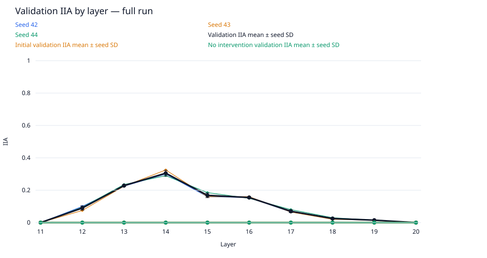
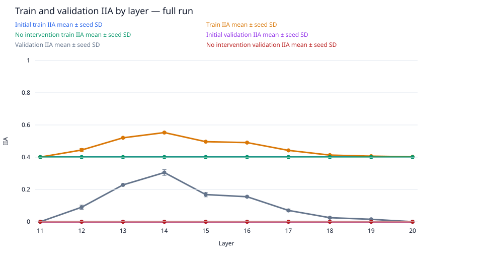
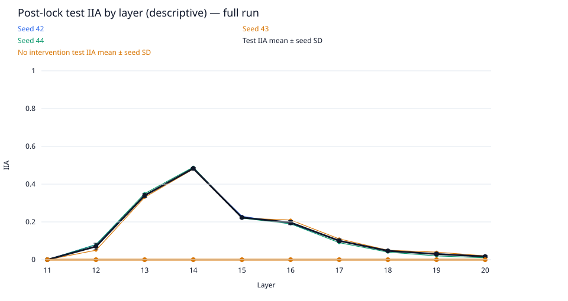
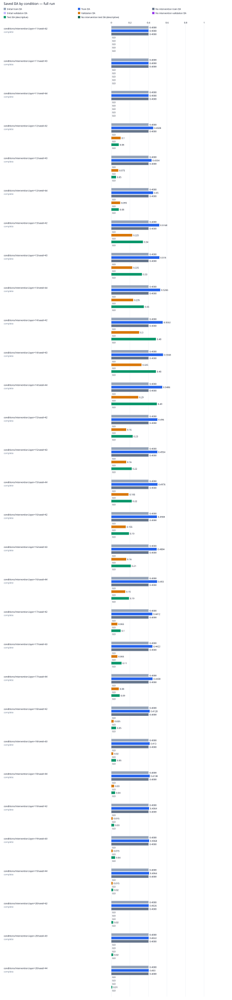

# data-scale / gpt2-medium-rank8-n5000

Run kind: **full**; run status: **complete**.

Config SHA-256: `bfa05eb03ca731db27aa0b6ce3ab78e2771b9958cbcda9a83245756ac4742d4c`.

Conditions: complete=30.

The legacy test set is a descriptive benchmark, previously inspected in earlier runs.
It is not an untouched held-out test.

Selected layer: **14**; metric: `validation_iia`.
The choice was locked in `selection.json` before post-lock evaluation.

| Condition | Status | Initial train IIA | Train IIA | No intervention train IIA | Initial validation IIA | Validation IIA | No intervention validation IIA | Test IIA (descriptive) | No intervention test IIA (descriptive) | Post-lock status |
| --- | --- | --- | --- | --- | --- | --- | --- | --- | --- | --- |
| conditions/intervention.layer=11/seed=42 | complete | 2004/5000 = 0.4008 | 2004/5000 = 0.4008 | 2004/5000 = 0.4008 | 0/200 = 0.0 | 0/200 = 0.0 | 0/200 = 0.0 | 0/100 = 0.0 | 0/100 = 0.0 | complete |
| conditions/intervention.layer=11/seed=43 | complete | 2004/5000 = 0.4008 | 2004/5000 = 0.4008 | 2004/5000 = 0.4008 | 0/200 = 0.0 | 0/200 = 0.0 | 0/200 = 0.0 | 0/100 = 0.0 | 0/100 = 0.0 | complete |
| conditions/intervention.layer=11/seed=44 | complete | 2004/5000 = 0.4008 | 2004/5000 = 0.4008 | 2004/5000 = 0.4008 | 0/200 = 0.0 | 0/200 = 0.0 | 0/200 = 0.0 | 0/100 = 0.0 | 0/100 = 0.0 | complete |
| conditions/intervention.layer=12/seed=42 | complete | 2004/5000 = 0.4008 | 2254/5000 = 0.4508 | 2004/5000 = 0.4008 | 0/200 = 0.0 | 20/200 = 0.1 | 0/200 = 0.0 | 8/100 = 0.08 | 0/100 = 0.0 | complete |
| conditions/intervention.layer=12/seed=43 | complete | 2004/5000 = 0.4008 | 2167/5000 = 0.4334 | 2004/5000 = 0.4008 | 0/200 = 0.0 | 15/200 = 0.075 | 0/200 = 0.0 | 5/100 = 0.05 | 0/100 = 0.0 | complete |
| conditions/intervention.layer=12/seed=44 | complete | 2004/5000 = 0.4008 | 2250/5000 = 0.45 | 2004/5000 = 0.4008 | 0/200 = 0.0 | 19/200 = 0.095 | 0/200 = 0.0 | 8/100 = 0.08 | 0/100 = 0.0 | complete |
| conditions/intervention.layer=13/seed=42 | complete | 2004/5000 = 0.4008 | 2584/5000 = 0.5168 | 2004/5000 = 0.4008 | 0/200 = 0.0 | 45/200 = 0.225 | 0/200 = 0.0 | 34/100 = 0.34 | 0/100 = 0.0 | complete |
| conditions/intervention.layer=13/seed=43 | complete | 2004/5000 = 0.4008 | 2590/5000 = 0.518 | 2004/5000 = 0.4008 | 0/200 = 0.0 | 45/200 = 0.225 | 0/200 = 0.0 | 33/100 = 0.33 | 0/100 = 0.0 | complete |
| conditions/intervention.layer=13/seed=44 | complete | 2004/5000 = 0.4008 | 2633/5000 = 0.5266 | 2004/5000 = 0.4008 | 0/200 = 0.0 | 47/200 = 0.235 | 0/200 = 0.0 | 35/100 = 0.35 | 0/100 = 0.0 | complete |
| conditions/intervention.layer=14/seed=42 | complete | 2004/5000 = 0.4008 | 2766/5000 = 0.5532 | 2004/5000 = 0.4008 | 0/200 = 0.0 | 60/200 = 0.3 | 0/200 = 0.0 | 48/100 = 0.48 | 0/100 = 0.0 | complete |
| conditions/intervention.layer=14/seed=43 | complete | 2004/5000 = 0.4008 | 2784/5000 = 0.5568 | 2004/5000 = 0.4008 | 0/200 = 0.0 | 65/200 = 0.325 | 0/200 = 0.0 | 48/100 = 0.48 | 0/100 = 0.0 | complete |
| conditions/intervention.layer=14/seed=44 | complete | 2004/5000 = 0.4008 | 2743/5000 = 0.5486 | 2004/5000 = 0.4008 | 0/200 = 0.0 | 58/200 = 0.29 | 0/200 = 0.0 | 49/100 = 0.49 | 0/100 = 0.0 | complete |
| conditions/intervention.layer=15/seed=42 | complete | 2004/5000 = 0.4008 | 2480/5000 = 0.496 | 2004/5000 = 0.4008 | 0/200 = 0.0 | 32/200 = 0.16 | 0/200 = 0.0 | 23/100 = 0.23 | 0/100 = 0.0 | complete |
| conditions/intervention.layer=15/seed=43 | complete | 2004/5000 = 0.4008 | 2477/5000 = 0.4954 | 2004/5000 = 0.4008 | 0/200 = 0.0 | 32/200 = 0.16 | 0/200 = 0.0 | 22/100 = 0.22 | 0/100 = 0.0 | complete |
| conditions/intervention.layer=15/seed=44 | complete | 2004/5000 = 0.4008 | 2488/5000 = 0.4976 | 2004/5000 = 0.4008 | 0/200 = 0.0 | 37/200 = 0.185 | 0/200 = 0.0 | 22/100 = 0.22 | 0/100 = 0.0 | complete |
| conditions/intervention.layer=16/seed=42 | complete | 2004/5000 = 0.4008 | 2454/5000 = 0.4908 | 2004/5000 = 0.4008 | 0/200 = 0.0 | 31/200 = 0.155 | 0/200 = 0.0 | 19/100 = 0.19 | 0/100 = 0.0 | complete |
| conditions/intervention.layer=16/seed=43 | complete | 2004/5000 = 0.4008 | 2442/5000 = 0.4884 | 2004/5000 = 0.4008 | 0/200 = 0.0 | 32/200 = 0.16 | 0/200 = 0.0 | 21/100 = 0.21 | 0/100 = 0.0 | complete |
| conditions/intervention.layer=16/seed=44 | complete | 2004/5000 = 0.4008 | 2465/5000 = 0.493 | 2004/5000 = 0.4008 | 0/200 = 0.0 | 30/200 = 0.15 | 0/200 = 0.0 | 19/100 = 0.19 | 0/100 = 0.0 | complete |
| conditions/intervention.layer=17/seed=42 | complete | 2004/5000 = 0.4008 | 2206/5000 = 0.4412 | 2004/5000 = 0.4008 | 0/200 = 0.0 | 13/200 = 0.065 | 0/200 = 0.0 | 10/100 = 0.1 | 0/100 = 0.0 | complete |
| conditions/intervention.layer=17/seed=43 | complete | 2004/5000 = 0.4008 | 2211/5000 = 0.4422 | 2004/5000 = 0.4008 | 0/200 = 0.0 | 13/200 = 0.065 | 0/200 = 0.0 | 11/100 = 0.11 | 0/100 = 0.0 | complete |
| conditions/intervention.layer=17/seed=44 | complete | 2004/5000 = 0.4008 | 2219/5000 = 0.4438 | 2004/5000 = 0.4008 | 0/200 = 0.0 | 16/200 = 0.08 | 0/200 = 0.0 | 9/100 = 0.09 | 0/100 = 0.0 | complete |
| conditions/intervention.layer=18/seed=42 | complete | 2004/5000 = 0.4008 | 2064/5000 = 0.4128 | 2004/5000 = 0.4008 | 0/200 = 0.0 | 5/200 = 0.025 | 0/200 = 0.0 | 5/100 = 0.05 | 0/100 = 0.0 | complete |
| conditions/intervention.layer=18/seed=43 | complete | 2004/5000 = 0.4008 | 2065/5000 = 0.413 | 2004/5000 = 0.4008 | 0/200 = 0.0 | 4/200 = 0.02 | 0/200 = 0.0 | 5/100 = 0.05 | 0/100 = 0.0 | complete |
| conditions/intervention.layer=18/seed=44 | complete | 2004/5000 = 0.4008 | 2069/5000 = 0.4138 | 2004/5000 = 0.4008 | 0/200 = 0.0 | 6/200 = 0.03 | 0/200 = 0.0 | 4/100 = 0.04 | 0/100 = 0.0 | complete |
| conditions/intervention.layer=19/seed=42 | complete | 2004/5000 = 0.4008 | 2032/5000 = 0.4064 | 2004/5000 = 0.4008 | 0/200 = 0.0 | 3/200 = 0.015 | 0/200 = 0.0 | 3/100 = 0.03 | 0/100 = 0.0 | complete |
| conditions/intervention.layer=19/seed=43 | complete | 2004/5000 = 0.4008 | 2034/5000 = 0.4068 | 2004/5000 = 0.4008 | 0/200 = 0.0 | 3/200 = 0.015 | 0/200 = 0.0 | 4/100 = 0.04 | 0/100 = 0.0 | complete |
| conditions/intervention.layer=19/seed=44 | complete | 2004/5000 = 0.4008 | 2032/5000 = 0.4064 | 2004/5000 = 0.4008 | 0/200 = 0.0 | 3/200 = 0.015 | 0/200 = 0.0 | 2/100 = 0.02 | 0/100 = 0.0 | complete |
| conditions/intervention.layer=20/seed=42 | complete | 2004/5000 = 0.4008 | 2013/5000 = 0.4026 | 2004/5000 = 0.4008 | 0/200 = 0.0 | 0/200 = 0.0 | 0/200 = 0.0 | 2/100 = 0.02 | 0/100 = 0.0 | complete |
| conditions/intervention.layer=20/seed=43 | complete | 2004/5000 = 0.4008 | 2011/5000 = 0.4022 | 2004/5000 = 0.4008 | 0/200 = 0.0 | 0/200 = 0.0 | 0/200 = 0.0 | 2/100 = 0.02 | 0/100 = 0.0 | complete |
| conditions/intervention.layer=20/seed=44 | complete | 2004/5000 = 0.4008 | 2015/5000 = 0.403 | 2004/5000 = 0.4008 | 0/200 = 0.0 | 0/200 = 0.0 | 0/200 = 0.0 | 1/100 = 0.01 | 0/100 = 0.0 | complete |

Full-precision metrics and exact counts are saved in `conditions.csv`.
Missing metrics are shown as —; failed and pending conditions remain in the table.

Per-layer means and sample SD across seeds are saved in `layer_summary.csv`.
Seed SD describes variation across seeds; it is not a confidence interval.
A single available seed has no sample SD. Incomplete layers are flagged in the CSV.

Per-pairing and target-change groups (counts summed across seeds; means give equal weight to each seed):

| Layer | Split | Group | IIA | No-intervention IIA |
| --- | --- | --- | --- | --- |
| 11 | initial_train | ABB->ABB | 3021/3750; mean 0.8056 | 3021/3750; mean 0.8056 |
| 11 | initial_train | ABB->BAB | 0/3750; mean 0.0 | 0/3750; mean 0.0 |
| 11 | initial_train | BAB->ABB | 0/3750; mean 0.0 | 0/3750; mean 0.0 |
| 11 | initial_train | BAB->BAB | 2991/3750; mean 0.7976 | 2991/3750; mean 0.7976 |
| 11 | initial_train | switch_required | 0/7500; mean 0.0 | 0/7500; mean 0.0 |
| 11 | initial_train | unchanged_target | 6012/7500; mean 0.8016 | 6012/7500; mean 0.8016 |
| 12 | initial_train | ABB->ABB | 3021/3750; mean 0.8056 | 3021/3750; mean 0.8056 |
| 12 | initial_train | ABB->BAB | 0/3750; mean 0.0 | 0/3750; mean 0.0 |
| 12 | initial_train | BAB->ABB | 0/3750; mean 0.0 | 0/3750; mean 0.0 |
| 12 | initial_train | BAB->BAB | 2991/3750; mean 0.7976 | 2991/3750; mean 0.7976 |
| 12 | initial_train | switch_required | 0/7500; mean 0.0 | 0/7500; mean 0.0 |
| 12 | initial_train | unchanged_target | 6012/7500; mean 0.8016 | 6012/7500; mean 0.8016 |
| 13 | initial_train | ABB->ABB | 3021/3750; mean 0.8056 | 3021/3750; mean 0.8056 |
| 13 | initial_train | ABB->BAB | 0/3750; mean 0.0 | 0/3750; mean 0.0 |
| 13 | initial_train | BAB->ABB | 0/3750; mean 0.0 | 0/3750; mean 0.0 |
| 13 | initial_train | BAB->BAB | 2991/3750; mean 0.7976 | 2991/3750; mean 0.7976 |
| 13 | initial_train | switch_required | 0/7500; mean 0.0 | 0/7500; mean 0.0 |
| 13 | initial_train | unchanged_target | 6012/7500; mean 0.8016 | 6012/7500; mean 0.8016 |
| 14 | initial_train | ABB->ABB | 3021/3750; mean 0.8056 | 3021/3750; mean 0.8056 |
| 14 | initial_train | ABB->BAB | 0/3750; mean 0.0 | 0/3750; mean 0.0 |
| 14 | initial_train | BAB->ABB | 0/3750; mean 0.0 | 0/3750; mean 0.0 |
| 14 | initial_train | BAB->BAB | 2991/3750; mean 0.7976 | 2991/3750; mean 0.7976 |
| 14 | initial_train | switch_required | 0/7500; mean 0.0 | 0/7500; mean 0.0 |
| 14 | initial_train | unchanged_target | 6012/7500; mean 0.8016 | 6012/7500; mean 0.8016 |
| 15 | initial_train | ABB->ABB | 3021/3750; mean 0.8056 | 3021/3750; mean 0.8056 |
| 15 | initial_train | ABB->BAB | 0/3750; mean 0.0 | 0/3750; mean 0.0 |
| 15 | initial_train | BAB->ABB | 0/3750; mean 0.0 | 0/3750; mean 0.0 |
| 15 | initial_train | BAB->BAB | 2991/3750; mean 0.7976 | 2991/3750; mean 0.7976 |
| 15 | initial_train | switch_required | 0/7500; mean 0.0 | 0/7500; mean 0.0 |
| 15 | initial_train | unchanged_target | 6012/7500; mean 0.8016 | 6012/7500; mean 0.8016 |
| 16 | initial_train | ABB->ABB | 3021/3750; mean 0.8056 | 3021/3750; mean 0.8056 |
| 16 | initial_train | ABB->BAB | 0/3750; mean 0.0 | 0/3750; mean 0.0 |
| 16 | initial_train | BAB->ABB | 0/3750; mean 0.0 | 0/3750; mean 0.0 |
| 16 | initial_train | BAB->BAB | 2991/3750; mean 0.7976 | 2991/3750; mean 0.7976 |
| 16 | initial_train | switch_required | 0/7500; mean 0.0 | 0/7500; mean 0.0 |
| 16 | initial_train | unchanged_target | 6012/7500; mean 0.8016 | 6012/7500; mean 0.8016 |
| 17 | initial_train | ABB->ABB | 3021/3750; mean 0.8056 | 3021/3750; mean 0.8056 |
| 17 | initial_train | ABB->BAB | 0/3750; mean 0.0 | 0/3750; mean 0.0 |
| 17 | initial_train | BAB->ABB | 0/3750; mean 0.0 | 0/3750; mean 0.0 |
| 17 | initial_train | BAB->BAB | 2991/3750; mean 0.7976 | 2991/3750; mean 0.7976 |
| 17 | initial_train | switch_required | 0/7500; mean 0.0 | 0/7500; mean 0.0 |
| 17 | initial_train | unchanged_target | 6012/7500; mean 0.8016 | 6012/7500; mean 0.8016 |
| 18 | initial_train | ABB->ABB | 3021/3750; mean 0.8056 | 3021/3750; mean 0.8056 |
| 18 | initial_train | ABB->BAB | 0/3750; mean 0.0 | 0/3750; mean 0.0 |
| 18 | initial_train | BAB->ABB | 0/3750; mean 0.0 | 0/3750; mean 0.0 |
| 18 | initial_train | BAB->BAB | 2991/3750; mean 0.7976 | 2991/3750; mean 0.7976 |
| 18 | initial_train | switch_required | 0/7500; mean 0.0 | 0/7500; mean 0.0 |
| 18 | initial_train | unchanged_target | 6012/7500; mean 0.8016 | 6012/7500; mean 0.8016 |
| 19 | initial_train | ABB->ABB | 3021/3750; mean 0.8056 | 3021/3750; mean 0.8056 |
| 19 | initial_train | ABB->BAB | 0/3750; mean 0.0 | 0/3750; mean 0.0 |
| 19 | initial_train | BAB->ABB | 0/3750; mean 0.0 | 0/3750; mean 0.0 |
| 19 | initial_train | BAB->BAB | 2991/3750; mean 0.7976 | 2991/3750; mean 0.7976 |
| 19 | initial_train | switch_required | 0/7500; mean 0.0 | 0/7500; mean 0.0 |
| 19 | initial_train | unchanged_target | 6012/7500; mean 0.8016 | 6012/7500; mean 0.8016 |
| 20 | initial_train | ABB->ABB | 3021/3750; mean 0.8056 | 3021/3750; mean 0.8056 |
| 20 | initial_train | ABB->BAB | 0/3750; mean 0.0 | 0/3750; mean 0.0 |
| 20 | initial_train | BAB->ABB | 0/3750; mean 0.0 | 0/3750; mean 0.0 |
| 20 | initial_train | BAB->BAB | 2991/3750; mean 0.7976 | 2991/3750; mean 0.7976 |
| 20 | initial_train | switch_required | 0/7500; mean 0.0 | 0/7500; mean 0.0 |
| 20 | initial_train | unchanged_target | 6012/7500; mean 0.8016 | 6012/7500; mean 0.8016 |
| 11 | train | ABB->ABB | 3021/3750; mean 0.8056 | 3021/3750; mean 0.8056 |
| 11 | train | ABB->BAB | 0/3750; mean 0.0 | 0/3750; mean 0.0 |
| 11 | train | BAB->ABB | 0/3750; mean 0.0 | 0/3750; mean 0.0 |
| 11 | train | BAB->BAB | 2991/3750; mean 0.7976 | 2991/3750; mean 0.7976 |
| 11 | train | switch_required | 0/7500; mean 0.0 | 0/7500; mean 0.0 |
| 11 | train | unchanged_target | 6012/7500; mean 0.8016 | 6012/7500; mean 0.8016 |
| 12 | train | ABB->ABB | 3021/3750; mean 0.8056 | 3021/3750; mean 0.8056 |
| 12 | train | ABB->BAB | 19/3750; mean 0.005066666666666666 | 0/3750; mean 0.0 |
| 12 | train | BAB->ABB | 640/3750; mean 0.17066666666666666 | 0/3750; mean 0.0 |
| 12 | train | BAB->BAB | 2991/3750; mean 0.7976 | 2991/3750; mean 0.7976 |
| 12 | train | switch_required | 659/7500; mean 0.08786666666666666 | 0/7500; mean 0.0 |
| 12 | train | unchanged_target | 6012/7500; mean 0.8016 | 6012/7500; mean 0.8016 |
| 13 | train | ABB->ABB | 3021/3750; mean 0.8056 | 3021/3750; mean 0.8056 |
| 13 | train | ABB->BAB | 321/3750; mean 0.0856 | 0/3750; mean 0.0 |
| 13 | train | BAB->ABB | 1474/3750; mean 0.3930666666666667 | 0/3750; mean 0.0 |
| 13 | train | BAB->BAB | 2991/3750; mean 0.7976 | 2991/3750; mean 0.7976 |
| 13 | train | switch_required | 1795/7500; mean 0.23933333333333334 | 0/7500; mean 0.0 |
| 13 | train | unchanged_target | 6012/7500; mean 0.8016 | 6012/7500; mean 0.8016 |
| 14 | train | ABB->ABB | 3021/3750; mean 0.8056 | 3021/3750; mean 0.8056 |
| 14 | train | ABB->BAB | 1083/3750; mean 0.2888 | 0/3750; mean 0.0 |
| 14 | train | BAB->ABB | 1198/3750; mean 0.3194666666666667 | 0/3750; mean 0.0 |
| 14 | train | BAB->BAB | 2991/3750; mean 0.7976 | 2991/3750; mean 0.7976 |
| 14 | train | switch_required | 2281/7500; mean 0.3041333333333333 | 0/7500; mean 0.0 |
| 14 | train | unchanged_target | 6012/7500; mean 0.8016 | 6012/7500; mean 0.8016 |
| 15 | train | ABB->ABB | 3021/3750; mean 0.8056 | 3021/3750; mean 0.8056 |
| 15 | train | ABB->BAB | 444/3750; mean 0.1184 | 0/3750; mean 0.0 |
| 15 | train | BAB->ABB | 989/3750; mean 0.2637333333333333 | 0/3750; mean 0.0 |
| 15 | train | BAB->BAB | 2991/3750; mean 0.7976 | 2991/3750; mean 0.7976 |
| 15 | train | switch_required | 1433/7500; mean 0.19106666666666666 | 0/7500; mean 0.0 |
| 15 | train | unchanged_target | 6012/7500; mean 0.8016 | 6012/7500; mean 0.8016 |
| 16 | train | ABB->ABB | 3021/3750; mean 0.8056 | 3021/3750; mean 0.8056 |
| 16 | train | ABB->BAB | 500/3750; mean 0.13333333333333333 | 0/3750; mean 0.0 |
| 16 | train | BAB->ABB | 849/3750; mean 0.22640000000000002 | 0/3750; mean 0.0 |
| 16 | train | BAB->BAB | 2991/3750; mean 0.7976 | 2991/3750; mean 0.7976 |
| 16 | train | switch_required | 1349/7500; mean 0.17986666666666667 | 0/7500; mean 0.0 |
| 16 | train | unchanged_target | 6012/7500; mean 0.8016 | 6012/7500; mean 0.8016 |
| 17 | train | ABB->ABB | 3021/3750; mean 0.8056 | 3021/3750; mean 0.8056 |
| 17 | train | ABB->BAB | 235/3750; mean 0.06266666666666666 | 0/3750; mean 0.0 |
| 17 | train | BAB->ABB | 389/3750; mean 0.10373333333333333 | 0/3750; mean 0.0 |
| 17 | train | BAB->BAB | 2991/3750; mean 0.7976 | 2991/3750; mean 0.7976 |
| 17 | train | switch_required | 624/7500; mean 0.0832 | 0/7500; mean 0.0 |
| 17 | train | unchanged_target | 6012/7500; mean 0.8016 | 6012/7500; mean 0.8016 |
| 18 | train | ABB->ABB | 3021/3750; mean 0.8056 | 3021/3750; mean 0.8056 |
| 18 | train | ABB->BAB | 70/3750; mean 0.018666666666666665 | 0/3750; mean 0.0 |
| 18 | train | BAB->ABB | 116/3750; mean 0.030933333333333334 | 0/3750; mean 0.0 |
| 18 | train | BAB->BAB | 2991/3750; mean 0.7976 | 2991/3750; mean 0.7976 |
| 18 | train | switch_required | 186/7500; mean 0.0248 | 0/7500; mean 0.0 |
| 18 | train | unchanged_target | 6012/7500; mean 0.8016 | 6012/7500; mean 0.8016 |
| 19 | train | ABB->ABB | 3021/3750; mean 0.8056 | 3021/3750; mean 0.8056 |
| 19 | train | ABB->BAB | 32/3750; mean 0.008533333333333334 | 0/3750; mean 0.0 |
| 19 | train | BAB->ABB | 54/3750; mean 0.0144 | 0/3750; mean 0.0 |
| 19 | train | BAB->BAB | 2991/3750; mean 0.7976 | 2991/3750; mean 0.7976 |
| 19 | train | switch_required | 86/7500; mean 0.011466666666666667 | 0/7500; mean 0.0 |
| 19 | train | unchanged_target | 6012/7500; mean 0.8016 | 6012/7500; mean 0.8016 |
| 20 | train | ABB->ABB | 3021/3750; mean 0.8056 | 3021/3750; mean 0.8056 |
| 20 | train | ABB->BAB | 14/3750; mean 0.0037333333333333333 | 0/3750; mean 0.0 |
| 20 | train | BAB->ABB | 13/3750; mean 0.0034666666666666665 | 0/3750; mean 0.0 |
| 20 | train | BAB->BAB | 2991/3750; mean 0.7976 | 2991/3750; mean 0.7976 |
| 20 | train | switch_required | 27/7500; mean 0.0036 | 0/7500; mean 0.0 |
| 20 | train | unchanged_target | 6012/7500; mean 0.8016 | 6012/7500; mean 0.8016 |
| 11 | initial_validation | ABB->ABB | 0/0; mean — | 0/0; mean — |
| 11 | initial_validation | ABB->BAB | 0/300; mean 0.0 | 0/300; mean 0.0 |
| 11 | initial_validation | BAB->ABB | 0/300; mean 0.0 | 0/300; mean 0.0 |
| 11 | initial_validation | BAB->BAB | 0/0; mean — | 0/0; mean — |
| 11 | initial_validation | switch_required | 0/600; mean 0.0 | 0/600; mean 0.0 |
| 11 | initial_validation | unchanged_target | 0/0; mean — | 0/0; mean — |
| 12 | initial_validation | ABB->ABB | 0/0; mean — | 0/0; mean — |
| 12 | initial_validation | ABB->BAB | 0/300; mean 0.0 | 0/300; mean 0.0 |
| 12 | initial_validation | BAB->ABB | 0/300; mean 0.0 | 0/300; mean 0.0 |
| 12 | initial_validation | BAB->BAB | 0/0; mean — | 0/0; mean — |
| 12 | initial_validation | switch_required | 0/600; mean 0.0 | 0/600; mean 0.0 |
| 12 | initial_validation | unchanged_target | 0/0; mean — | 0/0; mean — |
| 13 | initial_validation | ABB->ABB | 0/0; mean — | 0/0; mean — |
| 13 | initial_validation | ABB->BAB | 0/300; mean 0.0 | 0/300; mean 0.0 |
| 13 | initial_validation | BAB->ABB | 0/300; mean 0.0 | 0/300; mean 0.0 |
| 13 | initial_validation | BAB->BAB | 0/0; mean — | 0/0; mean — |
| 13 | initial_validation | switch_required | 0/600; mean 0.0 | 0/600; mean 0.0 |
| 13 | initial_validation | unchanged_target | 0/0; mean — | 0/0; mean — |
| 14 | initial_validation | ABB->ABB | 0/0; mean — | 0/0; mean — |
| 14 | initial_validation | ABB->BAB | 0/300; mean 0.0 | 0/300; mean 0.0 |
| 14 | initial_validation | BAB->ABB | 0/300; mean 0.0 | 0/300; mean 0.0 |
| 14 | initial_validation | BAB->BAB | 0/0; mean — | 0/0; mean — |
| 14 | initial_validation | switch_required | 0/600; mean 0.0 | 0/600; mean 0.0 |
| 14 | initial_validation | unchanged_target | 0/0; mean — | 0/0; mean — |
| 15 | initial_validation | ABB->ABB | 0/0; mean — | 0/0; mean — |
| 15 | initial_validation | ABB->BAB | 0/300; mean 0.0 | 0/300; mean 0.0 |
| 15 | initial_validation | BAB->ABB | 0/300; mean 0.0 | 0/300; mean 0.0 |
| 15 | initial_validation | BAB->BAB | 0/0; mean — | 0/0; mean — |
| 15 | initial_validation | switch_required | 0/600; mean 0.0 | 0/600; mean 0.0 |
| 15 | initial_validation | unchanged_target | 0/0; mean — | 0/0; mean — |
| 16 | initial_validation | ABB->ABB | 0/0; mean — | 0/0; mean — |
| 16 | initial_validation | ABB->BAB | 0/300; mean 0.0 | 0/300; mean 0.0 |
| 16 | initial_validation | BAB->ABB | 0/300; mean 0.0 | 0/300; mean 0.0 |
| 16 | initial_validation | BAB->BAB | 0/0; mean — | 0/0; mean — |
| 16 | initial_validation | switch_required | 0/600; mean 0.0 | 0/600; mean 0.0 |
| 16 | initial_validation | unchanged_target | 0/0; mean — | 0/0; mean — |
| 17 | initial_validation | ABB->ABB | 0/0; mean — | 0/0; mean — |
| 17 | initial_validation | ABB->BAB | 0/300; mean 0.0 | 0/300; mean 0.0 |
| 17 | initial_validation | BAB->ABB | 0/300; mean 0.0 | 0/300; mean 0.0 |
| 17 | initial_validation | BAB->BAB | 0/0; mean — | 0/0; mean — |
| 17 | initial_validation | switch_required | 0/600; mean 0.0 | 0/600; mean 0.0 |
| 17 | initial_validation | unchanged_target | 0/0; mean — | 0/0; mean — |
| 18 | initial_validation | ABB->ABB | 0/0; mean — | 0/0; mean — |
| 18 | initial_validation | ABB->BAB | 0/300; mean 0.0 | 0/300; mean 0.0 |
| 18 | initial_validation | BAB->ABB | 0/300; mean 0.0 | 0/300; mean 0.0 |
| 18 | initial_validation | BAB->BAB | 0/0; mean — | 0/0; mean — |
| 18 | initial_validation | switch_required | 0/600; mean 0.0 | 0/600; mean 0.0 |
| 18 | initial_validation | unchanged_target | 0/0; mean — | 0/0; mean — |
| 19 | initial_validation | ABB->ABB | 0/0; mean — | 0/0; mean — |
| 19 | initial_validation | ABB->BAB | 0/300; mean 0.0 | 0/300; mean 0.0 |
| 19 | initial_validation | BAB->ABB | 0/300; mean 0.0 | 0/300; mean 0.0 |
| 19 | initial_validation | BAB->BAB | 0/0; mean — | 0/0; mean — |
| 19 | initial_validation | switch_required | 0/600; mean 0.0 | 0/600; mean 0.0 |
| 19 | initial_validation | unchanged_target | 0/0; mean — | 0/0; mean — |
| 20 | initial_validation | ABB->ABB | 0/0; mean — | 0/0; mean — |
| 20 | initial_validation | ABB->BAB | 0/300; mean 0.0 | 0/300; mean 0.0 |
| 20 | initial_validation | BAB->ABB | 0/300; mean 0.0 | 0/300; mean 0.0 |
| 20 | initial_validation | BAB->BAB | 0/0; mean — | 0/0; mean — |
| 20 | initial_validation | switch_required | 0/600; mean 0.0 | 0/600; mean 0.0 |
| 20 | initial_validation | unchanged_target | 0/0; mean — | 0/0; mean — |
| 11 | validation | ABB->ABB | 0/0; mean — | 0/0; mean — |
| 11 | validation | ABB->BAB | 0/300; mean 0.0 | 0/300; mean 0.0 |
| 11 | validation | BAB->ABB | 0/300; mean 0.0 | 0/300; mean 0.0 |
| 11 | validation | BAB->BAB | 0/0; mean — | 0/0; mean — |
| 11 | validation | switch_required | 0/600; mean 0.0 | 0/600; mean 0.0 |
| 11 | validation | unchanged_target | 0/0; mean — | 0/0; mean — |
| 12 | validation | ABB->ABB | 0/0; mean — | 0/0; mean — |
| 12 | validation | ABB->BAB | 4/300; mean 0.013333333333333334 | 0/300; mean 0.0 |
| 12 | validation | BAB->ABB | 50/300; mean 0.16666666666666666 | 0/300; mean 0.0 |
| 12 | validation | BAB->BAB | 0/0; mean — | 0/0; mean — |
| 12 | validation | switch_required | 54/600; mean 0.09 | 0/600; mean 0.0 |
| 12 | validation | unchanged_target | 0/0; mean — | 0/0; mean — |
| 13 | validation | ABB->ABB | 0/0; mean — | 0/0; mean — |
| 13 | validation | ABB->BAB | 36/300; mean 0.12000000000000001 | 0/300; mean 0.0 |
| 13 | validation | BAB->ABB | 101/300; mean 0.33666666666666667 | 0/300; mean 0.0 |
| 13 | validation | BAB->BAB | 0/0; mean — | 0/0; mean — |
| 13 | validation | switch_required | 137/600; mean 0.22833333333333333 | 0/600; mean 0.0 |
| 13 | validation | unchanged_target | 0/0; mean — | 0/0; mean — |
| 14 | validation | ABB->ABB | 0/0; mean — | 0/0; mean — |
| 14 | validation | ABB->BAB | 103/300; mean 0.3433333333333333 | 0/300; mean 0.0 |
| 14 | validation | BAB->ABB | 80/300; mean 0.26666666666666666 | 0/300; mean 0.0 |
| 14 | validation | BAB->BAB | 0/0; mean — | 0/0; mean — |
| 14 | validation | switch_required | 183/600; mean 0.305 | 0/600; mean 0.0 |
| 14 | validation | unchanged_target | 0/0; mean — | 0/0; mean — |
| 15 | validation | ABB->ABB | 0/0; mean — | 0/0; mean — |
| 15 | validation | ABB->BAB | 35/300; mean 0.11666666666666667 | 0/300; mean 0.0 |
| 15 | validation | BAB->ABB | 66/300; mean 0.22 | 0/300; mean 0.0 |
| 15 | validation | BAB->BAB | 0/0; mean — | 0/0; mean — |
| 15 | validation | switch_required | 101/600; mean 0.16833333333333333 | 0/600; mean 0.0 |
| 15 | validation | unchanged_target | 0/0; mean — | 0/0; mean — |
| 16 | validation | ABB->ABB | 0/0; mean — | 0/0; mean — |
| 16 | validation | ABB->BAB | 33/300; mean 0.11 | 0/300; mean 0.0 |
| 16 | validation | BAB->ABB | 60/300; mean 0.2 | 0/300; mean 0.0 |
| 16 | validation | BAB->BAB | 0/0; mean — | 0/0; mean — |
| 16 | validation | switch_required | 93/600; mean 0.155 | 0/600; mean 0.0 |
| 16 | validation | unchanged_target | 0/0; mean — | 0/0; mean — |
| 17 | validation | ABB->ABB | 0/0; mean — | 0/0; mean — |
| 17 | validation | ABB->BAB | 9/300; mean 0.03 | 0/300; mean 0.0 |
| 17 | validation | BAB->ABB | 33/300; mean 0.11 | 0/300; mean 0.0 |
| 17 | validation | BAB->BAB | 0/0; mean — | 0/0; mean — |
| 17 | validation | switch_required | 42/600; mean 0.07 | 0/600; mean 0.0 |
| 17 | validation | unchanged_target | 0/0; mean — | 0/0; mean — |
| 18 | validation | ABB->ABB | 0/0; mean — | 0/0; mean — |
| 18 | validation | ABB->BAB | 6/300; mean 0.02 | 0/300; mean 0.0 |
| 18 | validation | BAB->ABB | 9/300; mean 0.03 | 0/300; mean 0.0 |
| 18 | validation | BAB->BAB | 0/0; mean — | 0/0; mean — |
| 18 | validation | switch_required | 15/600; mean 0.025 | 0/600; mean 0.0 |
| 18 | validation | unchanged_target | 0/0; mean — | 0/0; mean — |
| 19 | validation | ABB->ABB | 0/0; mean — | 0/0; mean — |
| 19 | validation | ABB->BAB | 6/300; mean 0.02 | 0/300; mean 0.0 |
| 19 | validation | BAB->ABB | 3/300; mean 0.01 | 0/300; mean 0.0 |
| 19 | validation | BAB->BAB | 0/0; mean — | 0/0; mean — |
| 19 | validation | switch_required | 9/600; mean 0.015 | 0/600; mean 0.0 |
| 19 | validation | unchanged_target | 0/0; mean — | 0/0; mean — |
| 20 | validation | ABB->ABB | 0/0; mean — | 0/0; mean — |
| 20 | validation | ABB->BAB | 0/300; mean 0.0 | 0/300; mean 0.0 |
| 20 | validation | BAB->ABB | 0/300; mean 0.0 | 0/300; mean 0.0 |
| 20 | validation | BAB->BAB | 0/0; mean — | 0/0; mean — |
| 20 | validation | switch_required | 0/600; mean 0.0 | 0/600; mean 0.0 |
| 20 | validation | unchanged_target | 0/0; mean — | 0/0; mean — |
| 11 | test | ABB->ABB | 0/0; mean — | 0/0; mean — |
| 11 | test | ABB->BAB | 0/150; mean 0.0 | 0/150; mean 0.0 |
| 11 | test | BAB->ABB | 0/150; mean 0.0 | 0/150; mean 0.0 |
| 11 | test | BAB->BAB | 0/0; mean — | 0/0; mean — |
| 11 | test | switch_required | 0/300; mean 0.0 | 0/300; mean 0.0 |
| 11 | test | unchanged_target | 0/0; mean — | 0/0; mean — |
| 12 | test | ABB->ABB | 0/0; mean — | 0/0; mean — |
| 12 | test | ABB->BAB | 4/150; mean 0.02666666666666667 | 0/150; mean 0.0 |
| 12 | test | BAB->ABB | 17/150; mean 0.11333333333333334 | 0/150; mean 0.0 |
| 12 | test | BAB->BAB | 0/0; mean — | 0/0; mean — |
| 12 | test | switch_required | 21/300; mean 0.07 | 0/300; mean 0.0 |
| 12 | test | unchanged_target | 0/0; mean — | 0/0; mean — |
| 13 | test | ABB->ABB | 0/0; mean — | 0/0; mean — |
| 13 | test | ABB->BAB | 23/150; mean 0.15333333333333332 | 0/150; mean 0.0 |
| 13 | test | BAB->ABB | 79/150; mean 0.5266666666666666 | 0/150; mean 0.0 |
| 13 | test | BAB->BAB | 0/0; mean — | 0/0; mean — |
| 13 | test | switch_required | 102/300; mean 0.34 | 0/300; mean 0.0 |
| 13 | test | unchanged_target | 0/0; mean — | 0/0; mean — |
| 14 | test | ABB->ABB | 0/0; mean — | 0/0; mean — |
| 14 | test | ABB->BAB | 80/150; mean 0.5333333333333333 | 0/150; mean 0.0 |
| 14 | test | BAB->ABB | 65/150; mean 0.43333333333333335 | 0/150; mean 0.0 |
| 14 | test | BAB->BAB | 0/0; mean — | 0/0; mean — |
| 14 | test | switch_required | 145/300; mean 0.48333333333333334 | 0/300; mean 0.0 |
| 14 | test | unchanged_target | 0/0; mean — | 0/0; mean — |
| 15 | test | ABB->ABB | 0/0; mean — | 0/0; mean — |
| 15 | test | ABB->BAB | 32/150; mean 0.21333333333333332 | 0/150; mean 0.0 |
| 15 | test | BAB->ABB | 35/150; mean 0.23333333333333334 | 0/150; mean 0.0 |
| 15 | test | BAB->BAB | 0/0; mean — | 0/0; mean — |
| 15 | test | switch_required | 67/300; mean 0.22333333333333333 | 0/300; mean 0.0 |
| 15 | test | unchanged_target | 0/0; mean — | 0/0; mean — |
| 16 | test | ABB->ABB | 0/0; mean — | 0/0; mean — |
| 16 | test | ABB->BAB | 36/150; mean 0.24 | 0/150; mean 0.0 |
| 16 | test | BAB->ABB | 23/150; mean 0.15333333333333335 | 0/150; mean 0.0 |
| 16 | test | BAB->BAB | 0/0; mean — | 0/0; mean — |
| 16 | test | switch_required | 59/300; mean 0.19666666666666666 | 0/300; mean 0.0 |
| 16 | test | unchanged_target | 0/0; mean — | 0/0; mean — |
| 17 | test | ABB->ABB | 0/0; mean — | 0/0; mean — |
| 17 | test | ABB->BAB | 18/150; mean 0.12000000000000001 | 0/150; mean 0.0 |
| 17 | test | BAB->ABB | 12/150; mean 0.08 | 0/150; mean 0.0 |
| 17 | test | BAB->BAB | 0/0; mean — | 0/0; mean — |
| 17 | test | switch_required | 30/300; mean 0.1 | 0/300; mean 0.0 |
| 17 | test | unchanged_target | 0/0; mean — | 0/0; mean — |
| 18 | test | ABB->ABB | 0/0; mean — | 0/0; mean — |
| 18 | test | ABB->BAB | 11/150; mean 0.07333333333333333 | 0/150; mean 0.0 |
| 18 | test | BAB->ABB | 3/150; mean 0.02 | 0/150; mean 0.0 |
| 18 | test | BAB->BAB | 0/0; mean — | 0/0; mean — |
| 18 | test | switch_required | 14/300; mean 0.04666666666666667 | 0/300; mean 0.0 |
| 18 | test | unchanged_target | 0/0; mean — | 0/0; mean — |
| 19 | test | ABB->ABB | 0/0; mean — | 0/0; mean — |
| 19 | test | ABB->BAB | 6/150; mean 0.04 | 0/150; mean 0.0 |
| 19 | test | BAB->ABB | 3/150; mean 0.02 | 0/150; mean 0.0 |
| 19 | test | BAB->BAB | 0/0; mean — | 0/0; mean — |
| 19 | test | switch_required | 9/300; mean 0.03 | 0/300; mean 0.0 |
| 19 | test | unchanged_target | 0/0; mean — | 0/0; mean — |
| 20 | test | ABB->ABB | 0/0; mean — | 0/0; mean — |
| 20 | test | ABB->BAB | 2/150; mean 0.013333333333333334 | 0/150; mean 0.0 |
| 20 | test | BAB->ABB | 3/150; mean 0.02 | 0/150; mean 0.0 |
| 20 | test | BAB->BAB | 0/0; mean — | 0/0; mean — |
| 20 | test | switch_required | 5/300; mean 0.016666666666666666 | 0/300; mean 0.0 |
| 20 | test | unchanged_target | 0/0; mean — | 0/0; mean — |

