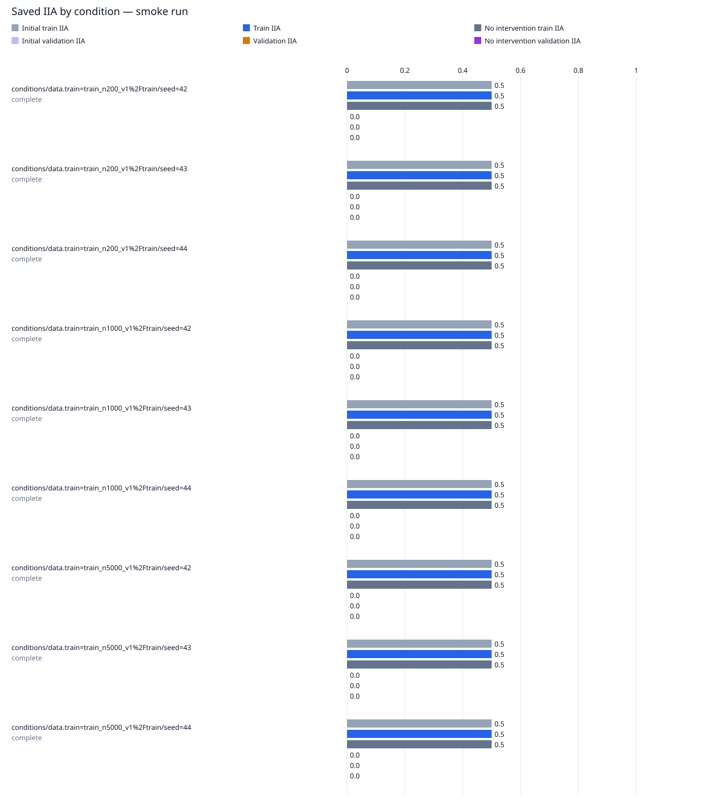

# data-scale / gpt2-small-layer8-placeholder-equal-updates

Run kind: **smoke**; run status: **complete**.

Config SHA-256: `6848c5955455504db861b4048591e9d05e1ff00ec30c1235123f5a185dcc5bbd`.

Conditions: complete=9.

This is a smoke run for execution checks; it is not a full experimental result.

| Train dataset | Train SHA-256 | Condition | Status | Initial train IIA | Train IIA | No intervention train IIA | Initial validation IIA | Validation IIA | No intervention validation IIA |
| --- | --- | --- | --- | --- | --- | --- | --- | --- | --- |
| train_n200_v1/train | da4ad541c74596a750eb547be5296b62cfcd47da11403d525a8469fdc2fa805e | conditions/data.train=train_n200_v1%2Ftrain/seed=42 | complete | 10/20 = 0.5 | 10/20 = 0.5 | 10/20 = 0.5 | 0/4 = 0.0 | 0/4 = 0.0 | 0/4 = 0.0 |
| train_n200_v1/train | da4ad541c74596a750eb547be5296b62cfcd47da11403d525a8469fdc2fa805e | conditions/data.train=train_n200_v1%2Ftrain/seed=43 | complete | 10/20 = 0.5 | 10/20 = 0.5 | 10/20 = 0.5 | 0/4 = 0.0 | 0/4 = 0.0 | 0/4 = 0.0 |
| train_n200_v1/train | da4ad541c74596a750eb547be5296b62cfcd47da11403d525a8469fdc2fa805e | conditions/data.train=train_n200_v1%2Ftrain/seed=44 | complete | 10/20 = 0.5 | 10/20 = 0.5 | 10/20 = 0.5 | 0/4 = 0.0 | 0/4 = 0.0 | 0/4 = 0.0 |
| train_n1000_v1/train | b45c8b66eb321dea0f2250585f7ee32cab9f4918a0366c9e431750acf964cd67 | conditions/data.train=train_n1000_v1%2Ftrain/seed=42 | complete | 10/20 = 0.5 | 10/20 = 0.5 | 10/20 = 0.5 | 0/4 = 0.0 | 0/4 = 0.0 | 0/4 = 0.0 |
| train_n1000_v1/train | b45c8b66eb321dea0f2250585f7ee32cab9f4918a0366c9e431750acf964cd67 | conditions/data.train=train_n1000_v1%2Ftrain/seed=43 | complete | 10/20 = 0.5 | 10/20 = 0.5 | 10/20 = 0.5 | 0/4 = 0.0 | 0/4 = 0.0 | 0/4 = 0.0 |
| train_n1000_v1/train | b45c8b66eb321dea0f2250585f7ee32cab9f4918a0366c9e431750acf964cd67 | conditions/data.train=train_n1000_v1%2Ftrain/seed=44 | complete | 10/20 = 0.5 | 10/20 = 0.5 | 10/20 = 0.5 | 0/4 = 0.0 | 0/4 = 0.0 | 0/4 = 0.0 |
| train_n5000_v1/train | 5d4e2014c7e88a2e7cb761ff6f569bbb12dc7a2fccbb35e9d13947702076ceed | conditions/data.train=train_n5000_v1%2Ftrain/seed=42 | complete | 10/20 = 0.5 | 10/20 = 0.5 | 10/20 = 0.5 | 0/4 = 0.0 | 0/4 = 0.0 | 0/4 = 0.0 |
| train_n5000_v1/train | 5d4e2014c7e88a2e7cb761ff6f569bbb12dc7a2fccbb35e9d13947702076ceed | conditions/data.train=train_n5000_v1%2Ftrain/seed=43 | complete | 10/20 = 0.5 | 10/20 = 0.5 | 10/20 = 0.5 | 0/4 = 0.0 | 0/4 = 0.0 | 0/4 = 0.0 |
| train_n5000_v1/train | 5d4e2014c7e88a2e7cb761ff6f569bbb12dc7a2fccbb35e9d13947702076ceed | conditions/data.train=train_n5000_v1%2Ftrain/seed=44 | complete | 10/20 = 0.5 | 10/20 = 0.5 | 10/20 = 0.5 | 0/4 = 0.0 | 0/4 = 0.0 | 0/4 = 0.0 |

Full-precision metrics and exact counts are saved in `conditions.csv`.
Missing metrics are shown as —; failed and pending conditions remain in the table.

Per-layer means and sample SD across seeds are grouped by train dataset in `layer_summary.csv`.
Seed SD describes variation across seeds; it is not a confidence interval.
A single available seed has no sample SD. Incomplete layers are flagged in the CSV.

Per-pairing and target-change groups (counts summed across seeds within each train dataset; means give equal weight to each seed):

| Train dataset | Train SHA-256 | Layer | Split | Group | IIA | No-intervention IIA |
| --- | --- | --- | --- | --- | --- | --- |
| train_n200_v1/train | da4ad541c74596a750eb547be5296b62cfcd47da11403d525a8469fdc2fa805e | 8 | initial_train | ABB->ABB | 15/15; mean 1.0 | 15/15; mean 1.0 |
| train_n200_v1/train | da4ad541c74596a750eb547be5296b62cfcd47da11403d525a8469fdc2fa805e | 8 | initial_train | ABB->BAB | 0/15; mean 0.0 | 0/15; mean 0.0 |
| train_n200_v1/train | da4ad541c74596a750eb547be5296b62cfcd47da11403d525a8469fdc2fa805e | 8 | initial_train | BAB->ABB | 0/15; mean 0.0 | 0/15; mean 0.0 |
| train_n200_v1/train | da4ad541c74596a750eb547be5296b62cfcd47da11403d525a8469fdc2fa805e | 8 | initial_train | BAB->BAB | 15/15; mean 1.0 | 15/15; mean 1.0 |
| train_n200_v1/train | da4ad541c74596a750eb547be5296b62cfcd47da11403d525a8469fdc2fa805e | 8 | initial_train | switch_required | 0/30; mean 0.0 | 0/30; mean 0.0 |
| train_n200_v1/train | da4ad541c74596a750eb547be5296b62cfcd47da11403d525a8469fdc2fa805e | 8 | initial_train | unchanged_target | 30/30; mean 1.0 | 30/30; mean 1.0 |
| train_n1000_v1/train | b45c8b66eb321dea0f2250585f7ee32cab9f4918a0366c9e431750acf964cd67 | 8 | initial_train | ABB->ABB | 15/15; mean 1.0 | 15/15; mean 1.0 |
| train_n1000_v1/train | b45c8b66eb321dea0f2250585f7ee32cab9f4918a0366c9e431750acf964cd67 | 8 | initial_train | ABB->BAB | 0/15; mean 0.0 | 0/15; mean 0.0 |
| train_n1000_v1/train | b45c8b66eb321dea0f2250585f7ee32cab9f4918a0366c9e431750acf964cd67 | 8 | initial_train | BAB->ABB | 0/15; mean 0.0 | 0/15; mean 0.0 |
| train_n1000_v1/train | b45c8b66eb321dea0f2250585f7ee32cab9f4918a0366c9e431750acf964cd67 | 8 | initial_train | BAB->BAB | 15/15; mean 1.0 | 15/15; mean 1.0 |
| train_n1000_v1/train | b45c8b66eb321dea0f2250585f7ee32cab9f4918a0366c9e431750acf964cd67 | 8 | initial_train | switch_required | 0/30; mean 0.0 | 0/30; mean 0.0 |
| train_n1000_v1/train | b45c8b66eb321dea0f2250585f7ee32cab9f4918a0366c9e431750acf964cd67 | 8 | initial_train | unchanged_target | 30/30; mean 1.0 | 30/30; mean 1.0 |
| train_n5000_v1/train | 5d4e2014c7e88a2e7cb761ff6f569bbb12dc7a2fccbb35e9d13947702076ceed | 8 | initial_train | ABB->ABB | 15/15; mean 1.0 | 15/15; mean 1.0 |
| train_n5000_v1/train | 5d4e2014c7e88a2e7cb761ff6f569bbb12dc7a2fccbb35e9d13947702076ceed | 8 | initial_train | ABB->BAB | 0/15; mean 0.0 | 0/15; mean 0.0 |
| train_n5000_v1/train | 5d4e2014c7e88a2e7cb761ff6f569bbb12dc7a2fccbb35e9d13947702076ceed | 8 | initial_train | BAB->ABB | 0/15; mean 0.0 | 0/15; mean 0.0 |
| train_n5000_v1/train | 5d4e2014c7e88a2e7cb761ff6f569bbb12dc7a2fccbb35e9d13947702076ceed | 8 | initial_train | BAB->BAB | 15/15; mean 1.0 | 15/15; mean 1.0 |
| train_n5000_v1/train | 5d4e2014c7e88a2e7cb761ff6f569bbb12dc7a2fccbb35e9d13947702076ceed | 8 | initial_train | switch_required | 0/30; mean 0.0 | 0/30; mean 0.0 |
| train_n5000_v1/train | 5d4e2014c7e88a2e7cb761ff6f569bbb12dc7a2fccbb35e9d13947702076ceed | 8 | initial_train | unchanged_target | 30/30; mean 1.0 | 30/30; mean 1.0 |
| train_n200_v1/train | da4ad541c74596a750eb547be5296b62cfcd47da11403d525a8469fdc2fa805e | 8 | train | ABB->ABB | 15/15; mean 1.0 | 15/15; mean 1.0 |
| train_n200_v1/train | da4ad541c74596a750eb547be5296b62cfcd47da11403d525a8469fdc2fa805e | 8 | train | ABB->BAB | 0/15; mean 0.0 | 0/15; mean 0.0 |
| train_n200_v1/train | da4ad541c74596a750eb547be5296b62cfcd47da11403d525a8469fdc2fa805e | 8 | train | BAB->ABB | 0/15; mean 0.0 | 0/15; mean 0.0 |
| train_n200_v1/train | da4ad541c74596a750eb547be5296b62cfcd47da11403d525a8469fdc2fa805e | 8 | train | BAB->BAB | 15/15; mean 1.0 | 15/15; mean 1.0 |
| train_n200_v1/train | da4ad541c74596a750eb547be5296b62cfcd47da11403d525a8469fdc2fa805e | 8 | train | switch_required | 0/30; mean 0.0 | 0/30; mean 0.0 |
| train_n200_v1/train | da4ad541c74596a750eb547be5296b62cfcd47da11403d525a8469fdc2fa805e | 8 | train | unchanged_target | 30/30; mean 1.0 | 30/30; mean 1.0 |
| train_n1000_v1/train | b45c8b66eb321dea0f2250585f7ee32cab9f4918a0366c9e431750acf964cd67 | 8 | train | ABB->ABB | 15/15; mean 1.0 | 15/15; mean 1.0 |
| train_n1000_v1/train | b45c8b66eb321dea0f2250585f7ee32cab9f4918a0366c9e431750acf964cd67 | 8 | train | ABB->BAB | 0/15; mean 0.0 | 0/15; mean 0.0 |
| train_n1000_v1/train | b45c8b66eb321dea0f2250585f7ee32cab9f4918a0366c9e431750acf964cd67 | 8 | train | BAB->ABB | 0/15; mean 0.0 | 0/15; mean 0.0 |
| train_n1000_v1/train | b45c8b66eb321dea0f2250585f7ee32cab9f4918a0366c9e431750acf964cd67 | 8 | train | BAB->BAB | 15/15; mean 1.0 | 15/15; mean 1.0 |
| train_n1000_v1/train | b45c8b66eb321dea0f2250585f7ee32cab9f4918a0366c9e431750acf964cd67 | 8 | train | switch_required | 0/30; mean 0.0 | 0/30; mean 0.0 |
| train_n1000_v1/train | b45c8b66eb321dea0f2250585f7ee32cab9f4918a0366c9e431750acf964cd67 | 8 | train | unchanged_target | 30/30; mean 1.0 | 30/30; mean 1.0 |
| train_n5000_v1/train | 5d4e2014c7e88a2e7cb761ff6f569bbb12dc7a2fccbb35e9d13947702076ceed | 8 | train | ABB->ABB | 15/15; mean 1.0 | 15/15; mean 1.0 |
| train_n5000_v1/train | 5d4e2014c7e88a2e7cb761ff6f569bbb12dc7a2fccbb35e9d13947702076ceed | 8 | train | ABB->BAB | 0/15; mean 0.0 | 0/15; mean 0.0 |
| train_n5000_v1/train | 5d4e2014c7e88a2e7cb761ff6f569bbb12dc7a2fccbb35e9d13947702076ceed | 8 | train | BAB->ABB | 0/15; mean 0.0 | 0/15; mean 0.0 |
| train_n5000_v1/train | 5d4e2014c7e88a2e7cb761ff6f569bbb12dc7a2fccbb35e9d13947702076ceed | 8 | train | BAB->BAB | 15/15; mean 1.0 | 15/15; mean 1.0 |
| train_n5000_v1/train | 5d4e2014c7e88a2e7cb761ff6f569bbb12dc7a2fccbb35e9d13947702076ceed | 8 | train | switch_required | 0/30; mean 0.0 | 0/30; mean 0.0 |
| train_n5000_v1/train | 5d4e2014c7e88a2e7cb761ff6f569bbb12dc7a2fccbb35e9d13947702076ceed | 8 | train | unchanged_target | 30/30; mean 1.0 | 30/30; mean 1.0 |
| train_n200_v1/train | da4ad541c74596a750eb547be5296b62cfcd47da11403d525a8469fdc2fa805e | 8 | initial_validation | ABB->ABB | 0/0; mean — | 0/0; mean — |
| train_n200_v1/train | da4ad541c74596a750eb547be5296b62cfcd47da11403d525a8469fdc2fa805e | 8 | initial_validation | ABB->BAB | 0/6; mean 0.0 | 0/6; mean 0.0 |
| train_n200_v1/train | da4ad541c74596a750eb547be5296b62cfcd47da11403d525a8469fdc2fa805e | 8 | initial_validation | BAB->ABB | 0/6; mean 0.0 | 0/6; mean 0.0 |
| train_n200_v1/train | da4ad541c74596a750eb547be5296b62cfcd47da11403d525a8469fdc2fa805e | 8 | initial_validation | BAB->BAB | 0/0; mean — | 0/0; mean — |
| train_n200_v1/train | da4ad541c74596a750eb547be5296b62cfcd47da11403d525a8469fdc2fa805e | 8 | initial_validation | switch_required | 0/12; mean 0.0 | 0/12; mean 0.0 |
| train_n200_v1/train | da4ad541c74596a750eb547be5296b62cfcd47da11403d525a8469fdc2fa805e | 8 | initial_validation | unchanged_target | 0/0; mean — | 0/0; mean — |
| train_n1000_v1/train | b45c8b66eb321dea0f2250585f7ee32cab9f4918a0366c9e431750acf964cd67 | 8 | initial_validation | ABB->ABB | 0/0; mean — | 0/0; mean — |
| train_n1000_v1/train | b45c8b66eb321dea0f2250585f7ee32cab9f4918a0366c9e431750acf964cd67 | 8 | initial_validation | ABB->BAB | 0/6; mean 0.0 | 0/6; mean 0.0 |
| train_n1000_v1/train | b45c8b66eb321dea0f2250585f7ee32cab9f4918a0366c9e431750acf964cd67 | 8 | initial_validation | BAB->ABB | 0/6; mean 0.0 | 0/6; mean 0.0 |
| train_n1000_v1/train | b45c8b66eb321dea0f2250585f7ee32cab9f4918a0366c9e431750acf964cd67 | 8 | initial_validation | BAB->BAB | 0/0; mean — | 0/0; mean — |
| train_n1000_v1/train | b45c8b66eb321dea0f2250585f7ee32cab9f4918a0366c9e431750acf964cd67 | 8 | initial_validation | switch_required | 0/12; mean 0.0 | 0/12; mean 0.0 |
| train_n1000_v1/train | b45c8b66eb321dea0f2250585f7ee32cab9f4918a0366c9e431750acf964cd67 | 8 | initial_validation | unchanged_target | 0/0; mean — | 0/0; mean — |
| train_n5000_v1/train | 5d4e2014c7e88a2e7cb761ff6f569bbb12dc7a2fccbb35e9d13947702076ceed | 8 | initial_validation | ABB->ABB | 0/0; mean — | 0/0; mean — |
| train_n5000_v1/train | 5d4e2014c7e88a2e7cb761ff6f569bbb12dc7a2fccbb35e9d13947702076ceed | 8 | initial_validation | ABB->BAB | 0/6; mean 0.0 | 0/6; mean 0.0 |
| train_n5000_v1/train | 5d4e2014c7e88a2e7cb761ff6f569bbb12dc7a2fccbb35e9d13947702076ceed | 8 | initial_validation | BAB->ABB | 0/6; mean 0.0 | 0/6; mean 0.0 |
| train_n5000_v1/train | 5d4e2014c7e88a2e7cb761ff6f569bbb12dc7a2fccbb35e9d13947702076ceed | 8 | initial_validation | BAB->BAB | 0/0; mean — | 0/0; mean — |
| train_n5000_v1/train | 5d4e2014c7e88a2e7cb761ff6f569bbb12dc7a2fccbb35e9d13947702076ceed | 8 | initial_validation | switch_required | 0/12; mean 0.0 | 0/12; mean 0.0 |
| train_n5000_v1/train | 5d4e2014c7e88a2e7cb761ff6f569bbb12dc7a2fccbb35e9d13947702076ceed | 8 | initial_validation | unchanged_target | 0/0; mean — | 0/0; mean — |
| train_n200_v1/train | da4ad541c74596a750eb547be5296b62cfcd47da11403d525a8469fdc2fa805e | 8 | validation | ABB->ABB | 0/0; mean — | 0/0; mean — |
| train_n200_v1/train | da4ad541c74596a750eb547be5296b62cfcd47da11403d525a8469fdc2fa805e | 8 | validation | ABB->BAB | 0/6; mean 0.0 | 0/6; mean 0.0 |
| train_n200_v1/train | da4ad541c74596a750eb547be5296b62cfcd47da11403d525a8469fdc2fa805e | 8 | validation | BAB->ABB | 0/6; mean 0.0 | 0/6; mean 0.0 |
| train_n200_v1/train | da4ad541c74596a750eb547be5296b62cfcd47da11403d525a8469fdc2fa805e | 8 | validation | BAB->BAB | 0/0; mean — | 0/0; mean — |
| train_n200_v1/train | da4ad541c74596a750eb547be5296b62cfcd47da11403d525a8469fdc2fa805e | 8 | validation | switch_required | 0/12; mean 0.0 | 0/12; mean 0.0 |
| train_n200_v1/train | da4ad541c74596a750eb547be5296b62cfcd47da11403d525a8469fdc2fa805e | 8 | validation | unchanged_target | 0/0; mean — | 0/0; mean — |
| train_n1000_v1/train | b45c8b66eb321dea0f2250585f7ee32cab9f4918a0366c9e431750acf964cd67 | 8 | validation | ABB->ABB | 0/0; mean — | 0/0; mean — |
| train_n1000_v1/train | b45c8b66eb321dea0f2250585f7ee32cab9f4918a0366c9e431750acf964cd67 | 8 | validation | ABB->BAB | 0/6; mean 0.0 | 0/6; mean 0.0 |
| train_n1000_v1/train | b45c8b66eb321dea0f2250585f7ee32cab9f4918a0366c9e431750acf964cd67 | 8 | validation | BAB->ABB | 0/6; mean 0.0 | 0/6; mean 0.0 |
| train_n1000_v1/train | b45c8b66eb321dea0f2250585f7ee32cab9f4918a0366c9e431750acf964cd67 | 8 | validation | BAB->BAB | 0/0; mean — | 0/0; mean — |
| train_n1000_v1/train | b45c8b66eb321dea0f2250585f7ee32cab9f4918a0366c9e431750acf964cd67 | 8 | validation | switch_required | 0/12; mean 0.0 | 0/12; mean 0.0 |
| train_n1000_v1/train | b45c8b66eb321dea0f2250585f7ee32cab9f4918a0366c9e431750acf964cd67 | 8 | validation | unchanged_target | 0/0; mean — | 0/0; mean — |
| train_n5000_v1/train | 5d4e2014c7e88a2e7cb761ff6f569bbb12dc7a2fccbb35e9d13947702076ceed | 8 | validation | ABB->ABB | 0/0; mean — | 0/0; mean — |
| train_n5000_v1/train | 5d4e2014c7e88a2e7cb761ff6f569bbb12dc7a2fccbb35e9d13947702076ceed | 8 | validation | ABB->BAB | 0/6; mean 0.0 | 0/6; mean 0.0 |
| train_n5000_v1/train | 5d4e2014c7e88a2e7cb761ff6f569bbb12dc7a2fccbb35e9d13947702076ceed | 8 | validation | BAB->ABB | 0/6; mean 0.0 | 0/6; mean 0.0 |
| train_n5000_v1/train | 5d4e2014c7e88a2e7cb761ff6f569bbb12dc7a2fccbb35e9d13947702076ceed | 8 | validation | BAB->BAB | 0/0; mean — | 0/0; mean — |
| train_n5000_v1/train | 5d4e2014c7e88a2e7cb761ff6f569bbb12dc7a2fccbb35e9d13947702076ceed | 8 | validation | switch_required | 0/12; mean 0.0 | 0/12; mean 0.0 |
| train_n5000_v1/train | 5d4e2014c7e88a2e7cb761ff6f569bbb12dc7a2fccbb35e9d13947702076ceed | 8 | validation | unchanged_target | 0/0; mean — | 0/0; mean — |

