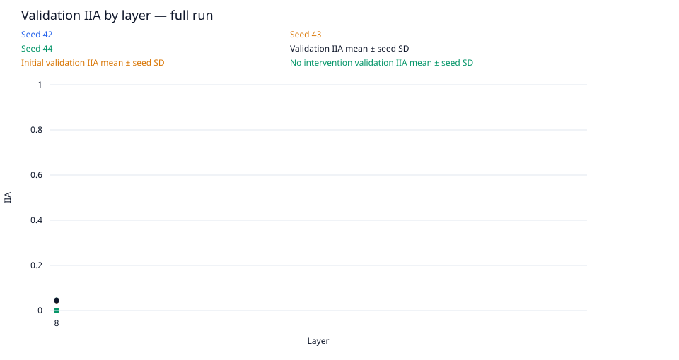
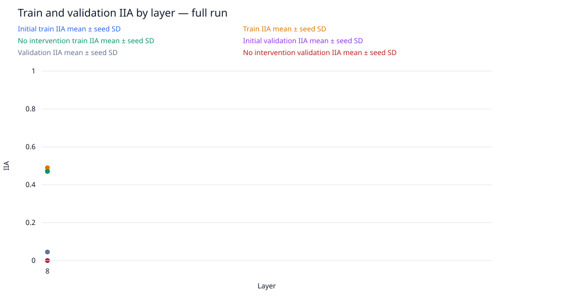
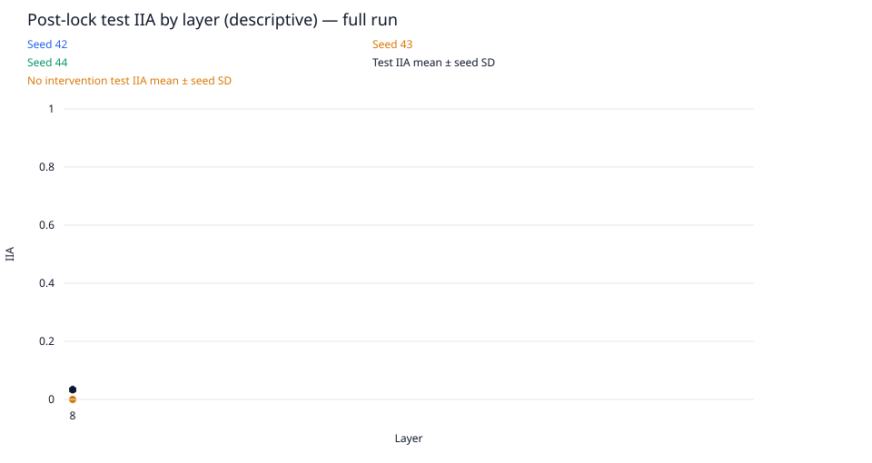
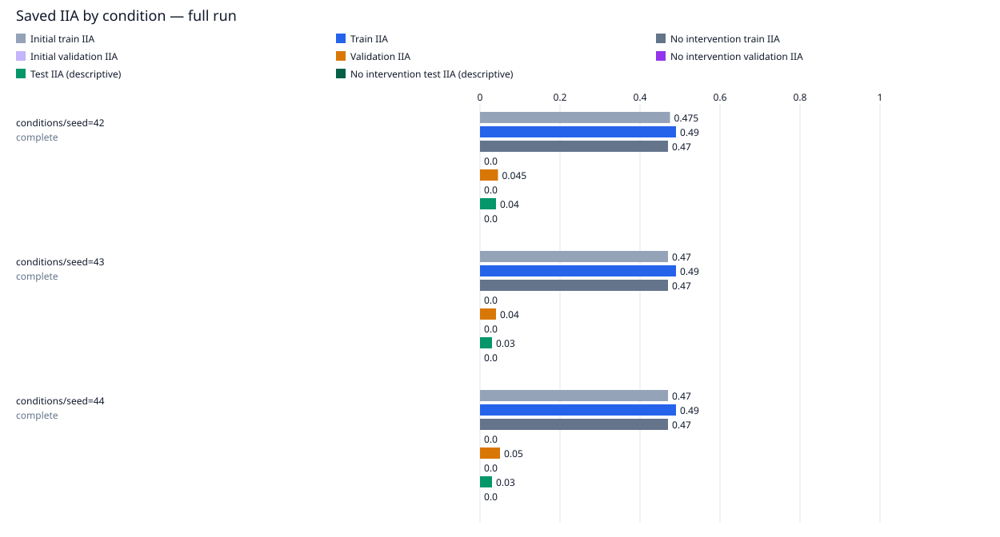

# intervention-sites / gpt2-small-l8h6-v

Run kind: **full**; run status: **complete**.

Config SHA-256: `331cb7f46cc3791f57f7fa913faa7d8f5c0b51c8544c12340c11965ace05030b`.

Conditions: complete=3.

The legacy test set is a descriptive benchmark, previously inspected in earlier runs.
It is not an untouched held-out test.

Selected layer: **8**; metric: `validation_iia`.
The choice was locked in `selection.json` before post-lock evaluation.

| Condition | Status | Initial train IIA | Train IIA | No intervention train IIA | Initial validation IIA | Validation IIA | No intervention validation IIA | Test IIA (descriptive) | No intervention test IIA (descriptive) | Post-lock status |
| --- | --- | --- | --- | --- | --- | --- | --- | --- | --- | --- |
| conditions/seed=42 | complete | 95/200 = 0.475 | 98/200 = 0.49 | 94/200 = 0.47 | 0/200 = 0.0 | 9/200 = 0.045 | 0/200 = 0.0 | 4/100 = 0.04 | 0/100 = 0.0 | complete |
| conditions/seed=43 | complete | 94/200 = 0.47 | 98/200 = 0.49 | 94/200 = 0.47 | 0/200 = 0.0 | 8/200 = 0.04 | 0/200 = 0.0 | 3/100 = 0.03 | 0/100 = 0.0 | complete |
| conditions/seed=44 | complete | 94/200 = 0.47 | 98/200 = 0.49 | 94/200 = 0.47 | 0/200 = 0.0 | 10/200 = 0.05 | 0/200 = 0.0 | 3/100 = 0.03 | 0/100 = 0.0 | complete |

Full-precision metrics and exact counts are saved in `conditions.csv`.
Missing metrics are shown as —; failed and pending conditions remain in the table.

Per-layer means and sample SD across seeds are saved in `layer_summary.csv`.
Seed SD describes variation across seeds; it is not a confidence interval.
A single available seed has no sample SD. Incomplete layers are flagged in the CSV.

Per-pairing and target-change groups (counts summed across seeds; means give equal weight to each seed):

| Layer | Split | Group | IIA | No-intervention IIA |
| --- | --- | --- | --- | --- |
| 8 | initial_train | ABB->ABB | 138/150; mean 0.92 | 138/150; mean 0.92 |
| 8 | initial_train | ABB->BAB | 0/150; mean 0.0 | 0/150; mean 0.0 |
| 8 | initial_train | BAB->ABB | 1/150; mean 0.006666666666666667 | 0/150; mean 0.0 |
| 8 | initial_train | BAB->BAB | 144/150; mean 0.96 | 144/150; mean 0.96 |
| 8 | initial_train | switch_required | 1/300; mean 0.0033333333333333335 | 0/300; mean 0.0 |
| 8 | initial_train | unchanged_target | 282/300; mean 0.94 | 282/300; mean 0.94 |
| 8 | train | ABB->ABB | 138/150; mean 0.92 | 138/150; mean 0.92 |
| 8 | train | ABB->BAB | 0/150; mean 0.0 | 0/150; mean 0.0 |
| 8 | train | BAB->ABB | 12/150; mean 0.08 | 0/150; mean 0.0 |
| 8 | train | BAB->BAB | 144/150; mean 0.96 | 144/150; mean 0.96 |
| 8 | train | switch_required | 12/300; mean 0.04 | 0/300; mean 0.0 |
| 8 | train | unchanged_target | 282/300; mean 0.94 | 282/300; mean 0.94 |
| 8 | initial_validation | ABB->ABB | 0/0; mean — | 0/0; mean — |
| 8 | initial_validation | ABB->BAB | 0/300; mean 0.0 | 0/300; mean 0.0 |
| 8 | initial_validation | BAB->ABB | 0/300; mean 0.0 | 0/300; mean 0.0 |
| 8 | initial_validation | BAB->BAB | 0/0; mean — | 0/0; mean — |
| 8 | initial_validation | switch_required | 0/600; mean 0.0 | 0/600; mean 0.0 |
| 8 | initial_validation | unchanged_target | 0/0; mean — | 0/0; mean — |
| 8 | validation | ABB->ABB | 0/0; mean — | 0/0; mean — |
| 8 | validation | ABB->BAB | 0/300; mean 0.0 | 0/300; mean 0.0 |
| 8 | validation | BAB->ABB | 27/300; mean 0.09 | 0/300; mean 0.0 |
| 8 | validation | BAB->BAB | 0/0; mean — | 0/0; mean — |
| 8 | validation | switch_required | 27/600; mean 0.045 | 0/600; mean 0.0 |
| 8 | validation | unchanged_target | 0/0; mean — | 0/0; mean — |
| 8 | test | ABB->ABB | 0/0; mean — | 0/0; mean — |
| 8 | test | ABB->BAB | 0/150; mean 0.0 | 0/150; mean 0.0 |
| 8 | test | BAB->ABB | 10/150; mean 0.06666666666666667 | 0/150; mean 0.0 |
| 8 | test | BAB->BAB | 0/0; mean — | 0/0; mean — |
| 8 | test | switch_required | 10/300; mean 0.03333333333333333 | 0/300; mean 0.0 |
| 8 | test | unchanged_target | 0/0; mean — | 0/0; mean — |

