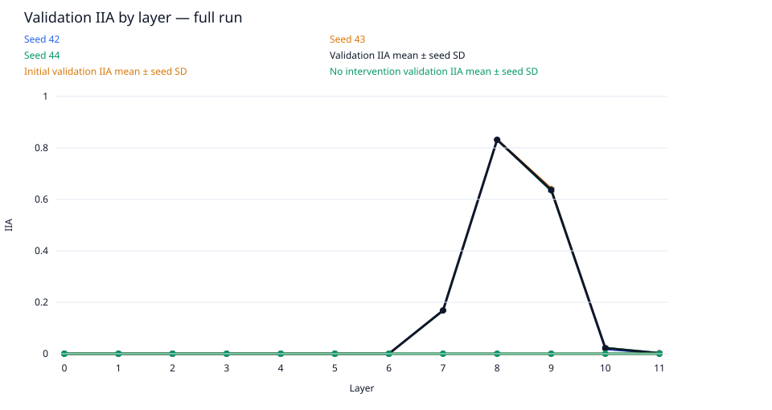
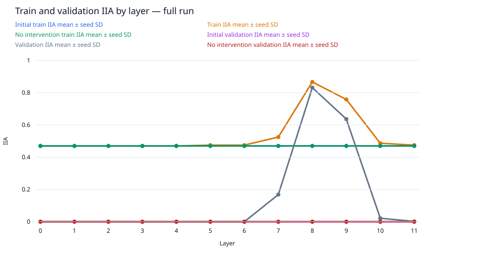
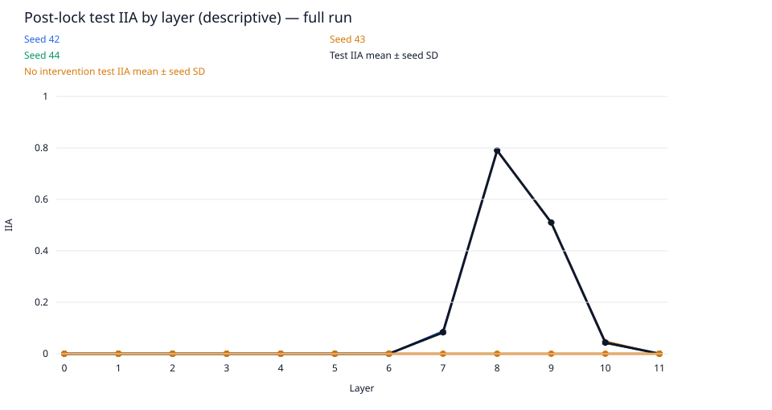
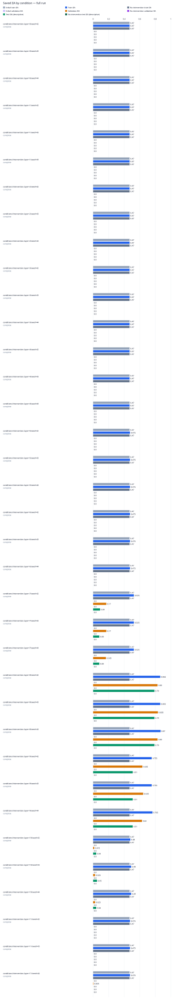

# layer-sweep / gpt2-small

Run kind: **full**; run status: **complete**.

Config SHA-256: `30a4e9eb983fbabff7d7bb0cc792549fe18312d03988bfdb737870fb821a882c`.

Conditions: complete=36.

The legacy test set is a descriptive benchmark, previously inspected in earlier runs.
It is not an untouched held-out test.

Selected layer: **8**; metric: `validation_iia`.
The choice was locked in `selection.json` before post-lock evaluation.

| Condition | Status | Initial train IIA | Train IIA | No intervention train IIA | Initial validation IIA | Validation IIA | No intervention validation IIA | Test IIA (descriptive) | No intervention test IIA (descriptive) | Post-lock status |
| --- | --- | --- | --- | --- | --- | --- | --- | --- | --- | --- |
| conditions/intervention.layer=0/seed=42 | complete | 94/200 = 0.47 | 94/200 = 0.47 | 94/200 = 0.47 | 0/200 = 0.0 | 0/200 = 0.0 | 0/200 = 0.0 | 0/100 = 0.0 | 0/100 = 0.0 | complete |
| conditions/intervention.layer=0/seed=43 | complete | 94/200 = 0.47 | 94/200 = 0.47 | 94/200 = 0.47 | 0/200 = 0.0 | 0/200 = 0.0 | 0/200 = 0.0 | 0/100 = 0.0 | 0/100 = 0.0 | complete |
| conditions/intervention.layer=0/seed=44 | complete | 94/200 = 0.47 | 94/200 = 0.47 | 94/200 = 0.47 | 0/200 = 0.0 | 0/200 = 0.0 | 0/200 = 0.0 | 0/100 = 0.0 | 0/100 = 0.0 | complete |
| conditions/intervention.layer=1/seed=42 | complete | 94/200 = 0.47 | 94/200 = 0.47 | 94/200 = 0.47 | 0/200 = 0.0 | 0/200 = 0.0 | 0/200 = 0.0 | 0/100 = 0.0 | 0/100 = 0.0 | complete |
| conditions/intervention.layer=1/seed=43 | complete | 94/200 = 0.47 | 94/200 = 0.47 | 94/200 = 0.47 | 0/200 = 0.0 | 0/200 = 0.0 | 0/200 = 0.0 | 0/100 = 0.0 | 0/100 = 0.0 | complete |
| conditions/intervention.layer=1/seed=44 | complete | 94/200 = 0.47 | 94/200 = 0.47 | 94/200 = 0.47 | 0/200 = 0.0 | 0/200 = 0.0 | 0/200 = 0.0 | 0/100 = 0.0 | 0/100 = 0.0 | complete |
| conditions/intervention.layer=2/seed=42 | complete | 94/200 = 0.47 | 94/200 = 0.47 | 94/200 = 0.47 | 0/200 = 0.0 | 0/200 = 0.0 | 0/200 = 0.0 | 0/100 = 0.0 | 0/100 = 0.0 | complete |
| conditions/intervention.layer=2/seed=43 | complete | 94/200 = 0.47 | 94/200 = 0.47 | 94/200 = 0.47 | 0/200 = 0.0 | 0/200 = 0.0 | 0/200 = 0.0 | 0/100 = 0.0 | 0/100 = 0.0 | complete |
| conditions/intervention.layer=2/seed=44 | complete | 94/200 = 0.47 | 94/200 = 0.47 | 94/200 = 0.47 | 0/200 = 0.0 | 0/200 = 0.0 | 0/200 = 0.0 | 0/100 = 0.0 | 0/100 = 0.0 | complete |
| conditions/intervention.layer=3/seed=42 | complete | 94/200 = 0.47 | 94/200 = 0.47 | 94/200 = 0.47 | 0/200 = 0.0 | 0/200 = 0.0 | 0/200 = 0.0 | 0/100 = 0.0 | 0/100 = 0.0 | complete |
| conditions/intervention.layer=3/seed=43 | complete | 94/200 = 0.47 | 94/200 = 0.47 | 94/200 = 0.47 | 0/200 = 0.0 | 0/200 = 0.0 | 0/200 = 0.0 | 0/100 = 0.0 | 0/100 = 0.0 | complete |
| conditions/intervention.layer=3/seed=44 | complete | 94/200 = 0.47 | 94/200 = 0.47 | 94/200 = 0.47 | 0/200 = 0.0 | 0/200 = 0.0 | 0/200 = 0.0 | 0/100 = 0.0 | 0/100 = 0.0 | complete |
| conditions/intervention.layer=4/seed=42 | complete | 94/200 = 0.47 | 94/200 = 0.47 | 94/200 = 0.47 | 0/200 = 0.0 | 0/200 = 0.0 | 0/200 = 0.0 | 0/100 = 0.0 | 0/100 = 0.0 | complete |
| conditions/intervention.layer=4/seed=43 | complete | 94/200 = 0.47 | 94/200 = 0.47 | 94/200 = 0.47 | 0/200 = 0.0 | 0/200 = 0.0 | 0/200 = 0.0 | 0/100 = 0.0 | 0/100 = 0.0 | complete |
| conditions/intervention.layer=4/seed=44 | complete | 94/200 = 0.47 | 94/200 = 0.47 | 94/200 = 0.47 | 0/200 = 0.0 | 0/200 = 0.0 | 0/200 = 0.0 | 0/100 = 0.0 | 0/100 = 0.0 | complete |
| conditions/intervention.layer=5/seed=42 | complete | 94/200 = 0.47 | 95/200 = 0.475 | 94/200 = 0.47 | 0/200 = 0.0 | 0/200 = 0.0 | 0/200 = 0.0 | 0/100 = 0.0 | 0/100 = 0.0 | complete |
| conditions/intervention.layer=5/seed=43 | complete | 94/200 = 0.47 | 95/200 = 0.475 | 94/200 = 0.47 | 0/200 = 0.0 | 0/200 = 0.0 | 0/200 = 0.0 | 0/100 = 0.0 | 0/100 = 0.0 | complete |
| conditions/intervention.layer=5/seed=44 | complete | 94/200 = 0.47 | 95/200 = 0.475 | 94/200 = 0.47 | 0/200 = 0.0 | 0/200 = 0.0 | 0/200 = 0.0 | 0/100 = 0.0 | 0/100 = 0.0 | complete |
| conditions/intervention.layer=6/seed=42 | complete | 94/200 = 0.47 | 95/200 = 0.475 | 94/200 = 0.47 | 0/200 = 0.0 | 0/200 = 0.0 | 0/200 = 0.0 | 0/100 = 0.0 | 0/100 = 0.0 | complete |
| conditions/intervention.layer=6/seed=43 | complete | 94/200 = 0.47 | 95/200 = 0.475 | 94/200 = 0.47 | 0/200 = 0.0 | 0/200 = 0.0 | 0/200 = 0.0 | 0/100 = 0.0 | 0/100 = 0.0 | complete |
| conditions/intervention.layer=6/seed=44 | complete | 94/200 = 0.47 | 95/200 = 0.475 | 94/200 = 0.47 | 0/200 = 0.0 | 0/200 = 0.0 | 0/200 = 0.0 | 0/100 = 0.0 | 0/100 = 0.0 | complete |
| conditions/intervention.layer=7/seed=42 | complete | 94/200 = 0.47 | 105/200 = 0.525 | 94/200 = 0.47 | 0/200 = 0.0 | 34/200 = 0.17 | 0/200 = 0.0 | 9/100 = 0.09 | 0/100 = 0.0 | complete |
| conditions/intervention.layer=7/seed=43 | complete | 94/200 = 0.47 | 105/200 = 0.525 | 94/200 = 0.47 | 0/200 = 0.0 | 34/200 = 0.17 | 0/200 = 0.0 | 8/100 = 0.08 | 0/100 = 0.0 | complete |
| conditions/intervention.layer=7/seed=44 | complete | 94/200 = 0.47 | 105/200 = 0.525 | 94/200 = 0.47 | 0/200 = 0.0 | 33/200 = 0.165 | 0/200 = 0.0 | 8/100 = 0.08 | 0/100 = 0.0 | complete |
| conditions/intervention.layer=8/seed=42 | complete | 94/200 = 0.47 | 173/200 = 0.865 | 94/200 = 0.47 | 0/200 = 0.0 | 166/200 = 0.83 | 0/200 = 0.0 | 79/100 = 0.79 | 0/100 = 0.0 | complete |
| conditions/intervention.layer=8/seed=43 | complete | 94/200 = 0.47 | 173/200 = 0.865 | 94/200 = 0.47 | 0/200 = 0.0 | 167/200 = 0.835 | 0/200 = 0.0 | 79/100 = 0.79 | 0/100 = 0.0 | complete |
| conditions/intervention.layer=8/seed=44 | complete | 94/200 = 0.47 | 174/200 = 0.87 | 94/200 = 0.47 | 0/200 = 0.0 | 166/200 = 0.83 | 0/200 = 0.0 | 79/100 = 0.79 | 0/100 = 0.0 | complete |
| conditions/intervention.layer=9/seed=42 | complete | 94/200 = 0.47 | 151/200 = 0.755 | 94/200 = 0.47 | 0/200 = 0.0 | 127/200 = 0.635 | 0/200 = 0.0 | 51/100 = 0.51 | 0/100 = 0.0 | complete |
| conditions/intervention.layer=9/seed=43 | complete | 94/200 = 0.47 | 151/200 = 0.755 | 94/200 = 0.47 | 0/200 = 0.0 | 129/200 = 0.645 | 0/200 = 0.0 | 51/100 = 0.51 | 0/100 = 0.0 | complete |
| conditions/intervention.layer=9/seed=44 | complete | 94/200 = 0.47 | 153/200 = 0.765 | 94/200 = 0.47 | 0/200 = 0.0 | 126/200 = 0.63 | 0/200 = 0.0 | 51/100 = 0.51 | 0/100 = 0.0 | complete |
| conditions/intervention.layer=10/seed=42 | complete | 94/200 = 0.47 | 96/200 = 0.48 | 94/200 = 0.47 | 0/200 = 0.0 | 3/200 = 0.015 | 0/200 = 0.0 | 4/100 = 0.04 | 0/100 = 0.0 | complete |
| conditions/intervention.layer=10/seed=43 | complete | 94/200 = 0.47 | 98/200 = 0.49 | 94/200 = 0.47 | 0/200 = 0.0 | 5/200 = 0.025 | 0/200 = 0.0 | 5/100 = 0.05 | 0/100 = 0.0 | complete |
| conditions/intervention.layer=10/seed=44 | complete | 94/200 = 0.47 | 98/200 = 0.49 | 94/200 = 0.47 | 0/200 = 0.0 | 5/200 = 0.025 | 0/200 = 0.0 | 4/100 = 0.04 | 0/100 = 0.0 | complete |
| conditions/intervention.layer=11/seed=42 | complete | 94/200 = 0.47 | 95/200 = 0.475 | 94/200 = 0.47 | 0/200 = 0.0 | 0/200 = 0.0 | 0/200 = 0.0 | 0/100 = 0.0 | 0/100 = 0.0 | complete |
| conditions/intervention.layer=11/seed=43 | complete | 94/200 = 0.47 | 95/200 = 0.475 | 94/200 = 0.47 | 0/200 = 0.0 | 0/200 = 0.0 | 0/200 = 0.0 | 0/100 = 0.0 | 0/100 = 0.0 | complete |
| conditions/intervention.layer=11/seed=44 | complete | 94/200 = 0.47 | 95/200 = 0.475 | 94/200 = 0.47 | 0/200 = 0.0 | 1/200 = 0.005 | 0/200 = 0.0 | 0/100 = 0.0 | 0/100 = 0.0 | complete |

Full-precision metrics and exact counts are saved in `conditions.csv`.
Missing metrics are shown as —; failed and pending conditions remain in the table.

Per-layer means and sample SD across seeds are saved in `layer_summary.csv`.
Seed SD describes variation across seeds; it is not a confidence interval.
A single available seed has no sample SD. Incomplete layers are flagged in the CSV.

Per-pairing and target-change groups (counts summed across seeds; means give equal weight to each seed):

| Layer | Split | Group | IIA | No-intervention IIA |
| --- | --- | --- | --- | --- |
| 0 | initial_train | ABB->ABB | 138/150; mean 0.92 | 138/150; mean 0.92 |
| 0 | initial_train | ABB->BAB | 0/150; mean 0.0 | 0/150; mean 0.0 |
| 0 | initial_train | BAB->ABB | 0/150; mean 0.0 | 0/150; mean 0.0 |
| 0 | initial_train | BAB->BAB | 144/150; mean 0.96 | 144/150; mean 0.96 |
| 0 | initial_train | switch_required | 0/300; mean 0.0 | 0/300; mean 0.0 |
| 0 | initial_train | unchanged_target | 282/300; mean 0.94 | 282/300; mean 0.94 |
| 1 | initial_train | ABB->ABB | 138/150; mean 0.92 | 138/150; mean 0.92 |
| 1 | initial_train | ABB->BAB | 0/150; mean 0.0 | 0/150; mean 0.0 |
| 1 | initial_train | BAB->ABB | 0/150; mean 0.0 | 0/150; mean 0.0 |
| 1 | initial_train | BAB->BAB | 144/150; mean 0.96 | 144/150; mean 0.96 |
| 1 | initial_train | switch_required | 0/300; mean 0.0 | 0/300; mean 0.0 |
| 1 | initial_train | unchanged_target | 282/300; mean 0.94 | 282/300; mean 0.94 |
| 2 | initial_train | ABB->ABB | 138/150; mean 0.92 | 138/150; mean 0.92 |
| 2 | initial_train | ABB->BAB | 0/150; mean 0.0 | 0/150; mean 0.0 |
| 2 | initial_train | BAB->ABB | 0/150; mean 0.0 | 0/150; mean 0.0 |
| 2 | initial_train | BAB->BAB | 144/150; mean 0.96 | 144/150; mean 0.96 |
| 2 | initial_train | switch_required | 0/300; mean 0.0 | 0/300; mean 0.0 |
| 2 | initial_train | unchanged_target | 282/300; mean 0.94 | 282/300; mean 0.94 |
| 3 | initial_train | ABB->ABB | 138/150; mean 0.92 | 138/150; mean 0.92 |
| 3 | initial_train | ABB->BAB | 0/150; mean 0.0 | 0/150; mean 0.0 |
| 3 | initial_train | BAB->ABB | 0/150; mean 0.0 | 0/150; mean 0.0 |
| 3 | initial_train | BAB->BAB | 144/150; mean 0.96 | 144/150; mean 0.96 |
| 3 | initial_train | switch_required | 0/300; mean 0.0 | 0/300; mean 0.0 |
| 3 | initial_train | unchanged_target | 282/300; mean 0.94 | 282/300; mean 0.94 |
| 4 | initial_train | ABB->ABB | 138/150; mean 0.92 | 138/150; mean 0.92 |
| 4 | initial_train | ABB->BAB | 0/150; mean 0.0 | 0/150; mean 0.0 |
| 4 | initial_train | BAB->ABB | 0/150; mean 0.0 | 0/150; mean 0.0 |
| 4 | initial_train | BAB->BAB | 144/150; mean 0.96 | 144/150; mean 0.96 |
| 4 | initial_train | switch_required | 0/300; mean 0.0 | 0/300; mean 0.0 |
| 4 | initial_train | unchanged_target | 282/300; mean 0.94 | 282/300; mean 0.94 |
| 5 | initial_train | ABB->ABB | 138/150; mean 0.92 | 138/150; mean 0.92 |
| 5 | initial_train | ABB->BAB | 0/150; mean 0.0 | 0/150; mean 0.0 |
| 5 | initial_train | BAB->ABB | 0/150; mean 0.0 | 0/150; mean 0.0 |
| 5 | initial_train | BAB->BAB | 144/150; mean 0.96 | 144/150; mean 0.96 |
| 5 | initial_train | switch_required | 0/300; mean 0.0 | 0/300; mean 0.0 |
| 5 | initial_train | unchanged_target | 282/300; mean 0.94 | 282/300; mean 0.94 |
| 6 | initial_train | ABB->ABB | 138/150; mean 0.92 | 138/150; mean 0.92 |
| 6 | initial_train | ABB->BAB | 0/150; mean 0.0 | 0/150; mean 0.0 |
| 6 | initial_train | BAB->ABB | 0/150; mean 0.0 | 0/150; mean 0.0 |
| 6 | initial_train | BAB->BAB | 144/150; mean 0.96 | 144/150; mean 0.96 |
| 6 | initial_train | switch_required | 0/300; mean 0.0 | 0/300; mean 0.0 |
| 6 | initial_train | unchanged_target | 282/300; mean 0.94 | 282/300; mean 0.94 |
| 7 | initial_train | ABB->ABB | 138/150; mean 0.92 | 138/150; mean 0.92 |
| 7 | initial_train | ABB->BAB | 0/150; mean 0.0 | 0/150; mean 0.0 |
| 7 | initial_train | BAB->ABB | 0/150; mean 0.0 | 0/150; mean 0.0 |
| 7 | initial_train | BAB->BAB | 144/150; mean 0.96 | 144/150; mean 0.96 |
| 7 | initial_train | switch_required | 0/300; mean 0.0 | 0/300; mean 0.0 |
| 7 | initial_train | unchanged_target | 282/300; mean 0.94 | 282/300; mean 0.94 |
| 8 | initial_train | ABB->ABB | 138/150; mean 0.92 | 138/150; mean 0.92 |
| 8 | initial_train | ABB->BAB | 0/150; mean 0.0 | 0/150; mean 0.0 |
| 8 | initial_train | BAB->ABB | 0/150; mean 0.0 | 0/150; mean 0.0 |
| 8 | initial_train | BAB->BAB | 144/150; mean 0.96 | 144/150; mean 0.96 |
| 8 | initial_train | switch_required | 0/300; mean 0.0 | 0/300; mean 0.0 |
| 8 | initial_train | unchanged_target | 282/300; mean 0.94 | 282/300; mean 0.94 |
| 9 | initial_train | ABB->ABB | 138/150; mean 0.92 | 138/150; mean 0.92 |
| 9 | initial_train | ABB->BAB | 0/150; mean 0.0 | 0/150; mean 0.0 |
| 9 | initial_train | BAB->ABB | 0/150; mean 0.0 | 0/150; mean 0.0 |
| 9 | initial_train | BAB->BAB | 144/150; mean 0.96 | 144/150; mean 0.96 |
| 9 | initial_train | switch_required | 0/300; mean 0.0 | 0/300; mean 0.0 |
| 9 | initial_train | unchanged_target | 282/300; mean 0.94 | 282/300; mean 0.94 |
| 10 | initial_train | ABB->ABB | 138/150; mean 0.92 | 138/150; mean 0.92 |
| 10 | initial_train | ABB->BAB | 0/150; mean 0.0 | 0/150; mean 0.0 |
| 10 | initial_train | BAB->ABB | 0/150; mean 0.0 | 0/150; mean 0.0 |
| 10 | initial_train | BAB->BAB | 144/150; mean 0.96 | 144/150; mean 0.96 |
| 10 | initial_train | switch_required | 0/300; mean 0.0 | 0/300; mean 0.0 |
| 10 | initial_train | unchanged_target | 282/300; mean 0.94 | 282/300; mean 0.94 |
| 11 | initial_train | ABB->ABB | 138/150; mean 0.92 | 138/150; mean 0.92 |
| 11 | initial_train | ABB->BAB | 0/150; mean 0.0 | 0/150; mean 0.0 |
| 11 | initial_train | BAB->ABB | 0/150; mean 0.0 | 0/150; mean 0.0 |
| 11 | initial_train | BAB->BAB | 144/150; mean 0.96 | 144/150; mean 0.96 |
| 11 | initial_train | switch_required | 0/300; mean 0.0 | 0/300; mean 0.0 |
| 11 | initial_train | unchanged_target | 282/300; mean 0.94 | 282/300; mean 0.94 |
| 0 | train | ABB->ABB | 138/150; mean 0.92 | 138/150; mean 0.92 |
| 0 | train | ABB->BAB | 0/150; mean 0.0 | 0/150; mean 0.0 |
| 0 | train | BAB->ABB | 0/150; mean 0.0 | 0/150; mean 0.0 |
| 0 | train | BAB->BAB | 144/150; mean 0.96 | 144/150; mean 0.96 |
| 0 | train | switch_required | 0/300; mean 0.0 | 0/300; mean 0.0 |
| 0 | train | unchanged_target | 282/300; mean 0.94 | 282/300; mean 0.94 |
| 1 | train | ABB->ABB | 138/150; mean 0.92 | 138/150; mean 0.92 |
| 1 | train | ABB->BAB | 0/150; mean 0.0 | 0/150; mean 0.0 |
| 1 | train | BAB->ABB | 0/150; mean 0.0 | 0/150; mean 0.0 |
| 1 | train | BAB->BAB | 144/150; mean 0.96 | 144/150; mean 0.96 |
| 1 | train | switch_required | 0/300; mean 0.0 | 0/300; mean 0.0 |
| 1 | train | unchanged_target | 282/300; mean 0.94 | 282/300; mean 0.94 |
| 2 | train | ABB->ABB | 138/150; mean 0.92 | 138/150; mean 0.92 |
| 2 | train | ABB->BAB | 0/150; mean 0.0 | 0/150; mean 0.0 |
| 2 | train | BAB->ABB | 0/150; mean 0.0 | 0/150; mean 0.0 |
| 2 | train | BAB->BAB | 144/150; mean 0.96 | 144/150; mean 0.96 |
| 2 | train | switch_required | 0/300; mean 0.0 | 0/300; mean 0.0 |
| 2 | train | unchanged_target | 282/300; mean 0.94 | 282/300; mean 0.94 |
| 3 | train | ABB->ABB | 138/150; mean 0.92 | 138/150; mean 0.92 |
| 3 | train | ABB->BAB | 0/150; mean 0.0 | 0/150; mean 0.0 |
| 3 | train | BAB->ABB | 0/150; mean 0.0 | 0/150; mean 0.0 |
| 3 | train | BAB->BAB | 144/150; mean 0.96 | 144/150; mean 0.96 |
| 3 | train | switch_required | 0/300; mean 0.0 | 0/300; mean 0.0 |
| 3 | train | unchanged_target | 282/300; mean 0.94 | 282/300; mean 0.94 |
| 4 | train | ABB->ABB | 138/150; mean 0.92 | 138/150; mean 0.92 |
| 4 | train | ABB->BAB | 0/150; mean 0.0 | 0/150; mean 0.0 |
| 4 | train | BAB->ABB | 0/150; mean 0.0 | 0/150; mean 0.0 |
| 4 | train | BAB->BAB | 144/150; mean 0.96 | 144/150; mean 0.96 |
| 4 | train | switch_required | 0/300; mean 0.0 | 0/300; mean 0.0 |
| 4 | train | unchanged_target | 282/300; mean 0.94 | 282/300; mean 0.94 |
| 5 | train | ABB->ABB | 138/150; mean 0.92 | 138/150; mean 0.92 |
| 5 | train | ABB->BAB | 0/150; mean 0.0 | 0/150; mean 0.0 |
| 5 | train | BAB->ABB | 3/150; mean 0.02 | 0/150; mean 0.0 |
| 5 | train | BAB->BAB | 144/150; mean 0.96 | 144/150; mean 0.96 |
| 5 | train | switch_required | 3/300; mean 0.01 | 0/300; mean 0.0 |
| 5 | train | unchanged_target | 282/300; mean 0.94 | 282/300; mean 0.94 |
| 6 | train | ABB->ABB | 138/150; mean 0.92 | 138/150; mean 0.92 |
| 6 | train | ABB->BAB | 0/150; mean 0.0 | 0/150; mean 0.0 |
| 6 | train | BAB->ABB | 3/150; mean 0.02 | 0/150; mean 0.0 |
| 6 | train | BAB->BAB | 144/150; mean 0.96 | 144/150; mean 0.96 |
| 6 | train | switch_required | 3/300; mean 0.01 | 0/300; mean 0.0 |
| 6 | train | unchanged_target | 282/300; mean 0.94 | 282/300; mean 0.94 |
| 7 | train | ABB->ABB | 138/150; mean 0.92 | 138/150; mean 0.92 |
| 7 | train | ABB->BAB | 10/150; mean 0.06666666666666667 | 0/150; mean 0.0 |
| 7 | train | BAB->ABB | 23/150; mean 0.15333333333333335 | 0/150; mean 0.0 |
| 7 | train | BAB->BAB | 144/150; mean 0.96 | 144/150; mean 0.96 |
| 7 | train | switch_required | 33/300; mean 0.11 | 0/300; mean 0.0 |
| 7 | train | unchanged_target | 282/300; mean 0.94 | 282/300; mean 0.94 |
| 8 | train | ABB->ABB | 138/150; mean 0.92 | 138/150; mean 0.92 |
| 8 | train | ABB->BAB | 104/150; mean 0.6933333333333334 | 0/150; mean 0.0 |
| 8 | train | BAB->ABB | 134/150; mean 0.8933333333333333 | 0/150; mean 0.0 |
| 8 | train | BAB->BAB | 144/150; mean 0.96 | 144/150; mean 0.96 |
| 8 | train | switch_required | 238/300; mean 0.7933333333333333 | 0/300; mean 0.0 |
| 8 | train | unchanged_target | 282/300; mean 0.94 | 282/300; mean 0.94 |
| 9 | train | ABB->ABB | 138/150; mean 0.92 | 138/150; mean 0.92 |
| 9 | train | ABB->BAB | 71/150; mean 0.47333333333333333 | 0/150; mean 0.0 |
| 9 | train | BAB->ABB | 102/150; mean 0.68 | 0/150; mean 0.0 |
| 9 | train | BAB->BAB | 144/150; mean 0.96 | 144/150; mean 0.96 |
| 9 | train | switch_required | 173/300; mean 0.5766666666666667 | 0/300; mean 0.0 |
| 9 | train | unchanged_target | 282/300; mean 0.94 | 282/300; mean 0.94 |
| 10 | train | ABB->ABB | 138/150; mean 0.92 | 138/150; mean 0.92 |
| 10 | train | ABB->BAB | 7/150; mean 0.04666666666666666 | 0/150; mean 0.0 |
| 10 | train | BAB->ABB | 3/150; mean 0.02 | 0/150; mean 0.0 |
| 10 | train | BAB->BAB | 144/150; mean 0.96 | 144/150; mean 0.96 |
| 10 | train | switch_required | 10/300; mean 0.03333333333333333 | 0/300; mean 0.0 |
| 10 | train | unchanged_target | 282/300; mean 0.94 | 282/300; mean 0.94 |
| 11 | train | ABB->ABB | 138/150; mean 0.92 | 138/150; mean 0.92 |
| 11 | train | ABB->BAB | 0/150; mean 0.0 | 0/150; mean 0.0 |
| 11 | train | BAB->ABB | 3/150; mean 0.02 | 0/150; mean 0.0 |
| 11 | train | BAB->BAB | 144/150; mean 0.96 | 144/150; mean 0.96 |
| 11 | train | switch_required | 3/300; mean 0.01 | 0/300; mean 0.0 |
| 11 | train | unchanged_target | 282/300; mean 0.94 | 282/300; mean 0.94 |
| 0 | initial_validation | ABB->ABB | 0/0; mean — | 0/0; mean — |
| 0 | initial_validation | ABB->BAB | 0/300; mean 0.0 | 0/300; mean 0.0 |
| 0 | initial_validation | BAB->ABB | 0/300; mean 0.0 | 0/300; mean 0.0 |
| 0 | initial_validation | BAB->BAB | 0/0; mean — | 0/0; mean — |
| 0 | initial_validation | switch_required | 0/600; mean 0.0 | 0/600; mean 0.0 |
| 0 | initial_validation | unchanged_target | 0/0; mean — | 0/0; mean — |
| 1 | initial_validation | ABB->ABB | 0/0; mean — | 0/0; mean — |
| 1 | initial_validation | ABB->BAB | 0/300; mean 0.0 | 0/300; mean 0.0 |
| 1 | initial_validation | BAB->ABB | 0/300; mean 0.0 | 0/300; mean 0.0 |
| 1 | initial_validation | BAB->BAB | 0/0; mean — | 0/0; mean — |
| 1 | initial_validation | switch_required | 0/600; mean 0.0 | 0/600; mean 0.0 |
| 1 | initial_validation | unchanged_target | 0/0; mean — | 0/0; mean — |
| 2 | initial_validation | ABB->ABB | 0/0; mean — | 0/0; mean — |
| 2 | initial_validation | ABB->BAB | 0/300; mean 0.0 | 0/300; mean 0.0 |
| 2 | initial_validation | BAB->ABB | 0/300; mean 0.0 | 0/300; mean 0.0 |
| 2 | initial_validation | BAB->BAB | 0/0; mean — | 0/0; mean — |
| 2 | initial_validation | switch_required | 0/600; mean 0.0 | 0/600; mean 0.0 |
| 2 | initial_validation | unchanged_target | 0/0; mean — | 0/0; mean — |
| 3 | initial_validation | ABB->ABB | 0/0; mean — | 0/0; mean — |
| 3 | initial_validation | ABB->BAB | 0/300; mean 0.0 | 0/300; mean 0.0 |
| 3 | initial_validation | BAB->ABB | 0/300; mean 0.0 | 0/300; mean 0.0 |
| 3 | initial_validation | BAB->BAB | 0/0; mean — | 0/0; mean — |
| 3 | initial_validation | switch_required | 0/600; mean 0.0 | 0/600; mean 0.0 |
| 3 | initial_validation | unchanged_target | 0/0; mean — | 0/0; mean — |
| 4 | initial_validation | ABB->ABB | 0/0; mean — | 0/0; mean — |
| 4 | initial_validation | ABB->BAB | 0/300; mean 0.0 | 0/300; mean 0.0 |
| 4 | initial_validation | BAB->ABB | 0/300; mean 0.0 | 0/300; mean 0.0 |
| 4 | initial_validation | BAB->BAB | 0/0; mean — | 0/0; mean — |
| 4 | initial_validation | switch_required | 0/600; mean 0.0 | 0/600; mean 0.0 |
| 4 | initial_validation | unchanged_target | 0/0; mean — | 0/0; mean — |
| 5 | initial_validation | ABB->ABB | 0/0; mean — | 0/0; mean — |
| 5 | initial_validation | ABB->BAB | 0/300; mean 0.0 | 0/300; mean 0.0 |
| 5 | initial_validation | BAB->ABB | 0/300; mean 0.0 | 0/300; mean 0.0 |
| 5 | initial_validation | BAB->BAB | 0/0; mean — | 0/0; mean — |
| 5 | initial_validation | switch_required | 0/600; mean 0.0 | 0/600; mean 0.0 |
| 5 | initial_validation | unchanged_target | 0/0; mean — | 0/0; mean — |
| 6 | initial_validation | ABB->ABB | 0/0; mean — | 0/0; mean — |
| 6 | initial_validation | ABB->BAB | 0/300; mean 0.0 | 0/300; mean 0.0 |
| 6 | initial_validation | BAB->ABB | 0/300; mean 0.0 | 0/300; mean 0.0 |
| 6 | initial_validation | BAB->BAB | 0/0; mean — | 0/0; mean — |
| 6 | initial_validation | switch_required | 0/600; mean 0.0 | 0/600; mean 0.0 |
| 6 | initial_validation | unchanged_target | 0/0; mean — | 0/0; mean — |
| 7 | initial_validation | ABB->ABB | 0/0; mean — | 0/0; mean — |
| 7 | initial_validation | ABB->BAB | 0/300; mean 0.0 | 0/300; mean 0.0 |
| 7 | initial_validation | BAB->ABB | 0/300; mean 0.0 | 0/300; mean 0.0 |
| 7 | initial_validation | BAB->BAB | 0/0; mean — | 0/0; mean — |
| 7 | initial_validation | switch_required | 0/600; mean 0.0 | 0/600; mean 0.0 |
| 7 | initial_validation | unchanged_target | 0/0; mean — | 0/0; mean — |
| 8 | initial_validation | ABB->ABB | 0/0; mean — | 0/0; mean — |
| 8 | initial_validation | ABB->BAB | 0/300; mean 0.0 | 0/300; mean 0.0 |
| 8 | initial_validation | BAB->ABB | 0/300; mean 0.0 | 0/300; mean 0.0 |
| 8 | initial_validation | BAB->BAB | 0/0; mean — | 0/0; mean — |
| 8 | initial_validation | switch_required | 0/600; mean 0.0 | 0/600; mean 0.0 |
| 8 | initial_validation | unchanged_target | 0/0; mean — | 0/0; mean — |
| 9 | initial_validation | ABB->ABB | 0/0; mean — | 0/0; mean — |
| 9 | initial_validation | ABB->BAB | 0/300; mean 0.0 | 0/300; mean 0.0 |
| 9 | initial_validation | BAB->ABB | 0/300; mean 0.0 | 0/300; mean 0.0 |
| 9 | initial_validation | BAB->BAB | 0/0; mean — | 0/0; mean — |
| 9 | initial_validation | switch_required | 0/600; mean 0.0 | 0/600; mean 0.0 |
| 9 | initial_validation | unchanged_target | 0/0; mean — | 0/0; mean — |
| 10 | initial_validation | ABB->ABB | 0/0; mean — | 0/0; mean — |
| 10 | initial_validation | ABB->BAB | 0/300; mean 0.0 | 0/300; mean 0.0 |
| 10 | initial_validation | BAB->ABB | 0/300; mean 0.0 | 0/300; mean 0.0 |
| 10 | initial_validation | BAB->BAB | 0/0; mean — | 0/0; mean — |
| 10 | initial_validation | switch_required | 0/600; mean 0.0 | 0/600; mean 0.0 |
| 10 | initial_validation | unchanged_target | 0/0; mean — | 0/0; mean — |
| 11 | initial_validation | ABB->ABB | 0/0; mean — | 0/0; mean — |
| 11 | initial_validation | ABB->BAB | 0/300; mean 0.0 | 0/300; mean 0.0 |
| 11 | initial_validation | BAB->ABB | 0/300; mean 0.0 | 0/300; mean 0.0 |
| 11 | initial_validation | BAB->BAB | 0/0; mean — | 0/0; mean — |
| 11 | initial_validation | switch_required | 0/600; mean 0.0 | 0/600; mean 0.0 |
| 11 | initial_validation | unchanged_target | 0/0; mean — | 0/0; mean — |
| 0 | validation | ABB->ABB | 0/0; mean — | 0/0; mean — |
| 0 | validation | ABB->BAB | 0/300; mean 0.0 | 0/300; mean 0.0 |
| 0 | validation | BAB->ABB | 0/300; mean 0.0 | 0/300; mean 0.0 |
| 0 | validation | BAB->BAB | 0/0; mean — | 0/0; mean — |
| 0 | validation | switch_required | 0/600; mean 0.0 | 0/600; mean 0.0 |
| 0 | validation | unchanged_target | 0/0; mean — | 0/0; mean — |
| 1 | validation | ABB->ABB | 0/0; mean — | 0/0; mean — |
| 1 | validation | ABB->BAB | 0/300; mean 0.0 | 0/300; mean 0.0 |
| 1 | validation | BAB->ABB | 0/300; mean 0.0 | 0/300; mean 0.0 |
| 1 | validation | BAB->BAB | 0/0; mean — | 0/0; mean — |
| 1 | validation | switch_required | 0/600; mean 0.0 | 0/600; mean 0.0 |
| 1 | validation | unchanged_target | 0/0; mean — | 0/0; mean — |
| 2 | validation | ABB->ABB | 0/0; mean — | 0/0; mean — |
| 2 | validation | ABB->BAB | 0/300; mean 0.0 | 0/300; mean 0.0 |
| 2 | validation | BAB->ABB | 0/300; mean 0.0 | 0/300; mean 0.0 |
| 2 | validation | BAB->BAB | 0/0; mean — | 0/0; mean — |
| 2 | validation | switch_required | 0/600; mean 0.0 | 0/600; mean 0.0 |
| 2 | validation | unchanged_target | 0/0; mean — | 0/0; mean — |
| 3 | validation | ABB->ABB | 0/0; mean — | 0/0; mean — |
| 3 | validation | ABB->BAB | 0/300; mean 0.0 | 0/300; mean 0.0 |
| 3 | validation | BAB->ABB | 0/300; mean 0.0 | 0/300; mean 0.0 |
| 3 | validation | BAB->BAB | 0/0; mean — | 0/0; mean — |
| 3 | validation | switch_required | 0/600; mean 0.0 | 0/600; mean 0.0 |
| 3 | validation | unchanged_target | 0/0; mean — | 0/0; mean — |
| 4 | validation | ABB->ABB | 0/0; mean — | 0/0; mean — |
| 4 | validation | ABB->BAB | 0/300; mean 0.0 | 0/300; mean 0.0 |
| 4 | validation | BAB->ABB | 0/300; mean 0.0 | 0/300; mean 0.0 |
| 4 | validation | BAB->BAB | 0/0; mean — | 0/0; mean — |
| 4 | validation | switch_required | 0/600; mean 0.0 | 0/600; mean 0.0 |
| 4 | validation | unchanged_target | 0/0; mean — | 0/0; mean — |
| 5 | validation | ABB->ABB | 0/0; mean — | 0/0; mean — |
| 5 | validation | ABB->BAB | 0/300; mean 0.0 | 0/300; mean 0.0 |
| 5 | validation | BAB->ABB | 0/300; mean 0.0 | 0/300; mean 0.0 |
| 5 | validation | BAB->BAB | 0/0; mean — | 0/0; mean — |
| 5 | validation | switch_required | 0/600; mean 0.0 | 0/600; mean 0.0 |
| 5 | validation | unchanged_target | 0/0; mean — | 0/0; mean — |
| 6 | validation | ABB->ABB | 0/0; mean — | 0/0; mean — |
| 6 | validation | ABB->BAB | 0/300; mean 0.0 | 0/300; mean 0.0 |
| 6 | validation | BAB->ABB | 0/300; mean 0.0 | 0/300; mean 0.0 |
| 6 | validation | BAB->BAB | 0/0; mean — | 0/0; mean — |
| 6 | validation | switch_required | 0/600; mean 0.0 | 0/600; mean 0.0 |
| 6 | validation | unchanged_target | 0/0; mean — | 0/0; mean — |
| 7 | validation | ABB->ABB | 0/0; mean — | 0/0; mean — |
| 7 | validation | ABB->BAB | 38/300; mean 0.12666666666666668 | 0/300; mean 0.0 |
| 7 | validation | BAB->ABB | 63/300; mean 0.21000000000000002 | 0/300; mean 0.0 |
| 7 | validation | BAB->BAB | 0/0; mean — | 0/0; mean — |
| 7 | validation | switch_required | 101/600; mean 0.16833333333333333 | 0/600; mean 0.0 |
| 7 | validation | unchanged_target | 0/0; mean — | 0/0; mean — |
| 8 | validation | ABB->ABB | 0/0; mean — | 0/0; mean — |
| 8 | validation | ABB->BAB | 237/300; mean 0.79 | 0/300; mean 0.0 |
| 8 | validation | BAB->ABB | 262/300; mean 0.8733333333333333 | 0/300; mean 0.0 |
| 8 | validation | BAB->BAB | 0/0; mean — | 0/0; mean — |
| 8 | validation | switch_required | 499/600; mean 0.8316666666666667 | 0/600; mean 0.0 |
| 8 | validation | unchanged_target | 0/0; mean — | 0/0; mean — |
| 9 | validation | ABB->ABB | 0/0; mean — | 0/0; mean — |
| 9 | validation | ABB->BAB | 182/300; mean 0.6066666666666667 | 0/300; mean 0.0 |
| 9 | validation | BAB->ABB | 200/300; mean 0.6666666666666667 | 0/300; mean 0.0 |
| 9 | validation | BAB->BAB | 0/0; mean — | 0/0; mean — |
| 9 | validation | switch_required | 382/600; mean 0.6366666666666667 | 0/600; mean 0.0 |
| 9 | validation | unchanged_target | 0/0; mean — | 0/0; mean — |
| 10 | validation | ABB->ABB | 0/0; mean — | 0/0; mean — |
| 10 | validation | ABB->BAB | 12/300; mean 0.04 | 0/300; mean 0.0 |
| 10 | validation | BAB->ABB | 1/300; mean 0.0033333333333333335 | 0/300; mean 0.0 |
| 10 | validation | BAB->BAB | 0/0; mean — | 0/0; mean — |
| 10 | validation | switch_required | 13/600; mean 0.021666666666666667 | 0/600; mean 0.0 |
| 10 | validation | unchanged_target | 0/0; mean — | 0/0; mean — |
| 11 | validation | ABB->ABB | 0/0; mean — | 0/0; mean — |
| 11 | validation | ABB->BAB | 0/300; mean 0.0 | 0/300; mean 0.0 |
| 11 | validation | BAB->ABB | 1/300; mean 0.0033333333333333335 | 0/300; mean 0.0 |
| 11 | validation | BAB->BAB | 0/0; mean — | 0/0; mean — |
| 11 | validation | switch_required | 1/600; mean 0.0016666666666666668 | 0/600; mean 0.0 |
| 11 | validation | unchanged_target | 0/0; mean — | 0/0; mean — |
| 0 | test | ABB->ABB | 0/0; mean — | 0/0; mean — |
| 0 | test | ABB->BAB | 0/150; mean 0.0 | 0/150; mean 0.0 |
| 0 | test | BAB->ABB | 0/150; mean 0.0 | 0/150; mean 0.0 |
| 0 | test | BAB->BAB | 0/0; mean — | 0/0; mean — |
| 0 | test | switch_required | 0/300; mean 0.0 | 0/300; mean 0.0 |
| 0 | test | unchanged_target | 0/0; mean — | 0/0; mean — |
| 1 | test | ABB->ABB | 0/0; mean — | 0/0; mean — |
| 1 | test | ABB->BAB | 0/150; mean 0.0 | 0/150; mean 0.0 |
| 1 | test | BAB->ABB | 0/150; mean 0.0 | 0/150; mean 0.0 |
| 1 | test | BAB->BAB | 0/0; mean — | 0/0; mean — |
| 1 | test | switch_required | 0/300; mean 0.0 | 0/300; mean 0.0 |
| 1 | test | unchanged_target | 0/0; mean — | 0/0; mean — |
| 2 | test | ABB->ABB | 0/0; mean — | 0/0; mean — |
| 2 | test | ABB->BAB | 0/150; mean 0.0 | 0/150; mean 0.0 |
| 2 | test | BAB->ABB | 0/150; mean 0.0 | 0/150; mean 0.0 |
| 2 | test | BAB->BAB | 0/0; mean — | 0/0; mean — |
| 2 | test | switch_required | 0/300; mean 0.0 | 0/300; mean 0.0 |
| 2 | test | unchanged_target | 0/0; mean — | 0/0; mean — |
| 3 | test | ABB->ABB | 0/0; mean — | 0/0; mean — |
| 3 | test | ABB->BAB | 0/150; mean 0.0 | 0/150; mean 0.0 |
| 3 | test | BAB->ABB | 0/150; mean 0.0 | 0/150; mean 0.0 |
| 3 | test | BAB->BAB | 0/0; mean — | 0/0; mean — |
| 3 | test | switch_required | 0/300; mean 0.0 | 0/300; mean 0.0 |
| 3 | test | unchanged_target | 0/0; mean — | 0/0; mean — |
| 4 | test | ABB->ABB | 0/0; mean — | 0/0; mean — |
| 4 | test | ABB->BAB | 0/150; mean 0.0 | 0/150; mean 0.0 |
| 4 | test | BAB->ABB | 0/150; mean 0.0 | 0/150; mean 0.0 |
| 4 | test | BAB->BAB | 0/0; mean — | 0/0; mean — |
| 4 | test | switch_required | 0/300; mean 0.0 | 0/300; mean 0.0 |
| 4 | test | unchanged_target | 0/0; mean — | 0/0; mean — |
| 5 | test | ABB->ABB | 0/0; mean — | 0/0; mean — |
| 5 | test | ABB->BAB | 0/150; mean 0.0 | 0/150; mean 0.0 |
| 5 | test | BAB->ABB | 0/150; mean 0.0 | 0/150; mean 0.0 |
| 5 | test | BAB->BAB | 0/0; mean — | 0/0; mean — |
| 5 | test | switch_required | 0/300; mean 0.0 | 0/300; mean 0.0 |
| 5 | test | unchanged_target | 0/0; mean — | 0/0; mean — |
| 6 | test | ABB->ABB | 0/0; mean — | 0/0; mean — |
| 6 | test | ABB->BAB | 0/150; mean 0.0 | 0/150; mean 0.0 |
| 6 | test | BAB->ABB | 0/150; mean 0.0 | 0/150; mean 0.0 |
| 6 | test | BAB->BAB | 0/0; mean — | 0/0; mean — |
| 6 | test | switch_required | 0/300; mean 0.0 | 0/300; mean 0.0 |
| 6 | test | unchanged_target | 0/0; mean — | 0/0; mean — |
| 7 | test | ABB->ABB | 0/0; mean — | 0/0; mean — |
| 7 | test | ABB->BAB | 0/150; mean 0.0 | 0/150; mean 0.0 |
| 7 | test | BAB->ABB | 25/150; mean 0.16666666666666666 | 0/150; mean 0.0 |
| 7 | test | BAB->BAB | 0/0; mean — | 0/0; mean — |
| 7 | test | switch_required | 25/300; mean 0.08333333333333333 | 0/300; mean 0.0 |
| 7 | test | unchanged_target | 0/0; mean — | 0/0; mean — |
| 8 | test | ABB->ABB | 0/0; mean — | 0/0; mean — |
| 8 | test | ABB->BAB | 96/150; mean 0.64 | 0/150; mean 0.0 |
| 8 | test | BAB->ABB | 141/150; mean 0.94 | 0/150; mean 0.0 |
| 8 | test | BAB->BAB | 0/0; mean — | 0/0; mean — |
| 8 | test | switch_required | 237/300; mean 0.79 | 0/300; mean 0.0 |
| 8 | test | unchanged_target | 0/0; mean — | 0/0; mean — |
| 9 | test | ABB->ABB | 0/0; mean — | 0/0; mean — |
| 9 | test | ABB->BAB | 64/150; mean 0.42666666666666664 | 0/150; mean 0.0 |
| 9 | test | BAB->ABB | 89/150; mean 0.5933333333333333 | 0/150; mean 0.0 |
| 9 | test | BAB->BAB | 0/0; mean — | 0/0; mean — |
| 9 | test | switch_required | 153/300; mean 0.51 | 0/300; mean 0.0 |
| 9 | test | unchanged_target | 0/0; mean — | 0/0; mean — |
| 10 | test | ABB->ABB | 0/0; mean — | 0/0; mean — |
| 10 | test | ABB->BAB | 13/150; mean 0.08666666666666667 | 0/150; mean 0.0 |
| 10 | test | BAB->ABB | 0/150; mean 0.0 | 0/150; mean 0.0 |
| 10 | test | BAB->BAB | 0/0; mean — | 0/0; mean — |
| 10 | test | switch_required | 13/300; mean 0.043333333333333335 | 0/300; mean 0.0 |
| 10 | test | unchanged_target | 0/0; mean — | 0/0; mean — |
| 11 | test | ABB->ABB | 0/0; mean — | 0/0; mean — |
| 11 | test | ABB->BAB | 0/150; mean 0.0 | 0/150; mean 0.0 |
| 11 | test | BAB->ABB | 0/150; mean 0.0 | 0/150; mean 0.0 |
| 11 | test | BAB->BAB | 0/0; mean — | 0/0; mean — |
| 11 | test | switch_required | 0/300; mean 0.0 | 0/300; mean 0.0 |
| 11 | test | unchanged_target | 0/0; mean — | 0/0; mean — |

