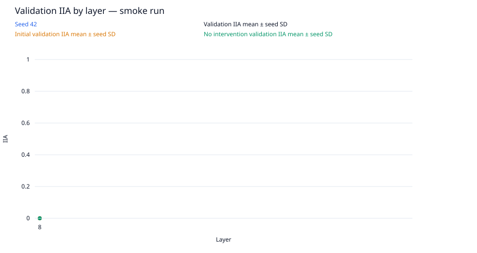
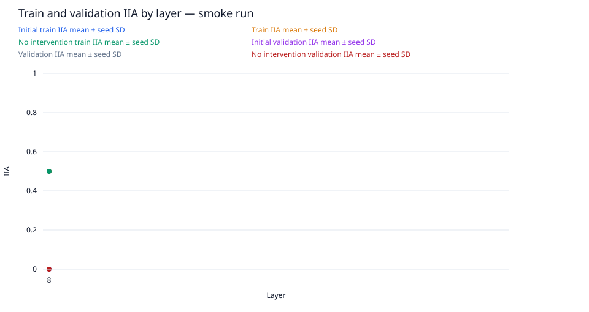
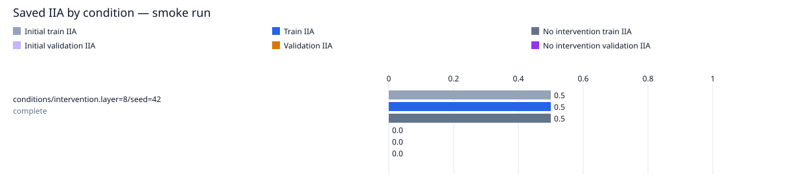

# layer-sweep / gpt2-small

Run kind: **smoke**; run status: **complete**.

Config SHA-256: `ec49d955d19466ffb31e2d45a01bb8ada6daa1b632c7e703e21df8d1e9fa6cf4`.

Conditions: complete=1.

This is a smoke run for execution checks; it is not a full experimental result.

| Condition | Status | Initial train IIA | Train IIA | No intervention train IIA | Initial validation IIA | Validation IIA | No intervention validation IIA |
| --- | --- | --- | --- | --- | --- | --- | --- |
| conditions/intervention.layer=8/seed=42 | complete | 10/20 = 0.5 | 10/20 = 0.5 | 10/20 = 0.5 | 0/4 = 0.0 | 0/4 = 0.0 | 0/4 = 0.0 |

Full-precision metrics and exact counts are saved in `conditions.csv`.
Missing metrics are shown as —; failed and pending conditions remain in the table.

Per-layer means and sample SD across seeds are saved in `layer_summary.csv`.
Seed SD describes variation across seeds; it is not a confidence interval.
A single available seed has no sample SD. Incomplete layers are flagged in the CSV.

Per-pairing and target-change groups (counts summed across seeds; means give equal weight to each seed):

| Layer | Split | Group | IIA | No-intervention IIA |
| --- | --- | --- | --- | --- |
| 8 | initial_train | ABB->ABB | 5/5; mean 1.0 | 5/5; mean 1.0 |
| 8 | initial_train | ABB->BAB | 0/5; mean 0.0 | 0/5; mean 0.0 |
| 8 | initial_train | BAB->ABB | 0/5; mean 0.0 | 0/5; mean 0.0 |
| 8 | initial_train | BAB->BAB | 5/5; mean 1.0 | 5/5; mean 1.0 |
| 8 | initial_train | switch_required | 0/10; mean 0.0 | 0/10; mean 0.0 |
| 8 | initial_train | unchanged_target | 10/10; mean 1.0 | 10/10; mean 1.0 |
| 8 | train | ABB->ABB | 5/5; mean 1.0 | 5/5; mean 1.0 |
| 8 | train | ABB->BAB | 0/5; mean 0.0 | 0/5; mean 0.0 |
| 8 | train | BAB->ABB | 0/5; mean 0.0 | 0/5; mean 0.0 |
| 8 | train | BAB->BAB | 5/5; mean 1.0 | 5/5; mean 1.0 |
| 8 | train | switch_required | 0/10; mean 0.0 | 0/10; mean 0.0 |
| 8 | train | unchanged_target | 10/10; mean 1.0 | 10/10; mean 1.0 |
| 8 | initial_validation | ABB->ABB | 0/0; mean — | 0/0; mean — |
| 8 | initial_validation | ABB->BAB | 0/2; mean 0.0 | 0/2; mean 0.0 |
| 8 | initial_validation | BAB->ABB | 0/2; mean 0.0 | 0/2; mean 0.0 |
| 8 | initial_validation | BAB->BAB | 0/0; mean — | 0/0; mean — |
| 8 | initial_validation | switch_required | 0/4; mean 0.0 | 0/4; mean 0.0 |
| 8 | initial_validation | unchanged_target | 0/0; mean — | 0/0; mean — |
| 8 | validation | ABB->ABB | 0/0; mean — | 0/0; mean — |
| 8 | validation | ABB->BAB | 0/2; mean 0.0 | 0/2; mean 0.0 |
| 8 | validation | BAB->ABB | 0/2; mean 0.0 | 0/2; mean 0.0 |
| 8 | validation | BAB->BAB | 0/0; mean — | 0/0; mean — |
| 8 | validation | switch_required | 0/4; mean 0.0 | 0/4; mean 0.0 |
| 8 | validation | unchanged_target | 0/0; mean — | 0/0; mean — |

