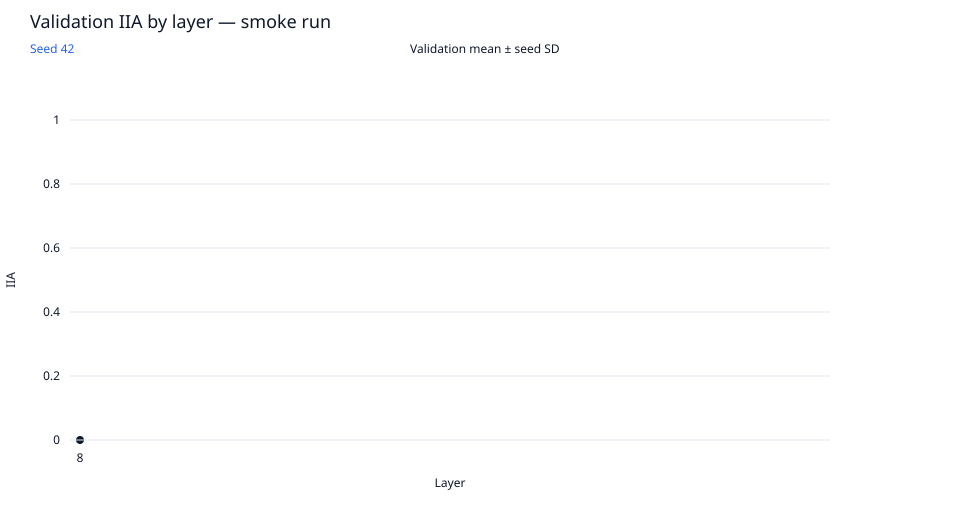
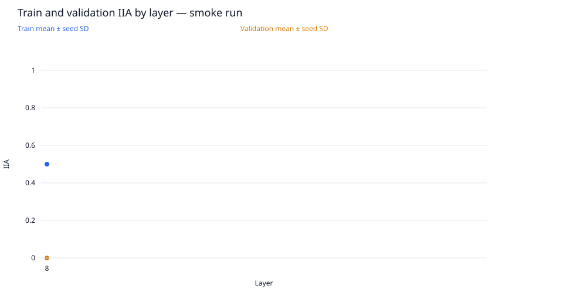
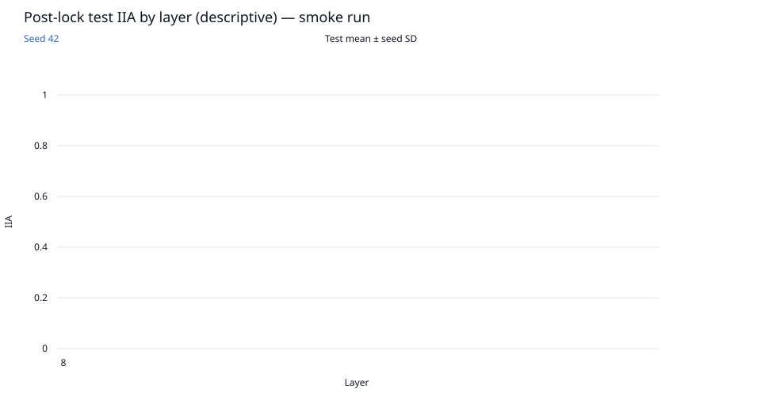
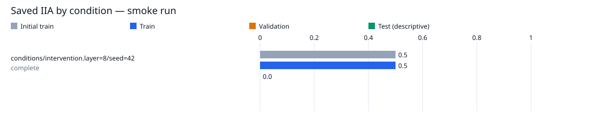

# layer-sweep / gpt2-small

Run kind: **smoke**; run status: **complete**.

Config SHA-256: `ec49d955d19466ffb31e2d45a01bb8ada6daa1b632c7e703e21df8d1e9fa6cf4`.

Conditions: complete=1.

This is a smoke run for execution checks; it is not a full experimental result.

The legacy test set is a descriptive benchmark, previously inspected in earlier runs.
It is not an untouched held-out test.

| Condition | Status | Initial train IIA | Train IIA | Validation IIA | Test IIA (descriptive) | Post-lock status |
| --- | --- | --- | --- | --- | --- | --- |
| conditions/intervention.layer=8/seed=42 | complete | 10/20 = 0.5 | 10/20 = 0.5 | 0/4 = 0.0 | — | not_scheduled |

Full-precision metrics and exact counts are saved in `conditions.csv`.
Missing metrics are shown as —; failed and pending conditions remain in the table.

Per-layer means and sample SD across seeds are saved in `layer_summary.csv`.
Seed SD describes variation across seeds; it is not a confidence interval.
A single available seed has no sample SD. Incomplete layers are flagged in the CSV.

