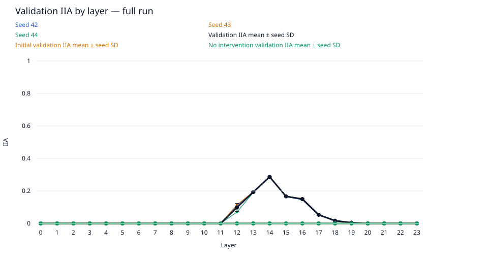
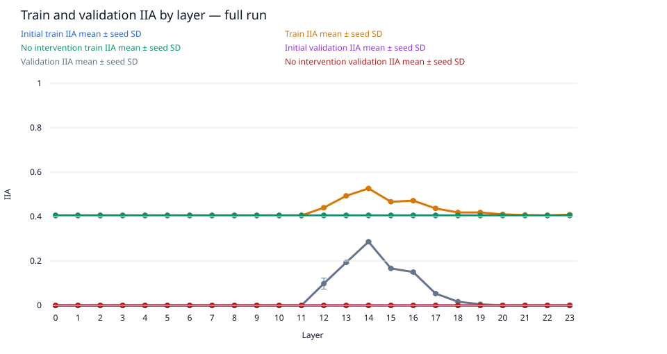
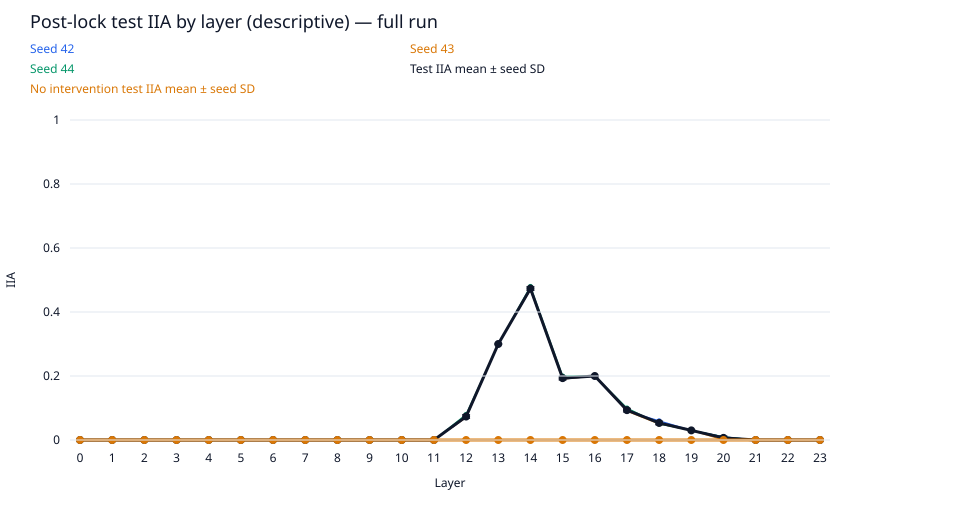
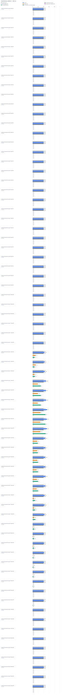

# rank-sweep / gpt2-medium-rank2

Run kind: **full**; run status: **complete**.

Config SHA-256: `70329bf54377bea1528e7e16f7349d501754f5e8ef7911f0e2c35678f7ad8d56`.

Conditions: complete=72.

The legacy test set is a descriptive benchmark, previously inspected in earlier runs.
It is not an untouched held-out test.

Selected layer: **14**; metric: `validation_iia`.
The choice was locked in `selection.json` before post-lock evaluation.

| Condition | Status | Initial train IIA | Train IIA | No intervention train IIA | Initial validation IIA | Validation IIA | No intervention validation IIA | Test IIA (descriptive) | No intervention test IIA (descriptive) | Post-lock status |
| --- | --- | --- | --- | --- | --- | --- | --- | --- | --- | --- |
| conditions/intervention.layer=0/seed=42 | complete | 81/200 = 0.405 | 81/200 = 0.405 | 81/200 = 0.405 | 0/200 = 0.0 | 0/200 = 0.0 | 0/200 = 0.0 | 0/100 = 0.0 | 0/100 = 0.0 | complete |
| conditions/intervention.layer=0/seed=43 | complete | 81/200 = 0.405 | 81/200 = 0.405 | 81/200 = 0.405 | 0/200 = 0.0 | 0/200 = 0.0 | 0/200 = 0.0 | 0/100 = 0.0 | 0/100 = 0.0 | complete |
| conditions/intervention.layer=0/seed=44 | complete | 81/200 = 0.405 | 81/200 = 0.405 | 81/200 = 0.405 | 0/200 = 0.0 | 0/200 = 0.0 | 0/200 = 0.0 | 0/100 = 0.0 | 0/100 = 0.0 | complete |
| conditions/intervention.layer=1/seed=42 | complete | 81/200 = 0.405 | 81/200 = 0.405 | 81/200 = 0.405 | 0/200 = 0.0 | 0/200 = 0.0 | 0/200 = 0.0 | 0/100 = 0.0 | 0/100 = 0.0 | complete |
| conditions/intervention.layer=1/seed=43 | complete | 81/200 = 0.405 | 81/200 = 0.405 | 81/200 = 0.405 | 0/200 = 0.0 | 0/200 = 0.0 | 0/200 = 0.0 | 0/100 = 0.0 | 0/100 = 0.0 | complete |
| conditions/intervention.layer=1/seed=44 | complete | 81/200 = 0.405 | 81/200 = 0.405 | 81/200 = 0.405 | 0/200 = 0.0 | 0/200 = 0.0 | 0/200 = 0.0 | 0/100 = 0.0 | 0/100 = 0.0 | complete |
| conditions/intervention.layer=2/seed=42 | complete | 81/200 = 0.405 | 81/200 = 0.405 | 81/200 = 0.405 | 0/200 = 0.0 | 0/200 = 0.0 | 0/200 = 0.0 | 0/100 = 0.0 | 0/100 = 0.0 | complete |
| conditions/intervention.layer=2/seed=43 | complete | 81/200 = 0.405 | 81/200 = 0.405 | 81/200 = 0.405 | 0/200 = 0.0 | 0/200 = 0.0 | 0/200 = 0.0 | 0/100 = 0.0 | 0/100 = 0.0 | complete |
| conditions/intervention.layer=2/seed=44 | complete | 81/200 = 0.405 | 81/200 = 0.405 | 81/200 = 0.405 | 0/200 = 0.0 | 0/200 = 0.0 | 0/200 = 0.0 | 0/100 = 0.0 | 0/100 = 0.0 | complete |
| conditions/intervention.layer=3/seed=42 | complete | 81/200 = 0.405 | 81/200 = 0.405 | 81/200 = 0.405 | 0/200 = 0.0 | 0/200 = 0.0 | 0/200 = 0.0 | 0/100 = 0.0 | 0/100 = 0.0 | complete |
| conditions/intervention.layer=3/seed=43 | complete | 81/200 = 0.405 | 81/200 = 0.405 | 81/200 = 0.405 | 0/200 = 0.0 | 0/200 = 0.0 | 0/200 = 0.0 | 0/100 = 0.0 | 0/100 = 0.0 | complete |
| conditions/intervention.layer=3/seed=44 | complete | 81/200 = 0.405 | 81/200 = 0.405 | 81/200 = 0.405 | 0/200 = 0.0 | 0/200 = 0.0 | 0/200 = 0.0 | 0/100 = 0.0 | 0/100 = 0.0 | complete |
| conditions/intervention.layer=4/seed=42 | complete | 81/200 = 0.405 | 81/200 = 0.405 | 81/200 = 0.405 | 0/200 = 0.0 | 0/200 = 0.0 | 0/200 = 0.0 | 0/100 = 0.0 | 0/100 = 0.0 | complete |
| conditions/intervention.layer=4/seed=43 | complete | 81/200 = 0.405 | 81/200 = 0.405 | 81/200 = 0.405 | 0/200 = 0.0 | 0/200 = 0.0 | 0/200 = 0.0 | 0/100 = 0.0 | 0/100 = 0.0 | complete |
| conditions/intervention.layer=4/seed=44 | complete | 81/200 = 0.405 | 81/200 = 0.405 | 81/200 = 0.405 | 0/200 = 0.0 | 0/200 = 0.0 | 0/200 = 0.0 | 0/100 = 0.0 | 0/100 = 0.0 | complete |
| conditions/intervention.layer=5/seed=42 | complete | 81/200 = 0.405 | 81/200 = 0.405 | 81/200 = 0.405 | 0/200 = 0.0 | 0/200 = 0.0 | 0/200 = 0.0 | 0/100 = 0.0 | 0/100 = 0.0 | complete |
| conditions/intervention.layer=5/seed=43 | complete | 81/200 = 0.405 | 81/200 = 0.405 | 81/200 = 0.405 | 0/200 = 0.0 | 0/200 = 0.0 | 0/200 = 0.0 | 0/100 = 0.0 | 0/100 = 0.0 | complete |
| conditions/intervention.layer=5/seed=44 | complete | 81/200 = 0.405 | 81/200 = 0.405 | 81/200 = 0.405 | 0/200 = 0.0 | 0/200 = 0.0 | 0/200 = 0.0 | 0/100 = 0.0 | 0/100 = 0.0 | complete |
| conditions/intervention.layer=6/seed=42 | complete | 81/200 = 0.405 | 81/200 = 0.405 | 81/200 = 0.405 | 0/200 = 0.0 | 0/200 = 0.0 | 0/200 = 0.0 | 0/100 = 0.0 | 0/100 = 0.0 | complete |
| conditions/intervention.layer=6/seed=43 | complete | 81/200 = 0.405 | 81/200 = 0.405 | 81/200 = 0.405 | 0/200 = 0.0 | 0/200 = 0.0 | 0/200 = 0.0 | 0/100 = 0.0 | 0/100 = 0.0 | complete |
| conditions/intervention.layer=6/seed=44 | complete | 81/200 = 0.405 | 81/200 = 0.405 | 81/200 = 0.405 | 0/200 = 0.0 | 0/200 = 0.0 | 0/200 = 0.0 | 0/100 = 0.0 | 0/100 = 0.0 | complete |
| conditions/intervention.layer=7/seed=42 | complete | 81/200 = 0.405 | 81/200 = 0.405 | 81/200 = 0.405 | 0/200 = 0.0 | 0/200 = 0.0 | 0/200 = 0.0 | 0/100 = 0.0 | 0/100 = 0.0 | complete |
| conditions/intervention.layer=7/seed=43 | complete | 81/200 = 0.405 | 81/200 = 0.405 | 81/200 = 0.405 | 0/200 = 0.0 | 0/200 = 0.0 | 0/200 = 0.0 | 0/100 = 0.0 | 0/100 = 0.0 | complete |
| conditions/intervention.layer=7/seed=44 | complete | 81/200 = 0.405 | 81/200 = 0.405 | 81/200 = 0.405 | 0/200 = 0.0 | 0/200 = 0.0 | 0/200 = 0.0 | 0/100 = 0.0 | 0/100 = 0.0 | complete |
| conditions/intervention.layer=8/seed=42 | complete | 81/200 = 0.405 | 81/200 = 0.405 | 81/200 = 0.405 | 0/200 = 0.0 | 0/200 = 0.0 | 0/200 = 0.0 | 0/100 = 0.0 | 0/100 = 0.0 | complete |
| conditions/intervention.layer=8/seed=43 | complete | 81/200 = 0.405 | 81/200 = 0.405 | 81/200 = 0.405 | 0/200 = 0.0 | 0/200 = 0.0 | 0/200 = 0.0 | 0/100 = 0.0 | 0/100 = 0.0 | complete |
| conditions/intervention.layer=8/seed=44 | complete | 81/200 = 0.405 | 81/200 = 0.405 | 81/200 = 0.405 | 0/200 = 0.0 | 0/200 = 0.0 | 0/200 = 0.0 | 0/100 = 0.0 | 0/100 = 0.0 | complete |
| conditions/intervention.layer=9/seed=42 | complete | 81/200 = 0.405 | 81/200 = 0.405 | 81/200 = 0.405 | 0/200 = 0.0 | 0/200 = 0.0 | 0/200 = 0.0 | 0/100 = 0.0 | 0/100 = 0.0 | complete |
| conditions/intervention.layer=9/seed=43 | complete | 81/200 = 0.405 | 81/200 = 0.405 | 81/200 = 0.405 | 0/200 = 0.0 | 0/200 = 0.0 | 0/200 = 0.0 | 0/100 = 0.0 | 0/100 = 0.0 | complete |
| conditions/intervention.layer=9/seed=44 | complete | 81/200 = 0.405 | 81/200 = 0.405 | 81/200 = 0.405 | 0/200 = 0.0 | 0/200 = 0.0 | 0/200 = 0.0 | 0/100 = 0.0 | 0/100 = 0.0 | complete |
| conditions/intervention.layer=10/seed=42 | complete | 81/200 = 0.405 | 81/200 = 0.405 | 81/200 = 0.405 | 0/200 = 0.0 | 0/200 = 0.0 | 0/200 = 0.0 | 0/100 = 0.0 | 0/100 = 0.0 | complete |
| conditions/intervention.layer=10/seed=43 | complete | 81/200 = 0.405 | 81/200 = 0.405 | 81/200 = 0.405 | 0/200 = 0.0 | 0/200 = 0.0 | 0/200 = 0.0 | 0/100 = 0.0 | 0/100 = 0.0 | complete |
| conditions/intervention.layer=10/seed=44 | complete | 81/200 = 0.405 | 81/200 = 0.405 | 81/200 = 0.405 | 0/200 = 0.0 | 0/200 = 0.0 | 0/200 = 0.0 | 0/100 = 0.0 | 0/100 = 0.0 | complete |
| conditions/intervention.layer=11/seed=42 | complete | 81/200 = 0.405 | 81/200 = 0.405 | 81/200 = 0.405 | 0/200 = 0.0 | 0/200 = 0.0 | 0/200 = 0.0 | 0/100 = 0.0 | 0/100 = 0.0 | complete |
| conditions/intervention.layer=11/seed=43 | complete | 81/200 = 0.405 | 81/200 = 0.405 | 81/200 = 0.405 | 0/200 = 0.0 | 0/200 = 0.0 | 0/200 = 0.0 | 0/100 = 0.0 | 0/100 = 0.0 | complete |
| conditions/intervention.layer=11/seed=44 | complete | 81/200 = 0.405 | 81/200 = 0.405 | 81/200 = 0.405 | 0/200 = 0.0 | 0/200 = 0.0 | 0/200 = 0.0 | 0/100 = 0.0 | 0/100 = 0.0 | complete |
| conditions/intervention.layer=12/seed=42 | complete | 81/200 = 0.405 | 87/200 = 0.435 | 81/200 = 0.405 | 0/200 = 0.0 | 22/200 = 0.11 | 0/200 = 0.0 | 7/100 = 0.07 | 0/100 = 0.0 | complete |
| conditions/intervention.layer=12/seed=43 | complete | 81/200 = 0.405 | 88/200 = 0.44 | 81/200 = 0.405 | 0/200 = 0.0 | 23/200 = 0.115 | 0/200 = 0.0 | 7/100 = 0.07 | 0/100 = 0.0 | complete |
| conditions/intervention.layer=12/seed=44 | complete | 81/200 = 0.405 | 89/200 = 0.445 | 81/200 = 0.405 | 0/200 = 0.0 | 14/200 = 0.07 | 0/200 = 0.0 | 8/100 = 0.08 | 0/100 = 0.0 | complete |
| conditions/intervention.layer=13/seed=42 | complete | 81/200 = 0.405 | 99/200 = 0.495 | 81/200 = 0.405 | 0/200 = 0.0 | 39/200 = 0.195 | 0/200 = 0.0 | 30/100 = 0.3 | 0/100 = 0.0 | complete |
| conditions/intervention.layer=13/seed=43 | complete | 81/200 = 0.405 | 98/200 = 0.49 | 81/200 = 0.405 | 0/200 = 0.0 | 39/200 = 0.195 | 0/200 = 0.0 | 30/100 = 0.3 | 0/100 = 0.0 | complete |
| conditions/intervention.layer=13/seed=44 | complete | 81/200 = 0.405 | 99/200 = 0.495 | 81/200 = 0.405 | 0/200 = 0.0 | 38/200 = 0.19 | 0/200 = 0.0 | 30/100 = 0.3 | 0/100 = 0.0 | complete |
| conditions/intervention.layer=14/seed=42 | complete | 81/200 = 0.405 | 106/200 = 0.53 | 81/200 = 0.405 | 0/200 = 0.0 | 58/200 = 0.29 | 0/200 = 0.0 | 47/100 = 0.47 | 0/100 = 0.0 | complete |
| conditions/intervention.layer=14/seed=43 | complete | 81/200 = 0.405 | 105/200 = 0.525 | 81/200 = 0.405 | 0/200 = 0.0 | 57/200 = 0.285 | 0/200 = 0.0 | 47/100 = 0.47 | 0/100 = 0.0 | complete |
| conditions/intervention.layer=14/seed=44 | complete | 81/200 = 0.405 | 105/200 = 0.525 | 81/200 = 0.405 | 0/200 = 0.0 | 57/200 = 0.285 | 0/200 = 0.0 | 48/100 = 0.48 | 0/100 = 0.0 | complete |
| conditions/intervention.layer=15/seed=42 | complete | 81/200 = 0.405 | 93/200 = 0.465 | 81/200 = 0.405 | 0/200 = 0.0 | 33/200 = 0.165 | 0/200 = 0.0 | 19/100 = 0.19 | 0/100 = 0.0 | complete |
| conditions/intervention.layer=15/seed=43 | complete | 81/200 = 0.405 | 94/200 = 0.47 | 81/200 = 0.405 | 0/200 = 0.0 | 33/200 = 0.165 | 0/200 = 0.0 | 19/100 = 0.19 | 0/100 = 0.0 | complete |
| conditions/intervention.layer=15/seed=44 | complete | 81/200 = 0.405 | 93/200 = 0.465 | 81/200 = 0.405 | 0/200 = 0.0 | 34/200 = 0.17 | 0/200 = 0.0 | 20/100 = 0.2 | 0/100 = 0.0 | complete |
| conditions/intervention.layer=16/seed=42 | complete | 81/200 = 0.405 | 94/200 = 0.47 | 81/200 = 0.405 | 0/200 = 0.0 | 29/200 = 0.145 | 0/200 = 0.0 | 20/100 = 0.2 | 0/100 = 0.0 | complete |
| conditions/intervention.layer=16/seed=43 | complete | 81/200 = 0.405 | 95/200 = 0.475 | 81/200 = 0.405 | 0/200 = 0.0 | 31/200 = 0.155 | 0/200 = 0.0 | 20/100 = 0.2 | 0/100 = 0.0 | complete |
| conditions/intervention.layer=16/seed=44 | complete | 81/200 = 0.405 | 94/200 = 0.47 | 81/200 = 0.405 | 0/200 = 0.0 | 30/200 = 0.15 | 0/200 = 0.0 | 20/100 = 0.2 | 0/100 = 0.0 | complete |
| conditions/intervention.layer=17/seed=42 | complete | 81/200 = 0.405 | 88/200 = 0.44 | 81/200 = 0.405 | 0/200 = 0.0 | 10/200 = 0.05 | 0/200 = 0.0 | 9/100 = 0.09 | 0/100 = 0.0 | complete |
| conditions/intervention.layer=17/seed=43 | complete | 81/200 = 0.405 | 87/200 = 0.435 | 81/200 = 0.405 | 0/200 = 0.0 | 11/200 = 0.055 | 0/200 = 0.0 | 9/100 = 0.09 | 0/100 = 0.0 | complete |
| conditions/intervention.layer=17/seed=44 | complete | 81/200 = 0.405 | 87/200 = 0.435 | 81/200 = 0.405 | 0/200 = 0.0 | 11/200 = 0.055 | 0/200 = 0.0 | 10/100 = 0.1 | 0/100 = 0.0 | complete |
| conditions/intervention.layer=18/seed=42 | complete | 81/200 = 0.405 | 84/200 = 0.42 | 81/200 = 0.405 | 0/200 = 0.0 | 3/200 = 0.015 | 0/200 = 0.0 | 6/100 = 0.06 | 0/100 = 0.0 | complete |
| conditions/intervention.layer=18/seed=43 | complete | 81/200 = 0.405 | 83/200 = 0.415 | 81/200 = 0.405 | 0/200 = 0.0 | 3/200 = 0.015 | 0/200 = 0.0 | 5/100 = 0.05 | 0/100 = 0.0 | complete |
| conditions/intervention.layer=18/seed=44 | complete | 81/200 = 0.405 | 84/200 = 0.42 | 81/200 = 0.405 | 0/200 = 0.0 | 4/200 = 0.02 | 0/200 = 0.0 | 5/100 = 0.05 | 0/100 = 0.0 | complete |
| conditions/intervention.layer=19/seed=42 | complete | 81/200 = 0.405 | 84/200 = 0.42 | 81/200 = 0.405 | 0/200 = 0.0 | 1/200 = 0.005 | 0/200 = 0.0 | 3/100 = 0.03 | 0/100 = 0.0 | complete |
| conditions/intervention.layer=19/seed=43 | complete | 81/200 = 0.405 | 83/200 = 0.415 | 81/200 = 0.405 | 0/200 = 0.0 | 1/200 = 0.005 | 0/200 = 0.0 | 3/100 = 0.03 | 0/100 = 0.0 | complete |
| conditions/intervention.layer=19/seed=44 | complete | 81/200 = 0.405 | 84/200 = 0.42 | 81/200 = 0.405 | 0/200 = 0.0 | 1/200 = 0.005 | 0/200 = 0.0 | 3/100 = 0.03 | 0/100 = 0.0 | complete |
| conditions/intervention.layer=20/seed=42 | complete | 81/200 = 0.405 | 82/200 = 0.41 | 81/200 = 0.405 | 0/200 = 0.0 | 0/200 = 0.0 | 0/200 = 0.0 | 1/100 = 0.01 | 0/100 = 0.0 | complete |
| conditions/intervention.layer=20/seed=43 | complete | 81/200 = 0.405 | 82/200 = 0.41 | 81/200 = 0.405 | 0/200 = 0.0 | 0/200 = 0.0 | 0/200 = 0.0 | 0/100 = 0.0 | 0/100 = 0.0 | complete |
| conditions/intervention.layer=20/seed=44 | complete | 81/200 = 0.405 | 82/200 = 0.41 | 81/200 = 0.405 | 0/200 = 0.0 | 0/200 = 0.0 | 0/200 = 0.0 | 1/100 = 0.01 | 0/100 = 0.0 | complete |
| conditions/intervention.layer=21/seed=42 | complete | 81/200 = 0.405 | 81/200 = 0.405 | 81/200 = 0.405 | 0/200 = 0.0 | 0/200 = 0.0 | 0/200 = 0.0 | 0/100 = 0.0 | 0/100 = 0.0 | complete |
| conditions/intervention.layer=21/seed=43 | complete | 81/200 = 0.405 | 82/200 = 0.41 | 81/200 = 0.405 | 0/200 = 0.0 | 0/200 = 0.0 | 0/200 = 0.0 | 0/100 = 0.0 | 0/100 = 0.0 | complete |
| conditions/intervention.layer=21/seed=44 | complete | 81/200 = 0.405 | 81/200 = 0.405 | 81/200 = 0.405 | 0/200 = 0.0 | 0/200 = 0.0 | 0/200 = 0.0 | 0/100 = 0.0 | 0/100 = 0.0 | complete |
| conditions/intervention.layer=22/seed=42 | complete | 81/200 = 0.405 | 81/200 = 0.405 | 81/200 = 0.405 | 0/200 = 0.0 | 0/200 = 0.0 | 0/200 = 0.0 | 0/100 = 0.0 | 0/100 = 0.0 | complete |
| conditions/intervention.layer=22/seed=43 | complete | 81/200 = 0.405 | 81/200 = 0.405 | 81/200 = 0.405 | 0/200 = 0.0 | 0/200 = 0.0 | 0/200 = 0.0 | 0/100 = 0.0 | 0/100 = 0.0 | complete |
| conditions/intervention.layer=22/seed=44 | complete | 81/200 = 0.405 | 81/200 = 0.405 | 81/200 = 0.405 | 0/200 = 0.0 | 0/200 = 0.0 | 0/200 = 0.0 | 0/100 = 0.0 | 0/100 = 0.0 | complete |
| conditions/intervention.layer=23/seed=42 | complete | 81/200 = 0.405 | 83/200 = 0.415 | 81/200 = 0.405 | 0/200 = 0.0 | 0/200 = 0.0 | 0/200 = 0.0 | 0/100 = 0.0 | 0/100 = 0.0 | complete |
| conditions/intervention.layer=23/seed=43 | complete | 81/200 = 0.405 | 81/200 = 0.405 | 81/200 = 0.405 | 0/200 = 0.0 | 0/200 = 0.0 | 0/200 = 0.0 | 0/100 = 0.0 | 0/100 = 0.0 | complete |
| conditions/intervention.layer=23/seed=44 | complete | 81/200 = 0.405 | 81/200 = 0.405 | 81/200 = 0.405 | 0/200 = 0.0 | 0/200 = 0.0 | 0/200 = 0.0 | 0/100 = 0.0 | 0/100 = 0.0 | complete |

Full-precision metrics and exact counts are saved in `conditions.csv`.
Missing metrics are shown as —; failed and pending conditions remain in the table.

Per-layer means and sample SD across seeds are saved in `layer_summary.csv`.
Seed SD describes variation across seeds; it is not a confidence interval.
A single available seed has no sample SD. Incomplete layers are flagged in the CSV.

Per-pairing and target-change groups (counts summed across seeds; means give equal weight to each seed):

| Layer | Split | Group | IIA | No-intervention IIA |
| --- | --- | --- | --- | --- |
| 0 | initial_train | ABB->ABB | 117/150; mean 0.78 | 117/150; mean 0.78 |
| 0 | initial_train | ABB->BAB | 0/150; mean 0.0 | 0/150; mean 0.0 |
| 0 | initial_train | BAB->ABB | 0/150; mean 0.0 | 0/150; mean 0.0 |
| 0 | initial_train | BAB->BAB | 126/150; mean 0.84 | 126/150; mean 0.84 |
| 0 | initial_train | switch_required | 0/300; mean 0.0 | 0/300; mean 0.0 |
| 0 | initial_train | unchanged_target | 243/300; mean 0.81 | 243/300; mean 0.81 |
| 1 | initial_train | ABB->ABB | 117/150; mean 0.78 | 117/150; mean 0.78 |
| 1 | initial_train | ABB->BAB | 0/150; mean 0.0 | 0/150; mean 0.0 |
| 1 | initial_train | BAB->ABB | 0/150; mean 0.0 | 0/150; mean 0.0 |
| 1 | initial_train | BAB->BAB | 126/150; mean 0.84 | 126/150; mean 0.84 |
| 1 | initial_train | switch_required | 0/300; mean 0.0 | 0/300; mean 0.0 |
| 1 | initial_train | unchanged_target | 243/300; mean 0.81 | 243/300; mean 0.81 |
| 2 | initial_train | ABB->ABB | 117/150; mean 0.78 | 117/150; mean 0.78 |
| 2 | initial_train | ABB->BAB | 0/150; mean 0.0 | 0/150; mean 0.0 |
| 2 | initial_train | BAB->ABB | 0/150; mean 0.0 | 0/150; mean 0.0 |
| 2 | initial_train | BAB->BAB | 126/150; mean 0.84 | 126/150; mean 0.84 |
| 2 | initial_train | switch_required | 0/300; mean 0.0 | 0/300; mean 0.0 |
| 2 | initial_train | unchanged_target | 243/300; mean 0.81 | 243/300; mean 0.81 |
| 3 | initial_train | ABB->ABB | 117/150; mean 0.78 | 117/150; mean 0.78 |
| 3 | initial_train | ABB->BAB | 0/150; mean 0.0 | 0/150; mean 0.0 |
| 3 | initial_train | BAB->ABB | 0/150; mean 0.0 | 0/150; mean 0.0 |
| 3 | initial_train | BAB->BAB | 126/150; mean 0.84 | 126/150; mean 0.84 |
| 3 | initial_train | switch_required | 0/300; mean 0.0 | 0/300; mean 0.0 |
| 3 | initial_train | unchanged_target | 243/300; mean 0.81 | 243/300; mean 0.81 |
| 4 | initial_train | ABB->ABB | 117/150; mean 0.78 | 117/150; mean 0.78 |
| 4 | initial_train | ABB->BAB | 0/150; mean 0.0 | 0/150; mean 0.0 |
| 4 | initial_train | BAB->ABB | 0/150; mean 0.0 | 0/150; mean 0.0 |
| 4 | initial_train | BAB->BAB | 126/150; mean 0.84 | 126/150; mean 0.84 |
| 4 | initial_train | switch_required | 0/300; mean 0.0 | 0/300; mean 0.0 |
| 4 | initial_train | unchanged_target | 243/300; mean 0.81 | 243/300; mean 0.81 |
| 5 | initial_train | ABB->ABB | 117/150; mean 0.78 | 117/150; mean 0.78 |
| 5 | initial_train | ABB->BAB | 0/150; mean 0.0 | 0/150; mean 0.0 |
| 5 | initial_train | BAB->ABB | 0/150; mean 0.0 | 0/150; mean 0.0 |
| 5 | initial_train | BAB->BAB | 126/150; mean 0.84 | 126/150; mean 0.84 |
| 5 | initial_train | switch_required | 0/300; mean 0.0 | 0/300; mean 0.0 |
| 5 | initial_train | unchanged_target | 243/300; mean 0.81 | 243/300; mean 0.81 |
| 6 | initial_train | ABB->ABB | 117/150; mean 0.78 | 117/150; mean 0.78 |
| 6 | initial_train | ABB->BAB | 0/150; mean 0.0 | 0/150; mean 0.0 |
| 6 | initial_train | BAB->ABB | 0/150; mean 0.0 | 0/150; mean 0.0 |
| 6 | initial_train | BAB->BAB | 126/150; mean 0.84 | 126/150; mean 0.84 |
| 6 | initial_train | switch_required | 0/300; mean 0.0 | 0/300; mean 0.0 |
| 6 | initial_train | unchanged_target | 243/300; mean 0.81 | 243/300; mean 0.81 |
| 7 | initial_train | ABB->ABB | 117/150; mean 0.78 | 117/150; mean 0.78 |
| 7 | initial_train | ABB->BAB | 0/150; mean 0.0 | 0/150; mean 0.0 |
| 7 | initial_train | BAB->ABB | 0/150; mean 0.0 | 0/150; mean 0.0 |
| 7 | initial_train | BAB->BAB | 126/150; mean 0.84 | 126/150; mean 0.84 |
| 7 | initial_train | switch_required | 0/300; mean 0.0 | 0/300; mean 0.0 |
| 7 | initial_train | unchanged_target | 243/300; mean 0.81 | 243/300; mean 0.81 |
| 8 | initial_train | ABB->ABB | 117/150; mean 0.78 | 117/150; mean 0.78 |
| 8 | initial_train | ABB->BAB | 0/150; mean 0.0 | 0/150; mean 0.0 |
| 8 | initial_train | BAB->ABB | 0/150; mean 0.0 | 0/150; mean 0.0 |
| 8 | initial_train | BAB->BAB | 126/150; mean 0.84 | 126/150; mean 0.84 |
| 8 | initial_train | switch_required | 0/300; mean 0.0 | 0/300; mean 0.0 |
| 8 | initial_train | unchanged_target | 243/300; mean 0.81 | 243/300; mean 0.81 |
| 9 | initial_train | ABB->ABB | 117/150; mean 0.78 | 117/150; mean 0.78 |
| 9 | initial_train | ABB->BAB | 0/150; mean 0.0 | 0/150; mean 0.0 |
| 9 | initial_train | BAB->ABB | 0/150; mean 0.0 | 0/150; mean 0.0 |
| 9 | initial_train | BAB->BAB | 126/150; mean 0.84 | 126/150; mean 0.84 |
| 9 | initial_train | switch_required | 0/300; mean 0.0 | 0/300; mean 0.0 |
| 9 | initial_train | unchanged_target | 243/300; mean 0.81 | 243/300; mean 0.81 |
| 10 | initial_train | ABB->ABB | 117/150; mean 0.78 | 117/150; mean 0.78 |
| 10 | initial_train | ABB->BAB | 0/150; mean 0.0 | 0/150; mean 0.0 |
| 10 | initial_train | BAB->ABB | 0/150; mean 0.0 | 0/150; mean 0.0 |
| 10 | initial_train | BAB->BAB | 126/150; mean 0.84 | 126/150; mean 0.84 |
| 10 | initial_train | switch_required | 0/300; mean 0.0 | 0/300; mean 0.0 |
| 10 | initial_train | unchanged_target | 243/300; mean 0.81 | 243/300; mean 0.81 |
| 11 | initial_train | ABB->ABB | 117/150; mean 0.78 | 117/150; mean 0.78 |
| 11 | initial_train | ABB->BAB | 0/150; mean 0.0 | 0/150; mean 0.0 |
| 11 | initial_train | BAB->ABB | 0/150; mean 0.0 | 0/150; mean 0.0 |
| 11 | initial_train | BAB->BAB | 126/150; mean 0.84 | 126/150; mean 0.84 |
| 11 | initial_train | switch_required | 0/300; mean 0.0 | 0/300; mean 0.0 |
| 11 | initial_train | unchanged_target | 243/300; mean 0.81 | 243/300; mean 0.81 |
| 12 | initial_train | ABB->ABB | 117/150; mean 0.78 | 117/150; mean 0.78 |
| 12 | initial_train | ABB->BAB | 0/150; mean 0.0 | 0/150; mean 0.0 |
| 12 | initial_train | BAB->ABB | 0/150; mean 0.0 | 0/150; mean 0.0 |
| 12 | initial_train | BAB->BAB | 126/150; mean 0.84 | 126/150; mean 0.84 |
| 12 | initial_train | switch_required | 0/300; mean 0.0 | 0/300; mean 0.0 |
| 12 | initial_train | unchanged_target | 243/300; mean 0.81 | 243/300; mean 0.81 |
| 13 | initial_train | ABB->ABB | 117/150; mean 0.78 | 117/150; mean 0.78 |
| 13 | initial_train | ABB->BAB | 0/150; mean 0.0 | 0/150; mean 0.0 |
| 13 | initial_train | BAB->ABB | 0/150; mean 0.0 | 0/150; mean 0.0 |
| 13 | initial_train | BAB->BAB | 126/150; mean 0.84 | 126/150; mean 0.84 |
| 13 | initial_train | switch_required | 0/300; mean 0.0 | 0/300; mean 0.0 |
| 13 | initial_train | unchanged_target | 243/300; mean 0.81 | 243/300; mean 0.81 |
| 14 | initial_train | ABB->ABB | 117/150; mean 0.78 | 117/150; mean 0.78 |
| 14 | initial_train | ABB->BAB | 0/150; mean 0.0 | 0/150; mean 0.0 |
| 14 | initial_train | BAB->ABB | 0/150; mean 0.0 | 0/150; mean 0.0 |
| 14 | initial_train | BAB->BAB | 126/150; mean 0.84 | 126/150; mean 0.84 |
| 14 | initial_train | switch_required | 0/300; mean 0.0 | 0/300; mean 0.0 |
| 14 | initial_train | unchanged_target | 243/300; mean 0.81 | 243/300; mean 0.81 |
| 15 | initial_train | ABB->ABB | 117/150; mean 0.78 | 117/150; mean 0.78 |
| 15 | initial_train | ABB->BAB | 0/150; mean 0.0 | 0/150; mean 0.0 |
| 15 | initial_train | BAB->ABB | 0/150; mean 0.0 | 0/150; mean 0.0 |
| 15 | initial_train | BAB->BAB | 126/150; mean 0.84 | 126/150; mean 0.84 |
| 15 | initial_train | switch_required | 0/300; mean 0.0 | 0/300; mean 0.0 |
| 15 | initial_train | unchanged_target | 243/300; mean 0.81 | 243/300; mean 0.81 |
| 16 | initial_train | ABB->ABB | 117/150; mean 0.78 | 117/150; mean 0.78 |
| 16 | initial_train | ABB->BAB | 0/150; mean 0.0 | 0/150; mean 0.0 |
| 16 | initial_train | BAB->ABB | 0/150; mean 0.0 | 0/150; mean 0.0 |
| 16 | initial_train | BAB->BAB | 126/150; mean 0.84 | 126/150; mean 0.84 |
| 16 | initial_train | switch_required | 0/300; mean 0.0 | 0/300; mean 0.0 |
| 16 | initial_train | unchanged_target | 243/300; mean 0.81 | 243/300; mean 0.81 |
| 17 | initial_train | ABB->ABB | 117/150; mean 0.78 | 117/150; mean 0.78 |
| 17 | initial_train | ABB->BAB | 0/150; mean 0.0 | 0/150; mean 0.0 |
| 17 | initial_train | BAB->ABB | 0/150; mean 0.0 | 0/150; mean 0.0 |
| 17 | initial_train | BAB->BAB | 126/150; mean 0.84 | 126/150; mean 0.84 |
| 17 | initial_train | switch_required | 0/300; mean 0.0 | 0/300; mean 0.0 |
| 17 | initial_train | unchanged_target | 243/300; mean 0.81 | 243/300; mean 0.81 |
| 18 | initial_train | ABB->ABB | 117/150; mean 0.78 | 117/150; mean 0.78 |
| 18 | initial_train | ABB->BAB | 0/150; mean 0.0 | 0/150; mean 0.0 |
| 18 | initial_train | BAB->ABB | 0/150; mean 0.0 | 0/150; mean 0.0 |
| 18 | initial_train | BAB->BAB | 126/150; mean 0.84 | 126/150; mean 0.84 |
| 18 | initial_train | switch_required | 0/300; mean 0.0 | 0/300; mean 0.0 |
| 18 | initial_train | unchanged_target | 243/300; mean 0.81 | 243/300; mean 0.81 |
| 19 | initial_train | ABB->ABB | 117/150; mean 0.78 | 117/150; mean 0.78 |
| 19 | initial_train | ABB->BAB | 0/150; mean 0.0 | 0/150; mean 0.0 |
| 19 | initial_train | BAB->ABB | 0/150; mean 0.0 | 0/150; mean 0.0 |
| 19 | initial_train | BAB->BAB | 126/150; mean 0.84 | 126/150; mean 0.84 |
| 19 | initial_train | switch_required | 0/300; mean 0.0 | 0/300; mean 0.0 |
| 19 | initial_train | unchanged_target | 243/300; mean 0.81 | 243/300; mean 0.81 |
| 20 | initial_train | ABB->ABB | 117/150; mean 0.78 | 117/150; mean 0.78 |
| 20 | initial_train | ABB->BAB | 0/150; mean 0.0 | 0/150; mean 0.0 |
| 20 | initial_train | BAB->ABB | 0/150; mean 0.0 | 0/150; mean 0.0 |
| 20 | initial_train | BAB->BAB | 126/150; mean 0.84 | 126/150; mean 0.84 |
| 20 | initial_train | switch_required | 0/300; mean 0.0 | 0/300; mean 0.0 |
| 20 | initial_train | unchanged_target | 243/300; mean 0.81 | 243/300; mean 0.81 |
| 21 | initial_train | ABB->ABB | 117/150; mean 0.78 | 117/150; mean 0.78 |
| 21 | initial_train | ABB->BAB | 0/150; mean 0.0 | 0/150; mean 0.0 |
| 21 | initial_train | BAB->ABB | 0/150; mean 0.0 | 0/150; mean 0.0 |
| 21 | initial_train | BAB->BAB | 126/150; mean 0.84 | 126/150; mean 0.84 |
| 21 | initial_train | switch_required | 0/300; mean 0.0 | 0/300; mean 0.0 |
| 21 | initial_train | unchanged_target | 243/300; mean 0.81 | 243/300; mean 0.81 |
| 22 | initial_train | ABB->ABB | 117/150; mean 0.78 | 117/150; mean 0.78 |
| 22 | initial_train | ABB->BAB | 0/150; mean 0.0 | 0/150; mean 0.0 |
| 22 | initial_train | BAB->ABB | 0/150; mean 0.0 | 0/150; mean 0.0 |
| 22 | initial_train | BAB->BAB | 126/150; mean 0.84 | 126/150; mean 0.84 |
| 22 | initial_train | switch_required | 0/300; mean 0.0 | 0/300; mean 0.0 |
| 22 | initial_train | unchanged_target | 243/300; mean 0.81 | 243/300; mean 0.81 |
| 23 | initial_train | ABB->ABB | 117/150; mean 0.78 | 117/150; mean 0.78 |
| 23 | initial_train | ABB->BAB | 0/150; mean 0.0 | 0/150; mean 0.0 |
| 23 | initial_train | BAB->ABB | 0/150; mean 0.0 | 0/150; mean 0.0 |
| 23 | initial_train | BAB->BAB | 126/150; mean 0.84 | 126/150; mean 0.84 |
| 23 | initial_train | switch_required | 0/300; mean 0.0 | 0/300; mean 0.0 |
| 23 | initial_train | unchanged_target | 243/300; mean 0.81 | 243/300; mean 0.81 |
| 0 | train | ABB->ABB | 117/150; mean 0.78 | 117/150; mean 0.78 |
| 0 | train | ABB->BAB | 0/150; mean 0.0 | 0/150; mean 0.0 |
| 0 | train | BAB->ABB | 0/150; mean 0.0 | 0/150; mean 0.0 |
| 0 | train | BAB->BAB | 126/150; mean 0.84 | 126/150; mean 0.84 |
| 0 | train | switch_required | 0/300; mean 0.0 | 0/300; mean 0.0 |
| 0 | train | unchanged_target | 243/300; mean 0.81 | 243/300; mean 0.81 |
| 1 | train | ABB->ABB | 117/150; mean 0.78 | 117/150; mean 0.78 |
| 1 | train | ABB->BAB | 0/150; mean 0.0 | 0/150; mean 0.0 |
| 1 | train | BAB->ABB | 0/150; mean 0.0 | 0/150; mean 0.0 |
| 1 | train | BAB->BAB | 126/150; mean 0.84 | 126/150; mean 0.84 |
| 1 | train | switch_required | 0/300; mean 0.0 | 0/300; mean 0.0 |
| 1 | train | unchanged_target | 243/300; mean 0.81 | 243/300; mean 0.81 |
| 2 | train | ABB->ABB | 117/150; mean 0.78 | 117/150; mean 0.78 |
| 2 | train | ABB->BAB | 0/150; mean 0.0 | 0/150; mean 0.0 |
| 2 | train | BAB->ABB | 0/150; mean 0.0 | 0/150; mean 0.0 |
| 2 | train | BAB->BAB | 126/150; mean 0.84 | 126/150; mean 0.84 |
| 2 | train | switch_required | 0/300; mean 0.0 | 0/300; mean 0.0 |
| 2 | train | unchanged_target | 243/300; mean 0.81 | 243/300; mean 0.81 |
| 3 | train | ABB->ABB | 117/150; mean 0.78 | 117/150; mean 0.78 |
| 3 | train | ABB->BAB | 0/150; mean 0.0 | 0/150; mean 0.0 |
| 3 | train | BAB->ABB | 0/150; mean 0.0 | 0/150; mean 0.0 |
| 3 | train | BAB->BAB | 126/150; mean 0.84 | 126/150; mean 0.84 |
| 3 | train | switch_required | 0/300; mean 0.0 | 0/300; mean 0.0 |
| 3 | train | unchanged_target | 243/300; mean 0.81 | 243/300; mean 0.81 |
| 4 | train | ABB->ABB | 117/150; mean 0.78 | 117/150; mean 0.78 |
| 4 | train | ABB->BAB | 0/150; mean 0.0 | 0/150; mean 0.0 |
| 4 | train | BAB->ABB | 0/150; mean 0.0 | 0/150; mean 0.0 |
| 4 | train | BAB->BAB | 126/150; mean 0.84 | 126/150; mean 0.84 |
| 4 | train | switch_required | 0/300; mean 0.0 | 0/300; mean 0.0 |
| 4 | train | unchanged_target | 243/300; mean 0.81 | 243/300; mean 0.81 |
| 5 | train | ABB->ABB | 117/150; mean 0.78 | 117/150; mean 0.78 |
| 5 | train | ABB->BAB | 0/150; mean 0.0 | 0/150; mean 0.0 |
| 5 | train | BAB->ABB | 0/150; mean 0.0 | 0/150; mean 0.0 |
| 5 | train | BAB->BAB | 126/150; mean 0.84 | 126/150; mean 0.84 |
| 5 | train | switch_required | 0/300; mean 0.0 | 0/300; mean 0.0 |
| 5 | train | unchanged_target | 243/300; mean 0.81 | 243/300; mean 0.81 |
| 6 | train | ABB->ABB | 117/150; mean 0.78 | 117/150; mean 0.78 |
| 6 | train | ABB->BAB | 0/150; mean 0.0 | 0/150; mean 0.0 |
| 6 | train | BAB->ABB | 0/150; mean 0.0 | 0/150; mean 0.0 |
| 6 | train | BAB->BAB | 126/150; mean 0.84 | 126/150; mean 0.84 |
| 6 | train | switch_required | 0/300; mean 0.0 | 0/300; mean 0.0 |
| 6 | train | unchanged_target | 243/300; mean 0.81 | 243/300; mean 0.81 |
| 7 | train | ABB->ABB | 117/150; mean 0.78 | 117/150; mean 0.78 |
| 7 | train | ABB->BAB | 0/150; mean 0.0 | 0/150; mean 0.0 |
| 7 | train | BAB->ABB | 0/150; mean 0.0 | 0/150; mean 0.0 |
| 7 | train | BAB->BAB | 126/150; mean 0.84 | 126/150; mean 0.84 |
| 7 | train | switch_required | 0/300; mean 0.0 | 0/300; mean 0.0 |
| 7 | train | unchanged_target | 243/300; mean 0.81 | 243/300; mean 0.81 |
| 8 | train | ABB->ABB | 117/150; mean 0.78 | 117/150; mean 0.78 |
| 8 | train | ABB->BAB | 0/150; mean 0.0 | 0/150; mean 0.0 |
| 8 | train | BAB->ABB | 0/150; mean 0.0 | 0/150; mean 0.0 |
| 8 | train | BAB->BAB | 126/150; mean 0.84 | 126/150; mean 0.84 |
| 8 | train | switch_required | 0/300; mean 0.0 | 0/300; mean 0.0 |
| 8 | train | unchanged_target | 243/300; mean 0.81 | 243/300; mean 0.81 |
| 9 | train | ABB->ABB | 117/150; mean 0.78 | 117/150; mean 0.78 |
| 9 | train | ABB->BAB | 0/150; mean 0.0 | 0/150; mean 0.0 |
| 9 | train | BAB->ABB | 0/150; mean 0.0 | 0/150; mean 0.0 |
| 9 | train | BAB->BAB | 126/150; mean 0.84 | 126/150; mean 0.84 |
| 9 | train | switch_required | 0/300; mean 0.0 | 0/300; mean 0.0 |
| 9 | train | unchanged_target | 243/300; mean 0.81 | 243/300; mean 0.81 |
| 10 | train | ABB->ABB | 117/150; mean 0.78 | 117/150; mean 0.78 |
| 10 | train | ABB->BAB | 0/150; mean 0.0 | 0/150; mean 0.0 |
| 10 | train | BAB->ABB | 0/150; mean 0.0 | 0/150; mean 0.0 |
| 10 | train | BAB->BAB | 126/150; mean 0.84 | 126/150; mean 0.84 |
| 10 | train | switch_required | 0/300; mean 0.0 | 0/300; mean 0.0 |
| 10 | train | unchanged_target | 243/300; mean 0.81 | 243/300; mean 0.81 |
| 11 | train | ABB->ABB | 117/150; mean 0.78 | 117/150; mean 0.78 |
| 11 | train | ABB->BAB | 0/150; mean 0.0 | 0/150; mean 0.0 |
| 11 | train | BAB->ABB | 0/150; mean 0.0 | 0/150; mean 0.0 |
| 11 | train | BAB->BAB | 126/150; mean 0.84 | 126/150; mean 0.84 |
| 11 | train | switch_required | 0/300; mean 0.0 | 0/300; mean 0.0 |
| 11 | train | unchanged_target | 243/300; mean 0.81 | 243/300; mean 0.81 |
| 12 | train | ABB->ABB | 117/150; mean 0.78 | 117/150; mean 0.78 |
| 12 | train | ABB->BAB | 11/150; mean 0.07333333333333333 | 0/150; mean 0.0 |
| 12 | train | BAB->ABB | 10/150; mean 0.06666666666666667 | 0/150; mean 0.0 |
| 12 | train | BAB->BAB | 126/150; mean 0.84 | 126/150; mean 0.84 |
| 12 | train | switch_required | 21/300; mean 0.07 | 0/300; mean 0.0 |
| 12 | train | unchanged_target | 243/300; mean 0.81 | 243/300; mean 0.81 |
| 13 | train | ABB->ABB | 117/150; mean 0.78 | 117/150; mean 0.78 |
| 13 | train | ABB->BAB | 32/150; mean 0.21333333333333335 | 0/150; mean 0.0 |
| 13 | train | BAB->ABB | 21/150; mean 0.14 | 0/150; mean 0.0 |
| 13 | train | BAB->BAB | 126/150; mean 0.84 | 126/150; mean 0.84 |
| 13 | train | switch_required | 53/300; mean 0.17666666666666667 | 0/300; mean 0.0 |
| 13 | train | unchanged_target | 243/300; mean 0.81 | 243/300; mean 0.81 |
| 14 | train | ABB->ABB | 117/150; mean 0.78 | 117/150; mean 0.78 |
| 14 | train | ABB->BAB | 45/150; mean 0.3 | 0/150; mean 0.0 |
| 14 | train | BAB->ABB | 28/150; mean 0.18666666666666668 | 0/150; mean 0.0 |
| 14 | train | BAB->BAB | 126/150; mean 0.84 | 126/150; mean 0.84 |
| 14 | train | switch_required | 73/300; mean 0.24333333333333332 | 0/300; mean 0.0 |
| 14 | train | unchanged_target | 243/300; mean 0.81 | 243/300; mean 0.81 |
| 15 | train | ABB->ABB | 117/150; mean 0.78 | 117/150; mean 0.78 |
| 15 | train | ABB->BAB | 16/150; mean 0.10666666666666667 | 0/150; mean 0.0 |
| 15 | train | BAB->ABB | 21/150; mean 0.14 | 0/150; mean 0.0 |
| 15 | train | BAB->BAB | 126/150; mean 0.84 | 126/150; mean 0.84 |
| 15 | train | switch_required | 37/300; mean 0.12333333333333334 | 0/300; mean 0.0 |
| 15 | train | unchanged_target | 243/300; mean 0.81 | 243/300; mean 0.81 |
| 16 | train | ABB->ABB | 117/150; mean 0.78 | 117/150; mean 0.78 |
| 16 | train | ABB->BAB | 20/150; mean 0.13333333333333333 | 0/150; mean 0.0 |
| 16 | train | BAB->ABB | 20/150; mean 0.13333333333333333 | 0/150; mean 0.0 |
| 16 | train | BAB->BAB | 126/150; mean 0.84 | 126/150; mean 0.84 |
| 16 | train | switch_required | 40/300; mean 0.13333333333333333 | 0/300; mean 0.0 |
| 16 | train | unchanged_target | 243/300; mean 0.81 | 243/300; mean 0.81 |
| 17 | train | ABB->ABB | 117/150; mean 0.78 | 117/150; mean 0.78 |
| 17 | train | ABB->BAB | 6/150; mean 0.04 | 0/150; mean 0.0 |
| 17 | train | BAB->ABB | 13/150; mean 0.08666666666666667 | 0/150; mean 0.0 |
| 17 | train | BAB->BAB | 126/150; mean 0.84 | 126/150; mean 0.84 |
| 17 | train | switch_required | 19/300; mean 0.06333333333333334 | 0/300; mean 0.0 |
| 17 | train | unchanged_target | 243/300; mean 0.81 | 243/300; mean 0.81 |
| 18 | train | ABB->ABB | 117/150; mean 0.78 | 117/150; mean 0.78 |
| 18 | train | ABB->BAB | 2/150; mean 0.013333333333333334 | 0/150; mean 0.0 |
| 18 | train | BAB->ABB | 6/150; mean 0.04 | 0/150; mean 0.0 |
| 18 | train | BAB->BAB | 126/150; mean 0.84 | 126/150; mean 0.84 |
| 18 | train | switch_required | 8/300; mean 0.026666666666666665 | 0/300; mean 0.0 |
| 18 | train | unchanged_target | 243/300; mean 0.81 | 243/300; mean 0.81 |
| 19 | train | ABB->ABB | 117/150; mean 0.78 | 117/150; mean 0.78 |
| 19 | train | ABB->BAB | 0/150; mean 0.0 | 0/150; mean 0.0 |
| 19 | train | BAB->ABB | 8/150; mean 0.05333333333333333 | 0/150; mean 0.0 |
| 19 | train | BAB->BAB | 126/150; mean 0.84 | 126/150; mean 0.84 |
| 19 | train | switch_required | 8/300; mean 0.026666666666666665 | 0/300; mean 0.0 |
| 19 | train | unchanged_target | 243/300; mean 0.81 | 243/300; mean 0.81 |
| 20 | train | ABB->ABB | 117/150; mean 0.78 | 117/150; mean 0.78 |
| 20 | train | ABB->BAB | 0/150; mean 0.0 | 0/150; mean 0.0 |
| 20 | train | BAB->ABB | 3/150; mean 0.02 | 0/150; mean 0.0 |
| 20 | train | BAB->BAB | 126/150; mean 0.84 | 126/150; mean 0.84 |
| 20 | train | switch_required | 3/300; mean 0.01 | 0/300; mean 0.0 |
| 20 | train | unchanged_target | 243/300; mean 0.81 | 243/300; mean 0.81 |
| 21 | train | ABB->ABB | 117/150; mean 0.78 | 117/150; mean 0.78 |
| 21 | train | ABB->BAB | 1/150; mean 0.006666666666666667 | 0/150; mean 0.0 |
| 21 | train | BAB->ABB | 0/150; mean 0.0 | 0/150; mean 0.0 |
| 21 | train | BAB->BAB | 126/150; mean 0.84 | 126/150; mean 0.84 |
| 21 | train | switch_required | 1/300; mean 0.0033333333333333335 | 0/300; mean 0.0 |
| 21 | train | unchanged_target | 243/300; mean 0.81 | 243/300; mean 0.81 |
| 22 | train | ABB->ABB | 117/150; mean 0.78 | 117/150; mean 0.78 |
| 22 | train | ABB->BAB | 0/150; mean 0.0 | 0/150; mean 0.0 |
| 22 | train | BAB->ABB | 0/150; mean 0.0 | 0/150; mean 0.0 |
| 22 | train | BAB->BAB | 126/150; mean 0.84 | 126/150; mean 0.84 |
| 22 | train | switch_required | 0/300; mean 0.0 | 0/300; mean 0.0 |
| 22 | train | unchanged_target | 243/300; mean 0.81 | 243/300; mean 0.81 |
| 23 | train | ABB->ABB | 117/150; mean 0.78 | 117/150; mean 0.78 |
| 23 | train | ABB->BAB | 1/150; mean 0.006666666666666667 | 0/150; mean 0.0 |
| 23 | train | BAB->ABB | 1/150; mean 0.006666666666666667 | 0/150; mean 0.0 |
| 23 | train | BAB->BAB | 126/150; mean 0.84 | 126/150; mean 0.84 |
| 23 | train | switch_required | 2/300; mean 0.006666666666666667 | 0/300; mean 0.0 |
| 23 | train | unchanged_target | 243/300; mean 0.81 | 243/300; mean 0.81 |
| 0 | initial_validation | ABB->ABB | 0/0; mean — | 0/0; mean — |
| 0 | initial_validation | ABB->BAB | 0/300; mean 0.0 | 0/300; mean 0.0 |
| 0 | initial_validation | BAB->ABB | 0/300; mean 0.0 | 0/300; mean 0.0 |
| 0 | initial_validation | BAB->BAB | 0/0; mean — | 0/0; mean — |
| 0 | initial_validation | switch_required | 0/600; mean 0.0 | 0/600; mean 0.0 |
| 0 | initial_validation | unchanged_target | 0/0; mean — | 0/0; mean — |
| 1 | initial_validation | ABB->ABB | 0/0; mean — | 0/0; mean — |
| 1 | initial_validation | ABB->BAB | 0/300; mean 0.0 | 0/300; mean 0.0 |
| 1 | initial_validation | BAB->ABB | 0/300; mean 0.0 | 0/300; mean 0.0 |
| 1 | initial_validation | BAB->BAB | 0/0; mean — | 0/0; mean — |
| 1 | initial_validation | switch_required | 0/600; mean 0.0 | 0/600; mean 0.0 |
| 1 | initial_validation | unchanged_target | 0/0; mean — | 0/0; mean — |
| 2 | initial_validation | ABB->ABB | 0/0; mean — | 0/0; mean — |
| 2 | initial_validation | ABB->BAB | 0/300; mean 0.0 | 0/300; mean 0.0 |
| 2 | initial_validation | BAB->ABB | 0/300; mean 0.0 | 0/300; mean 0.0 |
| 2 | initial_validation | BAB->BAB | 0/0; mean — | 0/0; mean — |
| 2 | initial_validation | switch_required | 0/600; mean 0.0 | 0/600; mean 0.0 |
| 2 | initial_validation | unchanged_target | 0/0; mean — | 0/0; mean — |
| 3 | initial_validation | ABB->ABB | 0/0; mean — | 0/0; mean — |
| 3 | initial_validation | ABB->BAB | 0/300; mean 0.0 | 0/300; mean 0.0 |
| 3 | initial_validation | BAB->ABB | 0/300; mean 0.0 | 0/300; mean 0.0 |
| 3 | initial_validation | BAB->BAB | 0/0; mean — | 0/0; mean — |
| 3 | initial_validation | switch_required | 0/600; mean 0.0 | 0/600; mean 0.0 |
| 3 | initial_validation | unchanged_target | 0/0; mean — | 0/0; mean — |
| 4 | initial_validation | ABB->ABB | 0/0; mean — | 0/0; mean — |
| 4 | initial_validation | ABB->BAB | 0/300; mean 0.0 | 0/300; mean 0.0 |
| 4 | initial_validation | BAB->ABB | 0/300; mean 0.0 | 0/300; mean 0.0 |
| 4 | initial_validation | BAB->BAB | 0/0; mean — | 0/0; mean — |
| 4 | initial_validation | switch_required | 0/600; mean 0.0 | 0/600; mean 0.0 |
| 4 | initial_validation | unchanged_target | 0/0; mean — | 0/0; mean — |
| 5 | initial_validation | ABB->ABB | 0/0; mean — | 0/0; mean — |
| 5 | initial_validation | ABB->BAB | 0/300; mean 0.0 | 0/300; mean 0.0 |
| 5 | initial_validation | BAB->ABB | 0/300; mean 0.0 | 0/300; mean 0.0 |
| 5 | initial_validation | BAB->BAB | 0/0; mean — | 0/0; mean — |
| 5 | initial_validation | switch_required | 0/600; mean 0.0 | 0/600; mean 0.0 |
| 5 | initial_validation | unchanged_target | 0/0; mean — | 0/0; mean — |
| 6 | initial_validation | ABB->ABB | 0/0; mean — | 0/0; mean — |
| 6 | initial_validation | ABB->BAB | 0/300; mean 0.0 | 0/300; mean 0.0 |
| 6 | initial_validation | BAB->ABB | 0/300; mean 0.0 | 0/300; mean 0.0 |
| 6 | initial_validation | BAB->BAB | 0/0; mean — | 0/0; mean — |
| 6 | initial_validation | switch_required | 0/600; mean 0.0 | 0/600; mean 0.0 |
| 6 | initial_validation | unchanged_target | 0/0; mean — | 0/0; mean — |
| 7 | initial_validation | ABB->ABB | 0/0; mean — | 0/0; mean — |
| 7 | initial_validation | ABB->BAB | 0/300; mean 0.0 | 0/300; mean 0.0 |
| 7 | initial_validation | BAB->ABB | 0/300; mean 0.0 | 0/300; mean 0.0 |
| 7 | initial_validation | BAB->BAB | 0/0; mean — | 0/0; mean — |
| 7 | initial_validation | switch_required | 0/600; mean 0.0 | 0/600; mean 0.0 |
| 7 | initial_validation | unchanged_target | 0/0; mean — | 0/0; mean — |
| 8 | initial_validation | ABB->ABB | 0/0; mean — | 0/0; mean — |
| 8 | initial_validation | ABB->BAB | 0/300; mean 0.0 | 0/300; mean 0.0 |
| 8 | initial_validation | BAB->ABB | 0/300; mean 0.0 | 0/300; mean 0.0 |
| 8 | initial_validation | BAB->BAB | 0/0; mean — | 0/0; mean — |
| 8 | initial_validation | switch_required | 0/600; mean 0.0 | 0/600; mean 0.0 |
| 8 | initial_validation | unchanged_target | 0/0; mean — | 0/0; mean — |
| 9 | initial_validation | ABB->ABB | 0/0; mean — | 0/0; mean — |
| 9 | initial_validation | ABB->BAB | 0/300; mean 0.0 | 0/300; mean 0.0 |
| 9 | initial_validation | BAB->ABB | 0/300; mean 0.0 | 0/300; mean 0.0 |
| 9 | initial_validation | BAB->BAB | 0/0; mean — | 0/0; mean — |
| 9 | initial_validation | switch_required | 0/600; mean 0.0 | 0/600; mean 0.0 |
| 9 | initial_validation | unchanged_target | 0/0; mean — | 0/0; mean — |
| 10 | initial_validation | ABB->ABB | 0/0; mean — | 0/0; mean — |
| 10 | initial_validation | ABB->BAB | 0/300; mean 0.0 | 0/300; mean 0.0 |
| 10 | initial_validation | BAB->ABB | 0/300; mean 0.0 | 0/300; mean 0.0 |
| 10 | initial_validation | BAB->BAB | 0/0; mean — | 0/0; mean — |
| 10 | initial_validation | switch_required | 0/600; mean 0.0 | 0/600; mean 0.0 |
| 10 | initial_validation | unchanged_target | 0/0; mean — | 0/0; mean — |
| 11 | initial_validation | ABB->ABB | 0/0; mean — | 0/0; mean — |
| 11 | initial_validation | ABB->BAB | 0/300; mean 0.0 | 0/300; mean 0.0 |
| 11 | initial_validation | BAB->ABB | 0/300; mean 0.0 | 0/300; mean 0.0 |
| 11 | initial_validation | BAB->BAB | 0/0; mean — | 0/0; mean — |
| 11 | initial_validation | switch_required | 0/600; mean 0.0 | 0/600; mean 0.0 |
| 11 | initial_validation | unchanged_target | 0/0; mean — | 0/0; mean — |
| 12 | initial_validation | ABB->ABB | 0/0; mean — | 0/0; mean — |
| 12 | initial_validation | ABB->BAB | 0/300; mean 0.0 | 0/300; mean 0.0 |
| 12 | initial_validation | BAB->ABB | 0/300; mean 0.0 | 0/300; mean 0.0 |
| 12 | initial_validation | BAB->BAB | 0/0; mean — | 0/0; mean — |
| 12 | initial_validation | switch_required | 0/600; mean 0.0 | 0/600; mean 0.0 |
| 12 | initial_validation | unchanged_target | 0/0; mean — | 0/0; mean — |
| 13 | initial_validation | ABB->ABB | 0/0; mean — | 0/0; mean — |
| 13 | initial_validation | ABB->BAB | 0/300; mean 0.0 | 0/300; mean 0.0 |
| 13 | initial_validation | BAB->ABB | 0/300; mean 0.0 | 0/300; mean 0.0 |
| 13 | initial_validation | BAB->BAB | 0/0; mean — | 0/0; mean — |
| 13 | initial_validation | switch_required | 0/600; mean 0.0 | 0/600; mean 0.0 |
| 13 | initial_validation | unchanged_target | 0/0; mean — | 0/0; mean — |
| 14 | initial_validation | ABB->ABB | 0/0; mean — | 0/0; mean — |
| 14 | initial_validation | ABB->BAB | 0/300; mean 0.0 | 0/300; mean 0.0 |
| 14 | initial_validation | BAB->ABB | 0/300; mean 0.0 | 0/300; mean 0.0 |
| 14 | initial_validation | BAB->BAB | 0/0; mean — | 0/0; mean — |
| 14 | initial_validation | switch_required | 0/600; mean 0.0 | 0/600; mean 0.0 |
| 14 | initial_validation | unchanged_target | 0/0; mean — | 0/0; mean — |
| 15 | initial_validation | ABB->ABB | 0/0; mean — | 0/0; mean — |
| 15 | initial_validation | ABB->BAB | 0/300; mean 0.0 | 0/300; mean 0.0 |
| 15 | initial_validation | BAB->ABB | 0/300; mean 0.0 | 0/300; mean 0.0 |
| 15 | initial_validation | BAB->BAB | 0/0; mean — | 0/0; mean — |
| 15 | initial_validation | switch_required | 0/600; mean 0.0 | 0/600; mean 0.0 |
| 15 | initial_validation | unchanged_target | 0/0; mean — | 0/0; mean — |
| 16 | initial_validation | ABB->ABB | 0/0; mean — | 0/0; mean — |
| 16 | initial_validation | ABB->BAB | 0/300; mean 0.0 | 0/300; mean 0.0 |
| 16 | initial_validation | BAB->ABB | 0/300; mean 0.0 | 0/300; mean 0.0 |
| 16 | initial_validation | BAB->BAB | 0/0; mean — | 0/0; mean — |
| 16 | initial_validation | switch_required | 0/600; mean 0.0 | 0/600; mean 0.0 |
| 16 | initial_validation | unchanged_target | 0/0; mean — | 0/0; mean — |
| 17 | initial_validation | ABB->ABB | 0/0; mean — | 0/0; mean — |
| 17 | initial_validation | ABB->BAB | 0/300; mean 0.0 | 0/300; mean 0.0 |
| 17 | initial_validation | BAB->ABB | 0/300; mean 0.0 | 0/300; mean 0.0 |
| 17 | initial_validation | BAB->BAB | 0/0; mean — | 0/0; mean — |
| 17 | initial_validation | switch_required | 0/600; mean 0.0 | 0/600; mean 0.0 |
| 17 | initial_validation | unchanged_target | 0/0; mean — | 0/0; mean — |
| 18 | initial_validation | ABB->ABB | 0/0; mean — | 0/0; mean — |
| 18 | initial_validation | ABB->BAB | 0/300; mean 0.0 | 0/300; mean 0.0 |
| 18 | initial_validation | BAB->ABB | 0/300; mean 0.0 | 0/300; mean 0.0 |
| 18 | initial_validation | BAB->BAB | 0/0; mean — | 0/0; mean — |
| 18 | initial_validation | switch_required | 0/600; mean 0.0 | 0/600; mean 0.0 |
| 18 | initial_validation | unchanged_target | 0/0; mean — | 0/0; mean — |
| 19 | initial_validation | ABB->ABB | 0/0; mean — | 0/0; mean — |
| 19 | initial_validation | ABB->BAB | 0/300; mean 0.0 | 0/300; mean 0.0 |
| 19 | initial_validation | BAB->ABB | 0/300; mean 0.0 | 0/300; mean 0.0 |
| 19 | initial_validation | BAB->BAB | 0/0; mean — | 0/0; mean — |
| 19 | initial_validation | switch_required | 0/600; mean 0.0 | 0/600; mean 0.0 |
| 19 | initial_validation | unchanged_target | 0/0; mean — | 0/0; mean — |
| 20 | initial_validation | ABB->ABB | 0/0; mean — | 0/0; mean — |
| 20 | initial_validation | ABB->BAB | 0/300; mean 0.0 | 0/300; mean 0.0 |
| 20 | initial_validation | BAB->ABB | 0/300; mean 0.0 | 0/300; mean 0.0 |
| 20 | initial_validation | BAB->BAB | 0/0; mean — | 0/0; mean — |
| 20 | initial_validation | switch_required | 0/600; mean 0.0 | 0/600; mean 0.0 |
| 20 | initial_validation | unchanged_target | 0/0; mean — | 0/0; mean — |
| 21 | initial_validation | ABB->ABB | 0/0; mean — | 0/0; mean — |
| 21 | initial_validation | ABB->BAB | 0/300; mean 0.0 | 0/300; mean 0.0 |
| 21 | initial_validation | BAB->ABB | 0/300; mean 0.0 | 0/300; mean 0.0 |
| 21 | initial_validation | BAB->BAB | 0/0; mean — | 0/0; mean — |
| 21 | initial_validation | switch_required | 0/600; mean 0.0 | 0/600; mean 0.0 |
| 21 | initial_validation | unchanged_target | 0/0; mean — | 0/0; mean — |
| 22 | initial_validation | ABB->ABB | 0/0; mean — | 0/0; mean — |
| 22 | initial_validation | ABB->BAB | 0/300; mean 0.0 | 0/300; mean 0.0 |
| 22 | initial_validation | BAB->ABB | 0/300; mean 0.0 | 0/300; mean 0.0 |
| 22 | initial_validation | BAB->BAB | 0/0; mean — | 0/0; mean — |
| 22 | initial_validation | switch_required | 0/600; mean 0.0 | 0/600; mean 0.0 |
| 22 | initial_validation | unchanged_target | 0/0; mean — | 0/0; mean — |
| 23 | initial_validation | ABB->ABB | 0/0; mean — | 0/0; mean — |
| 23 | initial_validation | ABB->BAB | 0/300; mean 0.0 | 0/300; mean 0.0 |
| 23 | initial_validation | BAB->ABB | 0/300; mean 0.0 | 0/300; mean 0.0 |
| 23 | initial_validation | BAB->BAB | 0/0; mean — | 0/0; mean — |
| 23 | initial_validation | switch_required | 0/600; mean 0.0 | 0/600; mean 0.0 |
| 23 | initial_validation | unchanged_target | 0/0; mean — | 0/0; mean — |
| 0 | validation | ABB->ABB | 0/0; mean — | 0/0; mean — |
| 0 | validation | ABB->BAB | 0/300; mean 0.0 | 0/300; mean 0.0 |
| 0 | validation | BAB->ABB | 0/300; mean 0.0 | 0/300; mean 0.0 |
| 0 | validation | BAB->BAB | 0/0; mean — | 0/0; mean — |
| 0 | validation | switch_required | 0/600; mean 0.0 | 0/600; mean 0.0 |
| 0 | validation | unchanged_target | 0/0; mean — | 0/0; mean — |
| 1 | validation | ABB->ABB | 0/0; mean — | 0/0; mean — |
| 1 | validation | ABB->BAB | 0/300; mean 0.0 | 0/300; mean 0.0 |
| 1 | validation | BAB->ABB | 0/300; mean 0.0 | 0/300; mean 0.0 |
| 1 | validation | BAB->BAB | 0/0; mean — | 0/0; mean — |
| 1 | validation | switch_required | 0/600; mean 0.0 | 0/600; mean 0.0 |
| 1 | validation | unchanged_target | 0/0; mean — | 0/0; mean — |
| 2 | validation | ABB->ABB | 0/0; mean — | 0/0; mean — |
| 2 | validation | ABB->BAB | 0/300; mean 0.0 | 0/300; mean 0.0 |
| 2 | validation | BAB->ABB | 0/300; mean 0.0 | 0/300; mean 0.0 |
| 2 | validation | BAB->BAB | 0/0; mean — | 0/0; mean — |
| 2 | validation | switch_required | 0/600; mean 0.0 | 0/600; mean 0.0 |
| 2 | validation | unchanged_target | 0/0; mean — | 0/0; mean — |
| 3 | validation | ABB->ABB | 0/0; mean — | 0/0; mean — |
| 3 | validation | ABB->BAB | 0/300; mean 0.0 | 0/300; mean 0.0 |
| 3 | validation | BAB->ABB | 0/300; mean 0.0 | 0/300; mean 0.0 |
| 3 | validation | BAB->BAB | 0/0; mean — | 0/0; mean — |
| 3 | validation | switch_required | 0/600; mean 0.0 | 0/600; mean 0.0 |
| 3 | validation | unchanged_target | 0/0; mean — | 0/0; mean — |
| 4 | validation | ABB->ABB | 0/0; mean — | 0/0; mean — |
| 4 | validation | ABB->BAB | 0/300; mean 0.0 | 0/300; mean 0.0 |
| 4 | validation | BAB->ABB | 0/300; mean 0.0 | 0/300; mean 0.0 |
| 4 | validation | BAB->BAB | 0/0; mean — | 0/0; mean — |
| 4 | validation | switch_required | 0/600; mean 0.0 | 0/600; mean 0.0 |
| 4 | validation | unchanged_target | 0/0; mean — | 0/0; mean — |
| 5 | validation | ABB->ABB | 0/0; mean — | 0/0; mean — |
| 5 | validation | ABB->BAB | 0/300; mean 0.0 | 0/300; mean 0.0 |
| 5 | validation | BAB->ABB | 0/300; mean 0.0 | 0/300; mean 0.0 |
| 5 | validation | BAB->BAB | 0/0; mean — | 0/0; mean — |
| 5 | validation | switch_required | 0/600; mean 0.0 | 0/600; mean 0.0 |
| 5 | validation | unchanged_target | 0/0; mean — | 0/0; mean — |
| 6 | validation | ABB->ABB | 0/0; mean — | 0/0; mean — |
| 6 | validation | ABB->BAB | 0/300; mean 0.0 | 0/300; mean 0.0 |
| 6 | validation | BAB->ABB | 0/300; mean 0.0 | 0/300; mean 0.0 |
| 6 | validation | BAB->BAB | 0/0; mean — | 0/0; mean — |
| 6 | validation | switch_required | 0/600; mean 0.0 | 0/600; mean 0.0 |
| 6 | validation | unchanged_target | 0/0; mean — | 0/0; mean — |
| 7 | validation | ABB->ABB | 0/0; mean — | 0/0; mean — |
| 7 | validation | ABB->BAB | 0/300; mean 0.0 | 0/300; mean 0.0 |
| 7 | validation | BAB->ABB | 0/300; mean 0.0 | 0/300; mean 0.0 |
| 7 | validation | BAB->BAB | 0/0; mean — | 0/0; mean — |
| 7 | validation | switch_required | 0/600; mean 0.0 | 0/600; mean 0.0 |
| 7 | validation | unchanged_target | 0/0; mean — | 0/0; mean — |
| 8 | validation | ABB->ABB | 0/0; mean — | 0/0; mean — |
| 8 | validation | ABB->BAB | 0/300; mean 0.0 | 0/300; mean 0.0 |
| 8 | validation | BAB->ABB | 0/300; mean 0.0 | 0/300; mean 0.0 |
| 8 | validation | BAB->BAB | 0/0; mean — | 0/0; mean — |
| 8 | validation | switch_required | 0/600; mean 0.0 | 0/600; mean 0.0 |
| 8 | validation | unchanged_target | 0/0; mean — | 0/0; mean — |
| 9 | validation | ABB->ABB | 0/0; mean — | 0/0; mean — |
| 9 | validation | ABB->BAB | 0/300; mean 0.0 | 0/300; mean 0.0 |
| 9 | validation | BAB->ABB | 0/300; mean 0.0 | 0/300; mean 0.0 |
| 9 | validation | BAB->BAB | 0/0; mean — | 0/0; mean — |
| 9 | validation | switch_required | 0/600; mean 0.0 | 0/600; mean 0.0 |
| 9 | validation | unchanged_target | 0/0; mean — | 0/0; mean — |
| 10 | validation | ABB->ABB | 0/0; mean — | 0/0; mean — |
| 10 | validation | ABB->BAB | 0/300; mean 0.0 | 0/300; mean 0.0 |
| 10 | validation | BAB->ABB | 0/300; mean 0.0 | 0/300; mean 0.0 |
| 10 | validation | BAB->BAB | 0/0; mean — | 0/0; mean — |
| 10 | validation | switch_required | 0/600; mean 0.0 | 0/600; mean 0.0 |
| 10 | validation | unchanged_target | 0/0; mean — | 0/0; mean — |
| 11 | validation | ABB->ABB | 0/0; mean — | 0/0; mean — |
| 11 | validation | ABB->BAB | 0/300; mean 0.0 | 0/300; mean 0.0 |
| 11 | validation | BAB->ABB | 0/300; mean 0.0 | 0/300; mean 0.0 |
| 11 | validation | BAB->BAB | 0/0; mean — | 0/0; mean — |
| 11 | validation | switch_required | 0/600; mean 0.0 | 0/600; mean 0.0 |
| 11 | validation | unchanged_target | 0/0; mean — | 0/0; mean — |
| 12 | validation | ABB->ABB | 0/0; mean — | 0/0; mean — |
| 12 | validation | ABB->BAB | 44/300; mean 0.14666666666666667 | 0/300; mean 0.0 |
| 12 | validation | BAB->ABB | 15/300; mean 0.05 | 0/300; mean 0.0 |
| 12 | validation | BAB->BAB | 0/0; mean — | 0/0; mean — |
| 12 | validation | switch_required | 59/600; mean 0.09833333333333334 | 0/600; mean 0.0 |
| 12 | validation | unchanged_target | 0/0; mean — | 0/0; mean — |
| 13 | validation | ABB->ABB | 0/0; mean — | 0/0; mean — |
| 13 | validation | ABB->BAB | 89/300; mean 0.29666666666666663 | 0/300; mean 0.0 |
| 13 | validation | BAB->ABB | 27/300; mean 0.09 | 0/300; mean 0.0 |
| 13 | validation | BAB->BAB | 0/0; mean — | 0/0; mean — |
| 13 | validation | switch_required | 116/600; mean 0.19333333333333333 | 0/600; mean 0.0 |
| 13 | validation | unchanged_target | 0/0; mean — | 0/0; mean — |
| 14 | validation | ABB->ABB | 0/0; mean — | 0/0; mean — |
| 14 | validation | ABB->BAB | 132/300; mean 0.44 | 0/300; mean 0.0 |
| 14 | validation | BAB->ABB | 40/300; mean 0.13333333333333333 | 0/300; mean 0.0 |
| 14 | validation | BAB->BAB | 0/0; mean — | 0/0; mean — |
| 14 | validation | switch_required | 172/600; mean 0.2866666666666666 | 0/600; mean 0.0 |
| 14 | validation | unchanged_target | 0/0; mean — | 0/0; mean — |
| 15 | validation | ABB->ABB | 0/0; mean — | 0/0; mean — |
| 15 | validation | ABB->BAB | 58/300; mean 0.19333333333333333 | 0/300; mean 0.0 |
| 15 | validation | BAB->ABB | 42/300; mean 0.14 | 0/300; mean 0.0 |
| 15 | validation | BAB->BAB | 0/0; mean — | 0/0; mean — |
| 15 | validation | switch_required | 100/600; mean 0.16666666666666669 | 0/600; mean 0.0 |
| 15 | validation | unchanged_target | 0/0; mean — | 0/0; mean — |
| 16 | validation | ABB->ABB | 0/0; mean — | 0/0; mean — |
| 16 | validation | ABB->BAB | 49/300; mean 0.16333333333333333 | 0/300; mean 0.0 |
| 16 | validation | BAB->ABB | 41/300; mean 0.1366666666666667 | 0/300; mean 0.0 |
| 16 | validation | BAB->BAB | 0/0; mean — | 0/0; mean — |
| 16 | validation | switch_required | 90/600; mean 0.15 | 0/600; mean 0.0 |
| 16 | validation | unchanged_target | 0/0; mean — | 0/0; mean — |
| 17 | validation | ABB->ABB | 0/0; mean — | 0/0; mean — |
| 17 | validation | ABB->BAB | 10/300; mean 0.03333333333333333 | 0/300; mean 0.0 |
| 17 | validation | BAB->ABB | 22/300; mean 0.07333333333333333 | 0/300; mean 0.0 |
| 17 | validation | BAB->BAB | 0/0; mean — | 0/0; mean — |
| 17 | validation | switch_required | 32/600; mean 0.05333333333333334 | 0/600; mean 0.0 |
| 17 | validation | unchanged_target | 0/0; mean — | 0/0; mean — |
| 18 | validation | ABB->ABB | 0/0; mean — | 0/0; mean — |
| 18 | validation | ABB->BAB | 6/300; mean 0.02 | 0/300; mean 0.0 |
| 18 | validation | BAB->ABB | 4/300; mean 0.013333333333333334 | 0/300; mean 0.0 |
| 18 | validation | BAB->BAB | 0/0; mean — | 0/0; mean — |
| 18 | validation | switch_required | 10/600; mean 0.016666666666666666 | 0/600; mean 0.0 |
| 18 | validation | unchanged_target | 0/0; mean — | 0/0; mean — |
| 19 | validation | ABB->ABB | 0/0; mean — | 0/0; mean — |
| 19 | validation | ABB->BAB | 0/300; mean 0.0 | 0/300; mean 0.0 |
| 19 | validation | BAB->ABB | 3/300; mean 0.01 | 0/300; mean 0.0 |
| 19 | validation | BAB->BAB | 0/0; mean — | 0/0; mean — |
| 19 | validation | switch_required | 3/600; mean 0.005 | 0/600; mean 0.0 |
| 19 | validation | unchanged_target | 0/0; mean — | 0/0; mean — |
| 20 | validation | ABB->ABB | 0/0; mean — | 0/0; mean — |
| 20 | validation | ABB->BAB | 0/300; mean 0.0 | 0/300; mean 0.0 |
| 20 | validation | BAB->ABB | 0/300; mean 0.0 | 0/300; mean 0.0 |
| 20 | validation | BAB->BAB | 0/0; mean — | 0/0; mean — |
| 20 | validation | switch_required | 0/600; mean 0.0 | 0/600; mean 0.0 |
| 20 | validation | unchanged_target | 0/0; mean — | 0/0; mean — |
| 21 | validation | ABB->ABB | 0/0; mean — | 0/0; mean — |
| 21 | validation | ABB->BAB | 0/300; mean 0.0 | 0/300; mean 0.0 |
| 21 | validation | BAB->ABB | 0/300; mean 0.0 | 0/300; mean 0.0 |
| 21 | validation | BAB->BAB | 0/0; mean — | 0/0; mean — |
| 21 | validation | switch_required | 0/600; mean 0.0 | 0/600; mean 0.0 |
| 21 | validation | unchanged_target | 0/0; mean — | 0/0; mean — |
| 22 | validation | ABB->ABB | 0/0; mean — | 0/0; mean — |
| 22 | validation | ABB->BAB | 0/300; mean 0.0 | 0/300; mean 0.0 |
| 22 | validation | BAB->ABB | 0/300; mean 0.0 | 0/300; mean 0.0 |
| 22 | validation | BAB->BAB | 0/0; mean — | 0/0; mean — |
| 22 | validation | switch_required | 0/600; mean 0.0 | 0/600; mean 0.0 |
| 22 | validation | unchanged_target | 0/0; mean — | 0/0; mean — |
| 23 | validation | ABB->ABB | 0/0; mean — | 0/0; mean — |
| 23 | validation | ABB->BAB | 0/300; mean 0.0 | 0/300; mean 0.0 |
| 23 | validation | BAB->ABB | 0/300; mean 0.0 | 0/300; mean 0.0 |
| 23 | validation | BAB->BAB | 0/0; mean — | 0/0; mean — |
| 23 | validation | switch_required | 0/600; mean 0.0 | 0/600; mean 0.0 |
| 23 | validation | unchanged_target | 0/0; mean — | 0/0; mean — |
| 0 | test | ABB->ABB | 0/0; mean — | 0/0; mean — |
| 0 | test | ABB->BAB | 0/150; mean 0.0 | 0/150; mean 0.0 |
| 0 | test | BAB->ABB | 0/150; mean 0.0 | 0/150; mean 0.0 |
| 0 | test | BAB->BAB | 0/0; mean — | 0/0; mean — |
| 0 | test | switch_required | 0/300; mean 0.0 | 0/300; mean 0.0 |
| 0 | test | unchanged_target | 0/0; mean — | 0/0; mean — |
| 1 | test | ABB->ABB | 0/0; mean — | 0/0; mean — |
| 1 | test | ABB->BAB | 0/150; mean 0.0 | 0/150; mean 0.0 |
| 1 | test | BAB->ABB | 0/150; mean 0.0 | 0/150; mean 0.0 |
| 1 | test | BAB->BAB | 0/0; mean — | 0/0; mean — |
| 1 | test | switch_required | 0/300; mean 0.0 | 0/300; mean 0.0 |
| 1 | test | unchanged_target | 0/0; mean — | 0/0; mean — |
| 2 | test | ABB->ABB | 0/0; mean — | 0/0; mean — |
| 2 | test | ABB->BAB | 0/150; mean 0.0 | 0/150; mean 0.0 |
| 2 | test | BAB->ABB | 0/150; mean 0.0 | 0/150; mean 0.0 |
| 2 | test | BAB->BAB | 0/0; mean — | 0/0; mean — |
| 2 | test | switch_required | 0/300; mean 0.0 | 0/300; mean 0.0 |
| 2 | test | unchanged_target | 0/0; mean — | 0/0; mean — |
| 3 | test | ABB->ABB | 0/0; mean — | 0/0; mean — |
| 3 | test | ABB->BAB | 0/150; mean 0.0 | 0/150; mean 0.0 |
| 3 | test | BAB->ABB | 0/150; mean 0.0 | 0/150; mean 0.0 |
| 3 | test | BAB->BAB | 0/0; mean — | 0/0; mean — |
| 3 | test | switch_required | 0/300; mean 0.0 | 0/300; mean 0.0 |
| 3 | test | unchanged_target | 0/0; mean — | 0/0; mean — |
| 4 | test | ABB->ABB | 0/0; mean — | 0/0; mean — |
| 4 | test | ABB->BAB | 0/150; mean 0.0 | 0/150; mean 0.0 |
| 4 | test | BAB->ABB | 0/150; mean 0.0 | 0/150; mean 0.0 |
| 4 | test | BAB->BAB | 0/0; mean — | 0/0; mean — |
| 4 | test | switch_required | 0/300; mean 0.0 | 0/300; mean 0.0 |
| 4 | test | unchanged_target | 0/0; mean — | 0/0; mean — |
| 5 | test | ABB->ABB | 0/0; mean — | 0/0; mean — |
| 5 | test | ABB->BAB | 0/150; mean 0.0 | 0/150; mean 0.0 |
| 5 | test | BAB->ABB | 0/150; mean 0.0 | 0/150; mean 0.0 |
| 5 | test | BAB->BAB | 0/0; mean — | 0/0; mean — |
| 5 | test | switch_required | 0/300; mean 0.0 | 0/300; mean 0.0 |
| 5 | test | unchanged_target | 0/0; mean — | 0/0; mean — |
| 6 | test | ABB->ABB | 0/0; mean — | 0/0; mean — |
| 6 | test | ABB->BAB | 0/150; mean 0.0 | 0/150; mean 0.0 |
| 6 | test | BAB->ABB | 0/150; mean 0.0 | 0/150; mean 0.0 |
| 6 | test | BAB->BAB | 0/0; mean — | 0/0; mean — |
| 6 | test | switch_required | 0/300; mean 0.0 | 0/300; mean 0.0 |
| 6 | test | unchanged_target | 0/0; mean — | 0/0; mean — |
| 7 | test | ABB->ABB | 0/0; mean — | 0/0; mean — |
| 7 | test | ABB->BAB | 0/150; mean 0.0 | 0/150; mean 0.0 |
| 7 | test | BAB->ABB | 0/150; mean 0.0 | 0/150; mean 0.0 |
| 7 | test | BAB->BAB | 0/0; mean — | 0/0; mean — |
| 7 | test | switch_required | 0/300; mean 0.0 | 0/300; mean 0.0 |
| 7 | test | unchanged_target | 0/0; mean — | 0/0; mean — |
| 8 | test | ABB->ABB | 0/0; mean — | 0/0; mean — |
| 8 | test | ABB->BAB | 0/150; mean 0.0 | 0/150; mean 0.0 |
| 8 | test | BAB->ABB | 0/150; mean 0.0 | 0/150; mean 0.0 |
| 8 | test | BAB->BAB | 0/0; mean — | 0/0; mean — |
| 8 | test | switch_required | 0/300; mean 0.0 | 0/300; mean 0.0 |
| 8 | test | unchanged_target | 0/0; mean — | 0/0; mean — |
| 9 | test | ABB->ABB | 0/0; mean — | 0/0; mean — |
| 9 | test | ABB->BAB | 0/150; mean 0.0 | 0/150; mean 0.0 |
| 9 | test | BAB->ABB | 0/150; mean 0.0 | 0/150; mean 0.0 |
| 9 | test | BAB->BAB | 0/0; mean — | 0/0; mean — |
| 9 | test | switch_required | 0/300; mean 0.0 | 0/300; mean 0.0 |
| 9 | test | unchanged_target | 0/0; mean — | 0/0; mean — |
| 10 | test | ABB->ABB | 0/0; mean — | 0/0; mean — |
| 10 | test | ABB->BAB | 0/150; mean 0.0 | 0/150; mean 0.0 |
| 10 | test | BAB->ABB | 0/150; mean 0.0 | 0/150; mean 0.0 |
| 10 | test | BAB->BAB | 0/0; mean — | 0/0; mean — |
| 10 | test | switch_required | 0/300; mean 0.0 | 0/300; mean 0.0 |
| 10 | test | unchanged_target | 0/0; mean — | 0/0; mean — |
| 11 | test | ABB->ABB | 0/0; mean — | 0/0; mean — |
| 11 | test | ABB->BAB | 0/150; mean 0.0 | 0/150; mean 0.0 |
| 11 | test | BAB->ABB | 0/150; mean 0.0 | 0/150; mean 0.0 |
| 11 | test | BAB->BAB | 0/0; mean — | 0/0; mean — |
| 11 | test | switch_required | 0/300; mean 0.0 | 0/300; mean 0.0 |
| 11 | test | unchanged_target | 0/0; mean — | 0/0; mean — |
| 12 | test | ABB->ABB | 0/0; mean — | 0/0; mean — |
| 12 | test | ABB->BAB | 15/150; mean 0.1 | 0/150; mean 0.0 |
| 12 | test | BAB->ABB | 7/150; mean 0.04666666666666667 | 0/150; mean 0.0 |
| 12 | test | BAB->BAB | 0/0; mean — | 0/0; mean — |
| 12 | test | switch_required | 22/300; mean 0.07333333333333333 | 0/300; mean 0.0 |
| 12 | test | unchanged_target | 0/0; mean — | 0/0; mean — |
| 13 | test | ABB->ABB | 0/0; mean — | 0/0; mean — |
| 13 | test | ABB->BAB | 75/150; mean 0.5 | 0/150; mean 0.0 |
| 13 | test | BAB->ABB | 15/150; mean 0.1 | 0/150; mean 0.0 |
| 13 | test | BAB->BAB | 0/0; mean — | 0/0; mean — |
| 13 | test | switch_required | 90/300; mean 0.3 | 0/300; mean 0.0 |
| 13 | test | unchanged_target | 0/0; mean — | 0/0; mean — |
| 14 | test | ABB->ABB | 0/0; mean — | 0/0; mean — |
| 14 | test | ABB->BAB | 109/150; mean 0.7266666666666667 | 0/150; mean 0.0 |
| 14 | test | BAB->ABB | 33/150; mean 0.22 | 0/150; mean 0.0 |
| 14 | test | BAB->BAB | 0/0; mean — | 0/0; mean — |
| 14 | test | switch_required | 142/300; mean 0.47333333333333333 | 0/300; mean 0.0 |
| 14 | test | unchanged_target | 0/0; mean — | 0/0; mean — |
| 15 | test | ABB->ABB | 0/0; mean — | 0/0; mean — |
| 15 | test | ABB->BAB | 40/150; mean 0.26666666666666666 | 0/150; mean 0.0 |
| 15 | test | BAB->ABB | 18/150; mean 0.12 | 0/150; mean 0.0 |
| 15 | test | BAB->BAB | 0/0; mean — | 0/0; mean — |
| 15 | test | switch_required | 58/300; mean 0.19333333333333333 | 0/300; mean 0.0 |
| 15 | test | unchanged_target | 0/0; mean — | 0/0; mean — |
| 16 | test | ABB->ABB | 0/0; mean — | 0/0; mean — |
| 16 | test | ABB->BAB | 45/150; mean 0.3 | 0/150; mean 0.0 |
| 16 | test | BAB->ABB | 15/150; mean 0.1 | 0/150; mean 0.0 |
| 16 | test | BAB->BAB | 0/0; mean — | 0/0; mean — |
| 16 | test | switch_required | 60/300; mean 0.2 | 0/300; mean 0.0 |
| 16 | test | unchanged_target | 0/0; mean — | 0/0; mean — |
| 17 | test | ABB->ABB | 0/0; mean — | 0/0; mean — |
| 17 | test | ABB->BAB | 24/150; mean 0.16 | 0/150; mean 0.0 |
| 17 | test | BAB->ABB | 4/150; mean 0.02666666666666667 | 0/150; mean 0.0 |
| 17 | test | BAB->BAB | 0/0; mean — | 0/0; mean — |
| 17 | test | switch_required | 28/300; mean 0.09333333333333334 | 0/300; mean 0.0 |
| 17 | test | unchanged_target | 0/0; mean — | 0/0; mean — |
| 18 | test | ABB->ABB | 0/0; mean — | 0/0; mean — |
| 18 | test | ABB->BAB | 13/150; mean 0.08666666666666667 | 0/150; mean 0.0 |
| 18 | test | BAB->ABB | 3/150; mean 0.02 | 0/150; mean 0.0 |
| 18 | test | BAB->BAB | 0/0; mean — | 0/0; mean — |
| 18 | test | switch_required | 16/300; mean 0.05333333333333334 | 0/300; mean 0.0 |
| 18 | test | unchanged_target | 0/0; mean — | 0/0; mean — |
| 19 | test | ABB->ABB | 0/0; mean — | 0/0; mean — |
| 19 | test | ABB->BAB | 6/150; mean 0.04 | 0/150; mean 0.0 |
| 19 | test | BAB->ABB | 3/150; mean 0.02 | 0/150; mean 0.0 |
| 19 | test | BAB->BAB | 0/0; mean — | 0/0; mean — |
| 19 | test | switch_required | 9/300; mean 0.03 | 0/300; mean 0.0 |
| 19 | test | unchanged_target | 0/0; mean — | 0/0; mean — |
| 20 | test | ABB->ABB | 0/0; mean — | 0/0; mean — |
| 20 | test | ABB->BAB | 2/150; mean 0.013333333333333334 | 0/150; mean 0.0 |
| 20 | test | BAB->ABB | 0/150; mean 0.0 | 0/150; mean 0.0 |
| 20 | test | BAB->BAB | 0/0; mean — | 0/0; mean — |
| 20 | test | switch_required | 2/300; mean 0.006666666666666667 | 0/300; mean 0.0 |
| 20 | test | unchanged_target | 0/0; mean — | 0/0; mean — |
| 21 | test | ABB->ABB | 0/0; mean — | 0/0; mean — |
| 21 | test | ABB->BAB | 0/150; mean 0.0 | 0/150; mean 0.0 |
| 21 | test | BAB->ABB | 0/150; mean 0.0 | 0/150; mean 0.0 |
| 21 | test | BAB->BAB | 0/0; mean — | 0/0; mean — |
| 21 | test | switch_required | 0/300; mean 0.0 | 0/300; mean 0.0 |
| 21 | test | unchanged_target | 0/0; mean — | 0/0; mean — |
| 22 | test | ABB->ABB | 0/0; mean — | 0/0; mean — |
| 22 | test | ABB->BAB | 0/150; mean 0.0 | 0/150; mean 0.0 |
| 22 | test | BAB->ABB | 0/150; mean 0.0 | 0/150; mean 0.0 |
| 22 | test | BAB->BAB | 0/0; mean — | 0/0; mean — |
| 22 | test | switch_required | 0/300; mean 0.0 | 0/300; mean 0.0 |
| 22 | test | unchanged_target | 0/0; mean — | 0/0; mean — |
| 23 | test | ABB->ABB | 0/0; mean — | 0/0; mean — |
| 23 | test | ABB->BAB | 0/150; mean 0.0 | 0/150; mean 0.0 |
| 23 | test | BAB->ABB | 0/150; mean 0.0 | 0/150; mean 0.0 |
| 23 | test | BAB->BAB | 0/0; mean — | 0/0; mean — |
| 23 | test | switch_required | 0/300; mean 0.0 | 0/300; mean 0.0 |
| 23 | test | unchanged_target | 0/0; mean — | 0/0; mean — |

