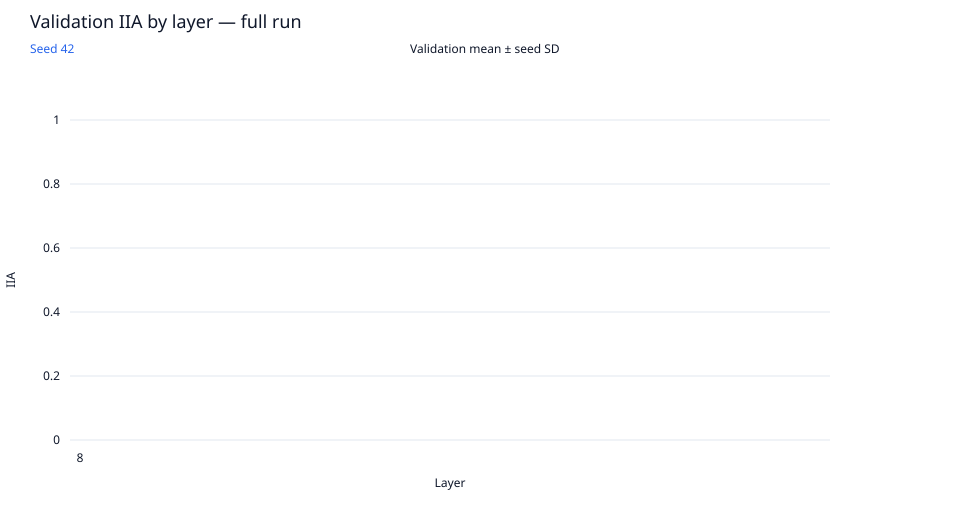
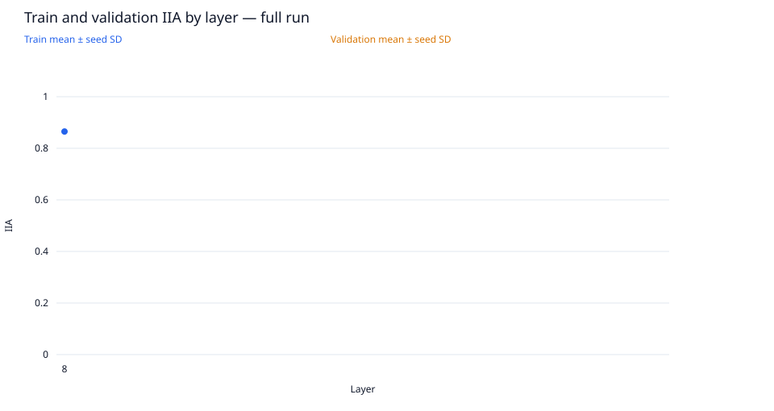
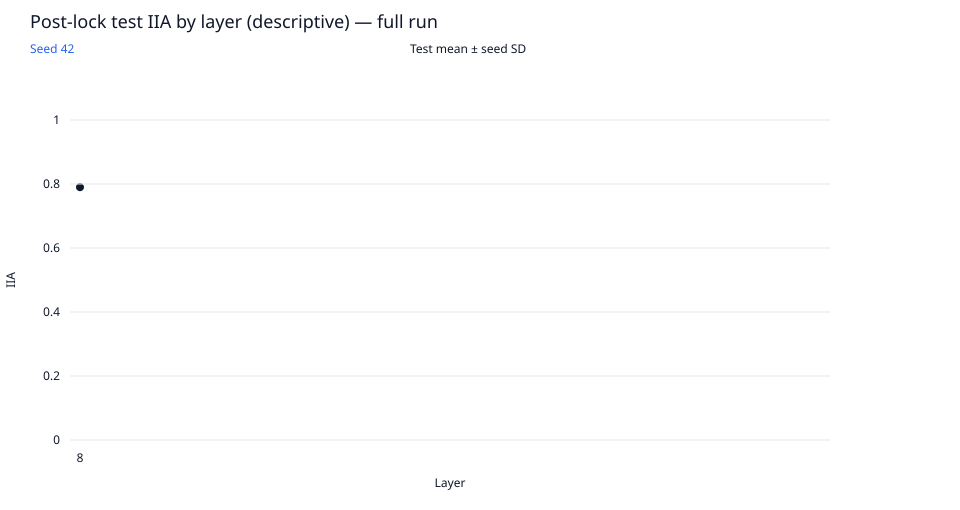
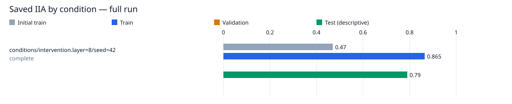

# single-condition-das / layer8-seed42

Run kind: **full**; run status: **complete**.

Config SHA-256: `f9c74ce47dc4ac9a94c090a533d6628544e0cdf93fb5a5ae850f898243015f5b`.

Conditions: complete=1.

The legacy test set is a descriptive benchmark, previously inspected in earlier runs.
It is not an untouched held-out test.

| Condition | Status | Initial train IIA | Train IIA | Validation IIA | Test IIA (descriptive) | Post-lock status |
| --- | --- | --- | --- | --- | --- | --- |
| conditions/intervention.layer=8/seed=42 | complete | 94/200 = 0.47 | 173/200 = 0.865 | — | 79/100 = 0.79 | not_scheduled |

Full-precision metrics and exact counts are saved in `conditions.csv`.
Missing metrics are shown as —; failed and pending conditions remain in the table.

Per-layer means and sample SD across seeds are saved in `layer_summary.csv`.
Seed SD describes variation across seeds; it is not a confidence interval.
A single available seed has no sample SD. Incomplete layers are flagged in the CSV.

