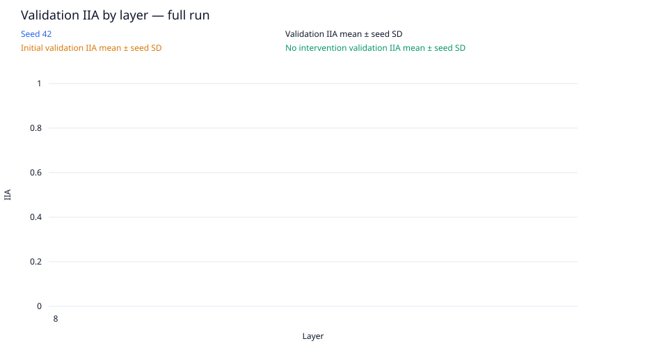
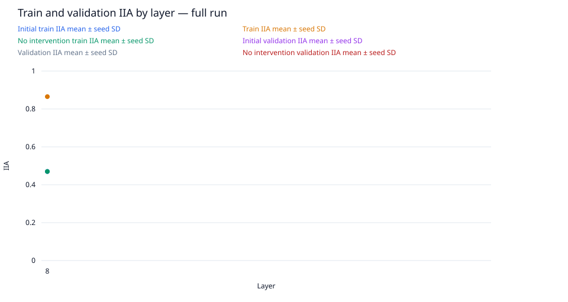
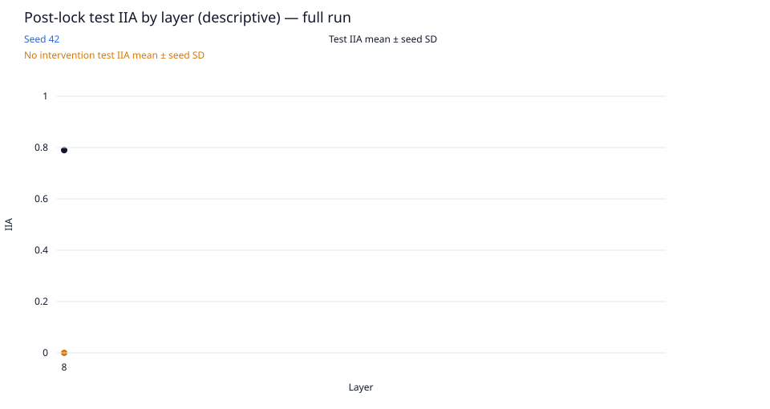
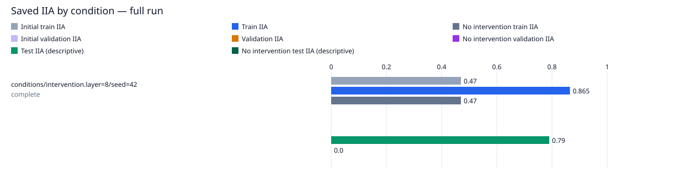

# single-condition-das / layer8-seed42

Run kind: **full**; run status: **complete**.

Config SHA-256: `f9c74ce47dc4ac9a94c090a533d6628544e0cdf93fb5a5ae850f898243015f5b`.

Conditions: complete=1.

The legacy test set is a descriptive benchmark, previously inspected in earlier runs.
It is not an untouched held-out test.

| Condition | Status | Initial train IIA | Train IIA | No intervention train IIA | Initial validation IIA | Validation IIA | No intervention validation IIA | Test IIA (descriptive) | No intervention test IIA (descriptive) | Post-lock status |
| --- | --- | --- | --- | --- | --- | --- | --- | --- | --- | --- |
| conditions/intervention.layer=8/seed=42 | complete | 94/200 = 0.47 | 173/200 = 0.865 | 94/200 = 0.47 | — | — | — | 79/100 = 0.79 | 0/100 = 0.0 | not_scheduled |

Full-precision metrics and exact counts are saved in `conditions.csv`.
Missing metrics are shown as —; failed and pending conditions remain in the table.

Per-layer means and sample SD across seeds are saved in `layer_summary.csv`.
Seed SD describes variation across seeds; it is not a confidence interval.
A single available seed has no sample SD. Incomplete layers are flagged in the CSV.

Per-pairing and target-change groups (counts summed across seeds; means give equal weight to each seed):

| Layer | Split | Group | IIA | No-intervention IIA |
| --- | --- | --- | --- | --- |
| 8 | initial_train | ABB->ABB | 46/50; mean 0.92 | 46/50; mean 0.92 |
| 8 | initial_train | ABB->BAB | 0/50; mean 0.0 | 0/50; mean 0.0 |
| 8 | initial_train | BAB->ABB | 0/50; mean 0.0 | 0/50; mean 0.0 |
| 8 | initial_train | BAB->BAB | 48/50; mean 0.96 | 48/50; mean 0.96 |
| 8 | initial_train | switch_required | 0/100; mean 0.0 | 0/100; mean 0.0 |
| 8 | initial_train | unchanged_target | 94/100; mean 0.94 | 94/100; mean 0.94 |
| 8 | train | ABB->ABB | 46/50; mean 0.92 | 46/50; mean 0.92 |
| 8 | train | ABB->BAB | 35/50; mean 0.7 | 0/50; mean 0.0 |
| 8 | train | BAB->ABB | 44/50; mean 0.88 | 0/50; mean 0.0 |
| 8 | train | BAB->BAB | 48/50; mean 0.96 | 48/50; mean 0.96 |
| 8 | train | switch_required | 79/100; mean 0.79 | 0/100; mean 0.0 |
| 8 | train | unchanged_target | 94/100; mean 0.94 | 94/100; mean 0.94 |
| 8 | test | ABB->ABB | 0/0; mean — | 0/0; mean — |
| 8 | test | ABB->BAB | 32/50; mean 0.64 | 0/50; mean 0.0 |
| 8 | test | BAB->ABB | 47/50; mean 0.94 | 0/50; mean 0.0 |
| 8 | test | BAB->BAB | 0/0; mean — | 0/0; mean — |
| 8 | test | switch_required | 79/100; mean 0.79 | 0/100; mean 0.0 |
| 8 | test | unchanged_target | 0/0; mean — | 0/0; mean — |

