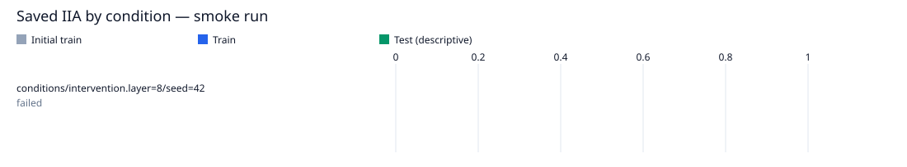

# single-condition-das / layer8-seed42

Run kind: **smoke**; run status: **failed**.

Config SHA-256: `f9c74ce47dc4ac9a94c090a533d6628544e0cdf93fb5a5ae850f898243015f5b`.

Conditions: failed=1.

This is a smoke run for execution checks; it is not a full experimental result.

The legacy test set is a descriptive benchmark, previously inspected in earlier runs.
It is not an untouched held-out test.

| Condition | Status | Initial train IIA | Train IIA | Test IIA (descriptive) |
| --- | --- | --- | --- | --- |
| conditions/intervention.layer=8/seed=42 | failed | — | — | — |

Full-precision metrics and exact counts are saved in `conditions.csv`.
Missing metrics are shown as —; failed and pending conditions remain in the table.

Condition errors:

- `conditions/intervention.layer=8/seed=42`: RuntimeError: The configured run requires a server CUDA device. Run outside a GPU-restricted sandbox; no CPU fallback is performed.
